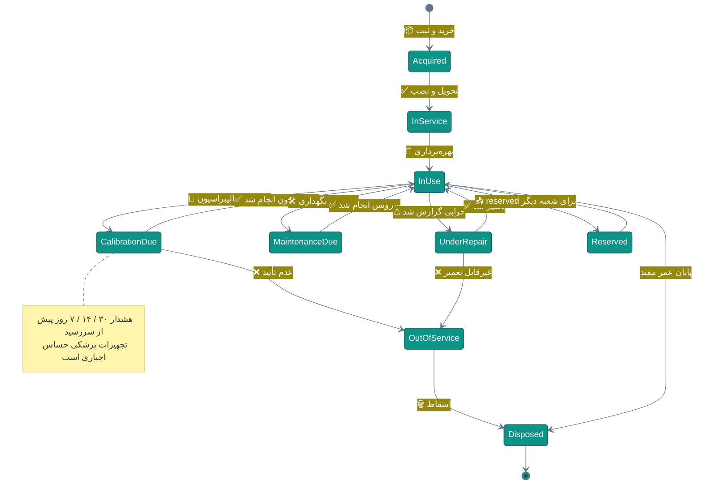
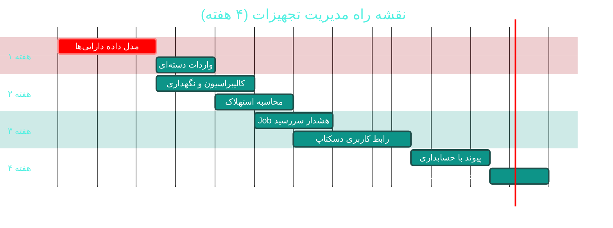

# 🧰 مدیریت تجهیزات و دارایی‌ها (Assets & Equipment)

> **لایسنس:** addon-assets · **اولویت:** 🟡 متوسط · **دشواری:** 🟢 کم · **زمان برآوردی:** ۳–۴ هفته

---

## ۱. 📋 خلاصه ماژول

مدیریت چرخه عمر دارایی‌های فیزیکی درمانگاه: دستگاه‌های پزشکی،
تجهیزات اداری و تأسیسات — شامل ردیابی، کالیبراسیون،
نگهداری پیشگیرانه و محاسبه استهلاک.

| ویژگی | مقدار |
|:---|:---|
| 🎯 هدف | کاهش توقف تجهیزات و انطباق با الزامات کالیبراسیون |
| 👤 کاربران اصلی | مدیر درمانگاه، مسئول فنی، حسابداری |
| 🔗 وابستگی‌ها | [B02 حسابداری](B02-accounting.md) · [C06 اعلان‌ها](C06-notifications-realtime.md) |
| 📊 وضعیت فعلی | ❌ وجود ندارد |

### ✨ جدول ویژگی‌ها

| # | ویژگی | شرح | اولویت |
|:--:|:---|:---|:--:|
| ۱ | 📦 ثبت دارایی | با شماره اموال و بارکد | 🔴 حیاتی |
| ۲ | 🔧 کالیبراسیون | زمان‌بندی و ثبت گواهی | 🔴 حیاتی |
| ۳ | 🛠 نگهداری پیشگیرانه (PM) | برنامه دوره‌ای خودکار | 🟠 بالا |
| ۴ | ⚠ ثبت خرابی | درخواست تعمیر و پیگیری | 🟠 بالا |
| ۵ | 📉 محاسبه استهلاک | پیوند با حسابداری | 🟠 بالا |
| ۶ | 📍 ردیابی مکان | تخصیص به اتاق/شعبه | 🟡 متوسط |
| ۷ | 📄 مستندات و گارانتی | پیوست فایل و تاریخ انقضا | 🟡 متوسط |
| ۸ | 🔔 هشدار سررسید | یادآوری کالیبراسیون/گارانتی | 🟠 بالا |
| ۹ | 📊 گزارش کارکرد | نرخ خرابی و هزینه نگهداری | 🟢 پایین |
| ۱۰ | 🗑 اسقاط و خروج | ثبت خروج دارایی | 🟢 پایین |

---

## ۲. 🎯 وضعیت فعلی در کدبیس

| لایه | فایل/مسیر | وضعیت |
|:---|:---|:---|
| 🧰 مدیریت دارایی | — | ❌ **وجود ندارد** |
| 💰 حسابداری | `Application/Features/Accounting/**` | 🟢 آماده (پیوند استهلاک) |
| 🔔 اعلان‌ها | `Infrastructure/Services/Realtime/**` | 🟢 آماده |
| 🖨 بارکد | پیشنهادی در [A07](A07-laboratory.md) | 🟡 `BarcodeHelper` |
| 🏢 شعب | [C05 — مدیریت شعب](C05-branches.md) | 🟡 |
| ⏰ Jobها | Hangfire 1.8.25 | 🟢 آماده |

> 💡 **هم‌افزایی:** `BarcodeHelper` پیشنهادی در
> [A07 — آزمایشگاه](A07-laboratory.md) می‌تواند
> برای برچسب‌گذاری دارایی‌ها بازاستفاده شود.

---

## ۳. 📊 نمودار چرخه عمر دارایی



---

## ۴. 🛠 دستورالعمل پیاده‌سازی

### 📌 گام ۱ — موجودیت دارایی

در `Domain/Entities/Asset.cs` (جدید):

```csharp
namespace Sahand.ClinicPro.Domain.Entities;

/// <summary>
/// دارایی فیزیکی درمانگاه — تجهیزات پزشکی، اداری یا تأسیساتی
/// </summary>
public class Asset : BaseEntity
{
    /// <summary>شماره اموال یکتا</summary>
    public string AssetNumber { get; set; } = default!;

    /// <summary>نام دارایی</summary>
    public string Name { get; set; } = default!;

    /// <summary>دسته‌بندی دارایی</summary>
    public AssetCategory Category { get; set; }

    /// <summary>نام تولیدکننده</summary>
    public string? Manufacturer { get; set; }

    /// <summary>مدل</summary>
    public string? Model { get; set; }

    /// <summary>شماره سریال دستگاه</summary>
    public string? SerialNumber { get; set; }

    /// <summary>تاریخ خرید</summary>
    public DateTime PurchaseDate { get; set; }

    /// <summary>قیمت خرید</summary>
    public decimal PurchasePrice { get; set; }

    /// <summary>عمر مفید بر حسب ماه</summary>
    public int UsefulLifeMonths { get; set; }

    /// <summary>روش استهلاک</summary>
    public DepreciationMethod DepreciationMethod { get; set; }
        = DepreciationMethod.StraightLine;

    /// <summary>ارزش اسقاطی در پایان عمر</summary>
    public decimal SalvageValue { get; set; }

    /// <summary>وضعیت عملیاتی</summary>
    public AssetStatus Status { get; set; } = AssetStatus.InUse;

    /// <summary>مکان فعلی (اتاق یا بخش)</summary>
    public string? Location { get; set; }

    /// <summary>شعبه</summary>
    public Guid? BranchId { get; set; }

    /// <summary>مسئول دارایی</summary>
    public Guid? CustodianEmployeeId { get; set; }

    /// <summary>تاریخ انقضای گارانتی</summary>
    public DateTime? WarrantyExpiryDate { get; set; }

    /// <summary>آیا نیازمند کالیبراسیون دوره‌ای است</summary>
    public bool RequiresCalibration { get; set; }

    /// <summary>دوره کالیبراسیون بر حسب ماه</summary>
    public int? CalibrationIntervalMonths { get; set; }

    /// <summary>تاریخ آخرین کالیبراسیون</summary>
    public DateTime? LastCalibrationDate { get; set; }

    /// <summary>تاریخ سررسید کالیبراسیون بعدی</summary>
    public DateTime? NextCalibrationDueDate { get; set; }

    /// <summary>آیا نگهداری پیشگیرانه دارد</summary>
    public bool HasPreventiveMaintenance { get; set; }

    /// <summary>دوره نگهداری پیشگیرانه بر حسب ماه</summary>
    public int? MaintenanceIntervalMonths { get; set; }

    /// <summary>تاریخ سررسید نگهداری بعدی</summary>
    public DateTime? NextMaintenanceDueDate { get; set; }

    /// <summary>ارزش دفتری محاسبه‌شده</summary>
    public decimal CurrentBookValue { get; set; }

    /// <summary>تاریخ اسقاط</summary>
    public DateTime? DisposedAtUtc { get; set; }

    /// <summary>دلیل اسقاط</summary>
    public string? DisposalReason { get; set; }

    /// <summary>یادداشت‌ها</summary>
    public string? Notes { get; set; }
}

/// <summary>دسته‌بندی دارایی</summary>
public enum AssetCategory
{
    MedicalDevice = 1,
    LaboratoryEquipment = 2,
    ImagingEquipment = 3,
    DentalEquipment = 4,
    OfficeEquipment = 5,
    Furniture = 6,
    ItInfrastructure = 7,
    Facility = 8,
    Vehicle = 9
}

/// <summary>وضعیت عملیاتی دارایی</summary>
public enum AssetStatus
{
    InUse = 1,
    Reserved = 2,
    UnderRepair = 3,
    OutOfService = 4,
    MaintenanceDue = 5,
    CalibrationDue = 6,
    Disposed = 7
}

/// <summary>روش محاسبه استهلاک</summary>
public enum DepreciationMethod
{
    StraightLine = 1,      // خط مستقیم
    DecliningBalance = 2,  // نزولی
    SumOfYearsDigits = 3   // مجموع سنوات
}
```

### 📌 گام ۲ — موجودیت‌های کالیبراسیون و نگهداری

در `Domain/Entities/AssetMaintenance.cs` (جدید):

```csharp
namespace Sahand.ClinicPro.Domain.Entities;

/// <summary>
/// رکورد عملیات روی دارایی — کالیبراسیون، نگهداری یا تعمیر
/// </summary>
public class AssetMaintenance : BaseEntity
{
    public Guid AssetId { get; set; }

    /// <summary>نوع عملیات</summary>
    public MaintenanceType Type { get; set; }

    /// <summary>تاریخ انجام</summary>
    public DateTime PerformedDate { get; set; }

    /// <summary>تاریخ سررسید بعدی</summary>
    public DateTime? NextDueDate { get; set; }

    /// <summary>شرح عملیات انجام‌شده</summary>
    public string Description { get; set; } = default!;

    /// <summary>نتیجه عملیات</summary>
    public MaintenanceOutcome Outcome { get; set; }

    /// <summary>نام پیمانکار یا شرکت خدمات</summary>
    public string? ServiceProvider { get; set; }

    /// <summary>نام تکنسین</summary>
    public string? TechnicianName { get; set; }

    /// <summary>هزینه عملیات</summary>
    public decimal Cost { get; set; }

    /// <summary>شماره گواهی کالیبراسیون</summary>
    public string? CertificateNumber { get; set; }

    /// <summary>پیوست گواهی (پیوند به سند)</summary>
    public Guid? CertificateDocumentId { get; set; }

    /// <summary>زمان توقف دستگاه بر حسب ساعت</summary>
    public decimal? DowntimeHours { get; set; }

    /// <summary>یادداشت‌ها</summary>
    public string? Notes { get; set; }

    public Asset Asset { get; set; } = default!;
}

/// <summary>نوع عملیات روی دارایی</summary>
public enum MaintenanceType
{
    Calibration = 1,
    PreventiveMaintenance = 2,
    CorrectiveRepair = 3,
    Inspection = 4,
    Upgrade = 5
}

/// <summary>نتیجه عملیات</summary>
public enum MaintenanceOutcome
{
    Passed = 1,
    PassedWithNotes = 2,
    Failed = 3,
    Deferred = 4
}
```

### 📌 گام ۳ — سرویس استهلاک

در `Application/Interfaces/IDepreciationCalculator.cs` (جدید):

```csharp
namespace Sahand.ClinicPro.Application.Interfaces;

/// <summary>نتیجه محاسبه استهلاک یک دارایی</summary>
public record DepreciationResult(
    decimal MonthlyDepreciation,
    decimal AccumulatedDepreciation,
    decimal CurrentBookValue,
    int ElapsedMonths,
    int RemainingMonths);

/// <summary>
/// محاسبه‌گر استهلاک دارایی‌ها با پشتیبانی از چند روش
/// </summary>
public interface IDepreciationCalculator
{
    /// <summary>محاسبه استهلاک یک دارایی تا تاریخ مشخص</summary>
    DepreciationResult Calculate(Asset asset, DateTime asOfDate);
}
```

در `Application/Services/DepreciationCalculator.cs` (جدید):

```csharp
namespace Sahand.ClinicPro.Application.Services;

/// <summary>
/// پیاده‌سازی محاسبه استهلاک — خط مستقیم، نزولی و مجموع سنوات
/// </summary>
public class DepreciationCalculator : IDepreciationCalculator
{
    /// <summary>محاسبه استهلاک دارایی تا تاریخ مشخص</summary>
    public DepreciationResult Calculate(
        Domain.Entities.Asset asset, DateTime asOfDate)
    {
        var elapsedMonths = Math.Max(0,
            (int)((asOfDate - asset.PurchaseDate).Days / 30.44));

        if (elapsedMonths >= asset.UsefulLifeMonths)
        {
            // پایان عمر مفید — ارزش دفتری برابر ارزش اسقاطی
            return new DepreciationResult(
                0m,
                asset.PurchasePrice - asset.SalvageValue,
                asset.SalvageValue,
                elapsedMonths,
                0);
        }

        var depreciableBase = asset.PurchasePrice - asset.SalvageValue;

        var accumulated = asset.DepreciationMethod switch
        {
            Domain.Entities.DepreciationMethod.DecliningBalance
                => CalculateDecliningBalance(asset, depreciableBase, elapsedMonths),

            Domain.Entities.DepreciationMethod.SumOfYearsDigits
                => CalculateSumOfYearsDigits(asset, depreciableBase, elapsedMonths),

            _ => CalculateStraightLine(asset, depreciableBase, elapsedMonths)
        };

        return new DepreciationResult(
            depreciableBase / asset.UsefulLifeMonths,
            accumulated,
            asset.PurchasePrice - accumulated,
            elapsedMonths,
            asset.UsefulLifeMonths - elapsedMonths);
    }

    /// <summary>استخراج استهلاک به روش خط مستقیم</summary>
    private static decimal CalculateStraightLine(
        Domain.Entities.Asset asset, decimal depreciableBase, int elapsedMonths)
        => depreciableBase * elapsedMonths / asset.UsefulLifeMonths;

    /// <summary>استخراج استهلاک به روش نزولی (دوبرابر خط مستقیم)</summary>
    private static decimal CalculateDecliningBalance(
        Domain.Entities.Asset asset, decimal depreciableBase, int elapsedMonths)
    {
        var rate = 2.0m / asset.UsefulLifeMonths;
        var accumulated = 0m;
        var bookValue = asset.PurchasePrice;

        for (var month = 0; month < elapsedMonths; month++)
        {
            var monthly = bookValue * rate;
            // استهلاک هرگز از مبنای قابل استهلاک فراتر نمی‌رود
            if (accumulated + monthly > depreciableBase)
                monthly = depreciableBase - accumulated;
            accumulated += monthly;
            bookValue -= monthly;
        }

        return accumulated;
    }

    /// <summary>استخراج استهلاک به روش مجموع سنوات</summary>
    private static decimal CalculateSumOfYearsDigits(
        Domain.Entities.Asset asset, decimal depreciableBase, int elapsedMonths)
    {
        var life = asset.UsefulLifeMonths;
        var sumOfDigits = life * (life + 1) / 2;
        var accumulated = 0m;

        for (var year = 1; year <= elapsedMonths; year++)
        {
            // سال‌های اول بار استهلاک بیشتری دارند
            accumulated += depreciableBase * (life - year + 1) / sumOfDigits;
        }

        return Math.Min(accumulated, depreciableBase);
    }
}
```

### 📌 گام ۴ — Job هشدار سررسید

در `Infrastructure/Jobs/AssetDueDateJob.cs` (جدید):

```csharp
using Hangfire;

namespace Sahand.ClinicPro.Infrastructure.Jobs;

/// <summary>
/// بررسی روزانه سررسید کالیبراسیون و نگهداری تجهیزات
/// </summary>
public class AssetDueDateJob
{
    private readonly IUnitOfWork _unitOfWork;
    private readonly INotificationService _notificationService;
    private readonly ILogger<AssetDueDateJob> _logger;

    /// <summary>آستانه‌های هشدار بر حسب روز</summary>
    private static readonly int[] AlertThresholds = { 30, 14, 7, 0 };

    public AssetDueDateJob(
        IUnitOfWork unitOfWork,
        INotificationService notificationService,
        ILogger<AssetDueDateJob> logger)
    {
        _unitOfWork = unitOfWork;
        _notificationService = notificationService;
        _logger = logger;
    }

    [AutomaticRetry(Attempts = 3)]
    public async Task CheckDueDatesAsync(
        CancellationToken cancellationToken = default)
    {
        var today = DateTime.UtcNow.Date;
        var maxWindow = today.AddDays(30);

        // ۱) کالیبراسیون‌های در پیشِ رو
        var calibrationDue = await _unitOfWork.Repository<Domain.Entities.Asset>()
            .QueryableNoTracking
            .Where(a => a.RequiresCalibration
                     && a.Status != Domain.Entities.AssetStatus.Disposed
                     && a.NextCalibrationDueDate != null
                     && a.NextCalibrationDueDate <= maxWindow)
            .ToListAsync(cancellationToken);

        await SendAlertsAsync(
            calibrationDue, a => a.NextCalibrationDueDate!.Value,
            "کالیبراسیون", "🔧", cancellationToken);

        // ۲) نگهداری‌های پیشگیرانه در پیشِ رو
        var maintenanceDue = await _unitOfWork.Repository<Domain.Entities.Asset>()
            .QueryableNoTracking
            .Where(a => a.HasPreventiveMaintenance
                     && a.Status != Domain.Entities.AssetStatus.Disposed
                     && a.NextMaintenanceDueDate != null
                     && a.NextMaintenanceDueDate <= maxWindow)
            .ToListAsync(cancellationToken);

        await SendAlertsAsync(
            maintenanceDue, a => a.NextMaintenanceDueDate!.Value,
            "نگهداری پیشگیرانه", "🛠", cancellationToken);

        _logger.LogInformation(
            "بررسی سررسید تجهیزات انجام شد: {Cal} کالیبراسیون، {Mnt} نگهداری",
            calibrationDue.Count, maintenanceDue.Count);
    }

    private async Task SendAlertsAsync(
        List<Domain.Entities.Asset> assets,
        Func<Domain.Entities.Asset, DateTime> dueSelector,
        string alertKind,
        string icon,
        CancellationToken cancellationToken)
    {
        var today = DateTime.UtcNow.Date;

        foreach (var asset in assets)
        {
            var daysRemaining = (dueSelector(asset).Date - today).Days;

            // فقط در آستانه‌های تعریف‌شده اطلاع‌رسانی می‌شود
            var threshold = AlertThresholds.FirstOrDefault(t => daysRemaining <= t);
            if (threshold == 0 && daysRemaining > 0) continue;
            if (daysRemaining > 30) continue;

            var severity = daysRemaining <= 0 ? "بحرانی"
                         : daysRemaining <= 7 ? "بالا" : "عادی";

            // TODO: ایجاد اعلان از طریق INotificationService
            // await _notificationService.CreateAsync(new CreateNotificationRequest(...));
        }

        await Task.CompletedTask;
    }
}
```

در `API/Program.cs`:

```csharp
RecurringJob.AddOrUpdate<AssetDueDateJob>(
    "asset-due-dates",
    job => job.CheckDueDatesAsync(CancellationToken.None),
    Cron.Daily(7));
```

### 📌 گام ۵ — مایگریشن

```bash
cd src/Sahand.ClinicPro.Infrastructure
dotnet ef migrations add Cycle49AssetsEquipment \
    --startup-project ../Sahand.ClinicPro.API --context ClinicProDbContext
dotnet ef database update --startup-project ../Sahand.ClinicPro.API
```

---

## ۵. ⚠️ کاستی‌ها و ریسک‌ها

| # | ریسک | شدت | راهکار |
|:--:|:---|:--:|:---|
| W-01 | استفاده از دستگاه کالیبره‌نشده روی بیمار | 🔴 بحرانی | قفل خودکار در صورت تأخیر کالیبراسیون |
| W-02 | عدم انطباق با الزامات تجهیزات پزشکی | 🟠 بالا | ثبت اجباری گواهی کالیبراسیون |
| W-03 | محاسبه نادرست استهلاک | 🟠 بالا | هم‌راستایی با [B02 حسابداری](B02-accounting.md) |
| W-04 | نادیده گرفتن هشدارها | 🟡 متوسط | ارتقای شدت اعلان با نزدیک‌شدن سررسید |
| W-05 | اطلاعات ناقص دارایی‌ها در شروع | 🟡 متوسط | واردات دسته‌ای از Excel |
| W-06 | توقف ناگهانی دستگاه حیاتی | 🟡 متوسط | نگهداری پیشگیرانه + قرارداد پشتیبانی |

---

## ۶. 📈 شاخص‌های موفقیت (KPI)

| شاخص | هدف |
|:---|:--:|
| ✅ انطباق کالیبراسیون | **۱۰۰٪** |
| ⏱ توقف برنامه‌ریزی‌نشده تجهیزات | **< ۵٪** زمان کارکرد |
| 📋 ثبت کامل دارایی‌ها | **≥ ۹۵٪** |
| 💰 دقت محاسبه استهلاک | **۱۰۰٪** با حسابداری |
| 🔔 پاسخ به هشدارهای بحرانی | **ظرف ۲۴ ساعت** |

---

## ۷. 🗓 برنامه زمانی



---

## 🔗 پیوندهای مرتبط

- [A07 — آزمایشگاه (LIS)](A07-laboratory.md)
- [A08 — پاراکلینیک و تصویربرداری](A08-paraclinical.md)
- [B02 — حسابداری](B02-accounting.md)
- [C05 — مدیریت شعب](C05-branches.md)
- [C06 — اعلان‌ها و بلادرنگ](C06-notifications-realtime.md)
- [D05 — مدیریت اسناد](D05-document-management.md)

---
<div align="center">📅 ۱۴۰۴/۰۷/۱۹ · 🔖 v1.0</div>
