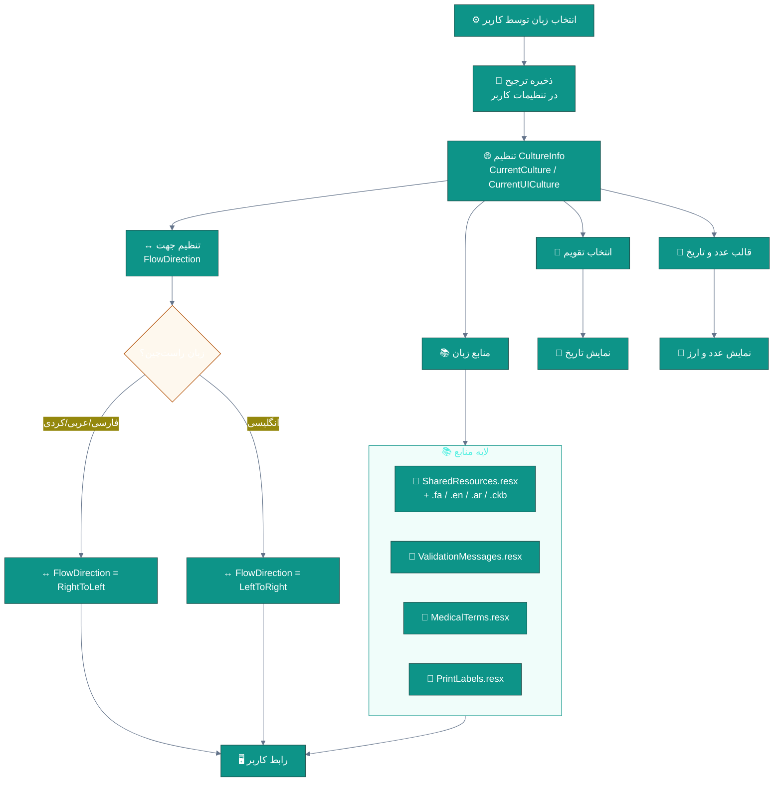
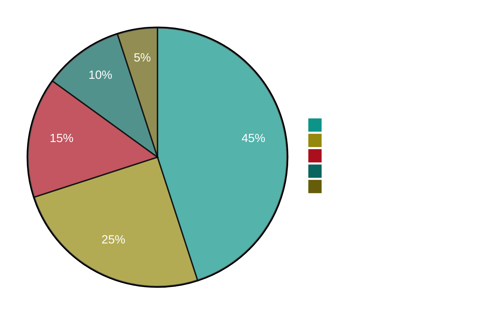
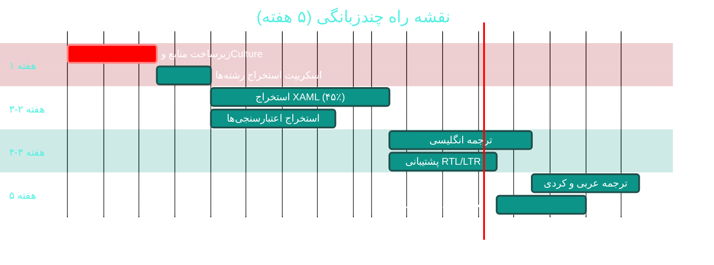

# 🌍 چندزبانگی و بومی‌سازی (Localization & i18n)

> **لایسنس:** addon-i18n · **اولویت:** 🟠 بالا · **دشواری:** 🟡 متوسط · **زمان برآوردی:** ۴–۵ هفته

---

## ۱. 📋 خلاصه ماژول

پشتیبانی از چند زبان و تقویم در نرم‌افزار: فارسی، انگلیسی، عربی و کردی،
با جهت‌بندی پویا (RTL/LTR)، تبدیل تقویم و قالب‌بندی عدد/ارز محلی —
که امکان صادرات و استفاده در مناطق چندزبانه را فراهم می‌کند.

| ویژگی | مقدار |
|:---|:---|
| 🎯 هدف | گسترش بازار و بهبود دسترسی‌پذیری |
| 👤 کاربران اصلی | همه کاربران |
| 🔗 وابستگی‌ها | منابع زبان · تقویم شمسی/میلادی/قمری · تنظیمات کاربر |
| 📊 وضعیت فعلی | 🟡 یک‌زبانه (فارسی) |

### ✨ جدول ویژگی‌ها

| # | ویژگی | شرح | اولویت |
|:--:|:---|:---|:--:|
| ۱ | 🌐 انتخاب زبان | تغییر در لحظه بدون راه‌اندازی مجدد | 🔴 حیاتی |
| ۲ | ↔ پشتیبانی RTL/LTR | جهت‌بندی پویای رابط کاربر | 🔴 حیاتی |
| ۳ | 📅 چندتقویمی | شمسی، میلادی، قمری | 🔴 حیاتی |
| ۴ | 🔢 قالب عدد و ارز | بر اساس فرهنگ محلی | 🟠 بالا |
| ۵ | 🏥 اصطلاحات پزشکی چندزبان | ترجمه تشخیص‌ها و داروها | 🟠 بالا |
| ۶ | 🖨 قالب‌های چاپ چندزبان | خروجی به زبان انتخابی | 🟡 متوسط |
| ۷ | 🕐 منطقه زمانی | پشتیبانی از چند منطقه | 🟡 متوسط |
| ۸ | ⌨ ورودی و صفحه‌کلید | پشتیبانی از چیدمان‌های مختلف | 🟢 پایین |
| ۹ | 🔤 فونت‌های بهینه | بهبود خوانایی هر زبان | 🟡 متوسط |
| ۱۰ | 📊 ترجمه گزارش‌ها | عناوین و برچسب‌ها | 🟡 متوسط |

---

## ۲. 🎯 وضعیت فعلی در کدبیس

| لایه | فایل/مسیر | وضعیت |
|:---|:---|:---|
| 📅 تقویم شمسی | `PersianDateHelper` در Shared | 🟢 **موجود** |
| 🌐 فرهنگ پیش‌فرض | `Directory.Build.props` → `fa-IR` | 🟢 |
| 🖥 رابط کاربر | ۹۳ فایل XAML با متن‌های داخلی | 🔴 **متن‌های hardcode** |
| 📝 پیام‌های اعتبارسنجی | FluentValidation سراسر Application | 🔴 **فارسی hardcode** |
| 🖨 قالب‌های چاپ | [B09](B09-print-templates.md) | 🟡 |
| 📚 فایل‌های منبع (.resx) | — | ❌ **وجود ندارد** |

> ⚠️ **چالش اصلی:** بیش از **۱۰٬۰۰۰ رشته متنی** در XAML و کد C#
> به‌صورت مستقیم نوشته شده‌اند. استخراج آن‌ها بزرگ‌ترین بخش این ماژول است.

---

## ۳. 📊 نمودار معماری بومی‌سازی



---

## ۴. 🛠 دستورالعمل پیاده‌سازی

### 📌 گام ۱ — ساختار فایل‌های منبع

```
📂 src/Sahand.ClinicPro.Shared/Resources/
├── 📄 SharedResources.resx           زبان پیش‌فرض (فارسی)
├── 📄 SharedResources.en.resx        انگلیسی
├── 📄 SharedResources.ar.resx        عربی
├── 📄 SharedResources.ckb.resx       کردی سورانی
├── 📄 ValidationMessages.resx
├── 📄 ValidationMessages.en.resx
├── 📄 ValidationMessages.ar.resx
├── 📄 ValidationMessages.ckb.resx
├── 📄 MedicalTerms.resx
├── 📄 MedicalTerms.en.resx
└── 📄 LocalizationSettings.cs
```

**۱.۱ کلاس دسترسی به منابع**

در `src/Sahand.ClinicPro.Shared/Resources/LocalizationSettings.cs` (جدید):

```csharp
using System.Globalization;

namespace Sahand.ClinicPro.Shared.Resources;

/// <summary>
/// تنظیمات و ابزارهای بومی‌سازی — مدیریت زبان، جهت و تقویم
/// </summary>
public static class LocalizationSettings
{
    /// <summary>شناسه زبان پیش‌فرض</summary>
    public const string DefaultCulture = "fa-IR";

    /// <summary>زبان‌های پشتیبانی‌شده</summary>
    public static readonly IReadOnlyList<LanguageInfo> SupportedLanguages =
    [
        new("fa-IR", "فارسی", "🇮🇷", true,  "Persian"),
        new("en-US", "English", "🇬🇧", false, "Gregorian"),
        new("ar-SA", "العربية", "🇸🇦", true,  "UmmAlQura"),
        new("ckb-IQ", "کوردی", "🏴", true,  "Gregorian")
    ];

    /// <summary>
    /// اعمال فرهنگ انتخاب‌شده بر رشته فعلی
    /// </summary>
    public static void ApplyCulture(string cultureName)
    {
        var culture = new CultureInfo(cultureName);

        // تقویم مناسب بر اساس زبان
        var language = SupportedLanguages
            .FirstOrDefault(l => l.CultureName == cultureName);

        if (language is not null && language.CalendarName is not null)
        {
            var calendar = language.CalendarName switch
            {
                "Persian" => new PersianCalendar(),
                "UmmAlQura" => new UmAlQuraCalendar(),
                _ => (Calendar)new GregorianCalendar()
            };

            culture.DateTimeFormat.Calendar = calendar;
        }

        CultureInfo.CurrentCulture = culture;
        CultureInfo.CurrentUICulture = culture;
    }

    /// <summary>
    /// تعیین جهت چیدمان بر اساس زبان جاری
    /// </summary>
    public static bool IsRightToLeft
        => CultureInfo.CurrentUICulture.TextInfo.IsRightToLeft;
}

/// <summary>اطلاعات یک زبان پشتیبانی‌شده</summary>
/// <param name="CultureName">شناسه فرهنگ</param>
/// <param name="DisplayName">نام نمایشی</param>
/// <param name="FlagEmoji">شکلک پرچم</param>
/// <param name="IsRtl">آیا راست‌چین است</param>
/// <param name="CalendarName">نام تقویم پیش‌فرض</param>
public record LanguageInfo(
    string CultureName,
    string DisplayName,
    string FlagEmoji,
    bool IsRtl,
    string? CalendarName);
```

### 📌 گام ۲ — میان‌افزار زبان در API

در `API/Middleware/LocalizationMiddleware.cs` (جدید):

```csharp
using System.Globalization;
using Sahand.ClinicPro.Shared.Resources;

namespace Sahand.ClinicPro.API.Middleware;

/// <summary>
/// تعیین زبان پاسخ بر اساس هدر Accept-Language یا تنظیمات کاربر
/// </summary>
public class LocalizationMiddleware
{
    private readonly RequestDelegate _next;
    private readonly ILogger<LocalizationMiddleware> _logger;

    public LocalizationMiddleware(
        RequestDelegate next,
        ILogger<LocalizationMiddleware> logger)
    {
        _next = next;
        _logger = logger;
    }

    public async Task InvokeAsync(HttpContext context)
    {
        // اولویت ۱: هدر صریح X-Language
        var requestedLanguage = context.Request.Headers["X-Language"].FirstOrDefault();

        // اولویت ۲: هدر استاندارد Accept-Language
        requestedLanguage ??= context.Request.Headers["Accept-Language"]
            .FirstOrDefault()?.Split(',')[0].Trim();

        // اولویت ۳: زبان پیش‌فرض
        requestedLanguage ??= LocalizationSettings.DefaultCulture;

        var matched = LocalizationSettings.SupportedLanguages
            .FirstOrDefault(l => l.CultureName.Equals(
                requestedLanguage, StringComparison.OrdinalIgnoreCase));

        if (matched is null)
        {
            // تلاش برای تطبیق بر اساس دو حرف ابتدایی (مثال: en-GB → en-US)
            var prefix = requestedLanguage[..Math.Min(2, requestedLanguage.Length)];
            matched = LocalizationSettings.SupportedLanguages
                .FirstOrDefault(l => l.CultureName.StartsWith(
                    prefix, StringComparison.OrdinalIgnoreCase));
        }

        if (matched is not null)
        {
            LocalizationSettings.ApplyCulture(matched.CultureName);
            // زبان انتخاب‌شده در پاسخ نیز اعلام می‌شود
            context.Response.Headers["Content-Language"] = matched.CultureName;
        }
        else
        {
            LocalizationSettings.ApplyCulture(LocalizationSettings.DefaultCulture);
        }

        await _next(context);
    }
}
```

در `API/Program.cs`:

```csharp
app.UseMiddleware<LocalizationMiddleware>();
```

### 📌 گام ۳ — جایگزینی پیام‌های اعتبارسنجی

**۳.۱ الگوی فعلی (نادرست برای چندزبانگی)**

```csharp
// ❌ قبل — پیام فارسی به‌صورت مستقیم در کد
RuleFor(x => x.NationalCode)
    .NotEmpty().WithMessage("کد ملی الزامی است")
    .Length(10).WithMessage("کد ملی باید ۱۰ رقم باشد");
```

**۳.۲ الگوی صحیح**

```csharp
// ✅ بعد — پیام از فایل منبع خوانده می‌شود
using Sahand.ClinicPro.Shared.Resources;

RuleFor(x => x.NationalCode)
    .NotEmpty().WithMessage(ValidationMessages.NationalCode_Required)
    .Length(10).WithMessage(ValidationMessages.NationalCode_Length);
```

**۳.۳ نمونه محتوای `ValidationMessages.resx`**

| کلید | فارسی (پیش‌فرض) | English |
|:---|:---|:---|
| `NationalCode_Required` | کد ملی الزامی است | National code is required |
| `NationalCode_Length` | کد ملی باید ۱۰ رقم باشد | National code must be 10 digits |
| `MobileNumber_Invalid` | قالب شماره همراه صحیح نیست | Mobile number format is invalid |
| `Amount_MustBePositive` | مبلغ باید مثبت باشد | Amount must be positive |
| `Visit_NotFound` | ویزیت یافت نشد | Visit not found |

### 📌 گام ۴ — جهت‌بندی پویا در WPF

در `Desktop/App.xaml.cs`:

```csharp
using System.Globalization;
using System.Windows;
using Sahand.ClinicPro.Shared.Resources;

namespace Sahand.ClinicPro.Desktop;

/// <summary>
/// نقطه ورود برنامه دسکتاپ — تنظیم زبان و جهت پیش از نمایش پنجره‌ها
/// </summary>
public partial class App : Application
{
    protected override void OnStartup(StartupEventArgs e)
    {
        base.OnStartup(e);

        // خواندن زبان ذخیره‌شده کاربر
        var savedCulture = SahandClinicPro.Desktop.Properties.Settings
            .Default.LanguageCulture;

        if (string.IsNullOrWhiteSpace(savedCulture))
            savedCulture = LocalizationSettings.DefaultCulture;

        LocalizationSettings.ApplyCulture(savedCulture);

        // اعمال جهت بر کل برنامه
        var flowDirection = LocalizationSettings.IsRightToLeft
            ? FlowDirection.RightToLeft
            : FlowDirection.LeftToRight;

        // جهت برای همه پنجره‌ها و عناصر ریشه
        Current.Resources["AppFlowDirection"] = flowDirection;
    }

    /// <summary>
    /// تغییر زبان در لحظه بدون نیاز به راه‌اندازی مجدد
    /// </summary>
    public static void ChangeLanguage(string cultureName)
    {
        LocalizationSettings.ApplyCulture(cultureName);

        SahandClinicPro.Desktop.Properties.Settings.Default.LanguageCulture = cultureName;
        SahandClinicPro.Desktop.Properties.Settings.Default.Save();

        // TODO: به‌روزرسانی جهت پنجره‌های باز
        // foreach (var window in Current.Windows) { ... }

        MessageBox.Show(
            SharedResources.LanguageChangedMessage,
            SharedResources.InformationTitle,
            MessageBoxButton.OK,
            MessageBoxImage.Information);
    }
}
```

> 💡 **نکته WPF:** برای تغییر کامل زبان در لحظه،
> بهتر است از یک `DynamicResource` و الگوی
> `INotifyPropertyChanged` در یک `LocalizationProvider` استفاده شود
> تا همه برچسب‌ها بدون راه‌اندازی مجدد به‌روز شوند.

### 📌 گام ۵ — نام‌های دارویی چندزبان

در `Domain/Entities/MedicationTranslation.cs` (جدید):

```csharp
namespace Sahand.ClinicPro.Domain.Entities;

/// <summary>
/// ترجمه نام دارو به زبان‌های مختلف — برای نسخه‌های چندزبانه
/// </summary>
public class MedicationTranslation : BaseEntity
{
    public Guid MedicationId { get; set; }

    /// <summary>کد زبان (مثال: en-US)</summary>
    public string CultureName { get; set; } = default!;

    /// <summary>نام دارو به آن زبان</summary>
    public string Name { get; set; } = default!;

    /// <summary>نام عمومی (Generic) در صورت تفاوت</summary>
    public string? GenericName { get; set; }

    /// <summary>نام تولیدکننده در آن زبان</summary>
    public string? ManufacturerName { get; set; }

    /// <summary>شکل دارویی ترجمه‌شده</summary>
    public string? DosageForm { get; set; }

    public Medication Medication { get; set; } = default!;
}
```

### 📌 گام ۶ — مایگریشن

```bash
cd src/Sahand.ClinicPro.Infrastructure
dotnet ef migrations add Cycle49LocalizationI18n \
    --startup-project ../Sahand.ClinicPro.API --context ClinicProDbContext
dotnet ef database update --startup-project ../Sahand.ClinicPro.API
```

---

## ۵. 📊 نمودار توزیع کار استخراج



---

## ۶. ⚠️ کاستی‌ها و ریسک‌ها

| # | ریسک | شدت | راهکار |
|:--:|:---|:--:|:---|
| W-01 | حجم بالای استخراج رشته‌ها | 🟠 بالا | خودکارسازی با اسکریپت + بررسی دستی |
| W-02 | شکست چیدمان در حالت LTR | 🟠 بالا | تست بصری هر دو جهت |
| W-03 | ترجمه نادرست اصطلاحات پزشکی | 🔴 بحرانی | تأیید توسط پزشک مسلط به زبان |
| W-04 | بریدن متن در دکمه‌ها (زبان‌های طولانی‌تر) | 🟡 متوسط | طراحی منعطف + تست |
| W-05 | ناهماهنگی ترجمه بین تیم‌ها | 🟡 متوسط | واژه‌نامه مرکزی |
| W-06 | کاهش عملکرد به‌دلیل جستجوی منابع | 🟢 پایین | کش منابع |

---

## ۷. 📈 شاخص‌های موفقیت (KPI)

| شاخص | هدف |
|:---|:--:|
| 🌐 تعداد زبان‌های پشتیبانی‌شده | **۴** |
| 📊 پوشش ترجمه رابط کاربر | **≥ ۹۵٪** |
| 🏥 پوشش اصطلاحات پزشکی پرکاربرد | **≥ ۱٬۰۰۰ اصطلاح** |
| ⏱ زمان تغییر زبان | **< ۱ ثانیه** |
| 🐛 خطاهای چیدمان گزارش‌شده | **< ۱۰** |

---

## ۸. 🗓 برنامه زمانی



---

## 🔗 پیوندهای مرتبط

- [A01 — مدیریت بیماران](A01-patients.md)
- [A06 — نسخه‌نویسی و ایمنی دارو](A06-prescriptions-safety.md)
- [B07 — داروخانه و انبار](B07-pharmacy-inventory.md)
- [B09 — قالب‌های چاپ](B09-print-templates.md)
- [C05 — مدیریت شعب](C05-branches.md)
- [D01 — پرتال بیمار](D01-patient-portal.md)
- [D10 — API عمومی و مارکت‌پلیس](D10-public-api-marketplace.md)

---
<div align="center">📅 ۱۴۰۴/۰۷/۱۹ · 🔖 v1.0</div>
