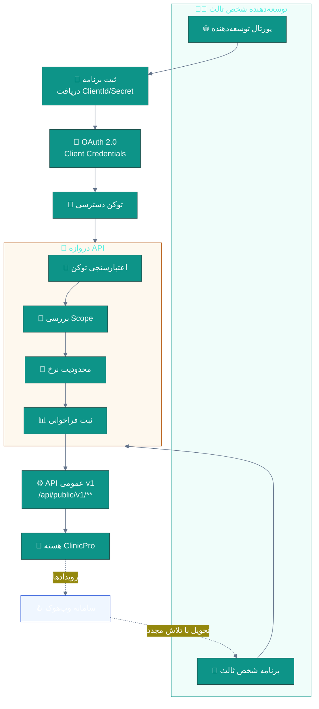
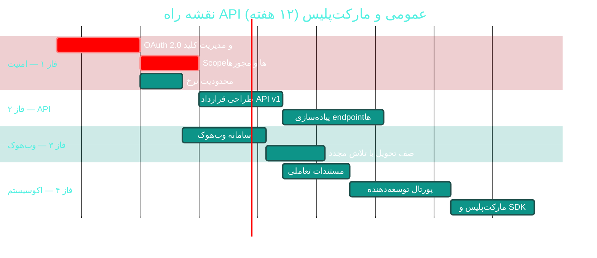

# 🔌 API عمومی و مارکت‌پلیس افزونه‌ها

> **لایسنس:** addon-marketplace · **اولویت:** 🟠 بالا · **دشواری:** 🔴 زیاد · **زمان برآوردی:** ۱۰–۱۲ هفته

---

## ۱. 📋 خلاصه ماژول

ارائه یک API عمومی مستند و امن برای توسعه‌دهندگان شخص ثالث،
به‌همراه مارکت‌پلیس افزونه‌ها که اکوسیستمی پیرامون ClinicPro ایجاد می‌کند
و ارزش محصول را فراتر از قابلیت‌های داخلی می‌برد.

| ویژگی | مقدار |
|:---|:---|
| 🎯 هدف | ایجاد اکوسیستم توسعه‌دهندگان و افزایش ارزش پلتفرم |
| 👤 کاربران اصلی | توسعه‌دهندگان شخص ثالث، شرکای تجاری |
| 🔗 وابستگی‌ها | OAuth 2.0 · دروازه API · مستندات OpenAPI · [C09 لایسنس](C09-licensing.md) |
| 📊 وضعیت فعلی | 🟡 Swagger موجود، API عمومی ندارد |

### ✨ جدول ویژگی‌ها

| # | ویژگی | شرح | اولویت |
|:--:|:---|:---|:--:|
| ۱ | 🔑 OAuth 2.0 / کلید API | احراز هویت برنامه‌های ثالث | 🔴 حیاتی |
| ۲ | 📖 مستندات تعاملی | OpenAPI با نمونه‌های اجرایی | 🔴 حیاتی |
| ۳ | 🚦 محدودیت نرخ (Rate Limiting) | سهمیه‌بندی بر اساس طرح | 🔴 حیاتی |
| ۴ | 🪝 وب‌هوک (Webhooks) | رویدادها به سامانه‌های خارجی | 🟠 بالا |
| ۵ | 🧩 SDK رسمی | برای .NET و JavaScript | 🟠 بالا |
| ۶ | 🏪 مارکت‌پلیس افزونه | فهرست، نصب و به‌روزرسانی | 🟠 بالا |
| ۷ | 🔒 محدوده دسترسی (Scopes) | کنترل دقیق مجوزها | 🔴 حیاتی |
| ۸ | 🧪 محیط آزمایشی (Sandbox) | تست بدون داده واقعی | 🟠 بالا |
| ۹ | 📊 داشبورد توسعه‌دهنده | آمار استفاده و خطاها | 🟡 متوسط |
| ۱۰ | 💰 مدل درآمدی مشارکت | تقسیم درآمد افزونه‌ها | 🟢 پایین |

---

## ۲. 🎯 وضعیت فعلی در کدبیس

| لایه | فایل/مسیر | وضعیت |
|:---|:---|:---|
| 📖 مستندات Swagger | Swashbuckle 6.6.2 در `Directory.Packages.props` | 🟡 موجود |
| 📄 فایل OpenAPI | `docs/api/openapi.json` | 🟡 موجود |
| 🔑 احراز هویت | JWT با `[HasPermission]` (۲۵۷ مورد) | 🟢 داخلی |
| 🚦 محدودیت نرخ | — | ❌ **وجود ندارد** |
| 🪝 وب‌هوک | — | ❌ **وجود ندارد** |
| 🧩 سیستم افزونه | [C09 لایسنس](C09-licensing.md) (۳۹ ماژول لایسنس‌پذیر) | 🟡 زیرساخت ماژول |
| 🧪 Sandbox | — | ❌ |

> 💡 **امتیاز بزرگ:** سامانه لایسنس با **۳۹ ماژول لایسنس‌پذیر**
> (در [C09](C09-licensing.md)) زیرساخت مناسبی برای
> مدیریت مجوزهای افزونه‌های مارکت‌پلیس فراهم می‌کند.

---

## ۳. 📊 نمودار معماری API عمومی



---

## ۴. 🛠 دستورالعمل پیاده‌سازی

### 📌 گام ۱ — موجودیت برنامه شخص ثالث

در `Domain/Entities/ExternalApplication.cs` (جدید):

```csharp
namespace Sahand.ClinicPro.Domain.Entities;

/// <summary>
/// برنامه شخص ثالث متصل به API عمومی ClinicPro
/// </summary>
public class ExternalApplication : BaseEntity
{
    /// <summary>نام برنامه</summary>
    public string Name { get; set; } = default!;

    /// <summary>شناسه عمومی برنامه (نمایشی)</summary>
    public string ClientId { get; set; } = default!;

    /// <summary>هش رمز برنامه — هرگز به‌صورت متن ساده ذخیره نمی‌شود</summary>
    public string ClientSecretHash { get; set; } = default!;

    /// <summary>شناسه توسعه‌دهنده</summary>
    public Guid DeveloperUserId { get; set; }

    /// <summary>شرح برنامه</summary>
    public string? Description { get; set; }

    /// <summary>نشانی بازگشت برای جریان کد تاییدیه</summary>
    public string? RedirectUri { get; set; }

    /// <summary>محدوده‌های دسترسی مجاز با جداکننده فاصله</summary>
    public string AllowedScopes { get; set; } = default!;

    /// <summary>سطح طرح اشتراک (تعیین‌کننده محدودیت نرخ)</summary>
    public ApiTier Tier { get; set; } = ApiTier.Free;

    /// <summary>وضعیت برنامه</summary>
    public ExternalApplicationStatus Status { get; set; }
        = ExternalApplicationStatus.Pending;

    /// <summary>تعداد فراخوانی در روز جاری</summary>
    public int DailyCallCount { get; set; }

    /// <summary>تاریخ بازنشانی شمارنده روزانه</summary>
    public DateTime CountResetAtUtc { get; set; }

    /// <summary>آیا در حالت آزمایشی است</summary>
    public bool IsSandbox { get; set; } = true;

    public DateTime? ApprovedAtUtc { get; set; }
    public Guid? ApprovedByUserId { get; set; }
}

/// <summary>سطح طرح API — تعیین‌کننده سهمیه</summary>
public enum ApiTier
{
    /// <summary>رایگان — ۱٬۰۰۰ فراخوانی در روز</summary>
    Free = 1,
    /// <summary>پایه — ۱۰٬۰۰۰ فراخوانی در روز</summary>
    Basic = 2,
    /// <summary>حرفه‌ای — ۱۰۰٬۰۰۰ فراخوانی در روز</summary>
    Professional = 3,
    /// <summary>سازمانی — نامحدود با توافق</summary>
    Enterprise = 4
}

/// <summary>وضعیت برنامه شخص ثالث</summary>
public enum ExternalApplicationStatus
{
    Pending = 1,
    Active = 2,
    Suspended = 3,
    Revoked = 4
}
```

### 📌 گام ۲ — محدودیت نرخ

در `API/Extensions/RateLimitExtensions.cs` (جدید):

```csharp
using System.Threading.RateLimiting;
using Sahand.ClinicPro.Domain.Entities;

namespace Sahand.ClinicPro.API.Extensions;

/// <summary>
/// پیکربندی محدودیت نرخ برای API عمومی بر اساس سطح طرح
/// </summary>
public static class RateLimitExtensions
{
    /// <summary>افزودن سیاست‌های محدودیت نرخ</summary>
    public static IServiceCollection AddPublicApiRateLimiting(
        this IServiceCollection services)
    {
        services.AddRateLimiter(options =>
        {
            options.RejectionStatusCode = StatusCodes.Status429TooManyRequests;

            // در صورت رد درخواست، سرآمدهای راهنما ارسال می‌شوند
            options.OnRejected = async (context, token) =>
            {
                if (context.Lease.TryGetMetadata(
                        MetadataName.RetryAfter, out var retryAfter))
                {
                    context.HttpContext.Response.Headers["Retry-After"] =
                        ((int)retryAfter.TotalSeconds).ToString();
                }

                context.HttpContext.Response.Headers["X-RateLimit-Limit"] = "see-tier";
                await Task.CompletedTask;
            };

            // سیاست برای سطح رایگان
            options.AddPolicy("tier-free", context =>
                RateLimitPartition.GetFixedWindowLimiter(
                    partitionKey: GetPartitionKey(context),
                    factory: _ => new FixedWindowRateLimiterOptions
                    {
                        PermitLimit = 1000,
                        Window = TimeSpan.FromDays(1),
                        QueueLimit = 0
                    }));

            // سیاست برای سطح پایه
            options.AddPolicy("tier-basic", context =>
                RateLimitPartition.GetFixedWindowLimiter(
                    partitionKey: GetPartitionKey(context),
                    factory: _ => new FixedWindowRateLimiterOptions
                    {
                        PermitLimit = 10000,
                        Window = TimeSpan.FromDays(1),
                        QueueLimit = 0
                    }));

            // سیاست کلی برای جلوگیری از حملات انکار سرویس
            options.GlobalLimiter = PartitionedRateLimiter.Create<HttpContext, string>(
                context => RateLimitPartition.GetConcurrencyLimiter(
                    partitionKey: context.Connection.RemoteIpAddress?.ToString() ?? "unknown",
                    factory: _ => new ConcurrencyLimiterOptions
                    {
                        PermitLimit = 100,
                        QueueLimit = 0
                    }));
        });

        return services;
    }

    /// <summary>استخراج کلید تفکیک — بر اساس شناسه برنامه</summary>
    private static string GetPartitionKey(HttpContext context)
    {
        // اولویت با شناسه برنامه، در غیر این صورت آدرس IP
        return context.User.FindFirst("client_id")?.Value
            ?? context.Connection.RemoteIpAddress?.ToString()
            ?? "anonymous";
    }
}
```

در `API/Program.cs`:

```csharp
builder.Services.AddPublicApiRateLimiting();
// ...
app.UseRateLimiter();
```

### 📌 گام ۳ — وب‌هوک‌ها

در `Domain/Entities/WebhookSubscription.cs` (جدید):

```csharp
namespace Sahand.ClinicPro.Domain.Entities;

/// <summary>
/// اشتراک وب‌هوک — ارسال رویدادها به سامانه شخص ثالث
/// </summary>
public class WebhookSubscription : BaseEntity
{
    public Guid ExternalApplicationId { get; set; }

    /// <summary>نشانی مقصد دریافت رویداد</summary>
    public string TargetUrl { get; set; } = default!;

    /// <summary>نوع رویداد (مثال: appointment.created)</summary>
    public string EventType { get; set; } = default!;

    /// <summary>رمز امضای HMAC برای تأیید اصالت</summary>
    public string SigningSecret { get; set; } = default!;

    public bool IsActive { get; set; } = true;

    /// <summary>تعداد تحویل‌های ناموفق پیاپی</summary>
    public int ConsecutiveFailures { get; set; }

    /// <summary>آیا به‌دلیل شکست‌های مکرر غیرفعال شده است</summary>
    public bool AutoDisabled { get; set; }

    public DateTime? LastDeliveryAtUtc { get; set; }
    public int? LastDeliveryStatusCode { get; set; }

    public ExternalApplication ExternalApplication { get; set; } = default!;
}

/// <summary>
/// صف تحویل وب‌هوک — تضمین ارسال حتی در صورت قطعی مقصد
/// </summary>
public class WebhookDelivery : BaseEntity
{
    public Guid WebhookSubscriptionId { get; set; }

    /// <summary>نوع رویداد</summary>
    public string EventType { get; set; } = default!;

    /// <summary>محتوای رویداد به صورت JSON</summary>
    public string Payload { get; set; } = default!;

    /// <summary>وضعیت تحویل</summary>
    public WebhookDeliveryStatus Status { get; set; }
        = WebhookDeliveryStatus.Pending;

    public int AttemptCount { get; set; }
    public DateTime? NextAttemptAtUtc { get; set; }
    public DateTime? DeliveredAtUtc { get; set; }
    public int? ResponseStatusCode { get; set; }
    public string? ResponseBody { get; set; }
    public string? LastError { get; set; }

    public WebhookSubscription WebhookSubscription { get; set; } = default!;
}

/// <summary>وضعیت تحویل وب‌هوک</summary>
public enum WebhookDeliveryStatus
{
    Pending = 1,
    Delivered = 2,
    Failed = 3,
    DeadLetter = 4
}
```

### 📌 گام ۴ — Job تحویل وب‌هوک

در `Infrastructure/Jobs/WebhookDeliveryJob.cs` (جدید):

```csharp
using System.Security.Cryptography;
using System.Text;
using Hangfire;

namespace Sahand.ClinicPro.Infrastructure.Jobs;

/// <summary>
/// تحویل وب‌هوک‌ها به برنامه‌های شخص ثالث — هر دقیقه
/// </summary>
public class WebhookDeliveryJob
{
    private readonly IUnitOfWork _unitOfWork;
    private readonly IHttpClientFactory _httpClientFactory;
    private readonly ILogger<WebhookDeliveryJob> _logger;

    private const int MaxAttempts = 5;

    public WebhookDeliveryJob(
        IUnitOfWork unitOfWork,
        IHttpClientFactory httpClientFactory,
        ILogger<WebhookDeliveryJob> logger)
    {
        _unitOfWork = unitOfWork;
        _httpClientFactory = httpClientFactory;
        _logger = logger;
    }

    [AutomaticRetry(Attempts = 0)]   // تلاش مجدد در خود Job مدیریت می‌شود
    public async Task DeliverPendingAsync(
        CancellationToken cancellationToken = default)
    {
        var now = DateTime.UtcNow;

        var pending = await _unitOfWork.Repository<Domain.Entities.WebhookDelivery>()
            .Queryable
            .Where(d => d.Status == Domain.Entities.WebhookDeliveryStatus.Pending
                     && (d.NextAttemptAtUtc == null || d.NextAttemptAtUtc <= now)
                     && d.AttemptCount < MaxAttempts)
            .OrderBy(d => d.CreatedAtUtc)
            .Take(100)
            .ToListAsync(cancellationToken);

        var client = _httpClientFactory.CreateClient("webhooks");

        foreach (var delivery in pending)
        {
            delivery.AttemptCount++;

            // امضای HMAC برای تأیید اصالت پیام توسط گیرنده
            var signature = ComputeHmacSha256(
                delivery.Payload,
                delivery.WebhookSubscription.SigningSecret);

            using var request = new HttpRequestMessage(
                HttpMethod.Post, delivery.WebhookSubscription.TargetUrl)
            {
                Content = new StringContent(
                    delivery.Payload, Encoding.UTF8, "application/json")
            };

            request.Headers.Add("X-ClinicPro-Event", delivery.EventType);
            request.Headers.Add("X-ClinicPro-Signature", signature);
            request.Headers.Add("X-ClinicPro-Delivery-Id", delivery.Id.ToString());

            try
            {
                var response = await client.SendAsync(request, cancellationToken);

                delivery.ResponseStatusCode = (int)response.StatusCode;
                delivery.ResponseBody = (await response.Content
                    .ReadAsStringAsync(cancellationToken))[..Math.Min(500, 0)];

                if (response.IsSuccessStatusCode)
                {
                    delivery.Status = Domain.Entities.WebhookDeliveryStatus.Delivered;
                    delivery.DeliveredAtUtc = now;
                    delivery.WebhookSubscription.ConsecutiveFailures = 0;
                    delivery.WebhookSubscription.LastDeliveryAtUtc = now;
                }
                else
                {
                    MarkFailure(delivery);
                }
            }
            catch (Exception ex)
            {
                delivery.LastError = ex.Message;
                MarkFailure(delivery);
            }
        }

        await _unitOfWork.SaveEntitiesAsync(cancellationToken);
    }

    private void MarkFailure(Domain.Entities.WebhookDelivery delivery)
    {
        if (delivery.AttemptCount >= MaxAttempts)
        {
            delivery.Status = Domain.Entities.WebhookDeliveryStatus.DeadLetter;
            delivery.WebhookSubscription.AutoDisabled = true;
            _logger.LogError(
                "وب‌هوک {Id} پس از {Count} تلاش وارد DeadLetter شد",
                delivery.Id, delivery.AttemptCount);
            return;
        }

        // Backoff نمایی: ۱، ۲، ۴، ۸ دقیقه
        delivery.NextAttemptAtUtc =
            DateTime.UtcNow.AddMinutes(Math.Pow(2, delivery.AttemptCount - 1));

        delivery.WebhookSubscription.ConsecutiveFailures++;
    }

    /// <summary>محاسبه امضای HMAC-SHA256 برای تأیید اصالت</summary>
    private static string ComputeHmacSha256(string payload, string secret)
    {
        var keyBytes = Encoding.UTF8.GetBytes(secret);
        var payloadBytes = Encoding.UTF8.GetBytes(payload);
        var hash = HMACSHA256.HashData(keyBytes, payloadBytes);
        return $"sha256={Convert.ToHexString(hash).ToLowerInvariant()}";
    }
}
```

در `API/Program.cs`:

```csharp
RecurringJob.AddOrUpdate<WebhookDeliveryJob>(
    "webhook-delivery",
    job => job.DeliverPendingAsync(CancellationToken.None),
    Cron.Minutely());
```

### 📌 گام ۵ — کنترلر عمومی نمونه

در `API/Controllers/Public/PublicPatientsController.cs` (جدید):

```csharp
using MediatR;
using Microsoft.AspNetCore.Authorization;
using Microsoft.AspNetCore.Mvc;
using Microsoft.AspNetCore.RateLimiting;

namespace Sahand.ClinicPro.API.Controllers.Public;

/// <summary>
/// API عمومی بیماران — نیازمند Scope: patients.read
/// </summary>
[ApiController]
[Route("api/public/v1/patients")]
[Authorize(Policy = "ExternalApplication")]
[EnableRateLimiting("tier-basic")]
public class PublicPatientsController : ControllerBase
{
    private readonly IMediator _mediator;

    public PublicPatientsController(IMediator mediator) => _mediator = mediator;

    /// <summary>
    /// جستجوی بیمار بر اساس کد ملی
    /// </summary>
    /// <remarks>
    /// این endpoint تنها برای برنامه‌های دارای Scope «patients.read» در دسترس است.
    /// شماره همراه و نشانی بیمار در پاسخ حذف می‌شوند مگر Scope «patients.read.sensitive» موجود باشد.
    /// </remarks>
    [HttpGet("by-national-code/{nationalCode}")]
    [RequiredScope("patients.read")]
    [ProducesResponseType(typeof(PublicPatientDto), StatusCodes.Status200OK)]
    [ProducesResponseType(StatusCodes.Status404NotFound)]
    [ProducesResponseType(StatusCodes.Status429TooManyRequests)]
    public async Task<IActionResult> GetByNationalCode(
        string nationalCode,
        CancellationToken cancellationToken)
    {
        var query = new GetPublicPatientQuery(nationalCode, IncludeSensitive: false);
        var result = await _mediator.Send(query, cancellationToken);
        return result.IsSuccess ? Ok(result.Value) : NotFound(result.Error);
    }
}
```

### 📌 گام ۶ — مایگریشن

```bash
cd src/Sahand.ClinicPro.Infrastructure
dotnet ef migrations add Cycle49PublicApiMarketplace \
    --startup-project ../Sahand.ClinicPro.API --context ClinicProDbContext
dotnet ef database update --startup-project ../Sahand.ClinicPro.API
```

---

## ۵. ⚠️ کاستی‌ها و ریسک‌ها

| # | ریسک | شدت | راهکار |
|:--:|:---|:--:|:---|
| W-01 | نشت داده بیماران از طریق API | 🔴 بحرانی | Scopeهای دقیق + ناشناس‌سازی پیش‌فرض |
| W-02 | افشای ClientSecret | 🔴 بحرانی | ذخیره هش‌شده + چرخش دوره‌ای |
| W-03 | حمله انکار سرویس | 🔴 بحرانی | محدودیت نرخ چندلایه |
| W-04 | جعل وب‌هوک | 🟠 بالا | امضای HMAC + HTTPS اجباری |
| W-05 | افزونه مخرب در مارکت‌پلیس | 🟠 بالا | بررسی امنیتی پیش از انتشار |
| W-06 | شکستن API با تغییرات نسخه | 🟠 بالا | نسخه‌بندی `v1` / `v2` + دوره منسوخ‌سازی |
| W-07 | بار سنگین روی پایگاه عملیاتی | 🟡 متوسط | محدودیت نرخ + کش |

---

## ۶. 📈 شاخص‌های موفقیت (KPI)

| شاخص | هدف |
|:---|:--:|
| 👨‍💻 تعداد برنامه‌های ثبت‌شده | **≥ ۱۰ در سال اول** |
| 🧩 تعداد افزونه‌های منتشرشده | **≥ ۵ در سال اول** |
| 📖 پوشش مستندات API | **۱۰۰٪** endpointها |
| ⏱ زمان پاسخ‌گویی (p95) | **< ۵۰۰ میلی‌ثانیه** |
| 🚦 نرخ رد درخواست به‌دلیل محدودیت | **< ۱٪** |
| 🔐 رخداد نشت داده | **۰** |

---

## ۷. 🗓 برنامه زمانی



---

## 🔗 پیوندهای مرتبط

- [C01 — امنیت و کنترل دسترسی](C01-security-rbac.md)
- [C02 — حسابرسی و انطباق](C02-audit-compliance.md)
- [C06 — اعلان‌ها و بلادرنگ](C06-notifications-realtime.md)
- [C09 — سامانه لایسنس](C09-licensing.md)
- [C11 — مقیاس‌پذیری پایگاه داده](C11-database-scalability.md)
- [D01 — پرتال بیمار](D01-patient-portal.md)
- [D02 — درمان از راه دور](D02-telemedicine.md)
- [D09 — چندزبانگی](D09-localization-i18n.md)

---
<div align="center">📅 ۱۴۰۴/۰۷/۱۹ · 🔖 v1.0</div>
