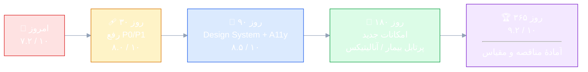

# 📌 ۰۱ · خلاصهٔ مدیریتی

---

> [!TIP]
> **همهٔ یافته‌های این سند به کارهای تیک‌دار تبدیل شده‌اند:** [**۱۰ · چک‌لیست اجرایی**](10-implementation-checklist.md) — ۹۴ کار با ترتیب پیاده‌سازی و دروازهٔ پذیرش برای هر فاز.

## 🧾 حکم نهایی

> [!IMPORTANT]
> **«سهند کلینیک‌پرو» یک محصول تجاری پخته است، نه یک نمونهٔ اولیه.** معماری لایه‌ای درست اجرا شده، دامنهٔ کسب‌وکار (۲۲۸ جدول، ۱۰۰+ موجودیت، ۳۳۴ اندپوینت) عمیق و واقعی است، منطق‌های حساس (حسابداری دوبل، سهم بیمه، FEFO داروخانه، بازهٔ مرجع آزمایشگاه، پشتیبان‌گیری واقعی SQL Server) درست پیاده شده‌اند و ۴۲۱ تست خودکار از آن‌ها محافظت می‌کند.
>
> **اما** فاصلهٔ آن با «بهترین محصول بازار» در سه محور متمرکز است: **(۱)** دسترس‌پذیری و ریزتعامل‌های رابط کاربری تقریباً وجود ندارد، **(۲)** لایهٔ نمایش و چند پرس‌وجوی داغ، الگوهای پرهزینه دارند که در مقیاس بزرگ‌تر خودشان را نشان می‌دهند، **(۳)** یک ایراد واقعی در بذر دسترسی‌ها وجود دارد که ۱۰ قابلیت را عملاً «فقط برای مدیر سامانه» قفل کرده است.

### ۷.۲ / ۱۰

**آمادهٔ فروش و بهره‌برداری است؛ با ۶–۸ هفته کار هدفمند به سطح «محصول ممتاز» می‌رسد.**

---

## 🔴 دوازده یافتهٔ کلیدی

<table dir="rtl" width="100%">
<thead>
<tr>
<th width="4%">#</th>
<th width="30%">یافته</th>
<th width="7%">شدت</th>
<th width="33%">اثر واقعی بر کسب‌وکار</th>
<th width="26%">شاهد در کد</th>
</tr>
</thead>
<tbody>
<tr>
<td>۱</td>
<td><b>۱۰ مجوز استفاده‌شده هیچ‌گاه بذر نمی‌شوند</b> حقوق و دستمزد، پروندهٔ بالینی پیشرفته، نظرسنجی، پیامک انبوه، انبارگردانی، دستگاه‌های حضور</td>
<td align="center">🔴 P0</td>
<td>مدیر درمانگاه یا حسابدار <b>هرگز</b> نمی‌تواند به این بخش‌ها دسترسی بگیرد؛ در عمل فقط «مدیر سامانه» کار می‌کند و اصل تفکیک نقش‌ها نقض می‌شود.</td>
<td><code>PermissionSeeder.cs:24-47</code> در برابر <code>*Controller.cs</code> ← <code>HasPermission("payroll.manage")</code></td>
</tr>
<tr>
<td>۲</td>
<td><b>توکن تازه‌سازی به‌صورت متن‌ساده در دیتابیس</b></td>
<td align="center">🟠 P1</td>
<td>هر نسخهٔ پشتیبان (که به ایمیل و فضای ابری هم می‌رود) حاوی <b>کلید ورود ۷ روزهٔ</b> همهٔ کاربران است.</td>
<td><code>IdentityService.cs:154</code> <code>Token = refreshToken</code></td>
</tr>
<tr>
<td>۳</td>
<td><b>۱۵۶ ادعای مجوز داخل هر JWT</b></td>
<td align="center">🟠 P1</td>
<td>توکن مدیر ≈ ۸–۹ کیلوبایت؛ این حجم در <b>هر</b> درخواست ارسال می‌شود. داشبورد با ۸ درخواست ⇒ ~۷۰KB فقط سرآیند.</td>
<td><code>JwtTokenGenerator.cs:67</code> + ۱۵۶ مجوز بذرشده</td>
</tr>
<tr>
<td>۴</td>
<td><b>۱۷۷ نقطهٔ «مشغول» بدون آزادسازی در خطا</b> در برابر فقط ۷۶ بلوک <code>finally</code></td>
<td align="center">🟠 P1</td>
<td>با یک قطعی شبکه یا خطای سرور، دکمه‌ها و نوار پیشرفت تا <b>ری‌استارت برنامه</b> قفل می‌مانند؛ کاربر فکر می‌کند برنامه هنگ کرده.</td>
<td><code>PatientsViewModel.cs:87-111</code> و ۷۲ مدل‌نمای دیگر</td>
</tr>
<tr>
<td>۵</td>
<td><b>۱۵۴ فراخوانی «بی‌صاحب» <code>_ = ...Async()</code></b></td>
<td align="center">🟠 P1</td>
<td>خطاها بی‌صدا می‌میرند، ترتیب بارگذاری تضمینی نیست و در ناوبری سریع، دادهٔ صفحهٔ قبلی روی صفحهٔ جدید می‌نشیند.</td>
<td>۱۵۴ مورد در <code>ViewModels/*.cs</code></td>
</tr>
<tr>
<td>۶</td>
<td><b>صفر پشتیبانی از صفحه‌خوان و ناوبری با صفحه‌کلید</b> ۰ مورد <code>AutomationProperties</code> · ۲ مورد <code>AccessText</code></td>
<td align="center">🟠 P1</td>
<td>کاربر کم‌بینا یا کاربری که با کیبورد کار می‌کند (پذیرش سریع) عملاً محروم است؛ همچنین مانع فروش سازمانی/مناقصهٔ دولتی.</td>
<td>شمارش سراسری روی ۹۲ فایل XAML</td>
</tr>
<tr>
<td>۷</td>
<td><b>۱۶ پنجره بلندتر از ۷۰۰px و ۱۷ پنجرهٔ غیرقابل‌تغییر اندازه</b></td>
<td align="center">🟠 P1</td>
<td>روی لپ‌تاپ‌های رایج درمانگاه (۱۳۶۶×۷۶۸) دکمهٔ «ذخیره» پایین پنجره <b>از صفحه بیرون می‌زند</b> و راهی برای کوچک‌کردن نیست.</td>
<td><code>VisitWindow.xaml</code> ۱۲۰۰×۸۰۰ <code>PayslipWindow.xaml</code> ۷۶۰×۸۸۰</td>
</tr>
<tr>
<td>۸</td>
<td><b>صفحات تک‌نمونه‌ای + بازسازی کامل نما در هر ناوبری</b></td>
<td align="center">🟡 P2</td>
<td>هر بار برگشت به یک صفحه، هم داده از نو گرفته می‌شود و هم ۱۵۰۰ خط XAML دوباره ساخته می‌شود ⇒ مکث محسوس و پرش تمرکز.</td>
<td><code>MainWindowViewModel.cs:1166-1190</code></td>
</tr>
<tr>
<td>۹</td>
<td><b>داشبورد: ۸ فراخوانی <i>متوالی</i> برای یک بار نمایش</b></td>
<td align="center">🟡 P2</td>
<td>روی شبکهٔ محلی ~۲۰۰ms، روی VPN/اینترنت درمانگاه ~۱.۵ ثانیه فقط انتظار شبکه.</td>
<td><code>DashboardViewModel.cs:1395-1525</code></td>
</tr>
<tr>
<td>۱۰</td>
<td><b>جستجو با <code>LIKE '%…%'</code> روی ۶ ستون</b></td>
<td align="center">🟡 P2</td>
<td>امروز با ۳٬۴۵۲ پرونده خوب است؛ بالای ~۱۰۰ هزار پرونده، هر تایپ جستجو جدول را اسکن می‌کند.</td>
<td><code>GetAllPatientsQueryHandler.cs:44-49</code></td>
</tr>
<tr>
<td>۱۱</td>
<td><b>بدون <code>CancellationToken</code> در ۷۰ مدل‌نمای از ۷۳</b></td>
<td align="center">🟡 P2</td>
<td>خروج از صفحه، درخواست‌های در جریان را لغو نمی‌کند ⇒ بار اضافی سرور و بازنویسی دادهٔ تازه با پاسخ کهنه.</td>
<td>فقط ۳ فایل از ۷۳</td>
</tr>
<tr>
<td>۱۲</td>
<td><b>سیستم طراحی (Design System) واقعی وجود ندارد</b> ۳۳۴ رنگ هاردکد + ۴۰ اندازهٔ فونت متفاوت</td>
<td align="center">🟡 P2</td>
<td>هر صفحهٔ جدید رنگ و اندازهٔ خودش را می‌آورد؛ تنظیم «بزرگ‌کردن فونت» در تنظیمات فقط بخشی از متن‌ها را بزرگ می‌کند.</td>
<td><code>Views/*.xaml</code>، <code>App.xaml</code></td>
</tr>
</tbody>
</table>

---

## ✅ آنچه واقعاً خوب است (و نباید دست بخورد)

<table dir="rtl" width="100%">
<thead>
<tr><th width="26%">نقطهٔ قوت</th><th>چرا مهم است</th><th width="24%">شاهد</th></tr>
</thead>
<tbody>
<tr><td>🏛 <b>معماری لایه‌ای بی‌نقص</b></td><td>دامنه به هیچ فناوری وابسته نیست؛ جابه‌جایی دیتابیس یا افزودن کلاینت موبایل بدون بازنویسی منطق ممکن است.</td><td>وابستگی یک‌طرفهٔ پروژه‌ها، ۰ ارجاع معکوس</td></tr>
<tr><td>🧮 <b>منطق مالی درست</b></td><td>حسابداری دوبل با استثنای «سند نامتوازن»، سهم بیمه fraction‌محور، پرداخت چندروشه — همه در سرور بازمحاسبه می‌شوند (نه اعتماد به کلاینت).</td><td><code>UnbalancedJournalEntryException</code> <code>CreateInvoiceCommand.cs:216-284</code></td></tr>
<tr><td>💊 <b>داروخانهٔ حرفه‌ای</b></td><td>خروج دارو به روش FEFO (اولین انقضا، اولین خروج) و حذف خودکار اقلام منقضی از انتخاب.</td><td><code>PharmacyFeatures.cs:88-89</code></td></tr>
<tr><td>🔬 <b>آزمایشگاه با بازهٔ مرجع جنسیت/سن</b></td><td>محدودهٔ نرمال بزرگسال مذکر/مؤنث/کودک + آستانهٔ بحرانی — استاندارد بالینی واقعی.</td><td><code>LabTest.cs:40-73</code></td></tr>
<tr><td>💾 <b>پشتیبان‌گیری و بازیابی واقعی</b></td><td><code>BACKUP DATABASE</code> + <code>RESTORE</code> با <code>FILELISTONLY</code> و جابه‌جایی فایل‌ها — نه کپی سادهٔ فایل.</td><td><code>BackupManager.cs:97,281-335</code></td></tr>
<tr><td>🛡 <b>امنیت پایهٔ درست</b></td><td>قفل حساب پس از ۵ تلاش، BCrypt با هزینهٔ ۱۲، تاریخچهٔ ۵ رمز، چرخش refresh token، محدودیت نرخ، هدرهای امنیتی، لاگ نوشتن‌ها.</td><td><code>IdentityService.cs:79-130</code></td></tr>
<tr><td>🧪 <b>۴۲۱ آزمون واقعی</b></td><td>آزمون دامنه، کاربرد، زیرساخت روی SQLite، API و حتی مدل‌نماهای دسکتاپ.</td><td><code>tests/**</code> — ۷۷ فایل</td></tr>
<tr><td>🖨 <b>چاپ حرفه‌ای</b></td><td>قالب‌های چاپ قابل ویرایش + پیش‌نمایش + چاپ رسید پذیرش/شیفت/برچسب نمونه.</td><td><code>PrintTemplate</code> + ۶ سرویس چاپ</td></tr>
</tbody>
</table>

---

## 🎯 ده اقدام با بالاترین بازده (۹۰ روز نخست)

| اولویت | اقدام | تلاش | اثر | شاخص موفقیت |
|:--:|:--|:--:|:--:|:--|
| ۱ | بذر کردن ۱۰ مجوز گمشده + آزمون گارد «هر `HasPermission` باید بذر داشته باشد» | ۰.۵ روز | ⭐⭐⭐⭐⭐ | ۰ مجوز بی‌بذر در CI |
| ۲ | هش کردن refresh token + ابطال خانوادگی | ۱ روز | ⭐⭐⭐⭐ | توکن خام در DB صفر |
| ۳ | حذف مجوزها از JWT و جایگزینی با نسخهٔ مجوز | ۲ روز | ⭐⭐⭐⭐ | توکن < ۱KB |
| ۴ | <code>try/finally</code> برای همهٔ <code>IsBusy</code> + لغو با <code>CancellationToken</code> | ۳ روز | ⭐⭐⭐⭐ | ۰ نقطهٔ قفل‌شده در قطعی شبکه |
| ۵ | چیدمان واکنش‌گرا: <code>MaxHeight</code> از ناحیهٔ کاری + بزرگ‌شدن پنجره‌ها | ۲ روز | ⭐⭐⭐⭐ | همهٔ پنجره‌ها روی ۱۳۶۶×۷۶۸ کامل |
| ۶ | یک اندپوینت تجمیعی <code>/dashboard/snapshot</code> | ۲ روز | ⭐⭐⭐ | < ۳ درخواست برای داشبورد |
| ۷ | پروجکشن DTO در فهرست‌ها به‌جای <code>Include</code> + نگاشت در حافظه | ۲ روز | ⭐⭐⭐ | حجم پاسخ ۴۰٪ کمتر |
| ۸ | سیستم طراحی: توکن‌های رنگ/فاصله/تایپوگرافی | ۵ روز | ⭐⭐⭐⭐ | ≥ ۸۰٪ رنگ‌ها از توکن |
| ۹ | دسترس‌پذیری پایه: <code>AutomationProperties</code> + پیمایش Tab + میان‌برهای F-کلید | ۴ روز | ⭐⭐⭐⭐ | عبور چک‌لیست A11y |
| ۱۰ | کش سمت کلاینت با «تازه‌سازی در پس‌زمینه» به‌جای بارگذاری دوباره در هر ناوبری | ۴ روز | ⭐⭐⭐ | ناوبری برگشتی < ۱۰۰ms |

> [!TIP]
> **جمع تلاش ۱۰ اقدام نخست ≈ ۲۶ روز کاری یک توسعه‌دهنده.** با این کار، امتیاز کل محصول از **۷.۲** به حدود **۸.۲** می‌رسد بدون آنکه هیچ قابلیت جدیدی اضافه شود.

---

## ⚖️ ریسک‌های کسب‌وکار (نه فنی)

<table dir="rtl" width="100%">
<thead><tr><th width="24%">ریسک</th><th width="12%">احتمال</th><th width="12%">اثر</th><th>توضیح</th></tr></thead>
<tbody>
<tr><td>🗣 «نرم‌افزار برای افراد مسن/کم‌بینا مناسب نیست»</td><td align="center">بالا</td><td align="center">بالا</td><td>بخش زیادی از کاربران پذیرش و پرسنل ارشد درمانگاه‌ها هستند؛ نبود بزرگ‌نمایی هماهنگ، کنتراست کافی در حالت روشن و ناوبری کیبورد، شکایت تکراری می‌سازد.</td></tr>
<tr><td>🔓 تفکیک وظایف (SoD) نقض می‌شود</td><td align="center">بالا</td><td align="center">بالا</td><td>وقتی ۱۰ قابلیت فقط با نقش «مدیر سامانه» کار می‌کند، درمانگاه مجبور می‌شود رمز مدیر را بین چند نفر بچرخاند — بزرگ‌ترین حفرهٔ واقعی در ممیزی‌های بالینی.</td></tr>
<tr><td>🐌 کندی محسوس در درمانگاه شلوغ</td><td align="center">متوسط</td><td align="center">متوسط</td><td>داشبورد + صف + جستجو روی شبکهٔ ضعیف؛ کاربر به‌جای نرم‌افزار به دفتر کاغذی برمی‌گردد.</td></tr>
<tr><td>🧾 نسخهٔ الکترونیک «واقعی» نیست</td><td align="center">بالا</td><td align="center">بالا</td><td>اتصال فعلی یک آداپتور عمومی HTTP است، نه پروتکل رسمی بیمه/تیتک. برای پذیرش سازمانی باید تکلیف شود.</td></tr>
<tr><td>💥 از دست رفتن اعتماد با یک باگ مالی</td><td align="center">کم</td><td align="center">بسیار بالا</td><td>خوشبختانه منطق مالی مستقل و آزمون‌شده است؛ ریسک اصلی، هم‌زمانی ویرایش دو کاربر است که با <code>RowVersion</code> تا حد زیادی مهار شده.</td></tr>
</tbody>
</table>

---

## 📈 مسیر پیشنهادی

