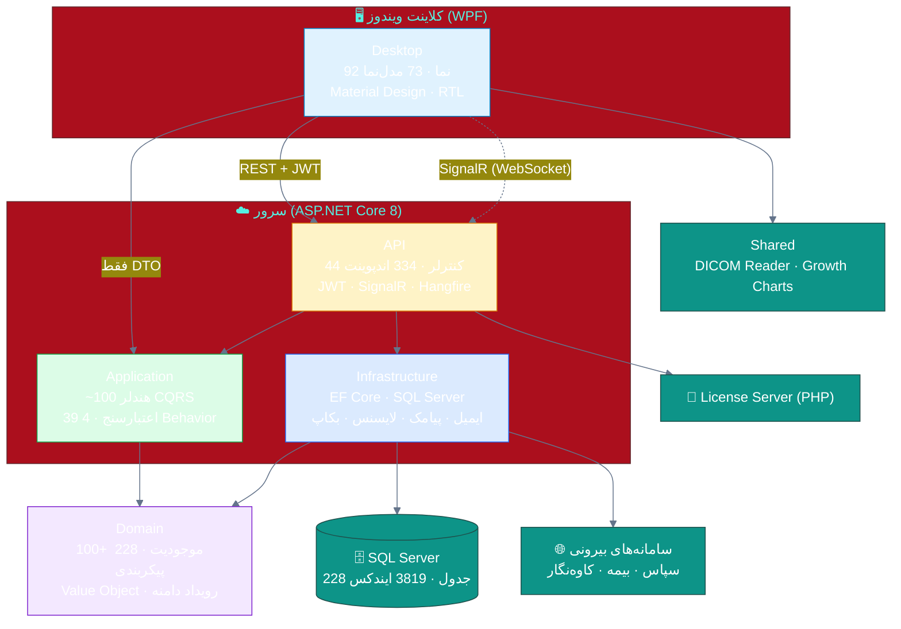
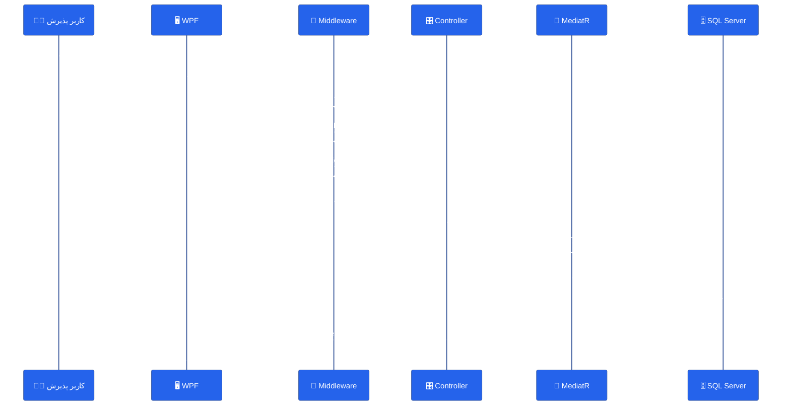
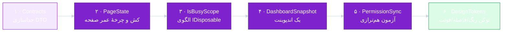

# 🏛 ۰۲ · معماری و کیفیت کد

---

## 🗺 نمای کلی راهکار

> [!NOTE]
> **جهت وابستگی‌ها درست است.** دامنه به هیچ چیز وابسته نیست؛ لایهٔ کاربرد فقط به دامنه؛ زیرساخت فقط به کاربرد؛ و کلاینت دسکتاپ **هرگز** مستقیم به زیرساخت یا دیتابیس وصل نمی‌شود. این یکی از نقاط قوت جدی محصول است.

| پروژه | خطوط | ارجاع به | ارزیابی |
|:--|--:|:--|:--|
| `Domain` | ~۲۴٬۰۰۰ | — | ✅ خالص، بدون وابستگی فناوری |
| `Application` | ~۹۵٬۰۰۰ | Domain | ✅ CQRS + Behavior + FluentValidation |
| `Infrastructure` | ~۱۰۵٬۰۰۰ | Application | ✅ EF Core، سرویس‌های بیرونی |
| `API` | ~۴۵٬۰۰۰ | Application + Infrastructure | ✅ Composition Root |
| `Desktop` | ~۹۰٬۰۰۰ | Application + Shared | ⚠️ جزئیات پایین |
| `Shared` | ~۳٬۰۰۰ | — | ✅ DICOM و منحنی رشد |

---

## 🔁 چرخهٔ یک درخواست (آنچه واقعاً اجرا می‌شود)

| لایه | قوت | ضعف مشاهده‌شده |
|:--|:--|:--|
| **Middleware** | ترتیب درست: Serilog → Exception → SecurityHeaders → RateLimit → Auth → Branch → License → Audit | 🔴 **لاگ عملیات فقط نوشتن‌ها را ثبت می‌کند** (`AuditLogMiddleware.cs:22,44`) — خواندن پروندهٔ بیمار ردگیری نمی‌شود |
| **Controller** | نازک، پاکت استاندارد `ApiResponse`، پیام فارسی | 🟠 `ReportsController` به ۱۶۶۴ خط رسیده (God Class) |
| **Application** | ۴ Behavior، اعتبارسنجی خط لوله، DTO | 🟡 فقط ۳۹ اعتبارسنج برای ~۱۰۰ فرمان |
| **Infrastructure** | ۳٬۸۱۹ ایندکس، بدون SQL خام ناامن | 🟠 مهاجرت خودکار در استارتاپ (`Program.cs:449`) |

---

## 🧨 بدهی فنی — فهرست صریح

<table dir="rtl" width="100%">
<thead><tr><th width="5%">#</th><th width="30%">مورد</th><th width="10%">شدت</th><th width="35%">چرا مسئله است</th><th width="20%">شاهد</th></tr></thead>
<tbody>
<tr><td>۱</td><td><b>Singleton بودن صفحه‌ها + بازسازی اجباری نما</b></td><td align="center">🟠</td><td>هر ناوبری: (الف) فرمان Refresh با Reflection صدا زده می‌شود، (ب) <code>CurrentPage = null</code> و ساخت مجدد کل نمای ۱۵۰۰ خطی. نتیجه: مکث، پرش اسکرول، درخواست تکراری.</td><td><code>MainWindowViewModel.cs:1166-1190</code></td></tr>
<tr><td>۲</td><td><b>ردیابی «تغییرات ذخیره‌نشده» با Snapshot بازتابی + تایمر ۲.۵ ثانیه</b></td><td align="center">🟠</td><td>رفتار درست از نظر کاربر، اما شکننده: اگر بارگذاری async دیر برسد فرم «کثیف» می‌شود؛ هزینهٔ Reflection روی هر فرم.</td><td><code>App.xaml.cs:143-190</code></td></tr>
<tr><td>۳</td><td><b>۶ کلاس غول‌آسا</b></td><td align="center">🟡</td><td>Receptions (۲۰۷۳)، Dashboard (۱۷۱۸)، ReportsController (۱۶۶۴)، Settings (۱۵۲۰)، MainWindow (۱۵۰۸)، Appointments (۱۳۸۸) — هر تغییر کوچک ریسک بالا دارد.</td><td><code>wc -l</code> روی مخزن</td></tr>
<tr><td>۴</td><td><b>کلاینت، اسمبلی‌های سروری را حمل می‌کند</b></td><td align="center">🟡</td><td>Desktop → Application ⇒ MediatR، EF Core، FluentValidation و حتی بستهٔ اکسل وارد کلاینت می‌شوند؛ حجم نصب و سطح حملهٔ بیشتر.</td><td><code>Desktop.csproj</code></td></tr>
<tr><td>۵</td><td><b>مهاجرت خودکار دیتابیس در استارتاپ</b></td><td align="center">🟠</td><td>روی نسخهٔ تولید با دیتابیس بزرگ، زمان بالا آمدن سرویس ویندوزی را بالا می‌برد؛ در چند نمونه‌ای شدن، رقابت روی مهاجرت.</td><td><code>Program.cs:447-452</code></td></tr>
<tr><td>۶</td><td><b>یک DbContext با ۲۲۸ موجودیت</b></td><td align="center">🟡</td><td>مدل‌سازی یکپارچه خوب است اما ساخت مدل در هر استارتاپ کند می‌شود؛ الگوی پیشنهادی: جداکردن «گزارش/آرشیو» (که تا حدی با <code>ReportingDbContext</code> انجام شده).</td><td><code>ClinicProDbContext.cs</code></td></tr>
<tr><td>۷</td><td><b>۰ فایل منابع (<code>.resx</code>)</b></td><td align="center">🟡</td><td>تمام رشته‌های فارسی داخل کد/ XAML هستند؛ ترجمه، سفارشی‌سازی واژه‌ها برای هر درمانگاه یا نسخهٔ عربی/کردی عملاً ناممکن است.</td><td><code>find src -name "*.resx" → 0</code></td></tr>
<tr><td>۸</td><td><b>اعتبارسنجی ناهمگون</b></td><td align="center">🟡</td><td>بخشی در FluentValidation، بخشی در هندلر با <code>if</code>، بخشی در DTO؛ قاعدهٔ واحد وجود ندارد.</td><td>۳۹ Validator / ~۱۰۰ فرمان</td></tr>
<tr><td>۹</td><td><b>نگاشت در حافظه به‌جای پروجکشن SQL</b></td><td align="center">🟡</td><td><code>.Include(...)</code> + <code>ToListAsync</code> + نگاشت: تمام ستون‌ها منتقل می‌شوند (مثلاً ۳۰+ ستون بیمار) در حالی که ۹ ستون لازم است.</td><td><code>GetAllPatientsQueryHandler.cs:37-66</code></td></tr>
<tr><td>۱۰</td><td><b>کد مرده/راه‌حل موقت</b></td><td align="center">🟢</td><td>خوشبختانه <code>TODO/FIXME = 0</code> و <code>NotImplementedException = 0</code>؛ اما ۲۹۷ بلوک <code>catch</code> بعضاً «بی‌صدا» هستند و خطا را فقط لاگ می‌کنند.</td><td><code>grep -c "catch"</code></td></tr>
</tbody>
</table>

---

## 🧪 کیفیت آزمون

| پروژهٔ آزمون | تمرکز | تعداد تأییدها | ارزیابی |
|:--|:--|--:|:--:|
| `Domain.UnitTests` | Value Object، کد ملی، پول، رویداد | ~۶۰ | ✅ |
| `Application.UnitTests` | تقویم جلالی، حقوق، صف انتظار، رمز | ~۱۱۰ | ✅ |
| `Infrastructure.IntegrationTests` | SQLite: فاکتور، بیمه، انبار، آرشیو، مهاجرت | ~۱۳۰ | ✅ قوی |
| `API.IntegrationTests` | سفر بیمار، گزارش، سلامت، SignalR | ~۸۰ | ✅ |
| `Desktop.UnitTests` | مدل‌نماها، جریان ورود، XAML audit | ~۴۰ | 🟡 کم برای ۹۲ نما |

> [!WARNING]
> **شکاف اصلی در آزمون:** منطق مالی و دامنه به‌خوبی پوشش دارد، اما **هیچ آزمونی برای «هم‌ترازی مجوزها با اندپوینت‌ها» وجود ندارد** — و همین‌جاست که ایراد P0 (۱۰ مجوز گمشده) سال‌ها پنهان مانده. یک آزمون ۲۰ خطی این کلاس از خطا را برای همیشه می‌بندد.

---

## 🧱 اصولی که رعایت شده‌اند (نگه‌داشتنشان واجب است)

<table dir="rtl" width="100%">
<thead><tr><th width="30%">اصل</th><th>شاهد</th></tr></thead>
<tbody>
<tr><td>✅ جداسازی دامنه از فناوری</td><td>هیچ <code>using</code> از EF/ASP.NET در Domain وجود ندارد</td></tr>
<tr><td>✅ پاکت پاسخ یکسان</td><td><code>ApiResponse&lt;T&gt;</code> با <code>Success/Failure</code> و پیام فارسی</td></tr>
<tr><td>✅ استثناهای دامنه‌محور</td><td><code>BusinessRuleException</code>، <code>NotFound</code>، <code>Conflict</code>، <code>UnbalancedJournalEntry</code></td></tr>
<tr><td>✅ هم‌زمانی خوش‌بینانه</td><td><code>RowVersion</code> روی <code>AuditableEntity</code> (۴١٣١ ارجاع)</td></tr>
<tr><td>✅ واحد کار + تراکنش خط لوله</td><td><code>TransactionBehavior</code> + <code>IUnitOfWork</code></td></tr>
<tr><td>✅ ایندکس‌گذاری دقیق</td><td>۳٬۸۱۹ ایندکس، شامل ایندکس یکتای فیلترشده برای کد ملی</td></tr>
<tr><td>✅ بذر دادهٔ مرجع</td><td>دارو (~۵٬۰۰۰ خط)، ICD-10، نقش‌ها، مجوزها</td></tr>
<tr><td>✅ نبود SQL خام خطرناک</td><td>فقط ۲ نقطهٔ <code>ExecuteSqlRaw</code> با پارامتر</td></tr>
<tr><td>✅ لاگ ساخت‌یافته + Seq (اختیاری)</td><td>Serilog با سینک فایل روزانهٔ UTF-8 و نگهداشت ۶۱ روز</td></tr>
<tr><td>✅ سلامت سرویس</td><td><code>/health</code>, <code>/health/live</code>, <code>/health/ready</code></td></tr>
</tbody>
</table>

---

## 🚧 پیشنهاد بازآرایی (به ترتیب اجرا)

| گام | کاری که انجام می‌شود | حذف می‌کند |
|:--:|:--|:--|
| ۱ | پروژهٔ `Contracts` فقط با DTOها؛ Desktop دیگر Application را ارجاع نمی‌دهد | 🔻 حجم نصب، سطح حمله |
| ۲ | `PageState<T>` با کش، انقضای اختیاری و «تازه‌سازی در پس‌زمینه» | 🔻 بازسازی نما در هر ناوبری |
| ۳ | `using var busy = BusyScope.Begin(this)` که در Dispose مقدار را برمی‌گرداند | 🔻 ۱۷۷ نقطهٔ قفل‌شدنی |
| ۴ | یک اندپوینت `/dashboard/snapshot` با `Task.WhenAll` داخلی | 🔻 ۷ رفت‌وبرگشت شبکه |
| ۵ | آزمون «هر `HasPermission` یا بذر دارد یا در لیست استثناهاست» | 🔻 کلاس خطای P0 |
| ۶ | `DesignTokens.xaml` (رنگ/فاصله/تایپوگرافی) و ممنوعیت هاردکد در بازبینی | 🔻 ۳۳۴ رنگ پراکنده |

---

## 📐 جمع‌بندی معماری

> [!TIP]
> معماری این محصول **بالاتر از میانگین بازار نرم‌افزارهای درمانگاهی ایران** است: لایه‌بندی درست، CQRS واقعی (نه نمایشی)، و به‌کارگیری الگوهای بالغ (UnitOfWork، Behavior، Outbox-مانند لاگ، SignalR بلادرنگ). بدهی فنی موجود بیشتر «فرسایش تدریجی در لایهٔ نمایش» است تا خطای ساختاری — و دقیقاً به همین دلیل با بازآرایی هدفمند (نه بازنویسی) قابل جبران است.

