<div dir="rtl" align="right">

# 🎨 ۰۳ · بررسی صفحه‌به‌صفحهٔ رابط کاربری

<div align="center">


</div>

---

## 🧬 زبان طراحی فعلی — چه چیزی ساخته شده است

<div align="center">

<table dir="rtl" width="100%">
<thead><tr><th width="22%">عنصر</th><th width="45%">پیاده‌سازی</th><th width="33%">ارزیابی</th></tr></thead>
<tbody>
<tr><td>📐 چیدمان کلی</td><td>سایدبار تیرهٔ برند (۲۶۰px) + نوار بالای روشن + ناحیهٔ محتوا با کارت‌های سفید و گوشهٔ ۱۴px</td><td>✅ حرفه‌ای و آشنا برای کاربر ایرانی</td></tr>
<tr><td>🎨 تم</td><td>۸ پالت + روشن/تیره + چگالی فشرده/استاندارد + شعاع گوشهٔ متغیر</td><td>✅ بالاتر از رقبای داخلی</td></tr>
<tr><td>🔤 تایپوگرافی</td><td>وزیرمتن، ۱۲ اندازهٔ متفاوت رایج از ۹.۵ تا ۲۰</td><td>⚠️ مقیاس تایپوگرافی منظم نیست</td></tr>
<tr><td>🖼 آیکون</td><td>۶۱۲ آیکون Material Design (PackIcon) با سبک یکسان</td><td>✅ یکدست</td></tr>
<tr><td>🧩 اجزای مشترک</td><td><code>EmptyState</code>، <code>PaginationBar</code>، <code>JalaliDatePicker</code>، <code>ComboBoxSearch</code>، <code>StatCard</code>، <code>DataGrid</code></td><td>✅ کامپوننت‌محور (اما استفاده ناهمگون)</td></tr>
<tr><td>💬 بازخورد</td><td>Snackbar (۶۹۸ فراخوانی) + نوار پیشرفت نامعین + دیالوگ اختصاصی</td><td>✅ پیام فارسی و یکدست</td></tr>
<tr><td>⌨️ میان‌بر</td><td><code>Ctrl+K</code> جستجوی سراسری + <code>Esc</code> لایه‌ای + F3/F5 در برخی صفحه‌ها</td><td>⚠️ ناهمگون بین صفحات</td></tr>
<tr><td>🌐 RTL</td><td>۹۹٪ نماها <code>FlowDirection="RightToLeft"</code> + اعداد فارسی با مبدل</td><td>✅ کامل و درست</td></tr>
</tbody>
</table>

</div>

---

## 📏 سنجه‌های سراسری (اندازه‌گیری‌شده)

<div align="center">

<table dir="rtl" width="100%">
<thead><tr><th width="30%">سنجه</th><th width="14%">مقدار</th><th width="10%">وضعیت</th><th>تفسیر</th></tr></thead>
<tbody>
<tr><td>جدول داده (DataGrid)</td><td align="center">۴۴</td><td align="center">—</td><td>بیش از نیمی از صفحات، فهرست‌محور هستند</td></tr>
<tr><td>استفاده از <code>PaginationBar</code></td><td align="center"><b>۳</b></td><td align="center">🔴</td><td>فقط ۳ جدول از ۴۴ صفحه‌بندی استاندارد دارند ⇒ الگوی «فهرست بی‌پایان» در بقیه</td></tr>
<tr><td>استفاده از <code>EmptyState</code></td><td align="center"><b>۸</b></td><td align="center">🟠</td><td>۳۶ جدول در حالت «نتیجه صفر» فقط سفید می‌شوند — کاربر نمی‌داند خطاست یا خالی</td></tr>
<tr><td>مجازی‌سازی فهرست</td><td align="center">۱۳</td><td align="center">🟡</td><td>روی DataGrid اصلی فعال است؛ بقیه باید بررسی شوند</td></tr>
<tr><td>Tooltip</td><td align="center">۳۱۴</td><td align="center">🟢</td><td>پوشش خوب برای دکمه‌های آیکونی</td></tr>
<tr><td><code>AutomationProperties</code> (صفحه‌خوان)</td><td align="center"><b>۰</b></td><td align="center">🔴</td><td>هیچ‌جا نام دسترس‌پذیری تعریف نشده</td></tr>
<tr><td><code>AccessText</code> (میان‌بر Alt)</td><td align="center"><b>۲</b></td><td align="center">🔴</td><td>کاربر کیبوردی نمی‌تواند بدون ماوس فرم پر کند</td></tr>
<tr><td>رنگ هاردکد (هگز)</td><td align="center"><b>۳۳۴</b></td><td align="center">🟠</td><td>بدون سیستم توکن ⇒ ناسازگاری رنگ در تم تاریک</td></tr>
<tr><td>اندازهٔ فونت متفاوت</td><td align="center">~<b>۴۰</b></td><td align="center">🟠</td><td>۱۱ / ۱۱٫۵ / ۱۲ / ۱۲٫۵ همزمان — تفاوت‌های نامحسوس و بی‌معنا</td></tr>
<tr><td>پنجره‌های بلندتر از ۷۰۰px</td><td align="center"><b>۱۶</b></td><td align="center">🔴</td><td>روی نمایشگر ۱۳۶۶×۷۶۸ دکمهٔ پایین دیده نمی‌شود</td></tr>
<tr><td>پنجره‌های <code>NoResize</code></td><td align="center"><b>۱۷</b></td><td align="center">🟠</td><td>کاربر نمی‌تواند اندازه را اصلاح کند</td></tr>
<tr><td>خطوط code-behind در نماها</td><td align="center">۷٬۴۷۶</td><td align="center">🟡</td><td>منطق نمایشی از MVVM خارج شده (بیشترین: WaitingRoom ۶۴۹ خط)</td></tr>
</tbody>
</table>

</div>

> [!CAUTION]
> **سه سنجهٔ قرمز بالا (صفحه‌بندی، حالت خالی، اندازهٔ پنجره) بیشترین شکایت کاربر واقعی را می‌سازند** — چون در استفادهٔ روزمره و روی سخت‌افزار متوسط درمانگاه دیده می‌شوند، نه در دموی شبکهٔ محلی.

---

## 🗂 بخش ۱ — داشبورد و نوبت‌دهی

<div align="center">

<table dir="rtl" width="100%">
<thead><tr><th width="17%">صفحه</th><th width="20%">هدف</th><th width="6%">نمره</th><th width="26%">نقطهٔ قوت</th><th width="31%">ضعف / نیاز به اصلاح</th></tr></thead>
<tbody>
<tr>
<td><b>داشبورد مدیریتی</b><br/><sub>DashboardView</sub></td>
<td>نمای ۳۶۰ درجه از وضعیت امروز</td>
<td align="center">۷.۸</td>
<td>کارت‌های قابل شخصی‌سازی (چیدمان، پهنای ۱–۳ ستون، ذخیرهٔ خودکار)، نمودار درآمد، صف زنده، بنر نسخه و هشدار لایسنس</td>
<td>نمودار بدون محور عمودی/راهنمای مقدار است؛ ۸ فراخوانی جدا برای یک نمایش؛ کارت‌های خالی فضای زیادی می‌گیرند؛ فشردن <kbd>F5</kbd> برای تازه‌سازی کشف‌شدنی نیست</td>
</tr>
<tr>
<td><b>بیماران</b><br/><sub>PatientsView</sub></td>
<td>جستجو و مدیریت پرونده</td>
<td align="center">۸.۴</td>
<td>بهترین صفحهٔ محصول: سربرگ گرادیانی، ۳ کارت آماری، جدول ۹ ستونی مجازی‌شده، منوی راست‌کلیک، حالت خالی، صفحه‌بندی سروری، برچسب «هویت نامشخص»</td>
<td>کد ملی و موبایل در جدول ماسک می‌شوند (برای پذیرش آزاردهنده است)؛ ستون «عملیات» چهار دکمه دارد که بار بصری زیادی می‌سازد؛ حالت انتخاب چندگانه (checkbox) بدون عملیات گروهی</td>
</tr>
<tr>
<td><b>نوبت‌دهی</b><br/><sub>AppointmentsView</sub></td>
<td>تقویم شمسی + اسلات‌ها + صف انتظار</td>
<td align="center">۸.۱</td>
<td>کاشی‌های رنگی اسلات با روبان وضعیت، هاور/سنجاق جزئیات بیمار، لیست انتظار با «پیشنهاد خودکار جای خالی» — نوآوری واقعی</td>
<td>وضعیت‌های «تایید شده / تایید نشده» در کنار «در راه / در انتظار» گیج‌کننده‌اند؛ جدول روز بدون فیلتر پزشک/وضعیت در نوار بالا؛ تقویم ماهانه و جدول روز در یک صفحه شلوغ است</td>
</tr>
<tr>
<td><b>پذیرش</b><br/><sub>ReceptionsView</sub></td>
<td>ویزارد ۴ گامهٔ پذیرش</td>
<td align="center">۷.۹</td>
<td>گام‌بندی روشن (نوع پذیرش ← بیمار ← پزشک/خدمت ← بیمه و ثبت)، بخش‌های اختیاری قابل تیک، استعلام بیمه، کسر خودکار انبار</td>
<td>۲۰۷۳ خط مدل‌نما (پرتکرارترین صفحهٔ روز)؛ محاسبهٔ مالی در کلاینت انجام می‌شود (فقط برای پیش‌نمایش)؛ نبود «بازگشت به بیمار قبلی» یا ثبت سریع بدون ویزارد برای موارد تکراری</td>
</tr>
<tr>
<td><b>ویزیت و معاینه</b><br/><sub>VisitsView</sub></td>
<td>صف ویزیت پزشک</td>
<td align="center">۷.۶</td>
<td>تفکیک صف ویزیت از صف خدمات، شمارندهٔ ویزیت‌شدهٔ امروز، تازه‌سازی ۳۰ ثانیه‌ای</td>
<td>تازه‌سازی خودکار بدون نشانگر «آخرین به‌روزرسانی»؛ نبود نمای «پزشک من» برای کاربر پزشک</td>
</tr>
<tr>
<td><b>صف خدمات درمانی</b><br/><sub>ServicesView</sub></td>
<td>صف خدمات غیرویزیت (تزریقات، پانسمان…)</td>
<td align="center">۷.۵</td>
<td>صفحهٔ مستقل و ساده، به‌روزرسانی زنده</td>
<td>هم‌پوشانی مفهومی با «ویزیت» برای کاربر تازه‌کار؛ نیاز به راهنمای درون‌برنامه‌ای</td>
</tr>
<tr>
<td><b>لوازم مصرفی</b><br/><sub>ConsumablesView</sub></td>
<td>قلم مصرفی مستقل از داروخانه</td>
<td align="center">۷.۷</td>
<td>مستقل از لایسنس داروخانه + توضیح درون‌صفحه‌ای برای کاربر</td>
<td>از نظر UI تقریباً کپی صفحهٔ داروخانه است؛ تفاوت دو صفحه برای کاربر روشن نیست</td>
</tr>
</tbody>
</table>

</div>

---

## 🗂 بخش ۲ — بالینی

<div align="center">

<table dir="rtl" width="100%">
<thead><tr><th width="17%">صفحه</th><th width="20%">هدف</th><th width="6%">نمره</th><th width="26%">نقطهٔ قوت</th><th width="31%">ضعف / نیاز</th></tr></thead>
<tbody>
<tr>
<td><b>پروندهٔ بیمار</b><br/><sub>PatientDetailWindow</sub></td>
<td>نمای ۳۶۰ درجهٔ بیمار</td>
<td align="center">۷.۹</td>
<td>تایم‌لاین، خلاصهٔ آزمایش‌های غیرطبیعی، یادداشت سریع، برچسب</td>
<td>اطلاعات در تب‌های زیاد پخش شده؛ نبود نمای چاپی «خلاصهٔ پرونده» با یک کلیک</td>
</tr>
<tr>
<td><b>ویزیت (پنجرهٔ فرم)</b><br/><sub>VisitWindow</sub></td>
<td>ثبت شرح حال، علائم حیاتی، تشخیص</td>
<td align="center">۷.۴</td>
<td>هشدار آلرژی قرمز و برجسته، ICD-10 با جستجو، بیماری‌های زمینه‌ای، ذخیرهٔ خودکار</td>
<td>علائم حیاتی به‌صورت متن آزاد (بدون ماسک ۱۲۰/۸۰ و بدون واحدهای اجباری)؛ نبود شاخص BMI محاسبه‌شده؛ ارتفاع ۸۰۰px روی لپ‌تاپ قطع می‌شود</td>
</tr>
<tr>
<td><b>نسخه‌نویسی</b><br/><sub>PrescriptionsView</sub></td>
<td>صدور نسخه</td>
<td align="center">۸.۰</td>
<td>جستجوی دارو با Debounce (۳۰۰ms)، هشدار تداخل دارویی، قالب نسخهٔ آماده</td>
<td>ویرایشگر نسخه فقط ۲ ScrollViewer دارد ⇒ در نسخهٔ ۱۵ قلمی، چیدمان باید آزمایش شود؛ نبود «تکرار نسخهٔ قبلی» یک‌کلیکی</td>
</tr>
<tr>
<td><b>پروندهٔ بالینی پیشرفته</b><br/><sub>AdvancedEmrView</sub></td>
<td>EMR کامل + منحنی رشد</td>
<td align="center">۷.۲</td>
<td>منحنی WHO، طرح مراقبت مزمن، سابقهٔ خانوادگی</td>
<td>دسترسی به آن با مجوز بذرشده <b>وجود ندارد</b> (یافتهٔ P0) ⇒ در عمل فقط مدیر سامانه می‌بیند</td>
</tr>
<tr>
<td><b>نسخهٔ الکترونیک</b><br/><sub>EPrescriptionView</sub></td>
<td>ارسال به سامانهٔ دولتی</td>
<td align="center">۵.۵</td>
<td>نمایش وضعیت ارسال و لاگ فراخوانی</td>
<td>اتصال عمومی HTTP است، نه پروتکل رسمی؛ UI وضعیت خطا را بدون راهنمای اقدام («چه کنم؟») نشان می‌دهد</td>
</tr>
</tbody>
</table>

</div>

---

## 🗂 بخش ۳ — پاراکلینیک و داروخانه

<div align="center">

<table dir="rtl" width="100%">
<thead><tr><th width="17%">صفحه</th><th width="20%">هدف</th><th width="6%">نمره</th><th width="26%">نقطهٔ قوت</th><th width="31%">ضعف / نیاز</th></tr></thead>
<tbody>
<tr>
<td><b>آزمایشگاه</b><br/><sub>LabView</sub></td>
<td>درخواست، نتیجه، بازهٔ مرجع</td>
<td align="center">۸.۲</td>
<td>مدیریت بازهٔ مرجع بر اساس جنسیت/سن، آستانهٔ بحرانی، ورود نتایج در پنجرهٔ اختصاصی، برچسب نمونه با QR</td>
<td>ورود نتیجه کاملاً دستی است (بدون رابط دستگاه/آنالایزر)؛ جدول نتایج بدون صفحه‌بندی استاندارد</td>
</tr>
<tr>
<td><b>تصویربرداری</b><br/><sub>ImagingView</sub></td>
<td>درخواست و پیوست تصویر</td>
<td align="center">۶.۸</td>
<td>پیوست فایل، نمایشگر DICOM داخلی</td>
<td>نمایشگر DICOM فقط ۱۶۸ خط است: بدون Window/Level، زوم، اندازه‌گیری یا سین (Cine) — برای استفادهٔ بالینی کافی نیست</td>
</tr>
<tr>
<td><b>دندان‌پزشکی</b><br/><sub>DentistryView</sub></td>
<td>چارت دندان و طرح درمان</td>
<td align="center">۷.۶</td>
<td>مدل دامنهٔ کامل (وضعیت دندان، رویه، طرح درمان)</td>
<td>نمای چارت دندان نیاز به بررسی اندازه در رزولوشن‌های پایین دارد؛ تعامل با ماوس و کیبورد همزمان تعریف نشده</td>
</tr>
<tr>
<td><b>چشم‌پزشکی</b><br/><sub>OphthalmologyView</sub></td>
<td>معاینهٔ چشم (حدت بینایی، فشار)</td>
<td align="center">۷.۳</td>
<td>فرم اختصاصی تخصصی</td>
<td>نبود نمایش گرافیکی میدان بینایی؛ نبود مقایسهٔ روند بین معاینات</td>
</tr>
<tr>
<td><b>فیزیوتراپی</b><br/><sub>PhysiotherapyView</sub></td>
<td>نقشهٔ بدن + جلسات</td>
<td align="center">۷.۸</td>
<td>نقشهٔ بدن با ۲۶ ناحیه و ماسک برای هر پیکر — ویژگی متمایز و دیدنی</td>
<td>انتخاب ناحیه روی تصویر بدون راهنمای صوتی/متنی؛ حالت انتخاب چندناحیه‌ای کشف‌شدنی نیست</td>
</tr>
<tr>
<td><b>داروخانه و انبار</b><br/><sub>PharmacyView</sub></td>
<td>موجودی، سری، انقضا</td>
<td align="center">۷.۹</td>
<td>FEFO، هشدار کم‌موجودی، سری و تاریخ انقضا، ورود کالا</td>
<td>جدول موجودی بدون صفحه‌بندی؛ نبود نمای «اقلام نزدیک انقضا» به‌صورت هشدار بالای صفحه</td>
</tr>
<tr>
<td><b>انبارگردانی</b><br/><sub>StocktakingView</sub></td>
<td>شمارش و اصلاح موجودی</td>
<td align="center">۷.۰</td>
<td>سند انبارگردانی با اقلام</td>
<td>دسترسی با مجوز بذرنشده <code>pharmacy.stocktake</code> قفل است (P0)</td>
</tr>
</tbody>
</table>

</div>

---

## 🗂 بخش ۴ — پرسنل و حضور

<div align="center">

<table dir="rtl" width="100%">
<thead><tr><th width="17%">صفحه</th><th width="20%">هدف</th><th width="6%">نمره</th><th width="26%">نقطهٔ قوت</th><th width="31%">ضعف / نیاز</th></tr></thead>
<tbody>
<tr>
<td><b>پزشکان</b><br/><sub>DoctorsView</sub></td>
<td>پروندهٔ پزشک، شیفت، حق ویزیت</td>
<td align="center">۷.۸</td>
<td>برنامهٔ هفتگی، مرخصی/غیبت، اتاق، سهم</td>
<td>نمایش برنامهٔ هفتگی در عرض کم شلوغ می‌شود؛ نبود نمای «امروز چه کسی کشیک است»</td>
</tr>
<tr>
<td><b>پرسنل</b><br/><sub>PersonnelView</sub></td>
<td>پروندهٔ پرسنلی + حقوق پایه</td>
<td align="center">۷.۵</td>
<td>عکس پرسنل، قرارداد، ویرایش حقوقی اختصاصی</td>
<td>فرم پرسنل ۷۸۰px ارتفاع و بدون MinHeight ⇒ در لپ‌تاپ کوچک قطع می‌شود</td>
</tr>
<tr>
<td><b>حقوق و دستمزد</b><br/><sub>PayrollView</sub></td>
<td>محاسبهٔ حقوق دوره‌ای</td>
<td align="center">۷.۱۳</td>
<td>قواعد روز، کسری/اضافه‌کاری، فیش قابل چاپ</td>
<td>مجوز <code>payroll.manage</code> بذر نشده ⇒ حسابدار عملاً دسترسی ندارد (P0)؛ فیش حقوقی ۸۸۰px ارتفاع</td>
</tr>
<tr>
<td><b>حضور و غیاب</b><br/><sub>AttendanceView</sub></td>
<td>تابلو امروز + دستگاه‌ها + اصلاحیه</td>
<td align="center">۷.۶</td>
<td>پشتیبانی ZKTeco و Hikvision + شبیه‌ساز، همگام‌سازی دقیقه‌ای، اصلاح دستی</td>
<td>«تأیید حضور» و «دستگاه‌ها» با مجوزهای بذرنشده قفل‌اند (P0)؛ نبود نمایش گرافیکی تایم‌لاین ورود/خروج</td>
</tr>
<tr>
<td><b>شیفت‌ها</b><br/><sub>ShiftsView</sub></td>
<td>تعریف و تخصیص شیفت</td>
<td align="center">۷.۲</td>
<td>مدل کامل (شیفت، تخصیص، تعطیلات)</td>
<td>مجوز <code>attendance.shifts</code> بذر نشده (P0)</td>
</tr>
</tbody>
</table>

</div>

---

## 🗂 بخش ۵ — مالی و حسابداری

<div align="center">

<table dir="rtl" width="100%">
<thead><tr><th width="17%">صفحه</th><th width="20%">هدف</th><th width="6%">نمره</th><th width="26%">نقطهٔ قوت</th><th width="31%">ضعف / نیاز</th></tr></thead>
<tbody>
<tr>
<td><b>صندوق و فاکتور</b><br/><sub>BillingView</sub></td>
<td>فاکتور، دریافت وجه، بستن شیفت</td>
<td align="center">۸.۰</td>
<td>۴ کارت شاخص مالی، جدول فاکتورهای امروز با وضعیت رنگی، پنل بستن شیفت با تفکیک نقدی/کارتخوان — تصویر مالی روشن</td>
<td>جدول بدون صفحه‌بندی و بدون فیلتر تاریخ/وضعیت در نوار بالا؛ نبود نمای «بدهکاران» با یک کلیک؛ اختلاف صندوق فقط متنی است (بدون نمودار)</td>
</tr>
<tr>
<td><b>حسابداری دوبل</b><br/><sub>AccountingView</sub></td>
<td>سند، دفتر، تراز</td>
<td align="center">۷.۹</td>
<td>سند متوازن با اعتبارسنجی دامنه، مرکز هزینه، سال مالی</td>
<td>نمای «درخت حساب‌ها» ندارد؛ صدور سند دستی نیاز به فرم پرجزئیات با راهنمای کافی ندارد</td>
</tr>
<tr>
<td><b>بیمه</b><br/><sub>InsuranceView</sub></td>
<td>شرکت‌ها، قواعد سهم، مطالبات</td>
<td align="center">۷.۵</td>
<td>قواعد fraction، درصد پوشش، استعلام آنلاین</td>
<td>نبود نمای «صورت‌حساب ارسالی به بیمه» و پیگیری وضعیت مطالبه در یک صفحه</td>
</tr>
<tr>
<td><b>سپاس</b><br/><sub>SepasView</sub></td>
<td>ارسال و پیگیری</td>
<td align="center">۶.۵</td>
<td>لاگ فراخوانی و وضعیت</td>
<td>وابستگی به تنظیمات بیرونی؛ در حالت غیرفعال، صفحه فقط پیام خطا نشان می‌دهد</td>
</tr>
<tr>
<td><b>پرداخت / فاکتور (فرم‌ها)</b><br/><sub>PaymentWindow · InvoiceFormWindow</sub></td>
<td>ثبت تراکنش</td>
<td align="center">۷.۳</td>
<td>روش پرداخت، تفکیک سهم‌ها</td>
<td>InvoiceForm ۷۲۰px ارتفاع بدون MinHeight؛ نبود میان‌بر «پرداخت کامل»</td>
</tr>
</tbody>
</table>

</div>

---

## 🗂 بخش ۶ — ارتباطات، گزارش و مدیریت

<div align="center">

<table dir="rtl" width="100%">
<thead><tr><th width="17%">صفحه</th><th width="20%">هدف</th><th width="6%">نمره</th><th width="26%">نقطهٔ قوت</th><th width="31%">ضعف / نیاز</th></tr></thead>
<tbody>
<tr>
<td><b>گزارش‌ها</b><br/><sub>ReportsView</sub></td>
<td>گزارش‌های مالی/عملکردی</td>
<td align="center">۷.۷</td>
<td>گزارش‌های نموداری، خروجی Excel و PDF با سربرگ، گزارش‌ساز رایگانه</td>
<td>فهرست گزارش‌ها بدون جستجو/دسته‌بندی؛ نبود «گزارش‌های من» (اخیر/پینی)</td>
</tr>
<tr>
<td><b>گزارش‌ساز</b><br/><sub>ReportBrowserView</sub></td>
<td>ساخت گزارش سفارشی</td>
<td align="center">۷.۱</td>
<td>موتور کوئری پویا، اجرای زمان‌بندی‌شده</td>
<td>فرم‌ساز بدون پیش‌نمایش زندهٔ ستون‌ها؛ خطای کوئری برای کاربر غیرفنی مفهوم نیست</td>
</tr>
<tr>
<td><b>پیامک</b><br/><sub>SmsView</sub></td>
<td>ارسال تک/گروهی و تاریخچه</td>
<td align="center">۷.۰</td>
<td>قالب‌ها، صف، ساعات سکوت</td>
<td>ارسال انبوه با مجوز <code>sms.bulksend</code> قفل است (P0)؛ نبود شمارندهٔ اعتبار پنل پیامک</td>
</tr>
<tr>
<td><b>نظرسنجی</b><br/><sub>SurveyView</sub></td>
<td>سازندهٔ پویای پرسش + نتایج</td>
<td align="center">۷.۲</td>
<td>سوالات پویا و پاسخ‌گیری</td>
<td>دسترسی به آن با مجوز بذرنشده قفل است (P0)؛ نمای تحلیلی نتایج ضعیف</td>
</tr>
<tr>
<td><b>اعلان‌ها</b><br/><sub>NotificationsView</sub></td>
<td>مرکز اعلان</td>
<td align="center">۷.۴</td>
<td>بلادرنگ با SignalR، علامت‌گذاری خوانده‌شده</td>
<td>مجوز <code>notifications.manage</code> بذر نشده (P0)</td>
</tr>
<tr>
<td><b>کاربران</b><br/><sub>UsersView</sub></td>
<td>مدیریت حساب‌ها</td>
<td align="center">۷.۵</td>
<td>قفل/فعال‌سازی، الزام تغییر رمز، اتصال به پرسنل</td>
<td>فرم کاربر فهرست ۵۰۰ کاربر را یک‌جا می‌گیرد</td>
</tr>
<tr>
<td><b>نقش‌ها و دسترسی</b><br/><sub>RolePermissionView</sub></td>
<td>ماتریس ۱۵۶ مجوز × ۸ نقش</td>
<td align="center">۶.۸</td>
<td>ماتریس کامل، گروه‌بندی بر اساس ماژول</td>
<td><b>ریشهٔ یافتهٔ P0</b>: فقط مجوزهای بذرشده در ماتریس دیده می‌شوند و ۱۰ مجوز موجود در کد غایب‌اند — کاربر نمی‌تواند آن‌ها را تیک بزند</td>
</tr>
<tr>
<td><b>تنظیمات</b><br/><sub>SettingsView</sub></td>
<td>۶ تب پیکربندی</td>
<td align="center">۷.۶</td>
<td>تب‌بندی منطقی، پشتیبانی از لایسنس، انتخاب تم، واحد پول، نمایشگر سالن</td>
<td>دکمهٔ «ذخیره» در نمای دیده‌شده پیدا نیست (ذخیرهٔ خودکار؟) — ابهام بازخورد؛ ۱۵۲۰ خط مدل‌نما</td>
</tr>
<tr>
<td><b>پشتیبان‌گیری</b><br/><sub>BackupView</sub></td>
<td>بکاپ/بازیابی/ابر</td>
<td align="center">۷.۸</td>
<td>بکاپ واقعی، بازیابی، ارسال ابری، ایمیل خودکار، نگهداشت تعداد</td>
<td>بازیابی مخرب‌ترین عملیات است و تأیید دو مرحله‌ای/متن تایپی ندارد</td>
</tr>
<tr>
<td><b>لاگ عملیات</b><br/><sub>AuditLogView</sub></td>
<td>ردگیری تغییرات</td>
<td align="center">۷.۳</td>
<td>ستون‌های فارسی، فیلتر، جزئیات تغییر مقدار قبل/بعد</td>
<td>فقط «نوشتن» ثبت می‌شود؛ نمای «چه کسی پروندهٔ X را دید» وجود ندارد (شکاف انطباق)</td>
</tr>
<tr>
<td><b>لایسنس</b><br/><sub>LicenseStatusView</sub></td>
<td>وضعیت و ماژول‌ها</td>
<td align="center">۷.۴</td>
<td>چیپ ماژول‌ها، تپ قلب، مهلت آفلاین</td>
<td>نبود توضیح تفاوت نسخه‌ها و مسیر ارتقا در همان صفحه</td>
</tr>
<tr>
<td><b>شعبه‌ها / اتاق‌ها</b><br/><sub>BranchesView · RoomsView</sub></td>
<td>مدیریت شعبه و اتاق</td>
<td align="center">۷.۲</td>
<td>مدل چندشعبه‌ای و هدر <code>X-Branch-Id</code></td>
<td>سوییچ شعبه در نوار بالا ناپیداست؛ کاربر چندشعبه‌ای سردرگم می‌شود</td>
</tr>
<tr>
<td><b>مدیریت سامانه</b><br/><sub>AdminHubView · AdminView</sub></td>
<td>هاب تنظیمات پیشرفته</td>
<td align="center">۶.۹</td>
<td>همه‌چیز یک‌جا</td>
<td>دوباره‌کاری با «تنظیمات»؛ دو مسیر برای یک کار = سردرگمی</td>
</tr>
<tr>
<td><b>مرکز آموزش</b><br/><sub>TrainingCenterView</sub></td>
<td>آموزش درون‌برنامه‌ای</td>
<td align="center">۷.۸</td>
<td>پیشرفت یادگیری، تور گام‌به‌گام ۸ مرحله‌ای</td>
<td>تور فقط یک‌بار پیشنهاد می‌شود؛ راه بازگشت به تور در منو پیدا نیست</td>
</tr>
<tr>
<td><b>درباره / تکمیلی</b><br/><sub>AboutWindow · ComplementaryView</sub></td>
<td>نسخه، قالب چاپ</td>
<td align="center">۷.۰</td>
<td>اطلاعات نسخه و قالب‌های چاپ</td>
<td>عنوان «فرم‌های تکمیلی» مبهم است؛ نیاز به دسته‌بندی واضح‌تر</td>
</tr>
</tbody>
</table>

</div>

---

## 🗂 بخش ۷ — فرم‌ها و دیالوگ‌ها (۴۶ پنجره)

<div align="center">

<table dir="rtl" width="100%">
<thead><tr><th width="24%">گروه فرم</th><th width="30%">نمونه‌ها</th><th width="6%">نمره</th><th width="40%">ارزیابی</th></tr></thead>
<tbody>
<tr><td>ورود و امنیت</td><td>LoginWindow · ChangePasswordWindow · LicenseActivationWindow</td><td align="center">۸.۰</td><td>ورود ۷۴۰px بدون MinHeight؛ صفحهٔ فعال‌سازی گام‌به‌گام خوب است</td></tr>
<tr><td>بیمار و پذیرش</td><td>PatientFormWindow · ReceptionFormWindow · ReceptionPayWindow</td><td align="center">۷.۸</td><td>گرید دوستونی، فیلدهای الزامی با <code>*</code>، راهنمای کد ملی؛ اما بدون گروه‌بندی بخش‌ها و بدون <kbd>Alt</kbd>-میان‌بر</td></tr>
<tr><td>ویزیت و نسخه</td><td>VisitWindow · PrescriptionFormWindow · PrescriptionDetailWindow</td><td align="center">۷.۴</td><td>ارتفاع ۸۰۰px مسئله‌ساز؛ Declaration جستجوی دارو با Debounce خوب است</td></tr>
<tr><td>مالی</td><td>InvoiceFormWindow · PaymentWindow · ShiftCloseWindow · PayslipWindow</td><td align="center">۷.۳</td><td>ShiftClose ۱۲۲۰×۸۲۰ (بزرگ‌ترین فرم)؛ Payslip ۸۸۰px بلند</td></tr>
<tr><td>آزمایشگاه</td><td>LabOrderFormWindow · LabResultWindow · LabTestResultEntryWindow · LabTestEditWindow</td><td align="center">۷.۵</td><td>سه پنجرهٔ شبیه برای ثبت نتیجه ⇒ خطر دوباره‌کاری و سردرگمی</td></tr>
<tr><td>دیالوگ‌های سیستمی</td><td>ThemedDialog · PrintPreviewWindow · HtmlPrintWindow · PhotoViewerWindow</td><td align="center">۷.۶</td><td>دیالوگ اختصاصی به‌جای MessageBox (قانون درست)؛ PhotoViewer بدون WindowStartupLocation (یافتهٔ P2)</td></tr>
<tr><td>صفحه‌های کمکی</td><td>QuickSearchWindow · GuidedTourWindow · ShortcutPickerWindow · NavMenuEditorWindow</td><td align="center">۷.۹</td><td>جستجوی سراسری <kbd>Ctrl+K</kbd> و ویرایشگر منو ویژگی‌های متمایز محصول‌اند</td></tr>
</tbody>
</table>

</div>

---

## 🔍 تحلیل عمیق چهار صفحهٔ کلیدی

### ۱) داشبورد مدیریتی — «زیبا، اما کم‌روایت»

```text
┌──────────────────────────────────────────────────────────────────────┐
│  🟩 بنر نسخهٔ ۲.۰ + 🟨 هشدار ۱۲ روز تا انقضای لایسنس                 │  ← فضای زیاد، پیام مهم
├────────┬────────┬────────┬────────┬────────┐
│ ۱۲۸    │ ۹      │ ۴۸۵٬۰۴۰│ ۶۷     │ ۲      │  ← پنج کارت KPI با نوار رنگی
│ بیمار  │ انتظار │ درآمد  │ نوبت   │ غیبت   │
├────────┴───┬────┴────────┴────────┴────────┤
│ صف زنده    │ نمودار روند ۷ روز               │  ← دو کارت بزرگ
│ ۴ بیمار     │ (بدون محور عمودی، بدون راهنما)  │
├─────────────┴─────────────────────────────────┤
│ چیپ‌های شخصی‌سازی داشبورد (۸ چیپ)              │
└───────────────────────────────────────────────┘
```

<div align="center">

| 🟢 قوت | 🔴 ضعف | 💡 پیشنهاد |
|:--|:--|:--|
| کارت‌های قابل چیدمان و پهنای متغیر | نمودار بدون مقدار روی نقاط و بدون مقایسهٔ دورهٔ قبل | افزودن Tooltip مقدار + خط هدف ماهانه |
| صف زنده با آواتار و وضعیت | ۸ درخواست متوالی برای یک صفحه | یک اندپوینت snapshot + اسکلتون بارگذاری |
| بنر هشدار لایسنس | کارت‌های خالی، فضای سفید بزرگ می‌سازند | کارت با ارتفاع ثابت + پیام «داده‌ای نیست» |

</div>

### ۲) بیماران — «الگوی طلایی محصول»

این صفحه **استاندارد داخلی** است: سربرگ گرادیانی برند، سه کارت آماری، نوار ابزار با جستجو، جدول مجازی‌شدهٔ ۹ ستونی، منوی راست‌کلیک، حالت خالی و صفحه‌بندی سروری. تنها ۲ صفحهٔ دیگر الگوی صفحه‌بندی را دارند ⇒ توصیه: **همین صفحه را به قالب مشترک تبدیل کنید** (مثل `ListPageTemplate` با Slot برای ستون‌ها).

> [!WARNING]
> «کد ملی» و «موبایل» در جدول با نقطه‌گذاری ماسک می‌شوند. برای حریم خصوصی خوب است، اما پذیرش تلفنی را کند می‌کند. راه‌حل: ماسک پیش‌فرض + دکمهٔ «نمایش» با ثبت در لاگ دسترسی (که اکنون وجود ندارد).

### ۳) پذیرش — «قلب عملیات، شلوغ‌ترین صفحه»

ویزارد چهارگامه درست طراحی شده و «بخش‌های اختیاری» (آمار امروز، صف امروز، مراجعه‌کنندگان اخیر) ایدهٔ خوبی برای شلوغی کم است. اما:

- ۲۰۷۳ خط مدل‌نما ⇒ هر تغییر کوچک، ریسک رگرسیون.
- محاسبهٔ سهم بیمه در کلاینت و در سرور به‌صورت موازی پیاده شده (ریسک واگرایی فرمول).
- برای بیمار تکراری، مسیر «پذیرش سریع» (۲ کلیک) وجود ندارد.

### ۴) فرم بیمار — «درست اما بی‌راهنما»

- ✅ الزامی‌ها با `*`، راهنمای الگوی موبایل و اعتبارسنجی کد ملی، هشدار پویا.
- 🔴 بدون گروه‌بندی بصری (هویت / تماس / بیمه) — ۱۱ فیلد در یک شبکهٔ یکنواخت.
- 🔴 بدون نشانگر خطای درجا (خطا فقط بعد از ذخیره دیده می‌شود) و بدون پرش فوکوس به فیلد خطادار.
- 🔴 بدون تاریخ‌شمار واقعی برای تولد در نگاه اول (فیلد متنی با آیکون).

---

## 🧩 الگوهای تکرارشوندهٔ ضعف (ریشه‌ای)

```mermaid
%%{init: {'theme':'base','themeVariables':{'primaryColor':'#dc2626','primaryTextColor':'#fff','lineColor':'#f87171','fontFamily':'Vazirmatn'}}}%%
graph TD
    A["🔴 نبود سیستم طراحی"] --> A1["۳۳۴ رنگ هاردکد"]
    A --> A2["۴۰ اندازهٔ فونت"]
    A --> A3["بی‌اثر شدن تنظیم «بزرگ‌کردن فونت»"]

    B["🟠 نبود قالب مشترک فهرست"] --> B1["۳ از ۴۴ جدول صفحه‌بندی"]
    B --> B2["۸ از ۴۴ حالت خالی"]
    B --> B3["تفاوت رفتار جدول‌ها"]

    C["🟠 نبود سیستم تعامل"] --> C1["۰ AutomationProperties"]
    C --> C2["۲ میان‌بر Alt"]
    C --> C3["میان‌برهای صفحه‌ای ناهمگون"]

    D["🟡 نبود اندازهٔ واکنش‌گرا"] --> D1["۱۶ پنجره بلندتر از ۷۰۰px"]
    D --> D2["۱۷ پنجرهٔ NoResize"]

    style A fill:#fee2e2,stroke:#dc2626
    style B fill:#ffedd5,stroke:#ea580c
    style C fill:#fef9c3,stroke:#ca8a04
    style D fill:#e0f2fe,stroke:#0284c7
```



> [!TIP]
> هر سه ریشه با یک اقدام مشترک حل می‌شوند: **ساخت یک «کیت رابط کاربری» داخلی** (`App.Tokens`، `App.ListPage`، `App.FormPage`) و بازآرایی تدریجی صفحات هنگام دست‌زدن به آن‌ها. جزئیات اجرایی در سند [۰۴ · اصلاحات UI/UX](04-ui-ux-fixes.md).

</div>
