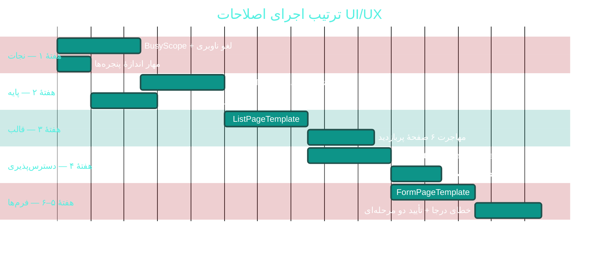

<div dir="rtl" align="right">

# 🛠 ۰۴ · سی اصلاح اجرایی رابط و تجربهٔ کاربری

<div align="center">


</div>

> [!NOTE]
> هر اقدام با **اولویت**، **تخمین تلاش** (روز کاری یک توسعه‌دهندهٔ WPF) و **معیار پذیرش قابل سنجش** آمده است. ترتیب پیشنهادی اجرا همان ترتیب جدول است.

---

> [!TIP]
> **برای اجرا:** این ۳۰ اقدام در [**چک‌لیست اجرایی**](10-implementation-checklist.md) با ترتیب صحیح پیاده‌سازی (فازهای ۱ تا ۳) و تیک بازچینی شده‌اند.

## 🅰 گروه ۱ — پایه‌ریزی سیستم طراحی (۵ اقدام)

<div align="center">

<table dir="rtl" width="100%">
<thead><tr><th width="4%">#</th><th width="24%">اقدام</th><th width="7%">اولویت</th><th width="6%">تلاش</th><th width="59%">چه کاری و چرا</th></tr></thead>
<tbody>
<tr><td>۱</td><td><b>ساخت <code>DesignTokens.xaml</code></b></td><td align="center">P1</td><td align="center">۲ روز</td><td>تعریف توکن برای رنگ‌ها (برند، موفق، هشدار، خطر، متن اصلی/ثانویه، سطح ۱–۳)، فاصله‌ها (۴/۸/۱۲/۱۶/۲۴)، شعاع گوشه و سایه. سپس جایگزینی تدریجی ۳۳۴ رنگ هاردکد با <code>DynamicResource</code> در ۱۰ صفحهٔ پربازدید.</td></tr>
<tr><td>۲</td><td><b>مقیاس تایپوگرافی ۶ سطحی</b></td><td align="center">P1</td><td align="center">۱ روز</td><td>جای ۴۰ اندازه: <code>Display 20 · H1 18 · H2 15 · Body 13 · Caption 11.5 · Micro 10</code>. همه به <code>App.BaseFontSize</code> مقیاس‌پذیر شوند تا تنظیم «اندازهٔ فونت» واقعاً روی کل برنامه اثر کند.</td></tr>
<tr><td>۳</td><td><b>قالب مشترک <code>ListPage</code></b></td><td align="center">P1</td><td align="center">۳ روز</td><td>یک <code>ControlTemplate</code>/<code>UserControl</code> با Slot برای: سربرگ، کارت‌های آماری، نوار ابزار، جدول، حالت خالی، حالت خطا، صفحه‌بندی، اسکلتون بارگذاری. بیماران/نوبت‌دهی/صندوق/داروخانه به آن مهاجرت کنند.</td></tr>
<tr><td>۴</td><td><b>قالب مشترک <code>FormPage</code></b></td><td align="center">P2</td><td align="center">۲ روز</td><td>شبکهٔ دوستونی + بخش‌بندی با عنوان + الگوی خطای فیلد + نوار چسبانِ «ذخیره/انصراف» در پایین. ۴۶ پنجرهٔ فرم به آن نزدیک شوند.</td></tr>
<tr><td>۵</td><td><b>حذف ناهمگونی آیکون و چیدمان سربرگ</b></td><td align="center">P3</td><td align="center">۱ روز</td><td>هر صفحه یک سربرگ با آیکون ۴۶px، عنوان ۱۸ و زیرعنوان ۱۱؛ گرادیان برند به‌جای ۸ گرادیان متفاوت.</td></tr>
</tbody>
</table>

</div>

**نمونهٔ کد توکن‌ها:**

```xml
<!-- App.Tokens.xaml -->
<ResourceDictionary xmlns="http://schemas.microsoft.com/winfx/2006/xaml/presentation">
    <!-- 🌈 رنگ: فقط ۶ نقش، نه ۳۳۴ رنگ -->
    <SolidColorBrush x:Key="App.Surface"      Color="{DynamicResource PrimaryHueLightBrush}" />
    <SolidColorBrush x:Key="App.SurfaceAlt"   Color="#F8FAFC" />
    <SolidColorBrush x:Key="App.TextPrimary"  Color="#0F172A" />
    <SolidColorBrush x:Key="App.TextMuted"    Color="#64748B" />
    <SolidColorBrush x:Key="App.Success"      Color="#16A34A" />
    <SolidColorBrush x:Key="App.Warning"      Color="#F59E0B" />
    <SolidColorBrush x:Key="App.Danger"       Color="#DC2626" />

    <!-- 📏 فاصله -->
    <sys:Double x:Key="App.Space.S">8</sys:Double>
    <sys:Double x:Key="App.Space.M">12</sys:Double>
    <sys:Double x:Key="App.Space.L">16</sys:Double>

    <!-- 🔤 تایپوگرافی مقیاس‌پذیر -->
    <Style x:Key="App.Text.Body" TargetType="TextBlock">
        <Setter Property="FontSize" Value="{DynamicResource App.BaseFontSize}" />
    </Style>
    <Style x:Key="App.Text.Caption" TargetType="TextBlock">
        <Setter Property="FontSize" Value="{DynamicResource App.FontSize.Caption}" />
    </Style>
</ResourceDictionary>
```

---

## 🅱 گروه ۲ — چرخهٔ عمر صفحه، بارگذاری و خطا (۶ اقدام)

<div align="center">

<table dir="rtl" width="100%">
<thead><tr><th width="4%">#</th><th width="24%">اقدام</th><th width="7%">اولویت</th><th width="6%">تلاش</th><th width="59%">چه کاری و چرا</th></tr></thead>
<tbody>
<tr><td>۶</td><td><b><code>BusyScope</code> برای همهٔ مدل‌نماها</b></td><td align="center">🔴 P0</td><td align="center">۳ روز</td><td>۱۷۷ نقطهٔ <code>IsBusy = true</code> در برابر ۷۶ <code>finally</code> ⇒ در قطعی شبکه صفحه برای همیشه «مشغول» می‌ماند. الگوی <code>using</code> جایگزین شود (کد پایین).</td></tr>
<tr><td>۷</td><td><b>حذف <code>_ = ...Async()</code> از سازنده‌ها</b></td><td align="center">🟠 P1</td><td align="center">۲ روز</td><td>۱۵۴ مورد. بارگذاری به رویداد <code>Loaded</code> صفحه یا <code>IAsyncInitialize</code> منتقل شود تا خطاها به Snackbar برسند، نه به <code>UnobservedTaskException</code>.</td></tr>
<tr><td>۸</td><td><b><code>CancellationToken</code> در ناوبری</b></td><td align="center">🟠 P1</td><td align="center">۲ روز</td><td>هر مدل‌نما یک <code>CancellationTokenSource</code> بگیرد؛ در خروج از صفحه لغو شود. جلوگیری از بازنویسی دادهٔ تازه با پاسخ کهنه.</td></tr>
<tr><td>۹</td><td><b>حالت‌های چهارگانهٔ فهرست</b></td><td align="center">P1</td><td align="center">۲ روز</td><td>هر فهرست باید چهار حالت داشته باشد: <b>بارگذاری (اسکلتون)</b>، <b>خالی</b>، <b>خطا با دکمهٔ «تلاش دوباره»</b>، <b>داده</b>. امروز فقط ۸ صفحه <code>EmptyState</code> دارند.</td></tr>
<tr><td>۱۰</td><td><b>صفحه‌بندی سروری برای همهٔ جدول‌ها</b></td><td align="center">P1</td><td align="center">۳ روز</td><td>۴۴ جدول، فقط ۳ صفحه‌بندی استاندارد. حداقل: <code>PageSize</code>، شمارندهٔ کل، و شناور «۱–۲۰ از ۳٬۴۵۲».</td></tr>
<tr><td>۱۱</td><td><b>نوار «آخرین به‌روزرسانی»</b></td><td align="center">P3</td><td align="center">۱ روز</td><td>صفحات با تازه‌سازی خودکار (۳۰–۶۰ ثانیه) باید نشان دهند داده از چه زمانی است و دکمهٔ «تازه‌سازی» داشته باشند.</td></tr>
</tbody>
</table>

</div>

**الگوی صحیح مشغول‌بودن:**

```csharp
// قبل (پرتکرار در ۷۳ مدل‌نما):
IsBusy = true;
var data = await _api.GetAsync<PatientsPage>(endpoint);   // ← اگر استثنا بدهد، IsBusy هرگز false نمی‌شود
IsBusy = false;

// بعد:
using var _ = BusyScope.Begin(this);          // در Dispose مقدار را به false برمی‌گرداند
try
{
    var data = await _api.GetAsync<PatientsPage>(endpoint, _page.Token);
    ...
}
catch (OperationCanceledException) { /* خروج از صفحه — طبیعی */ }
catch (Exception ex) { _snackbar.Error("دریافت فهرست ناموفق بود — اتصال به سرور را بررسی کنید"); _log.Error(ex); }

// BusyScope:
public readonly struct BusyScope : IDisposable
{
    private readonly ViewModelBase _vm;
    private BusyScope(ViewModelBase vm) { _vm = vm; vm.IsBusy = true; }
    public static BusyScope Begin(ViewModelBase vm) => new(vm);
    public void Dispose() => _vm.IsBusy = false;
}
```

---

## 🅲 گروه ۳ — دسترس‌پذیری و کیبورد (۶ اقدام)

<div align="center">

<table dir="rtl" width="100%">
<thead><tr><th width="4%">#</th><th width="24%">اقدام</th><th width="7%">اولویت</th><th width="6%">تلاش</th><th width="59%">چه کاری و چرا</th></tr></thead>
<tbody>
<tr><td>۱۲</td><td><b>نام دسترس‌پذیری برای کنترل‌های کلیدی</b></td><td align="center">🟠 P1</td><td align="center">۲ روز</td><td>۰ مورد <code>AutomationProperties</code> در کل برنامه. حداقل روی فرم‌های بیمار/پذیرش/نسخه/فاکتور: <code>AutomationProperties.Name</code> برای هر فیلد و دکمهٔ آیکونی.</td></tr>
<tr><td>۱۳</td><td><b>ترتیب پیمایش Tab درست</b></td><td align="center">P1</td><td align="center">۲ روز</td><td>هر فرم مسیر واضحی داشته باشد (بالا→پایین، راست→چپ RTL) و <code>TabIndex</code> صریح در فرم‌های کلیدی.</td></tr>
<tr><td>۱۴</td><td><b>میان‌برهای سراسری یکسان</b></td><td align="center">P1</td><td align="center">۲ روز</td><td>قرارداد: <kbd>F2</kbd> ذخیره · <kbd>F3</kbd> جدید · <kbd>F4</kbd> جستجو · <kbd>F5</kbd> تازه‌سازی · <kbd>Esc</kbd> انصراف · <kbd>Ctrl+K</kbd> جستجوی سراسری · <kbd>Ctrl+P</kbd> چاپ. امروز فقط <code>Ctrl+K</code> سراسری است.</td></tr>
<tr><td>۱۵</td><td><b>کنتراست و حالت فوکوس</b></td><td align="center">P1</td><td align="center">۱ روز</td><td>حلقهٔ فوکوس واضح (۲px، رنگ برند) روی همهٔ کنترل‌های تعاملی؛ کنتراست متن ثانویه حداقل ۴.۵:۱ در هر دو تم روشن و تیره.</td></tr>
<tr><td>۱۶</td><td><b>بزرگ‌نماییِ واقعی متن</b></td><td align="center">P2</td><td align="center">۱ روز</td><td>پس از اقدام ۲، تنظیم «اندازهٔ فونت پایه» در تنظیمات باید همهٔ صفحات را متأثر کند (امروز به‌دلیل هاردکدها فقط بخشی را بزرگ می‌کند).</td></tr>
<tr><td>۱۷</td><td><b>حالت پرکنتراست</b></td><td align="center">P3</td><td align="center">۱ روز</td><td>سه گزینه: استاندارد / پرکنتراست / بزرگ‌متن — پیش‌فرض برای کاربران بالای ۵۰ سال قابل انتخاب در اولین ورود.</td></tr>
</tbody>
</table>

</div>

---

## 🅳 گروه ۴ — اندازه، واکنش‌گرایی و چیدمان (۵ اقدام)

<div align="center">

<table dir="rtl" width="100%">
<thead><tr><th width="4%">#</th><th width="24%">اقدام</th><th width="7%">اولویت</th><th width="6%">تلاش</th><th width="59%">چه کاری و چرا</th></tr></thead>
<tbody>
<tr><td>۱۸</td><td><b>مهار پنجره‌ها به ناحیهٔ کاری</b></td><td align="center">🔴 P0</td><td align="center">۱ روز</td><td>در <code>App.xaml.cs</code>: هر پنجره در بارگذاری، <code>Height</code> را به <code>SystemParameters.WorkArea.Height - 40</code> محدود کند و <code>MaxHeight</code> بگذارد. ۱۶ پنجره بلندتر از ۷۰۰px وجود دارد.</td></tr>
<tr><td>۱۹</td><td><b>MinWidth/MinHeight و ResizeMode مناسب</b></td><td align="center">🟠 P1</td><td align="center">۱ روز</td><td>۱۷ پنجرهٔ <code>NoResize</code> باز شوند؛ برای دیالوگ‌های کوچک حداقل <code>SizeToContent="Height"</code>.</td></tr>
<tr><td>۲۰</td><td><b>بازبینی چیدمان جدول روز نوبت‌دهی</b></td><td align="center">P1</td><td align="center">۲ روز</td><td>تفکیک «تقویم ماه» و «جدول روز» با جابه‌جایی (Tab) یا چیدمان دو-سطحی؛ افزودن فیلتر پزشک/وضعیت.</td></tr>
<tr><td>۲۱</td><td><b>ارتفاع ثابت کارت‌های شاخص + حالت خالی درون‌کارتی</b></td><td align="center">P2</td><td align="center">۱ روز</td><td>حذف فضای سفید بزرگ در داشبورد/صندوق/بیماران با پیام «امروز موردی نیست» و آیکون.</td></tr>
<tr><td>۲۲</td><td><b>سوییچ شعبه در نوار بالا</b></td><td align="center">P2</td><td align="center">۱ روز</td><td>کاربر چندشعبه‌ای باید همیشه بداند در کدام شعبه است (نام + رنگ در نوار بالا).</td></tr>
</tbody>
</table>

</div>

```csharp
// App.xaml.cs — مهار خودکار پنجره‌ها به ناحیهٔ کاری (اقدام ۱۸)
window.Loaded += (_, _) =>
{
    var area = SystemParameters.WorkArea;
    if (window.Height > area.Height - 40)
    {
        window.MaxHeight = area.Height - 40;
        window.Height = area.Height - 40;
        window.WindowStartupLocation = WindowStartupLocation.CenterScreen;
    }
    if (window.MinHeight > area.Height - 40) window.MinHeight = area.Height - 80;
};
```

---

## 🅴 گروه ۵ — فرم‌ها، اعتبارسنجی و بازخورد (۵ اقدام)

<div align="center">

<table dir="rtl" width="100%">
<thead><tr><th width="4%">#</th><th width="24%">اقدام</th><th width="7%">اولویت</th><th width="6%">تلاش</th><th width="59%">چه کاری و چرا</th></tr></thead>
<tbody>
<tr><td>۲۳</td><td><b>خطای درجا و پرش فوکوس</b></td><td align="center">P1</td><td align="center">۲ روز</td><td>خطای هر فیلد زیر همان فیلد و قرمز شود + فوکوس به اولین فیلد خطادار برود. امروز خطا فقط بعد از ذخیره و به‌صورت Snackbar دیده می‌شود.</td></tr>
<tr><td>۲۴</td><td><b>گروه‌بندی بصری فرم‌ها</b></td><td align="center">P2</td><td align="center">۲ روز</td><td>فرم بیمار به سه بخش «هویت»، «تماس»، «بیمه و تکمیلی»؛ فرم پرسنل به «هویتی/شغلی/مالی». افزایش سرعت اسکن.<|?|> </td></tr>
<tr><td>۲۵</td><td><b>بازخورد ذخیره‌شدن</b></td><td align="center">P2</td><td align="center">۱ روز</td><td>در تنظیمات و فرم‌های خودذخیره: نشانگر «ذخیره شد ✓ ۱۲:۳۴» کنار عنوان؛ در فرم‌های دکمه‌دار: نوار چسبان با وضعیت «ذخیره‌نشده».</td></tr>
<tr><td>۲۶</td><td><b>تأیید دو مرحله‌ای برای عملیات مخرب</b></td><td align="center">P1</td><td align="center">۱ روز</td><td>بازیابی پشتیبان، حذف کاربر، ادغام پرونده: دیالوگ با تایپ عبارت («بازیابی»). امروز فقط تأیید ساده وجود دارد.</td></tr>
<tr><td>۲۷</td><td><b>الگوی «پذیرش سریع»</b></td><td align="center">P2</td><td align="center">۲ روز</td><td>برای بیمار تکراری: ۲ کلیک تا پذیرش (انتخاب نوبت امروز ← ثبت) بدون ویزارد کامل.</td></tr>
</tbody>
</table>

</div>

---

## 🅵 گروه ۶ — کشف‌پذیری و ریزتعامل (۳ اقدام)

<div align="center">

<table dir="rtl" width="100%">
<thead><tr><th width="4%">#</th><th width="24%">اقدام</th><th width="7%">اولویت</th><th width="6%">تلاش</th><th width="59%">چه کاری و چرا</th></tr></thead>
<tbody>
<tr><td>۲۸</td><td><b>راهنمای میان‌برها</b></td><td align="center">P2</td><td align="center">۱ روز</td><td>صفحهٔ «میان‌برها» با <kbd>?</kbd> یا <kbd>F1</kbd>؛ کپشن میان‌بر در Tooltip هر دکمه («ثبت بیمار جدید (F3)»).</td></tr>
<tr><td>۲۹</td><td><b>اسکلتون به‌جای اسپینر</b></td><td align="center">P3</td><td align="center">۲ روز</td><td>در بارگذاری اولیهٔ داشبورد/بیماران، اسکلتون ساختار صفحه نشان داده شود (زمان ادراک‌شده ۳۰–۴۰٪ کمتر).</td></tr>
<tr><td>۳۰</td><td><b>حالت خالی «آموزنده»</b></td><td align="center">P3</td><td align="center">۱ روز</td><td>در حالت خالی، دکمهٔ اقدام اصلی («ثبت اولین بیمار») + پیوند به مرکز آموزش.</td></tr>
</tbody>
</table>

</div>

---

## 📅 برنامهٔ اجرای پیشنهادی (۶ هفته)



---

## 📐 معیارهای پذیرش کلی (Definition of Done)

<div align="center">

<table dir="rtl" width="100%">
<thead><tr><th width="34%">شاخص</th><th width="16%">امروز</th><th width="16%">هدف</th><th width="34%">سنجش</th></tr></thead>
<tbody>
<tr><td>صفحات با ۴ حالت استاندارد</td><td align="center">~۲۰٪</td><td align="center">&gt; ۹۰٪</td><td>بازبینی کد (چک‌لیست)</td></tr>
<tr><td>جدول‌های صفحه‌بندی‌شده</td><td align="center">۳ از ۴۴</td><td align="center">۴۴ از ۴۴</td><td>جستجوی <code>PaginationBar</code></td></tr>
<tr><td>پنجره‌های سازگار با ۱۳۶۶×۷۶۸</td><td align="center">۳۲ از ۴۸</td><td align="center">۴۸ از ۴۸</td><td>آزمون دستی + اسکرین‌شات CI</td></tr>
<tr><td>کنترل‌های دارای نام دسترس‌پذیری</td><td align="center">۰</td><td align="center">&gt; ۲۰۰</td><td><code>grep AutomationProperties</code></td></tr>
<tr><td>رنگ هاردکد در نماها</td><td align="center">۳۳۴</td><td align="center">&lt; ۶۰</td><td><code>grep -o "#[0-9A-F]\{6\}"</code></td></tr>
<tr><td>اندازهٔ فونت متمایز</td><td align="center">~۴۰</td><td align="center">۶</td><td>بازبینی توکن‌ها</td></tr>
<tr><td>نقاط «مشغول» بدون <code>finally</code></td><td align="center">۱۰۱</td><td align="center">۰</td><td>تحلیل ایستا در CI</td></tr>
</tbody>
</table>

</div>

> [!IMPORTANT]
> **قاعدهٔ طلایی اجرا:** به هیچ صفحه‌ای «دست نزنید» مگر برای یکی از ۳۰ اقدام بالا. بازآرایی تدریجی (هر بار که صفحه‌ای را برای قابلیت جدید باز می‌کنید، به قالب مشترک منتقلش کنید) از یک پروژهٔ بازنویسی ۳ ماهه کم‌ریسک‌تر و سریع‌تر است.

</div>
