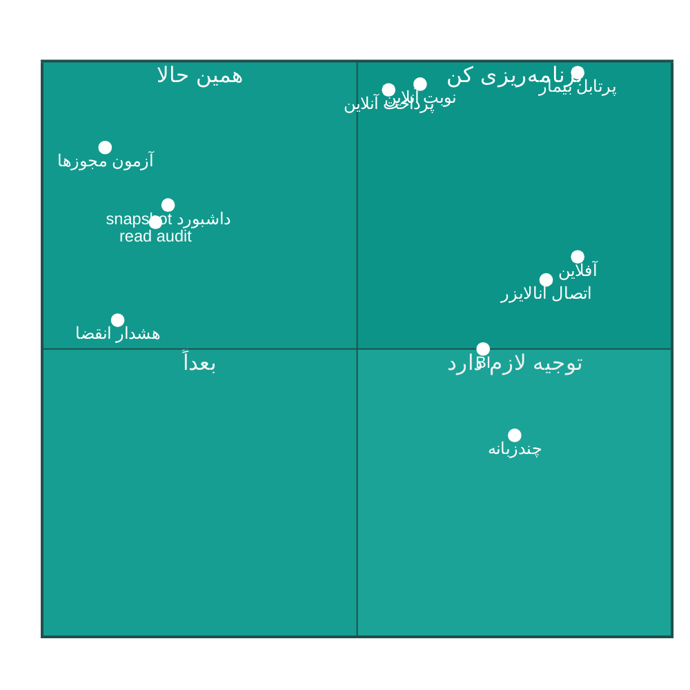

# 🧩 ۰۵ · ماتریس امکانات — چه هست، چه ناقص، چه اشتباه، چه نیست

---

> [!TIP]
> **برای اجرا:** ساخت این قابلیت‌ها در [**چک‌لیست اجرایی**](10-implementation-checklist.md) — فاز ۴ (افق یک‌ساله) و فاز ۵ (بک‌لاگ) — با تیک آمده است.

## 📊 بخش ۱ — ماتریس ماژول‌های اصلی

<table dir="rtl" width="100%">
<thead>
<tr><th width="18%">ماژول</th><th width="8%">وضعیت</th><th width="8%">عمق</th><th width="34%">آنچه واقعاً پیاده شده</th><th width="32%">آنچه کم دارد</th></tr>
</thead>
<tbody>
<tr><td>👥 <b>بیماران</b></td><td align="center">🟢 کامل</td><td align="center">۹۰٪</td><td>پروندهٔ کامل، اعتبارسنجی الگوریتمی کد ملی، بیمار بی‌هویت با کد موقت، ادغام پرونده، تایم‌لاین، یادداشت سریع، برچسب، عکس، بیمه، آلرژی</td><td>رضایت‌نامهٔ دیجیتال، نمای مقایسهٔ روند بالینی، خروجی PDF «خلاصهٔ پرونده» با یک کلیک</td></tr>
<tr><td>📅 <b>نوبت‌دهی</b></td><td align="center">🟢 کامل</td><td align="center">۸۸٪</td><td>تقویم جلالی، اسلات رنگی، کنترل ظرفیت، غیبت پزشک، تداخل زمانی بیمار، صف انتظار با پیشنهاد خودکار جای خالی، پیامک یادآوری دو موجی</td><td>نوبت آنلاین (خود بیمار)، لیست انتظار هوشمند خودکار (auto-fill)، تأیید حضور با QR</td></tr>
<tr><td>🧾 <b>پذیرش</b></td><td align="center">🟢 کامل</td><td align="center">۹۰٪</td><td>ویزارد ۴ گامه، استعلام/انتخاب بیمه، سهم بیمه از قواعد، لوازم مصرفیبا کسر انبار، رسید چاپی، نمایشگر سالن</td><td>پذیرش سریع بیمار تکراری، کیوسک نوبت‌گیری خودکار، پرداخت آنلاین</td></tr>
<tr><td>🩺 <b>ویزیت و EMR</b></td><td align="center">🟢 کامل</td><td align="center">۸۲٪</td><td>شرح حال، علائم حیاتی، ICD-10، بیماری زمینه‌ای، سابقهٔ خانوادگی، طرح مراقبت مزمن، منحنی رشد WHO، هشدار آلرژی</td><td>قالب‌های SOAP، مجموعه دستورات (Order Set)، امضای الکترونیک پزشک، نوار زمان بین ویزیت‌ها</td></tr>
<tr><td>💊 <b>نسخه‌نویسی</b></td><td align="center">🟢 کامل</td><td align="center">۸۵٪</td><td>کاتالوگ دارو (~۵٬۰۰۰ خط بذر)، هشدار تداخل، قالب نسخه، چاپ، QR راستی‌آزمایی</td><td>پیوند نسخه به موجودی داروخانه، دوز محاسبه‌شده بر وزن/سن کودکان، تکرار نسخهٔ قبلی با یک کلیک</td></tr>
<tr><td>🔬 <b>آزمایشگاه</b></td><td align="center">🟡 خوب</td><td align="center">۷۵٪</td><td>درخواست، کاتالوگ تست با بازهٔ مرجع جنسیت/سن، آستانهٔ بحرانی، ثبت نتیجه، برچسب نمونه QR، ارجاع بین‌بخشی</td><td><b>رابط دستگاه/آنالایزر (ASTM/HL7)</b>، کنترل کیفیت (QC)، تأیید دو مرحله‌ای نتیجه، نمودار روند شاخص</td></tr>
<tr><td>🖼 <b>تصویربرداری</b></td><td align="center">🟡 ناقص</td><td align="center">۵۰٪</td><td>درخواست، پیوست تصویر، خوانندهٔ DICOM پایه (۵۲۶ خط در Shared)</td><td>Window/Level، زوم و پن، اندازه‌گیری، سین، DICOM Web، ارسال به PACS</td></tr>
<tr><td>🦷 <b>دندان‌پزشکی</b></td><td align="center">🟢 کامل</td><td align="center">۸۰٪</td><td>چارت دندان، وضعیت، رویه‌ها، طرح درمان، پریودنتال، رادیوگرافی، رضایت‌نامه</td><td>نمای گرافیکی چارت با تعامل ماوس (بررسی)، پیوند به تصویربرداری</td></tr>
<tr><td>👁 <b>چشم‌پزشکی</b></td><td align="center">🟢 کامل</td><td align="center">۷۵٪</td><td>فرم اختصاصی معاینه، حدت بینایی، فشار چشم</td><td>نمای گرافیکی میدان بینایی، مقایسهٔ روند</td></tr>
<tr><td>🏃 <b>فیزیوتراپی</b></td><td align="center">🟢 کامل</td><td align="center">۷۸٪</td><td>نقشهٔ بدن ۲۶ ناحیه، جلسات درمان، طرح درمان</td><td>کتابخانهٔ تمرین با تصویر، پیگیری خانگی بیمار</td></tr>
<tr><td>💉 <b>داروخانه و انبار</b></td><td align="center">🟢 کامل</td><td align="center">۸۵٪</td><td>موجودی چندسری، انقضا، FEFO، تراکنش انبار، سفارش خرید، تأمین‌کننده، انبارگردانی</td><td>پیشنهاد خودکار سفارش بر اساس مصرف، بارکد اسکن، هشدار انقضای نزدیک در داشبورد</td></tr>
<tr><td>💰 <b>صندوق و فاکتور</b></td><td align="center">🟢 کامل</td><td align="center">۸۸٪</td><td>فاکتور چندقلمی، تخفیف، مالیات، پرداخت نقدی/کارتخوان/ترکیبی، ابطال و برگشت، بستن شیفت، رسید</td><td>پرداخت آنلاین/درگاه، تقسیط، نمای بدهکاران با یادآوری پیامکی</td></tr>
<tr><td>📒 <b>حسابداری دوبل</b></td><td align="center">🟢 کامل</td><td align="center">۸۲٪</td><td>کدینگ حساب، ماهیت، مرکز هزینه، سند متوازن، سال مالی، دفتر و تراز</td><td>صورت‌های مالی آماده (سود و زیان/ترازنامه) به‌صورت یک‌کلیک، بستن سال مالی خودکار</td></tr>
<tr><td>🛡 <b>بیمه</b></td><td align="center">🟢 کامل</td><td align="center">۷۸٪</td><td>شرکت‌های بیمه، قواعد fraction، درصد پوشش، استعلام آنلاین، مطالبات</td><td>ارسال دسته‌ای مطالبات، پیگیری وضعیت، مغایرت‌گیری</td></tr>
<tr><td>💵 <b>حقوق و دستمزد</b></td><td align="center">🟢 کامل</td><td align="center">۸۵٪</td><td><b>پلکان مالیات حقوق ۱۴۰۴ (ماده ۸۴)</b>، بیمه، معافیت، اضافه‌کاری، کسری، فیش چاپی، کمیسیون پزشک</td><td>ارسال لیست بیمه/مالیات در قالب رسمی، وام و مساعده، تسویهٔ پایان کار</td></tr>
<tr><td>👔 <b>پرسنل</b></td><td align="center">🟢 کامل</td><td align="center">۷۵٪</td><td>پرونده، قرارداد، سمت، دپارتمان، عکس، مدرک</td><td>ارزیابی عملکرد، آموزش و گواهی، مسیر ارتقا</td></tr>
<tr><td>⏰ <b>حضور و غیاب</b></td><td align="center">🟡 خوب</td><td align="center">۷۵٪</td><td>درایور ZKTeco و Hikvision + شبیه‌ساز، همگام‌سازی دقیقه‌ای، شیفت، اصلاحیه، تعطیلات، محاسبهٔ کارکرد</td><td>گردش تأیید مرخصی، اضافه‌کاری با تأیید مدیر، اثر انگشت ابری</td></tr>
<tr><td>📈 <b>گزارش‌ها</b></td><td align="center">🟢 کامل</td><td align="center">۸۰٪</td><td>گزارش مالی/عملکردی، گزارش نموداری، گزارش‌ساز Ad-hoc، خروجی Excel و PDF با سربرگ، زمان‌بندی</td><td>داشبورد تحلیلی (BI)، گزارش‌های مقایسه‌ای دوره‌ای، اشتراک‌گذاری گزارش</td></tr>
<tr><td>📨 <b>پیامک</b></td><td align="center">🟡 خوب</td><td align="center">۷۰٪</td><td>صف پیامک، قالب، ساعات سکوت، یادآوری خودکار نوبت، تاریخچه</td><td>پشتیبانی چند اپراتور (فقط کاوه‌نگار)، مدیریت اعتبار، لینک نظرسنجی در پیام</td></tr>
<tr><td>🔔 <b>اعلان بلادرنگ</b></td><td align="center">🟢 کامل</td><td align="center">۸۵٪</td><td>SignalR برای صف و اعلان کاربر، اولویت، خوانده‌شده</td><td>اعلان دسکتاپ ویندوز، صدا، کانال ایمیل</td></tr>
<tr><td>💾 <b>پشتیبان‌گیری</b></td><td align="center">🟢 کامل</td><td align="center">۸۸٪</td><td>BACKUP/RESTORE واقعی، ZIP، ارسال ابری S3 با رمزنگاری AES-GCM، ایمیل، نگهداشت، زمان‌بندی شبانه</td><td>آزمون خودکار بازیابی (restore drill)، نسخهٔ خارج از سایت، نمای «آخرین بازیابی موفق»</td></tr>
<tr><td>🔐 <b>لایسنس</b></td><td align="center">🟢 کامل</td><td align="center">۸۵٪</td><td>سرور PHP، فعال‌سازی آنلاین، امضای دیجیتال، تپ قلب روزانه، مهلت آفلاین، ۳۹ ماژول، پیام پشتیبانی زندهٔ پنل</td><td>انتقال لایسنس بین دستگاه‌ها، نسخهٔ آزمایشی محدود، پنل مشتری Libre</td></tr>
<tr><td>🗂 <b>آرشیو</b></td><td align="center">🟢 کامل</td><td align="center">۷۵٪</td><td>آرشیو سالانه با انتقال و حذف هدفمند</td><td>سیاست نگهداشت قابل تنظیم، نمای مقایسه‌ای آرشیو</td></tr>
<tr><td>📚 <b>آموزش</b></td><td align="center">🟢 کامل</td><td align="center">۷۰٪</td><td>کاتالوگ دوره، پیشرفت، تور گام‌به‌گام</td><td>آزمون پایان دوره، گواهی، ویدیوی درون‌برنامه</td></tr>
</tbody>
</table>

---

## 🟡 بخش ۲ — ده امکانات «ناقص»

<table dir="rtl" width="100%">
<thead><tr><th width="4%">#</th><th width="24%">قابلیت</th><th width="36%">وضعیت امروز</th><th width="36%">حداقل لازم برای «کامل» شدن</th></tr></thead>
<tbody>
<tr><td>۱</td><td>🖼 <b>نمایشگر DICOM</b></td><td>فقط نمایش تصویر؛ بدون Window/Level، زوم، اندازه‌گیری، سین. ۱۶۸ خط کد نما + ۵۲۶ خط خواننده</td><td>ابزارهای پایه: پنجره/سطح، زوم، پن، اندازه‌گیری فاصله، معکوس‌کردن روشنایی، صادرات PNG</td></tr>
<tr><td>۲</td><td>💳 <b>نسخهٔ الکترونیک</b></td><td>آداپتور عمومی <code>endpoint + token</code>؛ نه پروتکل رسمی TAK/TITK، نه امضای دیجیتال</td><td>پیاده‌سازی پروتکل رسمی بیمه/تیتک + امضا با کلید پزشک + پاسخ‌گویی به خطاهای استاندارد</td></tr>
<tr><td>۳</td><td>🏛 <b>سپاس</b></td><td>همان آداپتور عمومی با لاگ فراخوانی</td><td>تطبیق با سرویس واقعی، صف تلاش دوباره، گزارش مغایرت</td></tr>
<tr><td>۴</td><td>🔬 <b>اتصال آزمایشگاه به دستگاه</b></td><td>وجود ندارد؛ ورود کاملاً دستی</td><td>پارسر ASTM E1381/E1394 یا HL7 ORU برای حداقل ۳ مدل آنالایزر پرکاربرد</td></tr>
<tr><td>۵</td><td>🛡 <b>مطالبات بیمه</b></td><td>ثبت مطالبه و درصد پوشش؛ بدون ارسال دسته‌ای و پیگیری وضعیت</td><td>ساخت فایل/درخواست دسته‌ای، پیگیری وضعیت هر قلم، گزارش مغایرت</td></tr>
<tr><td>۶</td><td>📨 <b>پیامک</b></td><td>فقط کاوه‌نگار؛ بدون مدیریت اعتبار و صف جایگزین</td><td>حداقل یک اپراتور دوم + نمایش اعتبار + صف بازگشتی هنگام خطای اپراتور</td></tr>
<tr><td>۷</td><td>⏰ <b>مرخصی و اضافه‌کاری</b></td><td>ثبت مرخصی و محاسبهٔ کارکرد؛ بدون گردش تأیید</td><td>جریان تأیید (کارمند ← مدیر ← حقوق)، اعلان، اثر در حقوق</td></tr>
<tr><td>۸</td><td>🗂 <b>آرشیو</b></td><td>انتقال سالانه انجام می‌شود اما سیاست نگهداشت ثابت است</td><td>پیکربندی مدت نگهداشت + گزارش «چه چیزی آرشیو شد»</td></tr>
<tr><td>۹</td><td>📈 <b>گزارش‌ساز</b></td><td>ساخت گزارش پویا ممکن است؛ بدون پیش‌نمایش زنده و بدون اعتبارسنجی برای کاربر غیرفنی</td><td>پیش‌نمایش ۱۰ ردیف، محدودیت امنیتی کوئری، قالب ذخیره‌شده</td></tr>
<tr><td>۱۰</td><td>🔐 <b>لاگ عملیات</b></td><td>فقط نوشتن‌ها ثبت می‌شوند</td><td>ثبت «مشاهدهٔ پرونده» (read audit) برای انطباق و رسیدگی به شکایت</td></tr>
</tbody>
</table>

---

## 🔴 بخش ۳ — هشت امکانات «اشتباه پیاده‌شده»

<table dir="rtl" width="100%">
<thead><tr><th width="4%">#</th><th width="26%">مورد</th><th width="34%">چه اشتباهی وجود دارد</th><th width="36%">پیامد و اصلاح</th></tr></thead>
<tbody>
<tr>
<td>۱</td><td><b>مجوزهای ماژول‌های پیشرفته</b></td>
<td>۱۰ رشتهٔ مجوز در کنترلرها استفاده شده اما در بذر مجوزها وجود ندارد: <code>payroll.manage</code>، <code>emr.advanced</code>، <code>surveys.manage</code>، <code>surveys.view</code>، <code>sms.bulksend</code>، <code>pharmacy.stocktake</code>، <code>attendance.approve</code>، <code>attendance.devices</code>، <code>attendance.shifts</code>، <code>notifications.manage</code></td>
<td>🔴 این بخش‌ها <b>فقط با نقش «مدیر سامانه»</b> کار می‌کنند؛ تفکیک وظایف نقض می‌شود. <b>اصلاح:</b> افزودن به بذر + آزمون هم‌ترازی خودکار</td>
</tr>
<tr>
<td>۲</td><td><b>مجوزها داخل JWT</b></td>
<td>۱۵۶ ادعا در توکن مدیر ⇒ حجم ۸–۹KB؛ تغییر مجوز تا ۳۰ دقیقه اثر نمی‌کند</td>
<td>هر درخواست سنگین و ابطال دسترسی کند. <b>اصلاح:</b> توکن فقط نقش + <code>permVersion</code>؛ مجوزها در سرور با کش</td>
</tr>
<tr>
<td>۳</td><td><b>توکن تازه‌سازی متن‌ساده</b></td>
<td><code>RefreshToken.Token</code> بدون هش ذخیره می‌شود</td>
<td>نشت بکاپ = ورود ۷ روزه. <b>اصلاح:</b> ذخیرهٔ SHA-256 + ابطال خانوادگی هنگام استفادهٔ مجدد</td>
</tr>
<tr>
<td>۴</td><td><b>پرچم «مشغول» بدون خطاگیری</b></td>
<td>۱۷۷ نقطه <code>IsBusy = true</code> در برابر ۷۶ <code>finally</code></td>
<td>قفل دائمی رابط پس از یک خطای شبکه. <b>اصلاح:</b> <code>using var _ = BusyScope.Begin(this)</code></td>
</tr>
<tr>
<td>۵</td><td><b>بارگذاری خودکار در سازنده</b></td>
<td>۱۵۴ فراخوانی <code>_ = …Async()</code> بدون انتظار</td>
<td>خطاهای بی‌صدا، ترتیب نامطمئن، دادهٔ صفحهٔ قبلی روی صفحهٔ جدید. <b>اصلاح:</b> الگوی <code>IAsyncInitialize</code></td>
</tr>
<tr>
<td>۶</td><td><b>صفحه‌های Singleton + بازسازی نما</b></td>
<td>هر ناوبری: فرمان Refresh بازتابی + <code>CurrentPage = null</code></td>
<td>درخواست تکراری و مکث. <b>اصلاح:</b> کش صفحه + تازه‌سازی پس‌زمینه</td>
</tr>
<tr>
<td>۷</td><td><b>جستجوی <code>LIKE %…%</code></b></td>
<td>۶ ستون در فهرست بیماران + ۳ جستجوی موازی‌نشده در جستجوی سراسری</td>
<td>افت شدید در مقیاس. <b>اصلاح:</b> ایندکس full-text/trigram + جستجوی موازی</td>
</tr>
<tr>
<td>۸</td><td><b>مهاجرت خودکار در استارتاپ</b></td>
<td><code>Database:AutoMigrateOnStartup = true</code> پیش‌فرض</td>
<td>ریسک بالا آمدن کند/ناقص روی دیتابیس بزرگ. <b>اصلاح:</b> پیش‌فرض خاموش + نصب‌کننده مسئول مهاجرت</td>
</tr>
</tbody>
</table>

---

## ⬜ بخش ۴ — پانزده امکان «غایب» (با اولویت بازار ایران)

<table dir="rtl" width="100%">
<thead><tr><th width="4%">#</th><th width="28%">امکان</th><th width="10%">تقاضا</th><th width="10%">اثر</th><th width="48%">توضیح</th></tr></thead>
<tbody>
<tr><td>۱</td><td>🌐 <b>پرتابل بیمار</b></td><td align="center">🔴 بالا</td><td align="center">بسیار بالا</td><td>مشاهدهٔ نوبت، نتیجهٔ آزمایش، نسخه و پرداخت آنلاین. امروز هیچ نقطهٔ پایانی عمومی برای بیمار وجود ندارد.</td></tr>
<tr><td>۲</td><td>📱 <b>نوبت‌گیری آنلاین</b></td><td align="center">🔴 بالا</td><td align="center">بسیار بالا</td><td>لینک/QR برای بیمار، انتخاب پزشک و ساعت، تأیید پیامکی — بزرگ‌ترین مزیت رقابتی ممکن.</td></tr>
<tr><td>۳</td><td>💳 <b>درگاه پرداخت آنلاین</b></td><td align="center">🟠 متوسط</td><td align="center">بالا</td><td>پیش‌پرداخت نوبت، پرداخت بیعانه، کاهش «نوبت سوخته».</td></tr>
<tr><td>۴</td><td>🔗 <b>HL7 / FHIR</b></td><td align="center">🟡 کم</td><td align="center">بالا (سازمانی)</td><td>پیش‌نیاز اتصال به آزمایشگاه‌های مرجع، بیمارستان و پروندهٔ الکترونیک ملی.</td></tr>
<tr><td>۵</td><td>🧪 <b>رابط آنالایزر آزمایشگاه</b></td><td align="center">🟠 متوسط</td><td align="center">بالا</td><td>حذف ورود دستی نتایج؛ کاهش خطای انسانی در آزمایشگاه.</td></tr>
<tr><td>۶</td><td>✍️ <b>امضای الکترونیک</b></td><td align="center">🟠 متوسط</td><td align="center">بالا</td><td>امضای نسخه/گزارش با کلید پزشک (پیش‌نیاز نسخهٔ الکترونیک رسمی).</td></tr>
<tr><td>۷</td><td>📝 <b>رضایت‌نامهٔ دیجیتال</b></td><td align="center">🟠 متوسط</td><td align="center">بالا (حقوقی)</td><td>فرم رضایت با امضا روی تبلت و بایگانی در پرونده (اکنون فقط در ماژول دندان).</td></tr>
<tr><td>۸</td><td>🎥 <b>ویزیت آنلاین (تله‌مدیسین)</b></td><td align="center">🟡 کم</td><td align="center">متوسط</td><td>اتاق ویدیویی ساده برای ویزیت‌های پیگیری.</td></tr>
<tr><td>۹</td><td>🔁 <b>فراخوان خودکار بیماران مزمن</b></td><td align="center">🟠 متوسط</td><td align="center">بالا</td><td>بر اساس طرح مراقبت، پیامک/تماس خودکار برای مراجعهٔ بعدی.</td></tr>
<tr><td>۱۰</td><td>🖥 <b>کیوسک نوبت‌گیری</b></td><td align="center">🟡 کم</td><td align="center">متوسط</td><td>حالت لمسی برای سالن انتظار (نمایشگر سالن موجود است).</td></tr>
<tr><td>۱۱</td><td>📦 <b>پیشنهاد خودکار سفارش انبار</b></td><td align="center">🟠 متوسط</td><td align="center">متوسط</td><td>بر اساس مصرف میانگین و نقطهٔ سفارش (نقطهٔ سفارش ثبت می‌شود ولی پیشنهاد ساخته نمی‌شود).</td></tr>
<tr><td>۱۲</td><td>📊 <b>ماژول BI/آنالیتیکس</b></td><td align="center">🟠 متوسط</td><td align="center">متوسط</td><td>داشبورد مقایسهٔ دوره‌ای، سهم پزشک، نرخ عدم حضور، تحلیل درآمد به‌تفکیک خدمت.</td></tr>
<tr><td>۱۳</td><td>🌍 <b>چندزبانه</b></td><td align="center">🟡 کم</td><td align="center">متوسط</td><td>بدون <code>.resx</code> ممکن نیست؛ برای شعبه‌های کرد/عرب‌زبان و صادرات لازم است.</td></tr>
<tr><td>۱۴</td><td>📴 <b>حالت آفلاین/قطعی شبکه</b></td><td align="center">🟠 متوسط</td><td align="center">بالا</td><td>در قطعی برق/شبکه، پذیرش باید حداقل صف موقت ثبت کند و بعد همگام شود.</td></tr>
<tr><td>۱۵</td><td>🔔 <b>اعلان دسکتاپ ویندوز</b></td><td align="center">🟠 متوسط</td><td align="center">متوسط</td><td>Toast ویندوز برای نوبت جدید/پیام پشتیبانی، حتی وقتی پنجره کمینه است.</td></tr>
</tbody>
</table>

> [!TIP]
> از میان این ۱۵ مورد، **سه مورد ۱، ۲ و ۳ (پرتابل + نوبت آنلاین + پرداخت)** بیشترین اثر تجاری را دارند و می‌توانند به‌تنهایی نسخهٔ ۳.۰ محصول را بسازند. مورد ۱۴ (آفلاین) بیشترین اثر عملیاتی روزمره را دارد.

---

## 💡 بخش ۵ — سی‌وشش قابلیت پیشنهادی (مرتب بر اساس بازده)

<table dir="rtl" width="100%">
<thead><tr><th width="4%">#</th><th width="30%">قابلیت</th><th width="10%">اثر</th><th width="10%">تلاش</th><th width="46%">یادداشت اجرایی</th></tr></thead>
<tbody>
<tr><td>۱</td><td>نوبت‌گیری آنلاین با لینک امن</td><td align="center">⭐⭐⭐⭐⭐</td><td align="center">متوسط</td><td>توکن امضاشده با انقضا؛ همان موتور ظرفیت فعلی، بدون تغییر منطق</td></tr>
<tr><td>۲</td><td>پرتابل بیمار (نتیجه/نوبت/نسخه)</td><td align="center">⭐⭐⭐⭐⭐</td><td align="center">بالا</td><td>ورود با کد ملی + OTP پیامکی؛ در فاز اول فقط خواندنی</td></tr>
<tr><td>۳</td><td>پرداخت آنلاین نوبت/فاکتور</td><td align="center">⭐⭐⭐⭐⭐</td><td align="center">متوسط</td><td>درگاه + ثبت خودکار پرداخت با کد رهگیری</td></tr>
<tr><td>۴</td><td>قالب چهارحالتهٔ فهرست (بخش ۰۴)</td><td align="center">⭐⭐⭐⭐</td><td align="center">کم</td><td>پیش‌نیاز همهٔ بهبودهای UI</td></tr>
<tr><td>۵</td><td>REST تجمیعی <code>/dashboard/snapshot</code></td><td align="center">⭐⭐⭐⭐</td><td align="center">کم</td><td>۷ رفت‌وبرگشت کمتر برای هر ورود</td></tr>
<tr><td>۶</td><td>کش صفحه با تازه‌سازی پس‌زمینه</td><td align="center">⭐⭐⭐⭐</td><td align="center">متوسط</td><td>رفع مکث ناوبری و درخواست تکراری</td></tr>
<tr><td>۷</td><td>آزمون هم‌ترازی مجوزها در CI</td><td align="center">⭐⭐⭐⭐</td><td align="center">خیلی کم</td><td>پیشگیری دائمی از کلاس خطای P0</td></tr>
<tr><td>۸</td><td>سیستم طراحی + توکن</td><td align="center">⭐⭐⭐⭐</td><td align="center">متوسط</td><td>پایهٔ سرعت توسعهٔ UI در آینده</td></tr>
<tr><td>۹</td><td>صفحه‌خوان و پیمایش کیبورد</td><td align="center">⭐⭐⭐⭐</td><td align="center">متوسط</td><td>شرط ورود به مناقصه‌های دولتی</td></tr>
<tr><td>۱۰</td><td>ثبت دسترسی به پرونده (read audit)</td><td align="center">⭐⭐⭐⭐</td><td align="center">کم</td><td>یک middleware + جدول؛ الزام انطباق</td></tr>
<tr><td>۱۱</td><td>رضایت‌نامهٔ دیجیتال سراسری</td><td align="center">⭐⭐⭐</td><td align="center">متوسط</td><td>الگوی فرم + امضا روی صفحهٔ لمسی</td></tr>
<tr><td>۱۲</td><td>فراخوان خودکار بیمار مزمن</td><td align="center">⭐⭐⭐</td><td align="center">متوسط</td><td>Hangfire ماهانه + قالب پیامک</td></tr>
<tr><td>۱۳</td><td>پیشنهاد سفارش انبار</td><td align="center">⭐⭐⭐</td><td align="center">کم</td><td>محاسبهٔ مصرف ۹۰ روز گذشته</td></tr>
<tr><td>۱۴</td><td>هشدار انقضای نزدیک در داشبورد</td><td align="center">⭐⭐⭐</td><td align="center">خیلی کم</td><td>کوئری ساده + کارت موجود</td></tr>
<tr><td>۱۵</td><td>ویزارد «نسخهٔ قبلی» برای بیمار</td><td align="center">⭐⭐⭐</td><td align="center">کم</td><td>کپی اقلام با یک کلیک</td></tr>
<tr><td>۱۶</td><td>نمای بدهکاران + یادآوری پیامکی</td><td align="center">⭐⭐⭐</td><td align="center">کم</td><td>گزارش موجود + قالب پیامک</td></tr>
<tr><td>۱۷</td><td>صورت‌های مالی یک‌کلیکی</td><td align="center">⭐⭐⭐</td><td align="center">متوسط</td><td>سود و زیان/ترازنامه از اسناد موجود</td></tr>
<tr><td>۱۸</td><td>افزونهٔ دیدگاه بیمار روی نتایج</td><td align="center">⭐⭐⭐</td><td align="center">کم</td><td>رشتهٔ توضیح پزشک روی آزمایش</td></tr>
<tr><td>۱۹</td><td>گزارش «عملکرد من» برای پزشک</td><td align="center">⭐⭐⭐</td><td align="center">کم</td><td>استفادهٔ دوباره از گزارش عملکرد موجود</td></tr>
<tr><td>۲۰</td><td>اعلان دسکتاپ ویندوز</td><td align="center">⭐⭐⭐</td><td align="center">کم</td><td>NotifyIcon + SignalR فعلی</td></tr>
<tr><td>۲۱</td><td>حالت آفلاین صف پذیرش</td><td align="center">⭐⭐⭐</td><td align="center">بالا</td><td>ذخیرهٔ محلی + همگام‌سازی با تعارض‌زدایی</td></tr>
<tr><td>۲۲</td><td>کیوسک نوبت‌گیری لمسی</td><td align="center">⭐⭐</td><td align="center">متوسط</td><td>حالت تمام‌صفحهٔ همان ویزارد پذیرش</td></tr>
<tr><td>۲۳</td><td>اپلیکیشن موبایل پزشک</td><td align="center">⭐⭐⭐</td><td align="center">بالا</td><td>مصرف API موجود با توکن محدود</td></tr>
<tr><td>۲۴</td><td>BI و داشبورد تحلیلی</td><td align="center">⭐⭐⭐</td><td align="center">بالا</td><td>مدل دادهٔ ستاره‌ای روی ReportingDbContext</td></tr>
<tr><td>۲۵</td><td>چندزبانه (fa/en/ar/ku)</td><td align="center">⭐⭐</td><td align="center">بالا</td><td>نیازمند استخراج رشته‌ها به <code>.resx</code></td></tr>
<tr><td>۲۶</td><td>امضای الکترونیک اسناد</td><td align="center">⭐⭐⭐</td><td align="center">متوسط</td><td>گواهی + هش سند</td></tr>
<tr><td>۲۷</td><td>اتصال به آنالایزر آزمایشگاه</td><td align="center">⭐⭐⭐</td><td align="center">بالا</td><td>سرویس ویندوزی ASTM → API</td></tr>
<tr><td>۲۸</td><td>گزارش مغایرت بیمه</td><td align="center">⭐⭐⭐</td><td align="center">متوسط</td><td>مقایسهٔ سهم پرداختی و مطالبه</td></tr>
<tr><td>۲۹</td><td>گردش تأیید مرخصی</td><td align="center">⭐⭐</td><td align="center">متوسط</td><td>وضعیت درخواست + اعلان</td></tr>
<tr><td>۳۰</td><td>سبد بازیابی (Recycle Bin) پرونده</td><td align="center">⭐⭐⭐</td><td align="center">کم</td><td>حذف نرم موجود است؛ فقط نمای بازیابی لازم است</td></tr>
<tr><td>۳۱</td><td>جستجوی صوتی فارسی</td><td align="center">⭐⭐</td><td align="center">متوسط</td><td>Web Speech یا سرویس محلی</td></tr>
<tr><td>۳۲</td><td>پیش‌بینی عدم حضور (no-show)</td><td align="center">⭐⭐⭐</td><td align="center">متوسط</td><td>امتیاز ساده بر اساس سابقه — بدون ML سنگین</td></tr>
<tr><td>۳۳</td><td>پیشنهاد ساعت به بیمار (waitlist هوشمند)</td><td align="center">⭐⭐⭐</td><td align="center">کم</td><td>منطق «پیشنهاد جای خالی» موجود است؛ فقط پیامک لازم دارد</td></tr>
<tr><td>۳۴</td><td>داشبورد پشتیبانی زنده برای همهٔ مشتریان</td><td align="center">⭐⭐</td><td align="center">متوسط</td><td>در سرور لایسنس</td></tr>
<tr><td>۳۵</td><td>ثبت بازخورد درون‌برنامه</td><td align="center">⭐⭐</td><td align="center">خیلی کم</td><td>دکمهٔ «انتقاد/پیشنهاد» + ارسال به پشتیبانی</td></tr>
<tr><td>۳۶</td><td>گزارش آزمون بازیابی بکاپ</td><td align="center">⭐⭐⭐</td><td align="center">کم</td><td>بازیابی خودکار در محیط آزمایشی ماهانه</td></tr>
</tbody>
</table>

---

## 🎯 جمع‌بندی: نقشهٔ شکاف امکانات

> [!NOTE]
> ناحیهٔ «همین حالا» (اثر بالا، تلاش کم) چهار مورد دارد: **آزمون هم‌ترازی مجوزها**، **ثبت دسترسی به پرونده**، **اندپوینت تجمیعی داشبورد** و **هشدار انقضای انبار**. این چهار مورد در مجموع کمتر از ۵ روز کار هستند و بیشترین بازده را دارند.

