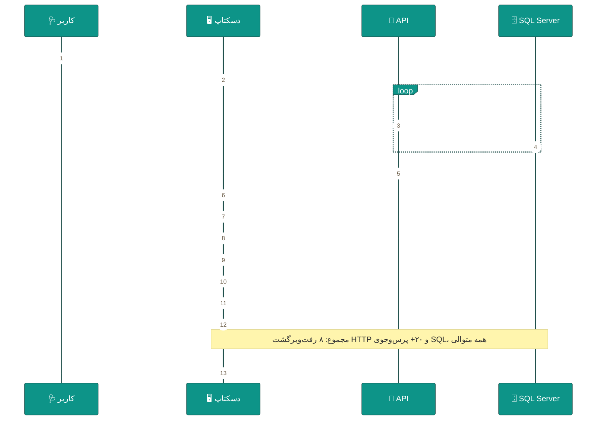

<div dir="rtl" align="right">

# ⚡ ۰۷ · کارایی و سرعت — تحلیل و ۲۵ بهینه‌سازی

<div align="center">


</div>

> [!WARNING]
> **محدودهٔ صداقت:** این بخش بر پایهٔ **بازبینی ایستای کد** (تعداد رفت‌وبرگشت‌ها، الگوی کوئری، سقف حافظه، رشتهٔ اجرا) نوشته شده است، نه اندازه‌گیری زنده روی دیتابیس واقعی. اعداد «برآورد» با فرض شبکهٔ محلی ۱Gbps و SQL Server روی همان سرور هستند. بخش ۶ طرح اندازه‌گیری دقیق را می‌دهد تا پیش از/پس از اصلاح، اعداد واقعی خودتان را داشته باشید.

---

## 🔍 بخش ۱ — آنچه امروز هنگام باز کردن صفحه‌ها رخ می‌دهد



**ریشهٔ کندی در سه عدد خلاصه می‌شود:**

<div align="center">

| نشانگر | مقدار امروز | چرا مهم است |
|:--|:--:|:--|
| فراخوانی متوالی در بارگذاری داشبورد | **۸** | <code>DashboardViewModel.cs:1395 → 1684</code> |
| پرس‌وجوی SQL داخل فقط <code>/dashboard/stats</code> | **۱۱** | <code>DashboardController.cs:67-119</code> |
| ستون‌های <code>LIKE '%…%'</code> در فهرست بیماران | **۶** | <code>GetAllPatientsQueryHandler.cs:44-49</code> |

</div>

---

## 📉 بخش ۲ — پروفایل کارایی (برآورد قبل / بعد)

<div align="center">

<table dir="rtl" width="100%">
<thead><tr><th width="26%">عملیات</th><th width="18%">امروز (برآورد)</th><th width="18%">پس از بهینه‌سازی</th><th width="38%">علت اصلی کندی</th></tr></thead>
<tbody>
<tr><td>🚀 راه‌اندازی برنامه تا صفحهٔ ورود</td><td align="center">۲–۵ ثانیه</td><td align="center">۱–۲ ثانیه</td><td>بارگذاری ۲۸ سرویس، مهاجرت خودکار DB، بررسی لایسنس، پیش‌بارگذاری ۱۹ نما</td></tr>
<tr><td>🔐 ورود تا داشبورد کامل</td><td align="center">۲–۴ ثانیه</td><td align="center">۰٫۶–۱ ثانیه</td><td>۸ فراخوانی متوالی + ۱۱ پرس‌وجوی KPI + حجم JWT</td></tr>
<tr><td>📋 فهرست بیماران (۲۰٬۰۰۰ پرونده)</td><td align="center">۰٫۴–۱٫۵ ثانیه</td><td align="center">۰٫۱–۰٫۳ ثانیه</td><td><code>LIKE %</code> روی ۶ ستون + نگاشت در حافظه + <code>Include</code> اضافی</td></tr>
<tr><td>🧭 جابه‌جایی بین صفحه‌ها</td><td align="center">۰٫۵–۱٫۲ ثانیه</td><td align="center">۰٫۱–۰٫۲ ثانیه</td><td>بازسازی نما + فرمان Refresh بازتابی + درخواست تکراری</td></tr>
<tr><td>🔎 جستجوی سراسری (هر تایپ)</td><td align="center">۰٫۳–۰٫۸ ثانیه</td><td align="center">۰٫۱–۰٫۲ ثانیه</td><td>۳ کوئری متوالی + Debounce ۲۵۰ms + تجزیهٔ همهٔ بیماران</td></tr>
<tr><td>📄 گزارش PDF با ۲٬۰۰۰ ردیف</td><td align="center">۳–۸ ثانیه</td><td align="center">۱–۳ ثانیه</td><td>ساخت کامل در حافظه؛ بدون استریم</td></tr>
<tr><td>💾 ذخیرهٔ فاکتور چندقلمی</td><td align="center">۰٫۳–۰٫۶ ثانیه</td><td align="center">۰٫۲–۰٫۴ ثانیه</td><td>بارگذاری کل موجودی/کاتالوگ برای پیش‌نمایش</td></tr>
<tr><td>📊 گزارش مالی یک ماهه</td><td align="center">۲–۶ ثانیه</td><td align="center">۰٫۸–۲ ثانیه</td><td><code>Include</code> زنجیره‌ای + محاسبه در حافظه</td></tr>
</tbody>
</table>

</div>

---

## 🎯 بخش ۳ — ۲۵ بهینه‌سازی، مرتب بر اساس بازده

### 🔌 لایهٔ API و پایگاه داده (۱۰ مورد)

<div align="center">

<table dir="rtl" width="100%">
<thead><tr><th width="4%">#</th><th width="26%">بهینه‌سازی</th><th width="8%">سود</th><th width="7%">تلاش</th><th width="55%">شرح و شاهد</th></tr></thead>
<tbody>
<tr><td><b>P-01</b></td><td><b>اندپوینت تجمیعی <code>/dashboard/snapshot</code></b></td><td align="center">🔴 بسیار زیاد</td><td align="center">۲ روز</td><td>یک درخواست، یک پرس‌وجو با <code>GROUP BY</code> شرطی برای ۱۱ شاخص؛ پاسخ <code>DashboardSnapshotDto</code>. حذف ۸ رفت‌وبرگشت.</td></tr>
<tr><td><b>P-02</b></td><td><b>یک‌پاس‌سازی KPI ها</b></td><td align="center">🔴 بسیار زیاد</td><td align="center">۱ روز</td><td>جای ۱۱ <code>CountAsync/SumAsync</code> مستقل: یک <code>Select</code> با <code>Count()</code> شرطی و <code>Sum()</code> شرطی.</td></tr>
<tr><td><b>P-03</b></td><td><b>جستجوی ایندکس‌پذیر</b></td><td align="center">🔴 بسیار زیاد</td><td align="center">۲ روز</td><td><code>LIKE '%term%'</code> به full-text یا ستون نرمال‌شدهٔ <code>SearchText</code> با ایندکس <code>trigram</code>/پیشوندی تغییر کند.</td></tr>
<tr><td><b>P-04</b></td><td><b>تصویرسازی مستقیم DTO</b></td><td align="center">🟠 زیاد</td><td align="center">۲ روز</td><td><code>.Select(p =&gt; new PatientListItem(...))</code> به‌جای <code>Include</code> + نگاشت در حافظه (D-15).</td></tr>
<tr><td><b>P-05</b></td><td><b>موازی‌سازی جستجوی سراسری</b></td><td align="center">🟠 زیاد</td><td align="center">۰٫۵ روز</td><td>۳ کوئری مستقل با <code>Task.WhenAll</code> روی <code>IDbContextFactory</code> (نه DbContext مشترک).</td></tr>
<tr><td><b>P-06</b></td><td><b>کش کوتاه‌مدت KPI ها</b></td><td align="center">🟠 زیاد</td><td align="center">۱ روز</td><td><code>IMemoryCache</code> با کلید «شعبه + دقیقه» و انقضای ۳۰ ثانیه؛ ابطال با رویدادهای SignalR.</td></tr>
<tr><td><b>P-07</b></td><td><b>ایندکس‌های پوشا</b></td><td align="center">🟠 زیاد</td><td align="center">۱ روز</td><td>۲٬۰۰۳ ایندکس موجود عمدتاً تک‌ستونه‌اند؛ برای پرس‌وجوهای داغ ایندکس مرکب <code>(BranchId, AppointmentDate, Status)</code> و <code>(BranchId, InvoiceDate, Status)</code>.</td></tr>
<tr><td><b>P-08</b></td><td><b>خواندن بدون ردیابی در گزارش‌ها</b></td><td align="center">🟡 متوسط</td><td align="center">۰٫۵ روز</td><td><code>AsNoTracking()</code> در همهٔ مسیرهای خواندنی؛ کاهش تخصیص حافظه و زمان جست‌وجوی تغییرات.</td></tr>
<tr><td><b>P-09</b></td><td><b>حذف <code>Include</code>های زنجیره‌ای در گزارش مالی</b></td><td align="center">🟡 متوسط</td><td align="center">۱ روز</td><td>گزارش با دو کوئری تجمیعی + اتصال در حافظه انجام شود (به‌جای درخت عمیق).</td></tr>
<tr><td><b>P-10</b></td><td><b>تقسیم صفحه‌های سنگین به صفحه‌بندی سروری</b></td><td align="center">🟠 زیاد</td><td align="center">۲ روز</td><td>حذف ۱۰ فراخوانی با <code>pageSize ≥ ۱۰۰</code> (تا ۵۰۰) و جایگزینی با جستجو + صفحه‌بندی کوچک.</td></tr>
</tbody>
</table>

</div>

**نمونهٔ کد P-01/P-02 — یک پرس‌وجو به‌جای ۱۱ پرس‌وجو:**

```csharp
// قبل: ۱۱ رفت‌وبرگشت به دیتابیس، همه متوالی (DashboardController.cs:67-119)
var newPatients      = await Patients.CountAsync(...);
var todayAppointments = await Appointments.CountAsync(...);
var activeAppointments = await Appointments.CountAsync(...);
// ...۸ مورد دیگر

// بعد: یک پرس‌وجو، همهٔ شاخص‌ها با تجمیع شرطی
var stats = await _db.Appointments
    .Where(a => a.AppointmentDate >= dayStart && a.AppointmentDate < dayEnd)
    .GroupBy(_ => 1)
    .Select(g => new
    {
        Total     = g.Count(),
        Active    = g.Count(a => a.Status == AppointmentStatus.Confirmed
                              || a.Status == AppointmentStatus.InProgress),
        Cancelled = g.Count(a => a.Status == AppointmentStatus.Cancelled),
        NoShow    = g.Count(a => a.Status == AppointmentStatus.NoShow)
    })
    .FirstOrDefaultAsync(ct);

var money = await _db.Payments
    .Where(p => p.PaymentDate >= dayStart && p.PaymentDate < dayEnd)
    .GroupBy(_ => 1)
    .Select(g => new {
        Revenue   = g.Sum(p => p.IsReturned ? -p.Amount : p.Amount),
        Count     = g.Count()
    })
    .FirstOrDefaultAsync(ct);
// ⇒ ۲ کوئری به جای ۱۱؛ و هر دو مستقل ⇒ قابل موازی‌سازی روی DbContextFactory
```

---

### 🖥 لایهٔ کلاینت (WPF) (۹ مورد)

<div align="center">

<table dir="rtl" width="100%">
<thead><tr><th width="4%">#</th><th width="26%">بهینه‌سازی</th><th width="8%">سود</th><th width="7%">تلاش</th><th width="55%">شرح و شاهد</th></tr></thead>
<tbody>
<tr><td><b>P-11</b></td><td><b>کش صفحه + تازه‌سازی پس‌زمینه</b></td><td align="center">🔴 بسیار زیاد</td><td align="center">۳ روز</td><td>حذف <code>CurrentPage = null</code> و بازسازی نما در <code>MainWindowViewModel.cs:1166-1190</code>؛ نمایش فوری محتوای قبلی و به‌روزرسانی بی‌صدا.</td></tr>
<tr><td><b>P-12</b></td><td><b>حذف فرمان Refresh بازتابی</b></td><td align="center">🟠 زیاد</td><td align="center">۱ روز</td><td>ناوبری از <code>Activator</code>/انعکاس فاصله بگیرد؛ قرارداد <code>INavigablePage.LoadAsync()</code>.</td></tr>
<tr><td><b>P-13</b></td><td><b>مجازی‌سازی جدول‌ها</b></td><td align="center">🟠 زیاد</td><td align="center">۱ روز</td><td>فقط ۱۳ مورد <code>VirtualizingPanel</code> در کل نماها؛ روی همهٔ <code>DataGrid</code>ها <code>EnableRowVirtualization</code> و ارتفاع ثابت ردیف.</td></tr>
<tr><td><b>P-14</b></td><td><b>Debounce یکسان برای جستجو</b></td><td align="center">🟠 زیاد</td><td align="center">۰٫۵ روز</td><td>الگوی واحد ۳۰۰ms با <code>DispatcherTimer</code> در <code>ViewModelBase</code>؛ امروز هر مدل‌نما نسخهٔ خودش را دارد.</td></tr>
<tr><td><b>P-15</b></td><td><b>کاهش پیمایش‌های چیدمان</b></td><td align="center">🟡 متوسط</td><td align="center">۲ روز</td><td>جای ۵۷ <code>ScrollViewer</code> تودرتو، یک ScrollViewer بیرونی + <code>StackPanel</code> سبک؛ حذف سایه‌های تودرتو (DropShadow ۳ لایه).</td></tr>
<tr><td><b>P-16</b></td><td><b>بارگذاری تنبل تب‌ها</b></td><td align="center">🟡 متوسط</td><td align="center">۱ روز</td><td>در «مدیریت سامانه» با ۶ تب و «تنظیمات» با ۶ تب، محتوای تب فقط در اولین انتخاب ساخته شود.</td></tr>
<tr><td><b>P-17</b></td><td><b>سبک‌سازی <code>MainWindow.xaml</code></b></td><td align="center">🟡 متوسط</td><td align="center">۱ روز</td><td>۱٬۱۰۹ خط که همهٔ ۱۹ آیتم منو، نوار بالا و اعلان‌ها را در یک درخت دارد؛ شکستن به <code>UserControl</code>های کوچک، زمان تحلیل XAML را کم می‌کند.</td></tr>
<tr><td><b>P-18</b></td><td><b>حذف تایمرهای بیدارکننده</b></td><td align="center">🟡 متوسط</td><td align="center">۰٫۵ روز</td><td>۳۸ ارجاع تایمر، از جمله ساعت هر ثانیه و نظرسنجی ۳۰/۶۰ ثانیه‌ای. ساعت با <code>DispatcherTimer</code> ۱۰ ثانیه‌ای (نمایش دقیقه) کافی است.</td></tr>
<tr><td><b>P-19</b></td><td><b>کاهش حجم JWT</b></td><td align="center">🟠 زیاد</td><td align="center">۱٫۵ روز</td><td>۱۵۶ ادعا (۸–۹KB) در هر درخواست گنجانده می‌شود؛ با <code>permVersion</code> حجم به ~۱KB می‌رسد.</td></tr>
</tbody>
</table>

</div>

---

### 🌐 شبکه، سریال‌سازی و فایل (۴ مورد)

<div align="center">

<table dir="rtl" width="100%">
<thead><tr><th width="4%">#</th><th width="25%">بهینه‌سازی</th><th width="8%">سود</th><th width="7%">تلاش</th><th width="56%">شرح</th></tr></thead>
<tbody>
<tr><td><b>P-20</b></td><td>فشرده‌سازی پاسخ (تأیید پیکربندی)</td><td align="center">🟡 متوسط</td><td align="center">۰٫۲ روز</td><td>روشن است؛ اما <code>EnableForHttps</code> و حداقل اندازه را تنظیم کنید و از gzip برای SignalR استفاده نکنید.</td></tr>
<tr><td><b>P-21</b></td><td>استریم خروجی PDF/Excel</td><td align="center">🟠 زیاد</td><td align="center">۲ روز</td><td>به‌جای ساخت کامل در حافظه، <code>FileStreamResult</code> با بافر ۶۴KB؛ در گزارش‌های بزرگ صرفه‌جویی حافظهٔ چشمگیر.</td></tr>
<tr><td><b>P-22</b></td><td>مخزن موقت تولید برچسب/QR</td><td align="center">🟡 متوسط</td><td align="center">۰٫۵ روز</td><td>تولید QR درون‌برنامه؛ نتایج با کلید محتوا کش شوند تا برچسب‌های تکراری دوباره ساخته نشوند.</td></tr>
<tr><td><b>P-23</b></td><td>صف و حجم پیامک</td><td align="center">🟢 کم</td><td align="center">۰٫۵ روز</td><td>ارسال انبوه در HarfFire Job با دستهٔ ۱۰۰ تایی و تأخیر؛ جلوگیری از مسدودشدن API اپراتور.</td></tr>
</tbody>
</table>

</div>

---

### 🧪 سنجش و نگهداشت (۲ مورد)

<div align="center">

<table dir="rtl" width="100%">
<thead><tr><th width="4%">#</th><th width="25%">بهینه‌سازی</th><th width="8%">سود</th><th width="7%">تلاش</th><th width="56%">شرح</th></tr></thead>
<tbody>
<tr><td><b>P-24</b></td><td>بنچمارک خودکار در CI</td><td align="center">🟠 زیاد</td><td align="center">۲ روز</td><td>۵ سناریوی داغ با <code>BenchmarkDotNet</code> یا اسکریپت بار؛ شکست اگر p95 بیش از بودجه شد.</td></tr>
<tr><td><b>P-25</b></td><td>لاگ پرس‌وجوی کند</td><td align="center">🟡 متوسط</td><td align="center">۰٫۵ روز</td><td>پیکربندی EF برای لاگ پرس‌وجوهای بیش از ۵۰۰ms + شمارش پرس‌وجو در هر درخواست (هشدار بالای ۲۰).</td></tr>
</tbody>
</table>

</div>

---

## 🧱 بخش ۴ — ایندکس‌ها و کوئری‌های پیشنهادی

```sql
-- ۱) فهرست نوبت‌های روز + شمارش KPI (پرکاربردترین مسیر)
CREATE INDEX IX_Appointments_Branch_Date_Status
    ON Appointments (BranchId, AppointmentDate, Status)
    INCLUDE (DoctorId, PatientId);

-- ۲) گزارش مالی و صندوق
CREATE INDEX IX_Invoices_Branch_Date_Status
    ON Invoices (BranchId, InvoiceDate, Status)
    INCLUDE (TotalAmount, PaidAmount, PatientId);

-- ۳) پرداخت‌ها برای جمع درآمد روزانه
CREATE INDEX IX_Payments_Branch_Date
    ON Payments (BranchId, PaymentDate)
    INCLUDE (Amount, IsReturned);

-- ۴) جستجوی بیماران — ستون نرمال‌شده (به‌جای LIKE %...%)
ALTER TABLE Patients ADD SearchText AS
    (LOWER(ISNULL(FirstName,'') + ' ' + ISNULL(LastName,'') + ' ' +
           ISNULL(NationalCode,'') + ' ' + ISNULL(Mobile,''))) PERSISTED;

CREATE INDEX IX_Patients_SearchText ON Patients (SearchText);
-- جستجو:  WHERE SearchText LIKE @term + '%'   ← قابل استفاده از ایندکس
-- و اگر جستجوی «درون‌متنی» لازم است: FULLTEXT CATALOG + CONTAINS
```

> [!IMPORTANT]
> **قاعدهٔ طلایی:** هر ایندکس تازه، هزینهٔ نوشتن دارد. این پنج پیشنهاد روی جدول‌های پرنوشتن (Appointments/Invoices/Payments) باید با اندازه‌گیری `sys.dm_db_index_usage_stats` پیش و پس از اعمال، ارزیابی شوند.

---

## 📏 بخش ۵ — بودجهٔ عملکرد (SLO) پیشنهادی

<div align="center">

<table dir="rtl" width="100%">
<thead><tr><th width="30%">سنجه</th><th width="15%">p50</th><th width="15%">p95</th><th width="15%">سقف</th><th width="25%">یادداشت</th></tr></thead>
<tbody>
<tr><td>درخواست خواندنی ساده (فهرست ۲۰ ردیف)</td><td align="center">&lt; ۸۰ms</td><td align="center">&lt; ۲۰۰ms</td><td align="center">&lt; ۵۰۰ms</td><td>روی شبکهٔ محلی</td></tr>
<tr><td>داشبورد کامل (snapshot)</td><td align="center">&lt; ۱۵۰ms</td><td align="center">&lt; ۳۰۰ms</td><td align="center">&lt; ۸۰۰ms</td><td>با کش ۳۰ ثانیه</td></tr>
<tr><td>ذخیرهٔ نوشتنی (فاکتور/ویزیت)</td><td align="center">&lt; ۱۰۰ms</td><td align="center">&lt; ۲۵۰ms</td><td align="center">&lt; ۶۰۰ms</td><td>شامل تراکنش</td></tr>
<tr><td>تولید گزارش PDF (۱٬۰۰۰ ردیف)</td><td align="center">&lt; ۱s</td><td align="center">&lt; ۲s</td><td align="center">&lt; ۴s</td><td>استریم</td></tr>
<tr><td>راه‌اندازی برنامه (سرد)</td><td align="center">&lt; ۱s</td><td align="center">&lt; ۲s</td><td align="center">&lt; ۳s</td><td>بدون مهاجرت خودکار</td></tr>
<tr><td>تغییر صفحه (کش‌شده)</td><td align="center">&lt; ۵۰ms</td><td align="center">&lt; ۱۰۰ms</td><td align="center">&lt; ۲۰۰ms</td><td>ویژگی P-11</td></tr>
</tbody>
</table>

</div>

---

## 🧪 بخش ۶ — طرح اندازه‌گیری برای اجرای واقعی

<div align="center">

<table dir="rtl" width="100%">
<thead><tr><th width="6%">گام</th><th width="30%">کار</th><th width="64%">چگونه</th></tr></thead>
<tbody>
<tr><td align="center">۱</td><td>پایه‌گیری</td><td>نصب روی دادهٔ واقعی (بکاپ درمانگاه) در محیط شبیه‌سازی؛ ثبت p50/p95 برای ۸ عملیات جدول ۲.</td></tr>
<tr><td align="center">۲</td><td>ابزار</td><td>سمت سرور: Serilog + <code>Seq</code>/فایل؛ ثبت <code>Elapsed</code> و <code>QueryCount</code> در middleware. سمت کلاینت: <code>Stopwatch</code> در <code>NavigationService</code> و نمایش در حالت Debug.</td></tr>
<tr><td align="center">۳</td><td>اجرای P-01 تا P-04</td><td>ترتیب پیشنهادی: snapshot → یک‌پاس‌سازی KPI → ایندکس جستجو → تصویرسازی مستقیم.</td></tr>
<tr><td align="center">۴</td><td>مقایسه</td><td>همان ۸ سنجه، همان داده، دو بار. اگر بهبود کمتر از ۳۰٪ بود، فرض علت اشتباه بوده — بازبینی کنید.</td></tr>
<tr><td align="center">۵</td><td>قفل‌کردن</td><td>افزودن آزمون عملکرد سبک به CI با آستانهٔ p95 (P-24) تا پس‌رفت برنگردد.</td></tr>
</tbody>
</table>

</div>

---

## ⚠️ بخش ۷ — ضدالگوهایی که نباید انجام دهید

<div align="center">

| ❌ نکنید | چرا |
|:--|:--|
| افزودن <code>AsNoTracking</code> به همه‌جا بدون بررسی | در تراکنش‌های نوشتنی، ردیابی لازم است؛ فقط مسیرهای خواندنی |
| موازی‌سازی روی <code>DbContext</code> مشترک | <code>DbContext</code> thread-safe نیست — باید <code>IDbContextFactory</code> استفاده شود |
| کش طولانی KPI ها | درمانگاه داده‌ای است که هر دقیقه تغییر می‌کند؛ ۳۰ ثانیه سقف منطقی |
| ایندکس روی هر ستون | ۲٬۰۰۳ ایندکس موجود؛ هر تازه، هزینهٔ درج دارد |
| انتقال همه‌چیز به «خواندن از کش» | ابطال کش پیچیده‌تر از سودش می‌شود؛ فقط اندپوینت‌های داغ |
| بازنویسی لایهٔ داده با Dapper | با وجود Clean Architecture و ۲۲ ویژگی CQRS، هزینه/سود منفی است |

</div>

> [!TIP]
> **خلاصهٔ یک‌خطی:** ۸۰٪ کندی محسوس کاربر از **دو** چیز می‌آید — بارگذاری متوالی داشبورد و بازسازی نما در ناوبری. با P-01، P-02، P-11 و P-12 (مجموع ~۸ روز) زمان ورود به داشبورد و جابه‌جایی صفحه‌ها تقریباً **به یک‌سوم** می‌رسد؛ بقیهٔ ۲۱ مورد بهبودهای درجه دو هستند.

</div>
