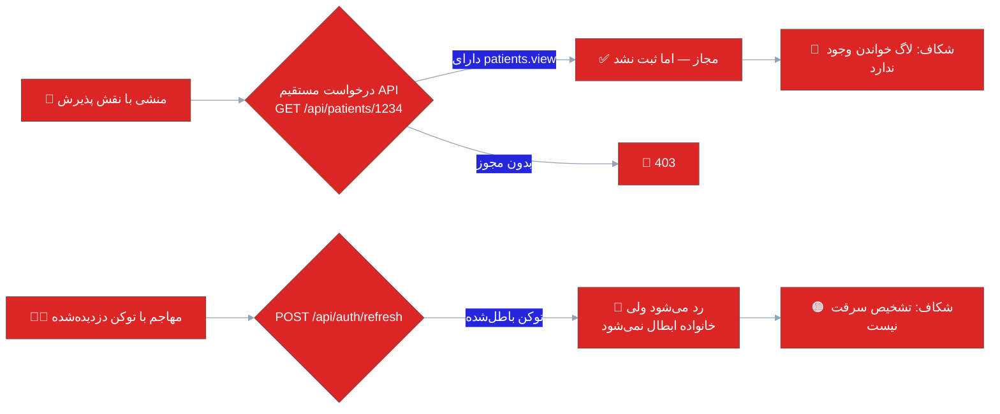

<div dir="rtl" align="right">

# 🔐 ۰۸ · امنیت و حریم خصوصی دادهٔ سلامت

<div align="center">


</div>

> [!IMPORTANT]
> این سند **ارزیابی فنی کد** است، نه گواهی انطباق حقوقی. برای پروندهٔ حقوقی/بیمه‌ای، ارزیابی مستقل توسط کارشناس حریم خصوصی لازم است.

---

> [!TIP]
> **برای اجرا:** اقدام‌های سخت‌سازی این سند همان فاز ۱ (فوری) و فاز ۳ (کوتاه‌مدت) در [**چک‌لیست اجرایی**](10-implementation-checklist.md) است.

## 🧭 بخش ۱ — جدول کنترل‌های امنیتی

<div align="center">

<table dir="rtl" width="100%">
<thead><tr><th width="6%">#</th><th width="26%">کنترل</th><th width="12%">وضعیت</th><th width="56%">شاهد / توضیح</th></tr></thead>
<tbody>
<tr><td>۱</td><td>هش رمز عبور</td><td align="center">🟢 خوب</td><td><b>BCrypt-Net-Next</b> با <code>workFactor</code> در <code>Identity/PasswordHasher.cs:8-13</code> — انتخاب درست و مدرن</td></tr>
<tr><td>۲</td><td>سیاست رمز پویا</td><td align="center">🟢 خوب</td><td><code>PasswordPolicy</code> با قواعد قابل تنظیم؛ اعتبارسنجی در همان سرویس</td></tr>
<tr><td>۳</td><td>قفل حساب پس از تلاش ناموفق</td><td align="center">🟢 خوب</td><td><code>IdentityService.cs:110-116</code> — شمارش، قفل موقت، بازنشانی پس از ورود موفق</td></tr>
<tr><td>۴</td><td>محدودسازی نرخ ورود</td><td align="center">🟢 خوب</td><td><code>[EnableRateLimiting("auth")]</code> روی ۳ اندپوینت <code>AuthController</code></td></tr>
<tr><td>۵</td><td>امضای توکن</td><td align="center">🟢 خوب</td><td>HMAC-SHA256 در <code>JwtTokenGenerator</code></td></tr>
<tr><td>۶</td><td>چرخش توکن تازه‌سازی</td><td align="center">🟢 خوب</td><td><code>RefreshTokenAsync:207-221</code> — توکن قدیمی ابطال و جفت تازه صادر می‌شود ✅</td></tr>
<tr><td>۷</td><td>تشخیص استفادهٔ مجدد از توکن</td><td align="center">🟠 ناقص</td><td>توکن ابطال‌شده فقط رد می‌شود (<code>:187-188</code>)؛ <b>خانوادهٔ توکن ابطال نمی‌شود</b> ⇒ سرقت توکن قابل تشخیص نیست</td></tr>
<tr><td>۸</td><td>مجوز مبتنی بر سیاست</td><td align="center">🟠 ناقص</td><td>هندلر <code>PermissionAuthorization</code> درست است، اما ۱۰ مجوز بذرنشده (<a href="06-defects.md">D-01</a>)</td></tr>
<tr><td>۹</td><td>سطح حملهٔ ناشناس</td><td align="center">🟢 خوب</td><td><code>AllowAnonymous</code> فقط در ۲ کنترلر (Auth، License)</td></tr>
<tr><td>۱۰</td><td>تزریق SQL</td><td align="center">🟢 خوب</td><td>۴ مورد SQL خام، همه پارامتری؛ بدون رشته‌سازی ورودی کاربر</td></tr>
<tr><td>۱۱</td><td>همزمانی خوش‌بینانه</td><td align="center">🟢 خوب</td><td><code>RowVersion</code> در ۴٬۱۳۱ ارجاع + <code>ConcurrencyCheck</code> — جلوگیری از گم‌شدن تغییرات همکار</td></tr>
<tr><td>۱۲</td><td>اعتبارسنجی ورودی</td><td align="center">🟢 خوب</td><td>FluentValidation + <code>ValidationBehavior</code> در خط لولهٔ MediatR (<code>DependencyInjection.cs:39</code>)</td></tr>
<tr><td>۱۳</td><td>مدیریت اسرار</td><td align="center">🟢 خوب</td><td><code>appsettings.json</code> بدون رمز واقعی؛ کلیدهای اپراتور پیامک با <code>IEncryptionService</code> رمزنگاری‌شده</td></tr>
<tr><td>۱۴</td><td><b>توکن تازه‌سازی در دیتابیس</b></td><td align="center">🔴 ضعیف</td><td><b>متن‌ساده</b> — <code>IdentityService.cs:154</code>؛ جستجوی مستقیم روی <code>Token</code> (<a href="06-defects.md">D-02</a>)</td></tr>
<tr><td>۱۵</td><td>مصرف‌نشدن ادعاهای حجیم</td><td align="center">🟠 ناقص</td><td>۱۵۶ ادعای مجوز در JWT (<a href="06-defects.md">D-03</a>)</td></tr>
<tr><td>۱۶</td><td>لاگ دسترسی خواندن پرونده</td><td align="center">🔴 غایب</td><td><code>AuditLogMiddleware.cs:22,44</code> فقط POST/PUT/PATCH/DELETE</td></tr>
<tr><td>۱۷</td><td>رمزنگاری داده در حال سکون</td><td align="center">🟠 ناقص</td><td>نسخهٔ ابری بکاپ با <b>AES-GCM</b> ✅ (<code>AesBackupEncryptor</code>) اما ستون‌های هویتی (کد ملی/موبایل/نشانی) متن‌ساده</td></tr>
<tr><td>۱۸</td><td>MFA برای مدیر سامانه</td><td align="center">🔴 غایب</td><td>هیچ لایهٔ دوم (TOTP/پیامکی) وجود ندارد</td></tr>
<tr><td>۱۹</td><td>HSTS / اجبار HTTPS</td><td align="center">🟠 ناقص</td><td><code>UseHttpsRedirection</code> فقط خارج از محیط توسعه؛ بدون <code>UseHsts</code></td></tr>
<tr><td>۲۰</td><td>CORS</td><td align="center">⚪ تعریف‌نشده</td><td>برای کلاینت دسکتاپ لازم نیست، اما هر پرتابل/وب آینده را مسدود می‌کند</td></tr>
<tr><td>۲۱</td><td>آپلود فایل</td><td align="center">🟠 ناقص</td><td>نام ذخیره‌سازی GUID (ضد Path Traversal ✅) و تشخیص DICOM با مِجیک‌بایت ✅، اما بدون فهرست مجاز پسوند/سقف اندازه در مسیر آپلود تصویربرداری</td></tr>
<tr><td>۲۲</td><td>پاک‌سازی داده هنگام حذف</td><td align="center">⚪ سیاست‌نشده</td><td>حذف نرم غالب است؛ سیاست نگهداشت/ناشناس‌سازی تعریف نشده</td></tr>
</tbody>
</table>

</div>

**نتیجهٔ جدول:** ۱۱ کنترل خوب، ۸ ناقص، ۳ غایب/ضعیف. پایهٔ امنیتی **درست انتخاب شده** (BCrypt، چرخش توکن، سیاست مجوز، RowVersion، AES-GCM) اما چند درز مشخص دارد.

---

## ✅ بخش ۲ — هشت نقطهٔ قوت امنیتی

<div align="center">

| # | قوت | چرا مهم است |
|:--:|:--|:--|
| ۱ | **BCrypt با ضریب سختی** | مقاوم در برابر حملهٔ دیکشنری/GPU؛ نه MD5 نه SHA1 |
| ۲ | **چرخش توکن تازه‌سازی** | کاهش پنجرهٔ سوءاستفاده در صورت نشت |
| ۳ | **محدودسازی نرخ روی ورود** | کند کردن حملهٔ رمز‌زدنی |
| ۴ | **مجوز در سطح سیاست، نه فقط نقش** | ۲۶ ماژول × ۶ عمل، قابل اعطا به نقش دلخواه |
| ۵ | **RowVersion سراسری** | جلوگیری از بازنویسی تغییرات همکار (مشکل کلاسیک درمانگاه چندکاربره) |
| ۶ | **FluentValidation در خط لوله** | ورودی نامعتبر هرگز به دامنه نمی‌رسد |
| ۷ | **AES-GCM برای بکاپ ابری** | رمزنگاری احراز‌شده (نه فقط محرمانگی) |
| ۸ | **صفر SQL رشته‌ای** | تنها ۴ مورد خام و همه پارامتری |

</div>

---

## 🚨 بخش ۳ — یافته‌های امنیتی (به ترتیب شدت)

### 🔴 S-01 · مجوزهای بذرنشده — نقض تفکیک وظایف

<div align="center">

<table dir="rtl" width="100%">
<tbody>
<tr><td width="18%"><b>شدت</b></td><td>🔴 بحرانی (P0)</td></tr>
<tr><td><b>شاهد</b></td><td><code>PermissionSeeder.cs</code> ۱۵۶ مجوز می‌سازد؛ ۱۰ رشتهٔ استفاده‌شده در کنترلرها در آن نیست</td></tr>
<tr><td><b>سناریوی سوءاستفاده</b></td><td>درمانگاه برای انجام حقوق و دستمزد یا انبارگردانی، حساب کاربری «مدیر سامانه» را در اختیار منشی می‌گذارد. حالا یک حساب، هم پذیرش می‌کند هم حقوق را می‌بیند هم بکاپ می‌گیرد.</td></tr>
<tr><td><b>اصلاح</b></td><td>افزودن ۱۰ مجوز به بذر + آزمون CI + ماتریس نقش پیش‌فرض برای «حسابدار»، «پرستار»، «کارشناس آزمایشگاه»</td></tr>
</tbody>
</table>

</div>

### 🔴 S-02 · توکن تازه‌سازی متن‌ساده

```csharp
// IdentityService.cs:151-158  ❌
_context.RefreshTokens.Add(new RefreshToken {
    Token = refreshToken,            // ← اگر دیتابیس/بکاپ لو برود، ورود ۷ روزه ممکن است
    ExpiresAt = refreshExpiry,
});

// ✅ پیشنهاد
var hash = Convert.ToHexString(SHA256.HashData(Encoding.UTF8.GetBytes(refreshToken)));
_context.RefreshTokens.Add(new RefreshToken {
    TokenHash = hash,
    // Token دیگر ذخیره نمی‌شود
});
// جستجو:  FirstOrDefaultAsync(t => t.TokenHash == Hash(incoming))
```

<div align="center">

| اثر | تلاش | ریسک اجرا |
|:--|:--:|:--|
| حذف کامل کلاس «نشت بکاپ = ورود» | ۰٫۵ روز | کم (نیازمند مهاجرت ستون + ابطال توکن‌های موجود) |

</div>

### 🟠 S-03 · بدون تشخیص استفادهٔ مجدد از توکن

الگوی درست OAuth 2.0: اگر توکنِ **قبلاً ابطال‌شده** ارائه شود، یعنی دو نفر آن را دارند ⇒ **همهٔ توکن‌های آن کاربر** ابطال شود.

```csharp
if (stored is null) return RefreshResult.Failure("...");
if (stored.IsRevoked)
{
    // 🚨 استفادهٔ مجدد ⇒ نشانهٔ سرقت
    var family = await _context.RefreshTokens
        .Where(t => t.UserId == stored.UserId && !t.IsRevoked).ToListAsync(ct);
    family.ForEach(t => t.IsRevoked = true);
    await _context.SaveChangesAsync(ct);
    _logger.LogWarning("Refresh token reuse detected for user {UserId} from {Ip}", stored.UserId, ipAddress);
    return RefreshResult.Failure("نشست شما به دلیل فعالیت مشکوک پایان یافت — دوباره وارد شوید");
}
```

### 🟠 S-04 · بدون لاگ دسترسی به پروندهٔ بیمار

<div align="center">

<table dir="rtl" width="100%">
<tbody>
<tr><td width="20%"><b>وضعیت</b></td><td>میان‌افزار لاگ فقط روش‌های نوشتنی را می‌بیند ⇒ «چه کسی پروندهٔ چه کسی را دید» ثبت نمی‌شود</td></tr>
<tr><td><b>ریسک حقوقی</b></td><td>در شکایت «افشای اطلاعات» یا بازرسی وزارت بهداشت، سامانه نمی‌تواند پاسخ دهد</td></tr>
<tr><td><b>پیشنهاد</b></td><td>مسیرهای حساس (<code>patients/{id}</code>، <code>visits/*</code>، <code>lab/results/*</code>، <code>prescriptions/*</code>) با GET هم لاگ شوند؛ نمونه‌برداری ۱۰۰٪ برای پرونده‌های خاص (VIP) و ۱۰٪ برای بقیه</td></tr>
<tr><td><b>حجم</b></td><td>~۵۰۰ رکورد در روز برای درمانگاه متوسط؛ با پارتیشن ماهانه قابل مدیریت</td></tr>
</tbody>
</table>

</div>

### 🟠 S-05 · نبود MFA برای نقش‌های حیاتی

<div align="center">

| نقش | ریسک بدون MFA | پیشنهاد |
|:--|:--|:--|
| مدیر سامانه | بکاپ/بازیابی، ماتریس مجوزها | TOTP اجباری |
| حسابدار | اسناد مالی و حقوق | TOTP یا پیامک |
| پزشک | امضای نسخه | TOTP اختیاری (فاز ۲) |

</div>

### 🟠 S-06 · داده‌های هویتی حساس بدون رمزنگاری ستونی

<div align="center">

<table dir="rtl" width="100%">
<thead><tr><th width="22%">ستون</th><th width="16%">امروز</th><th width="22%">پیشنهاد</th><th width="40%">یادداشت</th></tr></thead>
<tbody>
<tr><td>کد ملی</td><td>متن‌ساده</td><td>هش برای جستجو + نسخهٔ رمزنگاری‌شده</td><td>نیاز به جستجوی دقیق ⇒ ستون <code>NationalCodeHash</code> + <code>NationalCodeEnc</code></td></tr>
<tr><td>موبایل</td><td>متن‌ساده</td><td>رمزنگاری + ماسک در نمایش</td><td>جستجو معمولاً پسوندی است</td></tr>
<tr><td>نشانی</td><td>متن‌ساده</td><td>رمزنگاری</td><td>با <code>IEncryptionService</code> موجود</td></tr>
<tr><td>تشخیص/نتیجهٔ آزمایش</td><td>متن‌ساده</td><td>در فاز ۲</td><td>رمزنگاری ستونی، کوئری‌های تحلیلی را می‌شکند ⇒ نیازمند طراحی</td></tr>
</tbody>
</table>

</div>

> [!TIP]
> **رویکرد میانه و کم‌ریسک:** به‌جای رمزنگاری همه‌چیز، از **TDE (Transparent Data Encryption)** در SQL Server استفاده کنید — کل فایل دیتابیس و بکاپ در حالت سکون رمز می‌شود، بدون تغییر یک خط کد. برای درمانگاه، این ۸۰٪ سود با ۲ ساعت کار است. رمزنگاری ستونی را برای فیلدهای «به‌شدت حساس» (تشخیص روان‌پزشکی/اعتیاد) نگه دارید.

---

## 🕵️ بخش ۴ — مدل تهدید (STRIDE خلاصه)

<div align="center">

<table dir="rtl" width="100%">
<thead><tr><th width="14%">تهدید</th><th width="32%">سناریوی واقعی در درمانگاه</th><th width="12%">وضعیت فعلی</th><th width="42%">کنترل پیشنهادی</th></tr></thead>
<tbody>
<tr><td><b>جعل هویت</b></td><td>منشی رمز پزشک را می‌داند و نسخه صادر می‌کند</td><td align="center">🟠</td><td>MFA پزشک + لاگ «صادرکنندهٔ نسخه» با اثر انگشت دیجیتال/توکن دستگاه</td></tr>
<tr><td><b>دست‌کاری داده</b></td><td>تغییر سهم بیمه پس از صدور فاکتور</td><td align="center">🟢</td><td>RowVersion + لاگ تغییرات (موجود) — کافی است</td></tr>
<tr><td><b>انکار عمل</b></td><td>«من این فاکتور را ابطال نکردم»</td><td align="center">🟡</td><td>لاگ نوشتن هست؛ افزودن هش زنجیره‌ای (hash chain) برای غیرقابل‌انکار شدن</td></tr>
<tr><td><b>افشای اطلاعات</b></td><td>دیدن پروندهٔ همسر/آشنا بدون مجوز</td><td align="center">🔴</td><td>لاگ خواندن + هشدار «دسترسی غیرمرتبط» (کاربر بدون رابطهٔ نوبت با بیمار)</td></tr>
<tr><td><b>حرمان سرویس</b></td><td>ارسال انبوه پیامک، دکمهٔ «همگام‌سازی همه»</td><td align="center">🟡</td><td>نرخ‌محدودسازی عمومی + صف برای عملیات سنگین</td></tr>
<tr><td><b>ارتقای سطح</b></td><td>افزودن خود به نقش مدیر در پنل مجوزها</td><td align="center">🟢</td><td><code>users.manage</code> و <code>roles.manage</code> جدا هستند + محافظت «آخرین مدیر را حذف نکن»</td></tr>
</tbody>
</table>

</div>

**سه سناریوی پرتکرار واقعی که باید آزمایش شوند:**



---

## 📜 بخش ۵ — حریم خصوصی دادهٔ بیمار (فراتر از کد)

<div align="center">

<table dir="rtl" width="100%">
<thead><tr><th width="5%">#</th><th width="24%">موضوع</th><th width="12%">وضعیت</th><th width="59%">آنچه باید وجود داشته باشد</th></tr></thead>
<tbody>
<tr><td>۱</td><td>حداقل‌سازی داده</td><td align="center">🟡</td><td>فقط فیلدهای لازم جمع‌آوری شود؛ بازبینی فرم بیمار برای حذف فیلدهای بی‌مصرف</td></tr>
<tr><td>۲</td><td>رضایت آگاهانه</td><td align="center">🟠</td><td>فرم رضایت برای درمان، اشتراک‌گذاری با بیمه و ارسال پیامک بازاریابی — با تاریخ و امضا در پرونده</td></tr>
<tr><td>۳</td><td>حق دسترسی بیمار</td><td align="center">🔴</td><td>بیمار باید بتواند نسخهٔ پروندهٔ خود را بگیرد (چاپ «خلاصهٔ پرونده» موجود نیست به‌صورت یک‌کلیکی)</td></tr>
<tr><td>۴</td><td>سیاست نگهداشت</td><td align="center">🔴</td><td>تعریف مدت نگهداشت پرونده (مثلاً ۱۰ سال)، آرشیو، و امحای امن پس از انقضا</td></tr>
<tr><td>۵</td><td>ناشناس‌سازی برای تحلیل</td><td align="center">⚪</td><td>گزارش‌های آماری/پژوهشی باید بدون شناسهٔ هویتی تولید شوند</td></tr>
<tr><td>۶</td><td>افشا به شخص ثالث</td><td align="center">🟡</td><td>ارسال به بیمه/آزمایشگاه باید در پرونده «ثبت» شود (چه داده‌ای، به چه کسی، چه زمانی)</td></tr>
<tr><td>۷</td><td>آموزش کاربر</td><td align="center">🟢</td><td>ماژول آموزش موجود است — افزودن درس «محرمانگی و رفتار حرفه‌ای»</td></tr>
<tr><td>۸</td><td>پشتیبان‌گیری خارج از سایت</td><td align="center">🟡</td><td>فایل بکاپ رمزنگاری‌شده در محل دوم؛ کلید جدا از فایل نگهداری شود</td></tr>
</tbody>
</table>

</div>

---

## 🛠 بخش ۶ — نقشهٔ سخت‌سازی ساده، متوسط، سخت

<div align="center">

<table dir="rtl" width="100%">
<thead><tr><th width="8%">فاز</th><th width="44%">اقدام‌ها</th><th width="12%">تلاش</th><th width="36%">نتیجهٔ سنجش‌پذیر</th></tr></thead>
<tbody>
<tr>
<td align="center"><b>۱<br/>فوری<br/>(۱ هفته)</b></td>
<td>بذر ۱۰ مجوز گم‌شده · هش توکن تازه‌سازی · فعال‌کردن TDE · افزودن لاگ خواندن پرونده · حذف مهاجرت خودکار از استارتاپ</td>
<td align="center">۴ روز</td>
<td>هیچ قابلیتی نیازمند نقش مدیر نیست؛ هیچ توکنی متن‌ساده نیست؛ «چه کسی پرونده را دید» قابل پاسخ است</td>
</tr>
<tr>
<td align="center"><b>۲<br/>کوتاه‌مدت<br/>(۱ ماه)</b></td>
<td>تشخیص استفادهٔ مجدد توکن · توکن سبک با <code>permVersion</code> · MFA برای مدیر و حسابدار · فهرست مجاز پسوند و سقف اندازهٔ آپلود · HSTS + تنظیم CORS برای دامنه‌های آینده</td>
<td align="center">۹ روز</td>
<td>سرقت توکن قابل تشخیص؛ ورود مدیر دو مرحله‌ای؛ آپلود کنترل‌شده</td>
</tr>
<tr>
<td align="center"><b>۳<br/>میان‌مدت<br/>(۱ فصل)</b></td>
<td>رمزنگاری ستونی داده‌های هویتی · سیاست نگهداشت و امحا · رضایت‌نامهٔ دیجیتال · زنجیرهٔ هش لاگ · آزمون نفوذ بیرونی · سند مدون «سیاست حریم خصوصی»</td>
<td align="center">~۲۰ روز</td>
<td>آمادگی بازرسی/مناقصه؛ پاسخ‌گویی به شکایت</td>
</tr>
</tbody>
</table>

</div>

---

## ✅ بخش ۷ — چک‌لیست پذیرش امنیتی (برای CI و بازبینی دستی)

<div align="center">

| ✅ | بررسی | ابزار |
|:--:|:--|:--|
| ☐ | هیچ مجوز استفاده‌شده‌ای بدون بذر نیست | آزمون واحد (نمونه در [۰۶](06-defects.md) → D-01) |
| ☐ | هیچ توکن/رمز متنی در دیتابیس نیست | بازبینی ستون‌های <code>*Token*</code> + آزمون |
| ☐ | هر اندپوینت یا <code>[Authorize]</code> دارد یا <code>[AllowAnonymous]</code> صریح | تحلیل ایستا در CI |
| ☐ | هر مسیر حساس خواندنی لاگ می‌شود | آزمون یکپارچه‌سازی |
| ☐ | فهرست مجاز پسوند/اندازهٔ آپلود اعمال شده | آزمون با فایل نامعتبر |
| ☐ | هیچ کلید واقعی در مخزن نیست | <code>gitleaks</code> در CI |
| ☐ | پکیج‌ها بدون آسیب‌پذیری شناخته‌شده | <code>dotnet list package --vulnerable</code> |
| ☐ | آزمون بازیابی بکاپ ماهانه موفق | گزارش خودکار |

</div>

> [!WARNING]
> **مهم‌ترین جملهٔ این سند:** درمانگاهی که پروندهٔ بیمار را نگه می‌دارد، در برابر «سؤال» مسئول است — نه فقط در برابر «حمله». اگر نتوانید بگویید **چه کسی، چه زمانی، کدام پرونده را دید**، در هر اختلاف حقوقی بازنده‌اید. هزینهٔ رفع این شکاف (۳ فایل، ۱ روز) در برابر ریسکش تقریباً صفر است.

</div>
