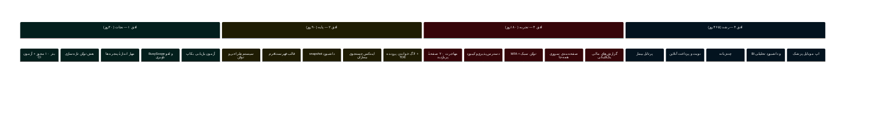
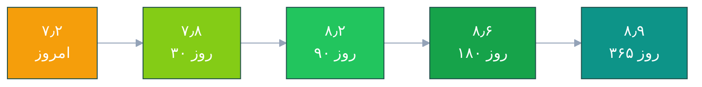

# 🎯 ۰۹ · تحلیل SWOT و نقشهٔ راه یک‌ساله

---

> [!TIP]
> **برای اجرا:** هر تحویل‌دادنی این نقشهٔ راه در [**چک‌لیست اجرایی**](10-implementation-checklist.md) به کارهای تیک‌دار با ترتیب و تخمین زمان تبدیل شده است.

## 🔲 بخش ۱ — ماتریس SWOT

<table dir="rtl" width="100%">
<thead>
<tr>
<th width="50%" style="background:#dcfce7">💪 <b>قوت‌ها (Strengths)</b> — درونی، مثبت</th>
<th width="50%" style="background:#fee2e2">🩹 <b>ضعف‌ها (Weaknesses)</b> — درونی، منفی</th>
</tr>
</thead>
<tbody>
<tr>
<td valign="top">

<b>۱. پوشش کارکردی استثنایی</b> 
از پذیرش تا حقوق و دستمزد، مالیات ۱۴۰۴، انبار با FEFO، نسخه، آزمایشگاه، تصویربرداری و دندان‌پزشکی.

<b>۲. معماری بالغ</b> 
Clean Architecture با جهت وابستگی درست، CQRS، Unit of Work، ۴۲۱ آزمون.

<b>۳. جزئیات بومی ایران</b> 
تقویم جلالی، الگوریتم کد ملی، سهم بیمه، پلکان مالیات، سپاس، پیامک کاوه‌نگار.

<b>۴. یکپارچگی واقعی</b> 
بکاپ BACKUP/RESTORE، حضور و غیاب ZKTeco/Hikvision، SignalR، گزارش‌ساز، لایسنس آنلاین.

<b>۵. کیفیت داده</b> 
RowVersion در ۴٬۱۳۱ نقطه، ۳٬۸۱۹ ایندکس، صفر SQL رشته‌ای، صفر <code>NotImplementedException</code>.

<b>۶. برند و تجربهٔ بصری</b> 
RTL اصیل، فونت وزیرمتن، تم روشن/تیره، ۶۴ اسکرین‌شات مستند، ویدیوی تبلیغاتی.

</td>
<td valign="top">

<b>۱. دسترس‌پذیری تقریباً صفر</b> 
صفر <code>AutomationProperties</code>، ۲ <code>AccessText</code>، بدون ناوبری کیبورد کامل.

<b>۲. سفتی لایهٔ نمایش</b> 
۳۳۴ رنگ هاردکد، ۱۷۷ نقطهٔ «مشغول» بدون آزادسازی، ۱۵۴ فراخوانی بی‌صاحب، بدون لغو.

<b>۳. درزهای امنیتی مشخص</b> 
۱۰ مجوز بذرنشده، توکن تازه‌سازی متن‌ساده، بدون لاگ خواندن پرونده، بدون MFA.

<b>۴. کارایی در مقیاس</b> 
۸ فراخوانی متوالی داشبورد، ۱۱ پرس‌وجوی KPI، <code>LIKE %</code> روی ۶ ستون.

<b>۵. سازگاری با مانیتور کوچک</b> 
۱۶ پنجره بلندتر از ۷۰۰px، بدون مدیریت ناحیهٔ کاری.

<b>۶. شکاف قابلیت‌های رشد</b> 
بدون پرتابل بیمار، بدون نوبت آنلاین، بدون پرداخت، بدون چندزبانه.

</td>
</tr>
<tr>
<th style="background:#dbeafe">🚀 <b>فرصت‌ها (Opportunities)</b> — بیرونی، مثبت</th>
<th style="background:#fef3c7">⚠️ <b>تهدیدها (Threats)</b> — بیرونی، منفی</th>
</tr>
<tr>
<td valign="top">

<b>۱. رقابت ضعیف در «یکپارچگی»</b> 
بسیاری از رقبا ماژول‌های جدا دارند؛ یکپارچگی پذیرش↔صندوق↔انبار↔حقوق مزیت نادر است.

<b>۲. الزام تدریجی پروندهٔ الکترونیک</b> 
هر سال فشار regulator بیشتر می‌شود؛ محصولی که آماده باشد برنده است.

<b>۳. نوبت آنلاین، ورودی رشد</b> 
تبدیل درمانگاه از «نرم‌افزار داخلی» به «کانال جذب بیمار».

<b>۴. چندشعبه‌ای بالفعل</b> 
<code>BranchId</code> در سراسر سیستم هست؛ فروش به زنجیره‌ها فقط نیازمند بسته‌بندی است.

<b>۵. صادرات منطقه‌ای</b> 
RTL + معماری تمیز، پایهٔ خوبی برای عراق/افغانستان/تاجیکستان است (نیازمند چندزبانه).

<b>۶. ماژول‌های تخصصی آماده</b> 
دندان‌پزشکی، چشم، فیزیوتراپی — هر کدام می‌تواند محصول مستقل باشد.

</td>
<td valign="top">

<b>۱. ریسک «تک‌فردی» دانش</b> 
۶ کلاس بالای ۱٬۳۰۰ خط و تمرکز منطق در چند فایل؛ جانشین‌پذیری پایین.

<b>۲. فاصلهٔ تبلیغات و واقعیت</b> 
«۹۷ جدول» در برابر ۲۲۸؛ در ارزیابی فنی سازمانی، اعتبار را می‌شکند.

<b>۳. توقع کاربر از وب/موبایل</b> 
نسل جدید کاربر، اپ موبایل می‌خواهد؛ دسکتاپ تنها، محدودیت فروش است.

<b>۴. فشار قیمت رقبا</b> 
نرم‌افزارهای ابری ارزان؛ ارزش باید از «یکپارچگی + پشتیبانی» بیاید نه از تعداد صفحه.

<b>۵. بدهی UI انباشته</b> 
هر صفحهٔ تازه، بدون سیستم طراحی، ۳۳۴ رنگ را بیشتر می‌کند.

<b>۶. ریسک داده</b> 
بدون آزمون بازیابی خودکار، یک بکاپ خراب = فاجعهٔ کامل.

</td>
</tr>
</tbody>
</table>

---

## 🧮 بخش ۲ — راهبردهای ترکیبی (TOWS)

<table dir="rtl" width="100%">
<thead><tr><th width="18%">ترکیب</th><th width="82%">راهبرد عملی</th></tr></thead>
<tbody>
<tr><td><b>قوت × فرصت</b> S+O «حمله»</td><td>با تکیه بر یکپارچگی موجود، بستهٔ «زنجیرهٔ کامل درمانگاه» بسازید: پرتابل بیمار + نوبت آنلاین + صندوق، و آن را به‌عنوان مزیت رقابتی اصلی در سایت و ویدیو معرفی کنید. ماژول‌های تخصصی (دندان/چشم/فیزیو) را به‌صورت بستهٔ جداگانه بفروشید.</td></tr>
<tr><td><b>ضعف × فرصت</b> W+O «بهبود»</td><td>پیش از افزودن قابلیت جدید، بدهی UI را با سیستم طراحی تسویه کنید؛ در غیر این‌صورت هر قابلیت تازه، بدهی را دو برابر می‌کند. ترتیب: توکن → قالب فهرست → مهاجرت صفحه‌ها.</td></tr>
<tr><td><b>قوت × تهدید</b> S+T «دفاع»</td><td>معماری تمیز و آزمون‌ها را ابزار «اعتماد سازمانی» کنید: گزارش پوشش آزمون، آزمون بازیابی، و مستند فنی واقعی (اعداد خودکار از کد) به مشتری سازمانی ارائه دهید.</td></tr>
<tr><td><b>ضعف × تهدید</b> W+T «نجات»</td><td>سه اقدام کم‌هزینه با اثر بالا: (۱) بذر مجوزها، (۲) مهار اندازهٔ پنجره‌ها، (۳) آزمون بازیابی بکاپ. این سه، سه تهدید واقعی (SoD، شکایت کاربر ۱۳۶۶×۷۶۸، فاجعهٔ داده) را می‌بندند.</td></tr>
</tbody>
</table>

---

## 🗺 بخش ۳ — نقشهٔ راه چهار افقی

---

### 📦 افق ۱ · نجات — ۳۰ روز اول

<table dir="rtl" width="100%">
<thead><tr><th width="30%">تحویل‌دادنی</th><th width="10%">تلاش</th><th width="14%">مالک</th><th width="46%">معیار پذیرش</th></tr></thead>
<tbody>
<tr><td>بذر ۱۰ مجوز گم‌شده + آزمون هم‌ترازی CI</td><td align="center">۰٫۵ روز</td><td align="center">بک‌اند</td><td>هیچ قابلیتی نیازمند نقش «مدیر سامانه» نیست؛ آزمون در CI سبز</td></tr>
<tr><td>هش توکن تازه‌سازی</td><td align="center">۰٫۵ روز</td><td align="center">بک‌اند</td><td>ستون <code>TokenHash</code>؛ هیچ رشتهٔ توکنی در جدول نیست</td></tr>
<tr><td>مهار اندازهٔ پنجره‌ها</td><td align="center">۱ روز</td><td align="center">فرانت</td><td>هر ۴۸ پنجره روی ۱۳۶۶×۷۶۸ کامل دیده می‌شود</td></tr>
<tr><td><code>BusyScope</code> + لغو ناوبری</td><td align="center">۴ روز</td><td align="center">فرانت</td><td>در قطع شبکه، رابط قفل نمی‌شود</td></tr>
<tr><td>ثبت دسترسی خواندن پرونده</td><td align="center">۱ روز</td><td align="center">بک‌اند</td><td>گزارش «چه کسی پروندهٔ چه کسی را دید» موجود است</td></tr>
<tr><td>آزمون بازیابی بکاپ ماهانه</td><td align="center">۱ روز</td><td align="center">DevOps</td><td>گزارش خودکار بازیابی موفق در داشبورد مدیریت</td></tr>
<tr><td><b>جمع افق</b></td><td align="center"><b>~۸ روز</b></td><td align="center">—</td><td><b>امتیاز ۷٫۲ → ۷٫۸</b></td></tr>
</tbody>
</table>

---

### 🧱 افق ۲ · پایه — تا ۹۰ روز

<table dir="rtl" width="100%">
<thead><tr><th width="30%">تحویل‌دادنی</th><th width="10%">تلاش</th><th width="14%">مالک</th><th width="46%">معیار پذیرش</th></tr></thead>
<tbody>
<tr><td>توکن‌های طراحی + مقیاس تایپوگرافی</td><td align="center">۳ روز</td><td align="center">فرانت</td><td>رنگ هاردکد در ۱۰ صفحهٔ پربازدید = ۰؛ اندازهٔ فونت = ۶</td></tr>
<tr><td>قالب مشترک فهرست و فرم</td><td align="center">۵ روز</td><td align="center">فرانت</td><td>۴ صفحهٔ پربازدید به آن مهاجرت کرده‌اند</td></tr>
<tr><td><code>/dashboard/snapshot</code> + یک‌پاس‌سازی KPI</td><td align="center">۳ روز</td><td align="center">بک‌اند</td><td>بارگذاری داشبورد &lt; ۳۰۰ms (p95) با یک درخواست</td></tr>
<tr><td>ایندکس جستجوی بیماران</td><td align="center">۲ روز</td><td align="center">دیتابیس</td><td>جستجو در ۵۰٬۰۰۰ پرونده &lt; ۱۵۰ms</td></tr>
<tr><td>TDE + HSTS + فهرست مجاز آپلود</td><td align="center">۲ روز</td><td align="center">DevOps</td><td>داده در حال سکون رمز؛ آپلود نامعتبر رد می‌شود</td></tr>
<tr><td>صفحه‌بندی سروری برای ۱۰ صفحهٔ پرترافیک</td><td align="center">۴ روز</td><td align="center">هر دو</td><td>هیچ فراخوانی با <code>pageSize &gt; ۱۰۰</code> نمانده</td></tr>
<tr><td><b>جمع افق</b></td><td align="center"><b>~۱۹ روز</b></td><td align="center">—</td><td><b>امتیاز ۷٫۸ → ۸٫۲</b></td></tr>
</tbody>
</table>

---

### ✨ افق ۳ · تجربه — تا ۱۸۰ روز

<table dir="rtl" width="100%">
<thead><tr><th width="30%">تحویل‌دادنی</th><th width="10%">تلاش</th><th width="14%">مالک</th><th width="46%">معیار پذیرش</th></tr></thead>
<tbody>
<tr><td>مهاجرت ۲۰ صفحهٔ پربازدید به قالب مشترک</td><td align="center">۱۲ روز</td><td align="center">فرانت</td><td>۸۵٪ ناوبری روزمره در قالب تازه</td></tr>
<tr><td>دسترس‌پذیری: نام، Tab، میان‌بر، فوکوس</td><td align="center">۶ روز</td><td align="center">فرانت</td><td>&gt; ۲۰۰ کنترل دارای <code>AutomationProperties</code></td></tr>
<tr><td>MFA + توکن سبک با <code>permVersion</code></td><td align="center">۴ روز</td><td align="center">بک‌اند</td><td>JWT &lt; ۲KB؛ تغییر مجوز در &lt; ۶۰ ثانیه اثر می‌کند</td></tr>
<tr><td>حالت چهارگانهٔ فهرست در همهٔ صفحه‌ها</td><td align="center">۵ روز</td><td align="center">فرانت</td><td>&gt; ۹۰٪ فهرست‌ها بارگذاری/خالی/خطا/داده دارند</td></tr>
<tr><td>گزارش‌های مالی یک‌کلیکی + نمای بدهکاران</td><td align="center">۴ روز</td><td align="center">هر دو</td><td>ترازنامه و سود و زیان در یک کلیک</td></tr>
<tr><td><b>جمع افق</b></td><td align="center"><b>~۳۱ روز</b></td><td align="center">—</td><td><b>امتیاز ۸٫۲ → ۸٫۶</b></td></tr>
</tbody>
</table>

---

### 🚀 افق ۴ · رشد — تا ۳۶۵ روز

<table dir="rtl" width="100%">
<thead><tr><th width="30%">تحویل‌دادنی</th><th width="10%">تلاش</th><th width="14%">مالک</th><th width="46%">معیار پذیرش</th></tr></thead>
<tbody>
<tr><td>پرتابل بیمار (خواندنی)</td><td align="center">۱۵ روز</td><td align="center">تیم</td><td>بیمار با کد ملی + OTP وارد می‌شود و نتیجه/نوبت/نسخه را می‌بیند</td></tr>
<tr><td>نوبت‌گیری و پرداخت آنلاین</td><td align="center">۱۲ روز</td><td align="center">تیم</td><td>۳۰٪ نوبت‌ها بدون تماس تلفنی ثبت می‌شود</td></tr>
<tr><td>چندزبانه (fa/en/ar)</td><td align="center">۱۰ روز</td><td align="center">فرانت</td><td>هیچ رشتهٔ فارسی هاردکد در ۱۰ صفحهٔ کلیدی</td></tr>
<tr><td>BI و داشبورد تحلیلی</td><td align="center">۸ روز</td><td align="center">بک‌اند</td><td>گزارش مقایسهٔ دوره‌ای برای مدیر</td></tr>
<tr><td>اپ موبایل پزشک (MVP)</td><td align="center">۱۵ روز</td><td align="center">تیم</td><td>مشاهدهٔ نوبت‌های امروز و پروندهٔ خلاصه</td></tr>
<tr><td><b>جمع افق</b></td><td align="center"><b>~۶۰ روز</b></td><td align="center">—</td><td><b>امتیاز ۸٫۶ → ۸٫۹</b></td></tr>
</tbody>
</table>

---

## 📈 بخش ۴ — مسیر امتیاز

<table dir="rtl" width="100%">
<thead><tr><th width="26%">حوزه</th><th width="12%">امروز</th><th width="12%">۳۰ روز</th><th width="12%">۹۰ روز</th><th width="12%">۱۸۰ روز</th><th width="12%">۳۶۵ روز</th><th width="14%">محرک اصلی</th></tr></thead>
<tbody>
<tr><td>معماری</td><td align="center">۸٫۶</td><td align="center">۸٫۶</td><td align="center">۸٫۸</td><td align="center">۸٫۹</td><td align="center">۹٫۰</td><td>Contracts + اسنپ‌شات</td></tr>
<tr><td>کیفیت کد</td><td align="center">۷٫۲</td><td align="center">۷٫۵</td><td align="center">۸٫۰</td><td align="center">۸٫۳</td><td align="center">۸٫۵</td><td>BusyScope + تقسیم کلاس‌ها</td></tr>
<tr><td>پوشش قابلیت</td><td align="center">۸٫۸</td><td align="center">۸٫۸</td><td align="center">۸٫۹</td><td align="center">۹٫۰</td><td align="center">۹٫۴</td><td>پرتابل + آنلاین</td></tr>
<tr><td>رابط کاربری</td><td align="center">۷٫۶</td><td align="center">۷٫۸</td><td align="center">۸٫۴</td><td align="center">۸٫۷</td><td align="center">۸٫۹</td><td>سیستم طراحی</td></tr>
<tr><td>تجربهٔ کاربری</td><td align="center">۶٫۹</td><td align="center">۷٫۵</td><td align="center">۸٫۱</td><td align="center">۸٫۵</td><td align="center">۸٫۷</td><td>قالب‌ها + چهار حالت</td></tr>
<tr><td>دسترس‌پذیری</td><td align="center">۲٫۵</td><td align="center">۲٫۵</td><td align="center">۴٫۰</td><td align="center">۷٫۰</td><td align="center">۷٫۵</td><td>Automation + کیبورد</td></tr>
<tr><td>کارایی</td><td align="center">۶٫۸</td><td align="center">۷٫۳</td><td align="center">۸٫۳</td><td align="center">۸٫۵</td><td align="center">۸٫۶</td><td>snapshot + ایندکس</td></tr>
<tr><td>امنیت</td><td align="center">۷٫۴</td><td align="center">۸٫۲</td><td align="center">۸٫۵</td><td align="center">۸٫۸</td><td align="center">۸٫۹</td><td>مجوز + هش توکن</td></tr>
<tr><td>آزمون</td><td align="center">۷٫۰</td><td align="center">۷٫۰</td><td align="center">۷٫۴</td><td align="center">۷٫۸</td><td align="center">۸٫۰</td><td>آزمون UI و امنیت</td></tr>
<tr><td>عملیات</td><td align="center">۷٫۸</td><td align="center">۸٫۲</td><td align="center">۸٫۴</td><td align="center">۸٫۵</td><td align="center">۸٫۶</td><td>آزمون بازیابی</td></tr>
<tr><td><b>کل</b></td><td align="center"><b>۷٫۲</b></td><td align="center"><b>۷٫۸</b></td><td align="center"><b>۸٫۲</b></td><td align="center"><b>۸٫۶</b></td><td align="center"><b>۸٫۹</b></td><td>—</td></tr>
</tbody>
</table>

---

## 💰 بخش ۵ — سرمایه‌گذاری و بازده

<table dir="rtl" width="100%">
<thead><tr><th width="22%">بسته</th><th width="14%">روز-نفر</th><th width="22%">چه چیزی به‌دست می‌آید</th><th width="42%">بازده قابل بیان</th></tr></thead>
<tbody>
<tr><td><b>افق ۱ — نجات</b></td><td align="center">۱۶٫۵</td><td>بستهٔ بدون نقص امنیتی و بدون قفل رابط</td><td>رفع تنها ریسک P0؛ حذف شکایت «برنامه گیر می‌کند»</td></tr>
<tr><td><b>افق ۲ — پایه</b></td><td align="center">۳۵٫۵</td><td>سرعت + پایهٔ طراحی + امنیت دادهٔ سکون</td><td>ورود به داشبورد ۳× سریع‌تر؛ هر صفحهٔ تازه ۵۰٪ ارزان‌تر</td></tr>
<tr><td><b>افق ۳ — تجربه</b></td><td align="center">۳۱</td><td>تجربهٔ یکدست + دسترس‌پذیری + MFA</td><td>آمادگی مناقصهٔ دولتی؛ آموزش کاربر جدید سریع‌تر</td></tr>
<tr><td><b>افق ۴ — رشد</b></td><td align="center">۶۵</td><td>پرتابل، آنلاین، موبایل، BI، چندزبانه</td><td>کانال درآمد تازه و ورود به بازارهای منطقه</td></tr>
<tr><td><b>جمع کل</b></td><td align="center"><b>~۱۵۲</b></td><td>محصول ۸٫۹/۱۰</td><td>از «نرم‌افزار درمانگاه» به «سکوی سلامت»</td></tr>
</tbody>
</table>

> [!NOTE]
> افق ۱ و ۲ با **۵۲ روز** کار، بیشترین سود را می‌دهند: بستن ریسک‌های واقعی و سه‌برابر کردن سرعت بارگذاری. افق ۴ تنها زمانی معنا دارد که افق ۲ کامل شده باشد — وگرنه هر صفحهٔ جدید، بدهی طراحی را بیشتر می‌کند.

---

## ⚠️ بخش ۶ — سیاههٔ ریسک اجرا

<table dir="rtl" width="100%">
<thead><tr><th width="26%">ریسک</th><th width="8%">احتمال</th><th width="8%">اثر</th><th width="58%">کاهش</th></tr></thead>
<tbody>
<tr><td>وابستگی به یک نفر</td><td align="center">بالا</td><td align="center">بالا</td><td>مستندسازی تصمیم‌ها (این گزارش شروع آن است) + مرور کد دو‌نفره + تقسیم ۶ کلاس بزرگ</td></tr>
<tr><td>خرابی داده در تغییر ایندکس/مهاجرت</td><td align="center">متوسط</td><td align="center">بحرانی</td><td>تست روی بکاپ تولید؛ بازگردانی هنگام خطا؛ اجرای خارج از ساعات کاری</td></tr>
<tr><td>تغییر مجوزها، دسترسی‌ها را بشکند</td><td align="center">متوسط</td><td align="center">متوسط</td><td>مهاجرت غیرمخرب + آزمون سناریوی نقش‌ها + بازهٔ پایش</td></tr>
<tr><td>مهاجرت UI نیمه‌کاره رها شود</td><td align="center">متوسط</td><td align="center">بالا</td><td>«قاعدهٔ طلایی»: هر صفحه‌ای که باز می‌شود، مهاجرت کند — بدون پروژهٔ جدا</td></tr>
<tr><td>افق ۴ پیش از افق ۲ شروع شود</td><td align="center">متوسط</td><td align="center">بالا</td><td>دروازهٔ تصمیم: بدون پایان افق ۲، هیچ قابلیت تازه‌ای (بدون استثنا) شروع نشود</td></tr>
<tr><td>هزینهٔ نگهداری MFA/چندزبانه</td><td align="center">کم</td><td align="center">متوسط</td><td>پیاده‌سازی استاندارد (TOTP استاندارد RFC 6238، <code>.resx</code>) به‌جای راه‌حل خانگی</td></tr>
</tbody>
</table>

---

## 🏁 بخش ۷ — داوری پایانی

<table dir="rtl" width="100%">
<thead><tr><th width="22%">پرسش</th><th width="78%">پاسخ</th></tr></thead>
<tbody>
<tr><td><b>آیا این نرم‌افزار «کامل» است؟</b></td><td>از نظر <b>پوشش کارکردی</b>، بله — یکی از جامع‌ترین نمونه‌های ایرانی در حوزهٔ درمانگاه. از نظر <b>تجربهٔ کاربری و دسترس‌پذیری</b>، نه — در سطح محصول تجاری ۱۴۰۴ عقب است.</td></tr>
<tr><td><b>آیا کدبیس سالم است؟</b></td><td>بله. معماری تمیز، جهت وابستگی درست، صفر ضدالگوی خطرناک در لایهٔ دامنه. بدهی اصلی در <b>لایهٔ نمایش</b> متمرکز است، نه در هسته.</td></tr>
<tr><td><b>ریسک‌دارترین ایراد کدام است؟</b></td><td>یک نفر با نقش «مدیر سامانه» همه‌کاره است، چون ۱۰ مجوز بذر نشده‌اند. هیچ ایراد فنی دیگری این اندازه اثر سازمانی/حقوقی ندارد.</td></tr>
<tr><td><b>سریع‌ترین برد کجاست؟</b></td><td>افق ۱ — ۸ روز کار، امتیاز ۷٫۲ → ۷٫۸ و بستن همهٔ ریسک‌های P0/P1.</td></tr>
<tr><td><b>برای فروش سازمانی چه لازم است؟</b></td><td>دسترس‌پذیری (افق ۳) + مستندات واقعی + گزارش امنیتی تست‌شده. بدون این سه، ارزیابی فنی سازمانی متوقف می‌شود.</td></tr>
<tr><td><b>یک جملهٔ صادقانه</b></td><td>این محصول <b>هستهٔ مهندسی خوبی دارد که پوست و تجربه‌اش از هسته عقب مانده</b> — و خبر خوب اینکه رفع این عقب‌ماندگی، ۲۷ روز کار است، نه یک بازنویسی.</td></tr>
</tbody>
</table>

---

### 📚 این گزارش چطور نگهداری شود

| فایل | چه وقت به‌روز شود |
|:--|:--|
| `README.md` | با هر تغییر کلی امتیاز یا افزودن سند تازه |
| `01-executive-summary.md` | پایان هر افق (۳۰/۹۰/۱۸۰/۳۶۵ روز) |
| `02-architecture-review.md` | با هر تغییر ساختاری پروژه |
| `03-ui-ux-pages.md` + `04-ui-ux-fixes.md` | با هر مهاجرت صفحه به قالب مشترک |
| `05-feature-matrix.md` | با هر قابلیت تازه یا تکمیل ماژول |
| `06-defects.md` | با هر رفع نقص (ستون وضعیت اضافه شود) |
| `07-performance.md` | با هر تغییر ایندکس/کوئری/کش |
| `08-security-privacy.md` | پایان هر فاز سخت‌سازی |
| `09-swot-roadmap.md` | هر فصل |
| `10-implementation-checklist.md` | با هر تیک‌خوردن و پایان هر فاز (به‌روزرسانی شمارنده‌ها) |

 

**پایان گزارش — نسخهٔ ۱٫۰**

