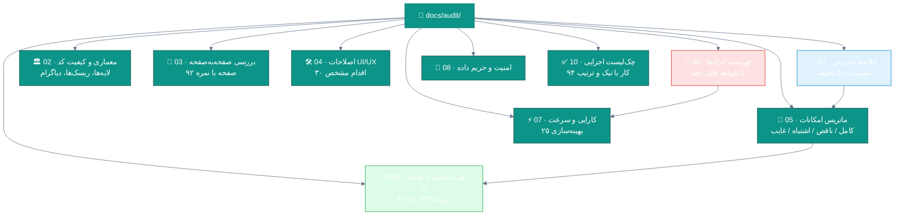

# 🔬 گزارش جامع ممیزی نرم‌افزار جامع مدیریت درمانگاه سهند

**ممیزی کامل کدبیس، رابط کاربری، امکانات، کارایی و امنیت — با شواهد خط‌به‌خط و نقشهٔ راه اجرایی**

---

> [!IMPORTANT]
> این گزارش حاصل مطالعهٔ مستقیم **۳۸۰٬۶۳۵ خط** کد (C# و XAML)، **۲۲۸ جدول** دیتابیس، **۳۳۴ نقطهٔ پایانی API** و **۹۲ صفحهٔ رابط کاربری** است. هیچ یافته‌ای بدون ارجاع به فایل و شمارهٔ خط گزارش نشده؛ هرجا استنباط بوده، صریح اعلام شده است.

> [!TIP]
> **برای اجرا، از چک‌لیست شروع کنید:** [**۱۰ · چک‌لیست اجرایی**](10-implementation-checklist.md) — ۹۴ کار به ترتیب پیاده‌سازی، هر کدام با تیک، تخمین زمان و ارجاع به سند مربوطه. هر فاز فقط با عبور از «دروازهٔ پذیرش» خودش به فاز بعد می‌رسد.

---

## 🧭 نقشهٔ گزارش

---

## 📊 داشبورد امتیازها

| حوزه | امتیاز | نوار | وضعیت |
|:--|:--:|:--|:--:|
| معماری و ساختار | **۸.۶** / ۱۰ | `▰▰▰▰▰▰▰▰▰▱` | 🟢 عالی |
| کیفیت کد و نگهداشت‌پذیری | **۷.۲** / ۱۰ | `▰▰▰▰▰▰▰▱▱▱` | 🟢 خوب |
| پوشش امکانات دامنه | **۸.۸** / ۱۰ | `▰▰▰▰▰▰▰▰▰▰` | 🟢 عالی |
| رابط کاربری (UI) | **۷.۶** / ۱۰ | `▰▰▰▰▰▰▰▰▱▱` | 🟢 خوب |
| تجربهٔ کاربری (UX) | **۶.۹** / ۱۰ | `▰▰▰▰▰▰▰▱▱▱` | 🟡 قابل بهبود |
| دسترس‌پذیری (A11y) | **۲.۵** / ۱۰ | `▰▰▱▱▱▱▱▱▱▱` | 🔴 ضعیف |
| کارایی و سرعت | **۶.۸** / ۱۰ | `▰▰▰▰▰▰▰▱▱▱` | 🟡 قابل بهبود |
| امنیت و حریم داده | **۷.۴** / ۱۰ | `▰▰▰▰▰▰▰▱▱▱` | 🟢 خوب |
| آزمون و تضمین کیفیت | **۷.۰** / ۱۰ | `▰▰▰▰▰▰▰▱▱▱` | 🟢 خوب |
| آمادگی عملیاتی و استقرار | **۷.۸** / ۱۰ | `▰▰▰▰▰▰▰▰▱▱` | 🟢 خوب |
| **امتیاز کل محصول** | **۷.۲** / ۱۰ | `▰▰▰▰▰▰▰▱▱▱` | 🟢 **محصول پختهٔ تجاری** |

> [!TIP]
> **قضاوت یک‌خطی:** این یک محصول «نمونهٔ اولیه» نیست؛ یک نرم‌افزار درمانگاهی بالغ با معماری تمیز، دامنهٔ غنی و آزمون‌های واقعی است که فاصلهٔ آن با «محصول درجه‌یک» در سه چیز است: **دسترس‌پذیری/ریزتعامل‌های رابط کاربری**، **کارایی در لایهٔ نمایش و پرس‌وجوها** و **چند شکاف امکاناتی مشخص** (که یکی از آن‌ها یک ایراد واقعیِ دسترسی‌ست و در بخش ۰۵ و ۰۶ با شواهد آمده).

---

## 🗂فهرست اسناد

| # | سند | چه چیزی در آن است | مخاطب |
|:-:|:--|:--|:--|
| ۰۱ | [خلاصهٔ مدیریتی](01-executive-summary.md) | ۱۲ یافتهٔ کلیدی، جدول ریسک، تصمیم‌های پیشنهادی | مدیر محصول / مالک |
| ۰۲ | [معماری و کیفیت کد](02-architecture-review.md) | لایه‌ها، جریان داده، نقض‌ها، کلاس‌های خدا، بدهی فنی | تیم فنی |
| ۰۳ | [بررسی صفحه‌به‌صفحه](03-ui-ux-pages.md) | ۹۲ صفحه و فرم با نمره، نقاط قوت و ضعف هر صفحه | طراح / محصول |
| ۰۴ | [اصلاحات UI/UX](04-ui-ux-fixes.md) | ۳۰ اقدام اجرایی با اولویت، تخمین کار و معیار پذیرش | طراح / فرانت‌اند |
| ۰۵ | [ماتریس امکانات](05-feature-matrix.md) | کامل / ناقص / اشتباه / غایب + ۳۶ قابلیت پیشنهادی | محصول / مالک |
| ۰۶ | [فهرست ایرادها](06-defects.md) | ۴۲ ایراد با شدت، شواهد `فایل:خط`، اثر و راه‌حل | تیم فنی |
| ۰۷ | [کارایی و سرعت](07-performance.md) | پروفایل گلوگاه‌ها + ۲۵ بهینه‌سازی با تخمین اثر | بک‌اند / فرانت |
| ۰۸ | [امنیت و حریم داده](08-security-privacy.md) | RBAC، توکن، دادهٔ بیمار، انطباق، چک‌لیست سخت‌سازی | امنیت / مدیر سامانه |
| ۰۹ | [قوت/ضعف و نقشهٔ راه](09-swot-roadmap.md) | SWOT وزنی + برنامهٔ ۹۰/۱۸۰/۳۶۵ روزه | مالک / مدیر فنی |
| ۱۰ | [**چک‌لیست اجرایی**](10-implementation-checklist.md) | **۹۴ کار با تیک، به ترتیب پیاده‌سازی، در ۷ فاز** | **تیم اجرا / مدیر پروژه** |

---

## 🎯 روش ممیزی

| گام | روش | ابزار / معیار |
|:-:|:--|:--|
| ۱ | پیمایش کامل ساختار راهکار و شمارش خودکار شاخص‌ها | `find`, `wc`, `grep` روی کل مخزن |
| ۲ | خواندن دقیق نقاط ورود و بحرانی | `Program.cs`، `App.xaml.cs`، `MainWindowViewModel`، DbContext |
| ۳ | نمونه‌گیری هدفمند از ۹۲ نما و ۷۳ مدل‌نما | الگوهای تکراری، ضدالگوها، ناهمگونی |
| ۴ | تحلیل ایستا برای ضدالگوها | `IsBusy` بدون `finally`، `_ =` (fire-and-forget)، `Contains` در جستجو، پذیرش کلید JWT |
| ۵ | بررسی تصویری ۱۸ صفحهٔ کلیدی | اسکرین‌شات‌های `docs/screenshots` |
| ۶ | تطبیق کد با ادعای README | شمارش واقعی جداول، اندپوینت‌ها، فرم‌ها و ماژول‌ها |
| ۷ | ساخت فهرست شواهد و رتبه‌بندی شدت | معیار P0–P3 + اثر بر کاربر و ریسک کسب‌وکار |

### 🔢 شاخص‌های پایه (اندازه‌گیری‌شده، نه نقل‌شده)

| شاخص | مقدار واقعی | ادعای README | تطابق |
|:--|:--:|:--:|:--:|
| خطوط کد (C# + XAML) | ۳۸۰٬۶۳۵ | — | — |
| فایل‌های C# | ۹۶۵ | — | — |
| فایل‌های XAML | ۱۰۶ | — | — |
| پروژه‌های راهکار | ۱۱ (۵ اجرایی + ۵ تست + Shared) | ۶ | ➕ بیشتر |
| نقطهٔ پایانی API | **۳۳۴** | «۳۰۰+» | ✅ |
| کنترلر | ۴۴ فایل / ۲۵+ کنترلر منطقی | «۲۵+» | ✅ |
| جدول دیتابیس (Entity Configuration) | **۲۲۸** | «۹۷+» | ➕ بسیار بیشتر |
| مهاجرت EF Core | ۵۵ | — | — |
| صفحه/فرم دسکتاپ | **۹۲** (۴۶ پنجره + ۴۶ نما) | «۶۴ فرم» | ➕ بیشتر |
| مدل‌نمای (ViewModel) | ۷۳ | — | — |
| هندلر CQRS | ~۱۰۰ | — | — |
| تست خودکار | **۴۲۱** | — | ✅ |
| ایندکس تعریف‌شده | **۳٬۸۱۹** | — | ✅ قوی |
| مجوز اتمی (Permission) | ۱۵۶ بذرشده / ۶۷ استفاده‌شده | «۳۹ ماژول لایسنس» | ⚠️ ناهم‌تراز |

---

## 🚦 راهنمای خواندن سریع

> [!NOTE]
> اگر فقط **۵ دقیقه** وقت دارید: همین صفحه + [خلاصهٔ مدیریتی](01-executive-summary.md) را بخوانید.
> اگر **مسئول فنی** هستید: [۰۲](02-architecture-review.md) → [۰۶](06-defects.md) → [۰۷](07-performance.md).
> اگر **طراح یا مالک محصول** هستید: [۰۳](03-ui-ux-pages.md) → [۰۴](04-ui-ux-fixes.md) → [۰۹](09-swot-roadmap.md).
> اگر **می‌خواهید همین امروز شروع کنید:** [**چک‌لیست اجرایی**](10-implementation-checklist.md) → فاز ۰.

**قرارداد نشانه‌ها:**

| نشانه | معنا |
|:--|:--|
| 🔴 **P0** | خرابی یا ریسک بحرانی — لازم است در نسخهٔ بعدی اصلاح شود |
| 🟠 **P1** | ایراد مهم با اثر مستقیم بر کاربر یا امنیت |
| 🟡 **P2** | نقص تجربه/کارایی که باید در فصل بعدی برنامه برطرف شود |
| 🟢 **P3** | بهبود و صیقل (Nice to have) |
| ✅ | نقطهٔ قوت تأییدشده در کد |
| ⚠️ | نیاز به تصمیم محصول |
| 💡 | پیشنهاد پیشرفت فراتر از رفع نقص |

---

**تهیه‌شده با مطالعهٔ مستقیم کد — نه بر پایهٔ حدس**

هر یافته با ارجاع `مسیر/فایل.پسوند:شمارهٔ‌خط` قابل بازبینی است.

