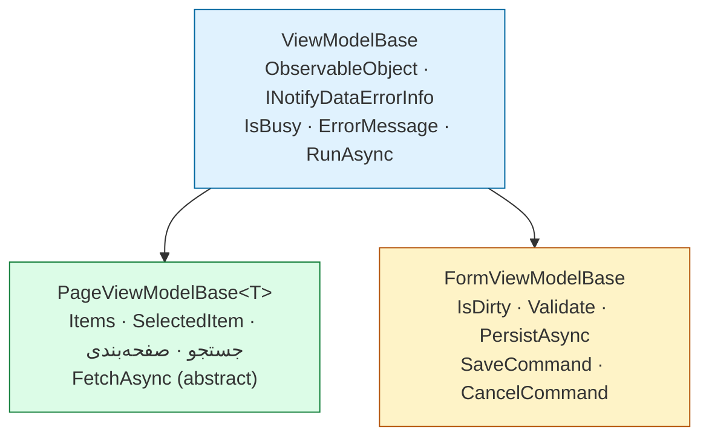
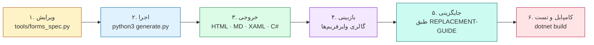

<div dir="rtl" align="center">

# 🎨 بازطراحی رابط کاربر — سهند ClinicPro

### نرم‌افزار جامع مدیریت درمانگاه سهند

**۸۱ وایرفریم · ۸۱ View · ۸۱ ViewModel · تم‌پذیر · دو زبانه**

</div>

<div dir="rtl" align="center">

| | |
|:--:|:---|
| 🏷 **نسخه** | ۱.۰ |
| 📅 **تاریخ** | ۱۴۰۴/۰۷/۱۹ |
| 🔧 **مولد** | `tools/generate.py` |
| 🔑 **منبع حقیقت** | `tools/forms_spec.py` |
| 🧩 **الگو** | MVVM · WPF · .NET 8 |
| 🎨 **تم‌ها** | ☀️ روشن · 🌙 تاریک |
| 🌐 **زبان‌ها** | 🇮🇷 فارسی · 🇺🇸 انگلیسی |

</div>

---

## 🚀 شروع سریع

### ۱. دیدنِ وایرفریم‌ها

فایل **`01-wireframes-html/index.html`** را در مرورگر باز کنید.
این گالری همه‌ی ۸۱ وایرفریم را در ۱۵ گروهِ موضوعی نمایش می‌دهد و روی هر کارت
که کلیک کنید، وایرفریمِ کاملِ آن فرم باز می‌شود.

### ۲. خواندنِ راهنمای جایگزینی

فایل **`REPLACEMENT-GUIDE.md`** را بخوانید — این راهنما گام‌به‌گام توضیح می‌دهد
که هر فایلِ جدید را کجا ببرید، چه چیزی را تغییر دهید و چگونه تست کنید.

### ۳. بازتولید (در صورت تغییرِ مشخصات)

```bash
python3 redesign/tools/generate.py
```

---

## 📁 ساختار پوشه‌ها

```
redesign/
│
├── 📄 README.md                 این فایل
├── 📘 REPLACEMENT-GUIDE.md      راهنمای جامع جایگزینی (بسیار مفصل)
│
├── ⚙️ 00-foundation/            زیرساختِ مشترک
│   ├── App.xaml / App.xaml.cs   نقطه‌ی تجمیعِ منابع
│   ├── Themes/                  تمِ روشن، تمِ تاریک، توکن‌ها، تایپوگرافی
│   ├── Controls/                PageHeader · StatCard · SearchBox ·
│   │                            EmptyState · StatusBadge · PasswordHelper
│   ├── Base/                    ViewModelBase · PageViewModelBase ·
│   │                            FormViewModelBase · RelayCommand
│   ├── Converters/              تاریخ شمسی · پول · Enum · تهی/بولی
│   └── Localization/            Strings.resx · Strings.en.resx ·
│                                LocalizationManager · LocExtension
│
├── 🖼 01-wireframes-html/       وایرفریم‌های گرافیکیِ زیبا
│   ├── index.html               🎨 گالریِ قابل مرور
│   └── {Name}.html              × ۸۱
│
├── 📝 02-wireframes-md/         وایرفریم‌های متنی + مستند المان‌ها
│   └── {Name}.md                × ۸۱
│
├── 🎨 03-views/                 Viewهای XAML بازطراحی‌شده
│   └── {Name}.xaml              × ۸۱
│
├── 🧠 04-viewmodels/            ViewModelهای C#‎ متناظر
│   └── {Key}ViewModel.cs        × ۸۱
│
└── 🔧 tools/
    ├── forms_spec.py            🔑 مشخصات ۸۱ فرم (تنها منبع حقیقت)
    └── generate.py              مولدِ خودکار چهارگانه
```

---

## 🎯 ویژگی‌های کلیدی

| ویژگی | توضیح | فایل‌های مرتبط |
|:---|:---|:---|
| 🎨 **تم‌پذیری کامل** | هیچ رنگِ ثابتی در هیچ Viewای نیست؛ همه با `DynamicResource` از توکن‌ها می‌آیند | `00-foundation/Themes/` |
| 🌙 **دو تم** | روشن و تاریک، با تعویضِ در لحظه و بدون ری‌استارت | `Colors.Light.xaml` · `Colors.Dark.xaml` · `ThemeManager.cs` |
| 🌐 **دو زبانه** | هیچ متنِ ثابتی نیست؛ همه از `Strings.resx` با `{loc:Loc}` می‌آیند | `00-foundation/Localization/` |
| 📱 **RTL/LTR خودکار** | جهتِ رابط بر اساس زبان تنظیم می‌شود | `LocalizationManager.IsRightToLeft` |
| 🧩 **کنترل‌های بازاستفاده** | ۵ کنترلِ سفارشی برای یکپارچگیِ بصری | `00-foundation/Controls/` |
| 🧱 **کلاس‌های پایه** | مدیریتِ وضعیت، صفحه‌بندی، اعتبارسنجی در یک‌جا | `00-foundation/Base/` |
| 🔁 **تولید خودکار** | تغییر در یک فایل → بازتولیدِ ۳۲۴ فایل | `tools/` |
| ♿ **دسترسی‌پذیری** | کنتراستِ مناسب، نشانگرِ فوکوس، برچسبِ الزامی | همه‌جا |

---

## 📊 آمار

| شاخص | تعداد |
|:---|:--:|
| 📄 کل فایل‌های تولیدی | **۳۵۶** |
| 🖼 وایرفریم‌های HTML | ۸۲ (۸۱ + گالری) |
| 📝 وایرفریم‌های Markdown | ۸۱ |
| 🎨 Viewهای XAML | ۸۱ |
| 🧠 ViewModelهای C#‎ | ۸۱ |
| 🔑 کلیدهای زبان | ۱٬۱۲۶ |
| 🗂 گروه‌های موضوعی | ۱۵ |
| ⚙️ فایل‌های زیرساخت | ۳۰ |

### توزیعِ نوعِ فرم‌ها

| نوع | تعداد | نماد | شرح |
|:---|:--:|:--:|:---|
| `list` | ۲۴ | 📋 | صفحه‌ی فهرستی با جدول، فیلتر و صفحه‌بندی |
| `form` | ۲۱ | 📝 | فرمِ ورود/ویرایش داده |
| `detail` | ۱۸ | 🔍 | صفحه‌ی جزئیات با تب‌ها |
| `dialog` | ۱۲ | 💬 | پنجره‌ی گفتگو |
| `dashboard` | ۱ | 🏠 | پیشخوان با کارت‌های شاخص |
| `settings` | ۱ | ⚙️ | تنظیمات |
| `login` | ۱ | 🔐 | ورود |
| `splash` | ۱ | ⏳ | صفحه‌ی آغازین |
| `shell` | ۱ | 🖥 | قاب اصلی |
| `viewer` | ۱ | 🖼 | نمایشگر |

### توزیعِ گروه‌ها

| گروه | تعداد | گروه | تعداد |
|:---|:--:|:---|:--:|
| 💰 مالی | ۱۱ | 🖼 تصویربرداری | ۲ |
| 🏠 پیشخوان | ۱۰ | 🏢 سازمانی | ۲ |
| 👔 منابع انسانی | ۱۰ | 📱 ارتباطات | ۲ |
| 🏥 پذیرش | ۹ | 📅 نوبت‌دهی | ۳ |
| 🩺 ویزیت | ۷ | 🧪 آزمایشگاه | ۳ |
| 👥 بیماران | ۵ | 💊 نسخه | ۴ |
| ⚙️ سیستم | ۵ | 🏥 داروخانه | ۴ |
| 📊 گزارشات | ۴ | | |

---

## 🧩 زیرساخت

### کلاس‌های پایه



| کلاس | مسئولیت | اعضای کلیدی |
|:---|:---|:---|
| `ViewModelBase` | وضعیت، خطاها، اعتبارسنجی، اجرای امنِ عملیات | `IsBusy` · `RunAsync` · `AddError` · `ShowError` · `LoadAsync` |
| `PageViewModelBase<T>` | صفحات فهرستی: بارگذاری، جستجو، صفحه‌بندی، CRUD | `Items` · `SearchText` · `PageNumber` · `FetchAsync` |
| `FormViewModelBase` | فرم‌ها: ردیابیِ تغییرات، اعتبارسنجی، ذخیره | `IsDirty` · `Validate` · `PersistAsync` · `CloseAction` |

### کنترل‌های سفارشی

| کنترل | کاربرد |
|:---|:---|
| `PageHeader` | هدر یکپارچه‌ی صفحه: عنوان، زیرعنوان، شکلک، دکمه‌ی اصلی و ثانویه |
| `StatCard` | کارتِ شاخص: عنوان، مقدار، روند (▲/▼/■) و رنگِ متناسب |
| `SearchBox` | جعبه‌ی جستجو با شکلک، متنِ راهنما و دکمه‌ی پاک‌کردن |
| `EmptyState` | وضعیتِ تهی: شکلک، عنوان، پیام و دکمه‌ی اقدام |
| `StatusBadge` | نشانِ وضعیت با ۵ سطح: موفقیت، هشدار، خطر، اطلاعات، خنثی |

### مدیرها

| مدیر | وظیفه | API |
|:---|:---|:---|
| `ThemeManager` | تعویض تم در لحظه | `Apply` · `Toggle` · `ApplySaved` · `Current` · `ThemeChanged` |
| `LocalizationManager` | تعویض زبان در لحظه | `Get` · `SetCulture` · `ApplySaved` · `IsRightToLeft` · `LanguageChanged` |
| `LocExtension` | اتصالِ کلیدِ زبان به XAML | `{loc:Loc Key}` · `{loc:Loc Key, Fallback=...}` |

---

## 🔄 گردش کارِ توسعه



### افزودن یک فرم جدید

۱. در `tools/forms_spec.py` ثبت کنید:

```python
F("TriageView", "تریاژ", "🚑", "list",
  "صف انتظار و اولویت‌بندی بیماران", "پذیرش",
  kpis=[("🚑", "در انتظار", "۰"), ("🩺", "در حال ویزیت", "۰")],
  filters=[("search", "جستجو", "search"), ("status", "وضعیت", "combo")],
  cols=[("Code", "کد", "100"), ("PatientName", "بیمار", "*"),
        ("TriageLevel", "سطح", "90"), ("Status", "وضعیت", "110")],
  actions=[("New", "پذیرش جدید", "Primary"), ("Refresh", "تازه‌سازی", "Ghost")],
  notes="جدولِ زنده با به‌روزرسانیِ خودکار هر ۳۰ ثانیه")
```

۲. مولد را اجرا کنید:

```bash
python3 redesign/tools/generate.py
```

۳. چهار فایلِ جدید ساخته می‌شود:

```
01-wireframes-html/TriageView.html      ← وایرفریم گرافیکی
02-wireframes-md/TriageView.md          ← وایرفریم متنی
03-views/TriageView.xaml                ← View
04-viewmodels/TriageViewModel.cs        ← ViewModel
```

۴. کلیدهای زبانِ جدید به‌طور خودکار به `Strings.resx` و `Strings.en.resx` افزوده می‌شوند.

---

## 📖 قالبِ مشخصات

### فیلدها

```
"prop:type:label[:*]"
```

| نوع | کنترل | نوع C#‎ |
|:---|:---|:---|
| `text` | TextBox | `string` |
| `textarea` | TextBox چندخطی | `string` |
| `number` | TextBox عددی | `decimal` |
| `money` | TextBox پولی (با جداکننده) | `decimal` |
| `date` | DatePicker (شمسی) | `DateTime?` |
| `time` | TimePicker | `TimeSpan?` |
| `combo` | ComboBox | `string` / `Guid?` |
| `lookup` | SearchBox + انتخاب | `Guid?` |
| `check` | CheckBox | `bool` |
| `password` | PasswordBox | `string` |
| `phone` | TextBox تلفن | `string` |
| `national` | TextBox کد ملی | `string` |
| `barcode` | TextBox بارکد | `string` |
| `file` | انتخاب فایل | `string` |

نشانه‌ی `*` در انتها ⇒ فیلدِ الزامی (در اعتبارسنجی لحاظ می‌شود).

### سایر بخش‌ها

```python
kpis    = [(icon, label, value), ...]         # کارت‌های شاخص
filters = [(name, label, control), ...]       # control: search|combo|date|check
cols    = [(binding, header, width), ...]     # width: عدد یا "*"
sections= [(title, icon, [fields]), ...]      # بخش‌های فرم
actions = [(command, label, style), ...]      # style: Primary|Secondary|Ghost|Danger|Success
tabs    = [(title, icon), ...]                # تب‌ها
```

---

## ⚠️ نکات مهم

> [!WARNING]
> **کامپایل نشده است.** در محیطِ تولید این مجموعه، .NET SDK در دسترس نبود،
> بنابراین فایل‌های XAML و C#‎ عملاً کامپایل نشده‌اند. پس از جایگزینی حتماً
> `dotnet build` اجرا کنید و خطاهای احتمالی را برطرف نمایید.

> [!IMPORTANT]
> **ViewModelها اسکلت هستند.** ویژگی‌ها، فرمان‌ها و اعتبارسنجی کامل‌اند،
> اما بدنه‌ی متدها با `// TODO` مشخص شده و باید به سرویس‌های واقعی متصل شوند.
> جزئیات در [گام ۳ راهنما](REPLACEMENT-GUIDE.md#۹-گام-۳-انطباق-viewmodelها).

> [!NOTE]
> **بازتولید، خروجی را بازنویسی می‌کند.** اگر در پوشه‌های `01` تا `04` تغییرِ
> دستی داده‌اید، آن را در `forms_spec.py` اعمال کنید تا از بین نرود.

---

## 🗺 نقشه‌ی راه پیشنهادی

| مرحله | کار | زمان تقریبی |
|:--:|:---|:--:|
| ۱ | نصب زیرساخت و ثبت منابع (`App.xaml`) | ۱ ساعت |
| ۲ | جایگزینی `MainWindow` و `LoginWindow` | ۲ ساعت |
| ۳ | جایگزینی `DashboardView` | ۱ ساعت |
| ۴ | جایگزینی گروه‌های بیماران، نوبت‌دهی، پذیرش | ۴ ساعت |
| ۵ | جایگزینی ماژول‌های تخصصی (ویزیت، نسخه، آزمایشگاه، تصویربرداری) | ۴ ساعت |
| ۶ | جایگزینی مالی، منابع انسانی، سازمانی | ۳ ساعت |
| ۷ | جایگزینی گزارشات، سیستم، ارتباطات | ۲ ساعت |
| ۸ | انطباقِ ViewModelها با سرویس‌های واقعی | ۸ تا ۱۶ ساعت |
| ۹ | تست و رفع اشکال | ۴ ساعت |

---

<div dir="rtl" align="center">

**📘 مستندات کامل:** [`REPLACEMENT-GUIDE.md`](REPLACEMENT-GUIDE.md)
**🖼 گالری وایرفریم‌ها:** [`01-wireframes-html/index.html`](01-wireframes-html/index.html)

📅 ۱۴۰۴/۰۷/۱۹ · 🔖 نسخه ۱.۰

</div>
