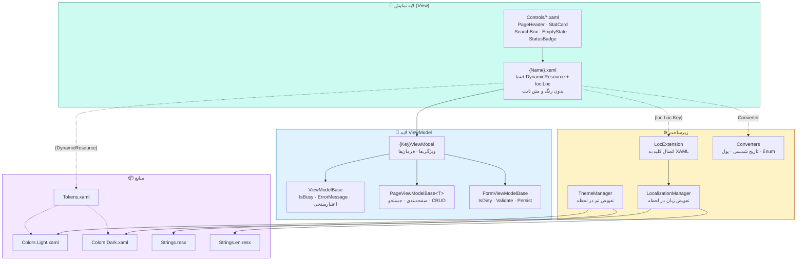
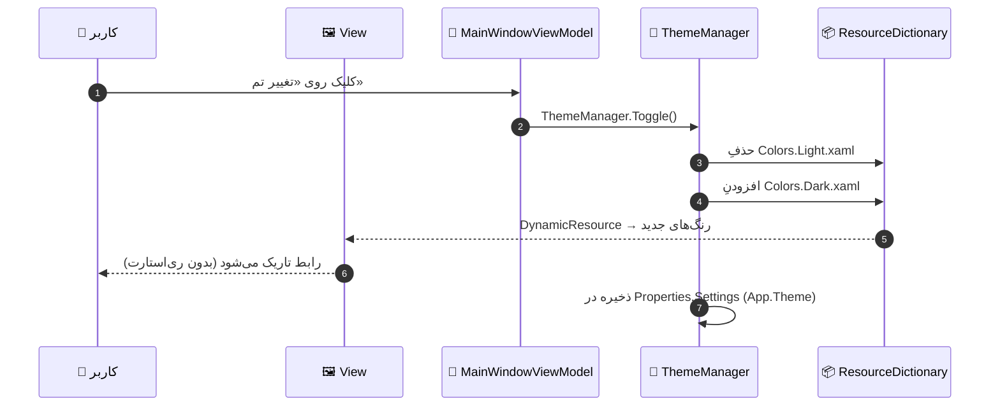
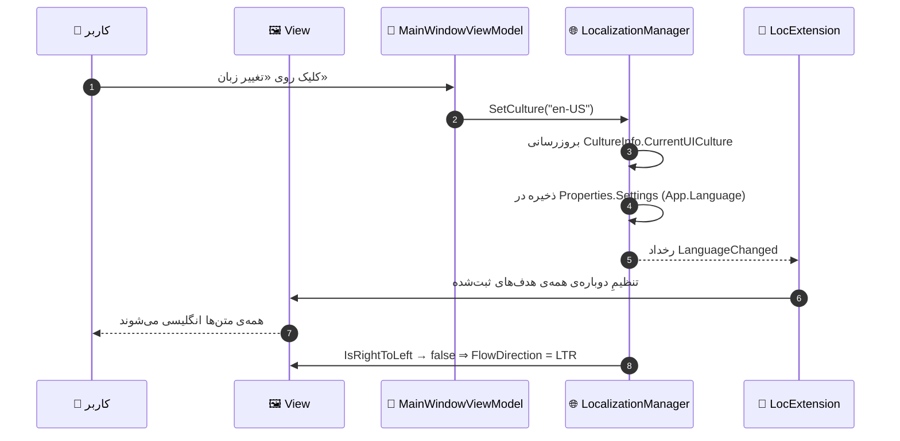
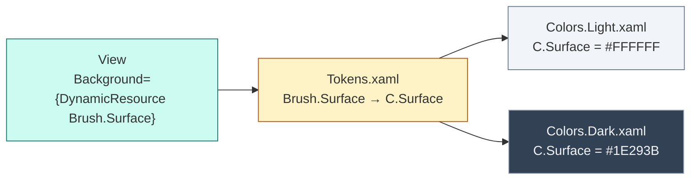

<div dir="rtl" align="center">

# 📘 راهنمای جامع جایگزینی

### بازطراحی رابط کاربرِ «نرم‌افزار جامع مدیریت درمانگاه سهند»

</div>

<div dir="rtl" align="center">

| | |
|:--:|:---|
| 🏷 **نسخه** | ۱.۰ |
| 📅 **تاریخ** | ۱۴۰۴/۰۷/۱۹ |
| 📄 **تعداد فرم‌ها** | ۸۱ فرم و صفحه |
| 🎨 **تم‌ها** | روشن (Light) و تاریک (Dark) |
| 🌐 **زبان‌ها** | فارسی (fa-IR) و انگلیسی (en-US) |
| 🧩 **الگو** | MVVM · WPF · .NET 8 |

</div>

---

## 📑 فهرست مطالب

| # | بخش | شرح |
|:--:|:---|:---|
| ۱ | [مقدمه و اهداف](#۱-مقدمه-و-اهداف) | چرا این بازطراحی و چه چیزی تحویل شده است |
| ۲ | [هشدارهای مهم](#۲-هشدارهای-مهم) | آن‌چه باید پیش از اجرا بدانید |
| ۳ | [درخت پوشه‌ها](#۳-درخت-پوشهها) | محل دقیق هر فایل |
| ۴ | [معماری جدید](#۴-معماری-جدید) | نمودار لایه‌ها و جریان داده |
| ۵ | [گام ۰: نصب پایه](#۵-گام-۰-نصب-زیرساخت-foundation) | فایل‌های Foundation |
| ۶ | [گام ۱: ثبت منابع](#۶-گام-۱-ثبت-منابع-در-appxaml) | `App.xaml` و `App.xaml.cs` |
| ۷ | [گام ۲: جایگزینی فایل‌ها](#۷-گام-۲-جایگزینی-فایلها) | دو روش: تدریجی و یک‌باره |
| ۸ | [جدول نگاشت کامل](#۸-جدول-نگاشت-کامل-۸۱-فرم) | همه‌ی ۸۱ فرم، فایل‌به‌فایل |
| ۹ | [گام ۳: انطباق ViewModelها](#۹-گام-۳-انطباق-viewmodelها) | اتصال به سرویس‌های واقعی |
| ۱۰ | [گام ۴: تم‌پذیری](#۱۰-گام-۴-تمپذیری) | تعویض و افزودن تم |
| ۱۱ | [گام ۵: دو زبانه‌سازی](#۱۱-گام-۵-دو-زبانهسازی) | افزودن زبان سوم |
| ۱۲ | [گام ۶: تست و پذیرش](#۱۲-گام-۶-تست-و-پذیرش) | چک‌لیست نهایی |
| ۱۳ | [رفع اشکال‌های رایج](#۱۳-رفع-اشکالهای-رایج) | جدول خطا → راه‌حل |
| ۱۴ | [پیوست الف: توکن‌ها](#پیوست-الف-فهرست-توکنها) | کلیدهای طراحی |
| ۱۵ | [پیوست ب: کلیدهای زبان](#پیوست-ب-کلیدهای-پرکاربرد-زبان) | کلیدهای مشترک |

---

## ۱. مقدمه و اهداف

<div dir="rtl">

این مجموعه، بازطراحیِ کاملِ لایه‌ی نمایش (Presentation Layer) برنامه‌ی دسکتاپِ سهند است.
هدف آن بوده است که **ظاهرِ فعلی** — که از ترکیبِ سبک‌های پراکنده و رنگ‌های ثابت ساخته شده — با
یک **سیستم طراحیِ یکپارچه** جایگزین شود که چهار ویژگیِ کلیدی داشته باشد:

</div>

| 🎯 هدف | 📝 توضیح | ✅ وضعیت |
|:---|:---|:--:|
| **زیبایی و به‌روز بودن** | طراحی مدرن با فاصله‌گذاری ۴پیکسلی، گوشه‌های گرد، سایه‌های ملایم و سلسله‌مراتب بصری روشن | ✅ |
| **تم‌پذیری کامل** | هیچ رنگِ ثابتی در هیچ Viewای وجود ندارد؛ همه چیز از `DynamicResource` می‌آید | ✅ |
| **دو زبانه بودن** | هیچ متنِ ثابتی در هیچ View یا ViewModelای وجود ندارد؛ همه از `Strings.resx` می‌آیند | ✅ |
| **نگه‌داری آسان** | تولیدِ خودکار از یک فایل مشخصات (`tools/forms_spec.py`) — تغییر در یک‌جا، بازتولیدِ همه‌جا | ✅ |

### 📦 آن‌چه تحویل شده است

| پوشه | محتوا | تعداد |
|:---|:---|:--:|
| `00-foundation/` | زیرساخت: تم‌ها، کنترل‌ها، کلاس‌های پایه، مدیر زبان، مدیر تم | ۳۰ فایل |
| `01-wireframes-html/` | وایرفریم‌های گرافیکیِ زیبا + گالریِ قابل مرور | ۸۲ فایل |
| `02-wireframes-md/` | وایرفریم‌های متنی + مستندِ المان‌ها | ۸۱ فایل |
| `03-views/` | Viewهای XAMLِ بازطراحی‌شده | ۸۱ فایل |
| `04-viewmodels/` | ViewModelهای C#‎ متناظر | ۸۱ فایل |
| `tools/` | مشخصاتِ ۸۱ فرم + مولدِ خودکار | ۲ فایل |

**مجموع:** ۳۵۶ فایل · حدود ۱۱۲۶ کلید زبان

---

## ۲. هشدارهای مهم

> [!WARNING]
> **۱. کامپایل نشده است.** در محیطِ تولید این مستند، **.NET SDK در دسترس نبود**؛ بنابراین
> هیچ‌یک از فایل‌های XAML و C#‎ عملاً کامپایل و اجرا نشده‌اند. ساختار، نحو و نام‌گذاری‌ها با
> دقتِ زیاد و بر اساسِ کدِ موجودِ پروژه نوشته شده، اما **حتماً پس از جایگزینی یک `dotnet build`
> اجرا کنید** و خطاهای جزئیِ احتمالی را برطرف نمایید.

> [!IMPORTANT]
> **۲. ViewModelها «اسکلت» هستند، نه پیاده‌سازیِ نهایی.** هر ViewModel:
> - ویژگی‌ها، فرمان‌ها و اعتبارسنجیِ کامل دارد؛
> - اما بدنه‌ی متدها با `// TODO` مشخص شده و باید به **سرویس‌های واقعیِ پروژه** متصل شود.
>
> این یک تصمیمِ آگاهانه است: اتصالِ خودکار به `ClinicProDbContext` و ۱۱۲ DbSet بدون دانستنِ
> قراردادِ سرویس‌ها، کدی تولید می‌کرد که یا کامپایل نمی‌شد یا رفتارِ اشتباه داشت.

> [!NOTE]
> **۳. نام‌گذاری.** کلاس‌های ViewModel با حذفِ پسوند `View` / `Window` نام‌گذاری شده‌اند:
> `PatientsView.xaml` ← `PatientsViewModel.cs` · `LoginWindow.xaml` ← `LoginViewModel.cs`
> استثنا: `MainWindow.xaml` ← `MainWindowViewModel.cs` (نام کامل حفظ شد).

---

## ۳. درخت پوشه‌ها

```
redesign/
│
├── 00-foundation/                          ← زیرساخت (کپی در ریشه‌ی پروژه‌ی دسکتاپ)
│   ├── App.xaml                            ← ادغامِ همه‌ی منابع
│   ├── App.xaml.cs                         ← مقداردهیِ تم و زبان در آغاز
│   │
│   ├── Themes/                             → src/.../Themes/
│   │   ├── Colors.Light.xaml               ← پالتِ تمِ روشن
│   │   ├── Colors.Dark.xaml                ← پالتِ تمِ تاریک
│   │   ├── Tokens.xaml                     ← توکن‌های معنایی (فاصله، شعاع، قلم‌مو)
│   │   ├── Typography.xaml                 ← سبک‌های متنی
│   │   ├── ThemeManager.cs                 ← تعویض تم در زمان اجرا
│   │   └── Controls/
│   │       ├── Buttons.xaml                ← Btn.Primary / Secondary / Danger / ...
│   │       ├── Inputs.xaml                 ← Input.TextBox / ComboBox / Date / ...
│   │       └── DataDisplay.xaml            ← Grid.Modern / Card / Badge / Tab
│   │
│   ├── Controls/                           → src/.../Controls/
│   │   ├── PageHeader.xaml(.cs)            ← هدر یکپارچه‌ی صفحه
│   │   ├── StatCard.xaml(.cs)              ← کارتِ شاخص با روند
│   │   ├── SearchBox.xaml(.cs)             ← جعبه‌ی جستجو با دکمه‌ی پاک‌کردن
│   │   ├── EmptyState.xaml(.cs)            ← وضعیتِ تهی
│   │   ├── StatusBadge.xaml(.cs)           ← نشانِ وضعیت رنگی
│   │   ├── PasswordHelper.cs               ← اتصالِ امنِ PasswordBox
│   │   └── Converters.xaml                 ← اعلانِ منابعِ تبدیل‌گرها
│   │
│   ├── Base/                               → src/.../ViewModels/Base/
│   │   ├── ViewModelBase.cs                ← پایه: Busy، خطا، اعتبارسنجی
│   │   ├── PageViewModelBase.cs            ← پایه‌ی صفحات فهرستی (صفحه‌بندی، جستجو)
│   │   ├── FormViewModelBase.cs            ← پایه‌ی فرم‌ها (ذخیره، انصراف، تغییرات)
│   │   └── RelayCommand.cs                 ← فرمانِ دستی (در صورت نیاز)
│   │
│   ├── Converters/Converters.cs            → src/.../Converters/
│   │
│   └── Localization/                       → src/.../Localization/
│       ├── Strings.resx                    ← فارسی (پیش‌فرض)
│       ├── Strings.en.resx                 ← انگلیسی
│       ├── LocalizationManager.cs          ← مدیرِ زبان
│       └── LocExtension.cs                 ← افزونه‌ی {loc:Loc} در XAML
│
├── 01-wireframes-html/                     ← وایرفریم‌های گرافیکی
│   ├── index.html                          ← 🎨 گالریِ قابل مرور (از این‌جا شروع کنید)
│   └── {Name}.html                         ← ۸۱ فایل
│
├── 02-wireframes-md/                       ← وایرفریم‌های متنی و مستند
│   └── {Name}.md                           ← ۸۱ فایل
│
├── 03-views/                               → src/.../Views/
│   └── {Name}.xaml                         ← ۸۱ فایل
│
├── 04-viewmodels/                          → src/.../ViewModels/
│   └── {Key}ViewModel.cs                   ← ۸۱ فایل
│
└── tools/
    ├── forms_spec.py                       ← 🔑 تنها منبع حقیقت (مشخصات ۸۱ فرم)
    └── generate.py                         ← مولدِ خودکار
```

---

## ۴. معماری جدید

### ۴.۱ نمودار لایه‌ها



### ۴.۲ جریانِ تعویضِ تم



### ۴.۳ جریانِ تعویضِ زبان



---

## ۵. گام ۰: نصب زیرساخت (Foundation)

زیرساخت باید **یک‌باره** و **پیش از** جایگزینیِ هر فرمی نصب شود.

### ۵.۱ جدول کپی

| مبدأ (در `redesign/00-foundation/`) | مقصد (در `src/Sahand.ClinicPro.Desktop/`) | عمل |
|:---|:---|:--:|
| `App.xaml` | `App.xaml` | 🔄 ادغام با فایل موجود |
| `App.xaml.cs` | `App.xaml.cs` | 🔄 ادغام با فایل موجود |
| `Themes/**` | `Themes/**` | ➕ جدید |
| `Controls/**` | `Controls/**` | ➕ جدید (در صورت وجود تداخل، ادغام) |
| `Base/**` | `ViewModels/Base/**` | ➕ جدید |
| `Converters/Converters.cs` | `Converters/Converters.cs` | 🔄 ادغام |
| `Localization/**` | `Localization/**` | ➕ جدید |

### ۵.۲ دستورات

```bash
cd Sahand_ClinicPro
DESKTOP="src/Sahand.ClinicPro.Desktop"
SRC="redesign/00-foundation"

# ساخت پوشه‌ها
mkdir -p "$DESKTOP/Themes/Controls" \
         "$DESKTOP/Controls" \
         "$DESKTOP/ViewModels/Base" \
         "$DESKTOP/Converters" \
         "$DESKTOP/Localization"

# کپی زیرساخت
cp -r "$SRC/Themes/."        "$DESKTOP/Themes/"
cp -r "$SRC/Controls/."      "$DESKTOP/Controls/"
cp -r "$SRC/Base/."          "$DESKTOP/ViewModels/Base/"
cp -r "$SRC/Converters/."    "$DESKTOP/Converters/"
cp -r "$SRC/Localization/."  "$DESKTOP/Localization/"
```

### ۵.۳ تنظیماتِ پروژه

فایل `Sahand.ClinicPro.Desktop.csproj` را باز کنید و مطمئن شوید که:

```xml
<PropertyGroup>
    <!-- برای پشتیبانی از منابعِ زبان -->
    <NeutralLanguage>fa-IR</NeutralLanguage>
    <SupportedCultures>fa-IR;en-US</SupportedCultures>
</PropertyGroup>

<ItemGroup>
    <!-- بسته‌ها (در Directory.Packages.props موجودند) -->
    <PackageReference Include="CommunityToolkit.Mvvm" />
    <PackageReference Include="Microsoft.Extensions.Logging.Abstractions" />
</ItemGroup>

<ItemGroup>
    <!-- فایل‌های XAML باید به عنوان Page ثبت شوند -->
    <Page Update="Themes\**\*.xaml">
        <Generator>MSBuild:Compile</Generator>
    </Page>
    <Page Update="Controls\**\*.xaml">
        <Generator>MSBuild:Compile</Generator>
    </Page>
</ItemGroup>
```

> [!TIP]
> اگر پروژه از `Directory.Packages.props` (مدیریت متمرکز بسته) استفاده می‌کند،
> نسخه را در آن‌جا و بدون `Version=` در این‌جا بنویسید.

---

## ۶. گام ۱: ثبت منابع در App.xaml

### ۶.۱ ادغام

فایل `redesign/00-foundation/App.xaml` را با `src/Sahand.ClinicPro.Desktop/App.xaml` ادغام کنید.
نکته‌ی حیاتی: **بخش `MergedDictionaries` را کامل جایگزین کنید** و سپس منابعِ قدیمیِ خود را
(در صورت نیاز) در انتها بیفزایید تا سبک‌های جدید بر آن‌ها غلبه کنند.

```xml
<Application.Resources>
    <ResourceDictionary>
        <ResourceDictionary.MergedDictionaries>
            <ResourceDictionary Source="Themes/Colors.Light.xaml" />
            <ResourceDictionary Source="Themes/Tokens.xaml" />
            <ResourceDictionary Source="Themes/Typography.xaml" />
            <ResourceDictionary Source="Themes/Controls/Buttons.xaml" />
            <ResourceDictionary Source="Themes/Controls/Inputs.xaml" />
            <ResourceDictionary Source="Themes/Controls/DataDisplay.xaml" />
            <ResourceDictionary Source="Controls/Converters.xaml" />

            <!-- منابع قدیمیِ پروژه (اختیاری، برای سازگاری موقت) -->
            <!-- <ResourceDictionary Source="Styles/Legacy.xaml" /> -->
        </ResourceDictionary.MergedDictionaries>
    </ResourceDictionary>
</Application.Resources>
```

### ۶.۲ مقداردهی در آغاز

کد زیر را به `App.xaml.cs` بیفزایید (فایل نمونه در `redesign/00-foundation/App.xaml.cs` آماده است):

```csharp
protected override void OnStartup(StartupEventArgs e)
{
    ThemeManager.ApplySaved();          // اعمال تمِ ذخیره‌شده
    LocalizationManager.ApplySaved();   // اعمال زبانِ ذخیره‌شده

    Resources["AppFlowDirection"] =
        LocalizationManager.IsRightToLeft ? FlowDirection.RightToLeft
                                          : FlowDirection.LeftToRight;

    LocalizationManager.LanguageChanged += (_, _) =>
        Resources["AppFlowDirection"] =
            LocalizationManager.IsRightToLeft ? FlowDirection.RightToLeft
                                              : FlowDirection.LeftToRight;

    base.OnStartup(e);
}
```

### ۶.۳ تستِ سریع

پس از این گام، برنامه باید بدون خطا اجرا شود (ظاهر هنوز قدیمی است — زیرا هیچ Viewای
جایگزین نشده). اگر خطا گرفتید، ابتدا [رفع اشکال‌های رایج](#۱۳-رفع-اشکالهای-رایج) را ببینید.

✅ **تأییدیه‌ی گام ۱:** برنامه اجرا می‌شود و `ThemeManager.Toggle()` در پنجره باز، رنگ‌ها را عوض می‌کند.

---

## ۷. گام ۲: جایگزینی فایل‌ها

دو روش وجود دارد؛ **روش الف** را توصیه می‌کنیم.

### ۷.۱ روش الف — تدریجی (توصیه‌شده) 🏆

هر فرم را جداگانه جایگزین کنید، کامپایل کنید، تست کنید، بعد بروید سراغ بعدی.

```bash
#!/usr/bin/env bash
# migrate.sh — جایگزینی یک فرم
# استفاده: ./migrate.sh PatientsView

set -euo pipefail
NAME="$1"
KEY="${NAME%View}"            # PatientsView → Patients
KEY="${KEY%Window}"           # LoginWindow  → Login
DESKTOP="src/Sahand.ClinicPro.Desktop"
BACKUP="backup-views-$(date +%Y%m%d-%H%M%S)"

# ۱. پشتیبان
mkdir -p "$BACKUP"
[ -f "$DESKTOP/Views/$NAME.xaml" ]    && cp "$DESKTOP/Views/$NAME.xaml"    "$BACKUP/"
[ -f "$DESKTOP/Views/$NAME.xaml.cs" ] && cp "$DESKTOP/Views/$NAME.xaml.cs" "$BACKUP/"
[ -f "$DESKTOP/ViewModels/${KEY}ViewModel.cs" ] \
    && cp "$DESKTOP/ViewModels/${KEY}ViewModel.cs" "$BACKUP/"

# ۲. کپی View جدید
cp "redesign/03-views/$NAME.xaml" "$DESKTOP/Views/$NAME.xaml"

# ۳. کپی ViewModel جدید
cp "redesign/04-viewmodels/${KEY}ViewModel.cs" "$DESKTOP/ViewModels/"

# ۴. کامپایل
dotnet build src/Sahand.ClinicPro.Desktop -v minimal
```

> [!IMPORTANT]
> **Code-behind را حفظ کنید.** بیشتر Viewهای موجود یک `*.xaml.cs` دارند که منطقِ
> خاصِ آن فرم (بازکردنِ زیرپنجره، مدیریتِ رویدادها، ...) در آن است. فایل‌های جدید
> **تنها** `.xaml` هستند. پس از کپی:
> 1. `*.xaml.cs` قدیمی را نگه دارید؛
> 2. `InitializeComponent()` را بررسی کنید — نام کلاس باید با `x:Class` هم‌خوان باشد؛
> 3. هر ارجاع به کنترلِ `x:Name` که در View جدید حذف شده را پاک یا بازنویسی کنید.

### ۷.۲ روش ب — یک‌باره

```bash
DESKTOP="src/Sahand.ClinicPro.Desktop"
BACKUP="backup-full-$(date +%Y%m%d-%H%M%S)"

mkdir -p "$BACKUP"
cp -r "$DESKTOP/Views"      "$BACKUP/Views"
cp -r "$DESKTOP/ViewModels" "$BACKUP/ViewModels"

cp redesign/03-views/*.xaml        "$DESKTOP/Views/"
cp redesign/04-viewmodels/*.cs     "$DESKTOP/ViewModels/"

dotnet build src/Sahand.ClinicPro.Desktop -v minimal
```

> [!CAUTION]
> در روش ب باید همه‌ی `*.xaml.cs` قدیمی را **دستی** بازبینی کنید. انتظار داشته باشید
> که نخستین کامپایل چند ده خطا بدهد — همه از نوعِ «کنترلِ `x:Name` پیدا نشد» خواهند بود.

### ۷.۳ ترتیب پیشنهادی

جایگزینی را از پایین‌ترین وابستگی آغاز کنید:

| مرحله | گروه | دلیل |
|:--:|:---|:---|
| ۱ | 🖥 قاب اصلی (`MainWindow`) | هدر، ناوبری و انتخاب‌گر تم/زبان را مستقر می‌کند |
| ۲ | 🔐 ورود و آغازین (`LoginWindow`, `SplashWindow`) | کمترین وابستگی |
| ۳ | 🏠 پیشخوان (`DashboardView`) | نخستین صفحه‌ی پس از ورود |
| ۴ | 👥 بیماران · 📅 نوبت‌دهی · 🏥 پذیرش | هسته‌ی عملیات |
| ۵ | 🩺 ویزیت · 💊 نسخه · 🧪 آزمایشگاه · 🖼 تصویربرداری | ماژول‌های تخصصی |
| ۶ | 💰 مالی · 👔 منابع انسانی · 🏢 سازمانی | ستاد |
| ۷ | 📊 گزارشات · ⚙️ سیستم · 📱 ارتباطات | پایانی |

---

## ۸. جدول نگاشت کامل ۸۱ فرم

<div dir="rtl">

ستون **«فایل قدیمی»** نام فایلِ همتای فعلی در `src/Sahand.ClinicPro.Desktop/` است.
علامت **➖** یعنی همتایی وجود ندارد و فایلِ جدید، کاملاً تازه است.

</div>


> **📊 آمار نگاشت**
>
> | شاخص | تعداد |
> |:---|:--:|
> | کل فرم‌ها | **81** |
> | دارای View همتا در پروژه فعلی | **80** |
> | بدون View همتا (کاملاً جدید) | **1** |
> | دارای ViewModel همتا در پروژه فعلی | **63** |
> | بدون ViewModel همتا | **18** |
>
> <div dir="rtl">
>
> **نکته:** فرم‌های «بدون ViewModel همتا» اکنون در پروژه یا فاقد ViewModel بوده‌اند
> یا نام‌گذاریِ متفاوتی داشته‌اند (مانند `VisitWindow` که ViewModel آن
> `VisitEditViewModel` نام دارد). برای این موارد، ViewModelِ جدید از صفر ساخته شده
> و منطقِ پراکنده‌ی فعلی باید هنگام انطباق به آن منتقل شود.
>
> </div>

### 🗂 گروه: پیشخوان  (10 فرم)

| # | عنوان | نوع | View جدید | View قدیمی | ViewModel جدید | ViewModel قدیمی |
|:--:|:---|:--:|:---|:---|:---|:---|
| 1 | پیشخوان | 🏠 پیشخوان | `03-views/DashboardView.xaml` | `DashboardView.xaml` | `04-viewmodels/DashboardViewModel.cs` | `DashboardViewModel.cs` |
| 2 | ورود به برنامه | 🔐 ورود | `03-views/LoginWindow.xaml` | `LoginWindow.xaml` | `04-viewmodels/LoginViewModel.cs` | `LoginViewModel.cs` |
| 3 | در حال بارگذاری | ⏳ آغازین | `03-views/SplashWindow.xaml` | `SplashWindow.xaml` | `04-viewmodels/SplashViewModel.cs` | ➖ |
| 4 | پنجره‌ی اصلی | 🖥 قاب اصلی | `03-views/MainWindow.xaml` | ➖ | `04-viewmodels/MainWindowViewModel.cs` | `MainWindowViewModel.cs` |
| 5 | تغییر رمز عبور | 📝 فرم | `03-views/ChangePasswordWindow.xaml` | `ChangePasswordWindow.xaml` | `04-viewmodels/ChangePasswordViewModel.cs` | `ChangePasswordViewModel.cs` |
| 6 | تنظیمات | ⚙️ تنظیمات | `03-views/SettingsView.xaml` | `SettingsView.xaml` | `04-viewmodels/SettingsViewModel.cs` | `SettingsViewModel.cs` |
| 7 | انتخاب میانبر | 💬 گفتگو | `03-views/ShortcutPickerWindow.xaml` | `ShortcutPickerWindow.xaml` | `04-viewmodels/ShortcutPickerViewModel.cs` | ➖ |
| 8 | اعلان‌ها | 📋 فهرستی | `03-views/NotificationsView.xaml` | `NotificationsView.xaml` | `04-viewmodels/NotificationsViewModel.cs` | `NotificationsViewModel.cs` |
| 9 | راهنمای تعاملی | 💬 گفتگو | `03-views/GuidedTourWindow.xaml` | `GuidedTourWindow.xaml` | `04-viewmodels/GuidedTourViewModel.cs` | ➖ |
| 10 | مرکز آموزش | 📋 فهرستی | `03-views/TrainingCenterView.xaml` | `TrainingCenterView.xaml` | `04-viewmodels/TrainingCenterViewModel.cs` | `TrainingCenterViewModel.cs` |

### 🗂 گروه: بیماران  (5 فرم)

| # | عنوان | نوع | View جدید | View قدیمی | ViewModel جدید | ViewModel قدیمی |
|:--:|:---|:--:|:---|:---|:---|:---|
| 11 | بیماران | 📋 فهرستی | `03-views/PatientsView.xaml` | `PatientsView.xaml` | `04-viewmodels/PatientsViewModel.cs` | `PatientsViewModel.cs` |
| 12 | فرم بیمار | 📝 فرم | `03-views/PatientFormWindow.xaml` | `PatientFormWindow.xaml` | `04-viewmodels/PatientFormViewModel.cs` | ➖ |
| 13 | پرونده‌ی بیمار | 🔍 جزئیات | `03-views/PatientDetailWindow.xaml` | `PatientDetailWindow.xaml` | `04-viewmodels/PatientDetailViewModel.cs` | `PatientDetailViewModel.cs` |
| 14 | پرونده بالینی پیشرفته | 🔍 جزئیات | `03-views/AdvancedEmrView.xaml` | `AdvancedEmrView.xaml` | `04-viewmodels/AdvancedEmrViewModel.cs` | `AdvancedEmrViewModel.cs` |
| 15 | نمایش تصویر | 💬 گفتگو | `03-views/PhotoViewerWindow.xaml` | `PhotoViewerWindow.xaml` | `04-viewmodels/PhotoViewerViewModel.cs` | ➖ |

### 🗂 گروه: نوبت‌دهی  (3 فرم)

| # | عنوان | نوع | View جدید | View قدیمی | ViewModel جدید | ViewModel قدیمی |
|:--:|:---|:--:|:---|:---|:---|:---|
| 16 | نوبت‌دهی | 📋 فهرستی | `03-views/AppointmentsView.xaml` | `AppointmentsView.xaml` | `04-viewmodels/AppointmentsViewModel.cs` | `AppointmentsViewModel.cs` |
| 17 | فرم نوبت | 📝 فرم | `03-views/AppointmentFormWindow.xaml` | `AppointmentFormWindow.xaml` | `04-viewmodels/AppointmentFormViewModel.cs` | `AppointmentFormViewModel.cs` |
| 18 | ویزیت پزشک | 🔍 جزئیات | `03-views/DoctorVisitView.xaml` | `DoctorVisitView.xaml` | `04-viewmodels/DoctorVisitViewModel.cs` | `DoctorVisitViewModel.cs` |

### 🗂 گروه: پذیرش  (9 فرم)

| # | عنوان | نوع | View جدید | View قدیمی | ViewModel جدید | ViewModel قدیمی |
|:--:|:---|:--:|:---|:---|:---|:---|
| 19 | پذیرش و صف | 📋 فهرستی | `03-views/ReceptionsView.xaml` | `ReceptionsView.xaml` | `04-viewmodels/ReceptionsViewModel.cs` | `ReceptionsViewModel.cs` |
| 20 | فرم پذیرش | 📝 فرم | `03-views/ReceptionFormWindow.xaml` | `ReceptionFormWindow.xaml` | `04-viewmodels/ReceptionFormViewModel.cs` | `ReceptionFormViewModel.cs` |
| 21 | دریافت وجه | 📝 فرم | `03-views/ReceptionPayWindow.xaml` | `ReceptionPayWindow.xaml` | `04-viewmodels/ReceptionPayViewModel.cs` | `ReceptionPayViewModel.cs` |
| 22 | پرداخت | 📝 فرم | `03-views/PaymentWindow.xaml` | `PaymentWindow.xaml` | `04-viewmodels/PaymentViewModel.cs` | `PaymentWindowViewModel.cs` |
| 23 | شیفت‌ها | 📋 فهرستی | `03-views/ShiftsView.xaml` | `ShiftsView.xaml` | `04-viewmodels/ShiftsViewModel.cs` | `ShiftsViewModel.cs` |
| 24 | بستن شیفت | 📝 فرم | `03-views/ShiftCloseWindow.xaml` | `ShiftCloseWindow.xaml` | `04-viewmodels/ShiftCloseViewModel.cs` | `ShiftCloseViewModel.cs` |
| 25 | پیش‌نمایش رسید شیفت | 💬 گفتگو | `03-views/ShiftReceiptPreviewWindow.xaml` | `ShiftReceiptPreviewWindow.xaml` | `04-viewmodels/ShiftReceiptPreviewViewModel.cs` | ➖ |
| 26 | اتاق‌ها | 📋 فهرستی | `03-views/RoomsView.xaml` | `RoomsView.xaml` | `04-viewmodels/RoomsViewModel.cs` | ➖ |
| 27 | مدیریت اتاق‌ها | 💬 گفتگو | `03-views/RoomsManagerWindow.xaml` | `RoomsManagerWindow.xaml` | `04-viewmodels/RoomsManagerViewModel.cs` | `RoomsManagerViewModel.cs` |

### 🗂 گروه: ویزیت  (7 فرم)

| # | عنوان | نوع | View جدید | View قدیمی | ViewModel جدید | ViewModel قدیمی |
|:--:|:---|:--:|:---|:---|:---|:---|
| 28 | ویزیت (SOAP) | 📝 فرم | `03-views/VisitWindow.xaml` | `VisitWindow.xaml` | `04-viewmodels/VisitViewModel.cs` | ➖ |
| 29 | فهرست ویزیت‌ها | 📋 فهرستی | `03-views/VisitsView.xaml` | `VisitsView.xaml` | `04-viewmodels/VisitsViewModel.cs` | `VisitsViewModel.cs` |
| 30 | دندانپزشکی | 🔍 جزئیات | `03-views/DentistryView.xaml` | `DentistryView.xaml` | `04-viewmodels/DentistryViewModel.cs` | `DentistryViewModel.cs` |
| 31 | چشم‌پزشکی | 🔍 جزئیات | `03-views/OphthalmologyView.xaml` | `OphthalmologyView.xaml` | `04-viewmodels/OphthalmologyViewModel.cs` | `OphthalmologyViewModel.cs` |
| 32 | فیزیوتراپی | 🔍 جزئیات | `03-views/PhysiotherapyView.xaml` | `PhysiotherapyView.xaml` | `04-viewmodels/PhysiotherapyViewModel.cs` | `PhysiotherapyViewModel.cs` |
| 33 | خدمات تکمیلی | 📋 فهرستی | `03-views/ComplementaryView.xaml` | `ComplementaryView.xaml` | `04-viewmodels/ComplementaryViewModel.cs` | `ComplementaryViewModel.cs` |
| 34 | لوازم مصرفی | 📋 فهرستی | `03-views/ConsumablesView.xaml` | `ConsumablesView.xaml` | `04-viewmodels/ConsumablesViewModel.cs` | `ConsumablesViewModel.cs` |

### 🗂 گروه: نسخه  (4 فرم)

| # | عنوان | نوع | View جدید | View قدیمی | ViewModel جدید | ViewModel قدیمی |
|:--:|:---|:--:|:---|:---|:---|:---|
| 35 | نسخه‌ها | 📋 فهرستی | `03-views/PrescriptionsView.xaml` | `PrescriptionsView.xaml` | `04-viewmodels/PrescriptionsViewModel.cs` | `PrescriptionsViewModel.cs` |
| 36 | فرم نسخه | 📝 فرم | `03-views/PrescriptionFormWindow.xaml` | `PrescriptionFormWindow.xaml` | `04-viewmodels/PrescriptionFormViewModel.cs` | `PrescriptionFormViewModel.cs` |
| 37 | جزئیات نسخه | 🔍 جزئیات | `03-views/PrescriptionDetailWindow.xaml` | `PrescriptionDetailWindow.xaml` | `04-viewmodels/PrescriptionDetailViewModel.cs` | `PrescriptionDetailViewModel.cs` |
| 38 | نسخه الکترونیک | 📋 فهرستی | `03-views/EPrescriptionView.xaml` | `EPrescriptionView.xaml` | `04-viewmodels/EPrescriptionViewModel.cs` | `EPrescriptionViewModel.cs` |

### 🗂 گروه: داروخانه  (4 فرم)

| # | عنوان | نوع | View جدید | View قدیمی | ViewModel جدید | ViewModel قدیمی |
|:--:|:---|:--:|:---|:---|:---|:---|
| 39 | داروخانه | 📋 فهرستی | `03-views/PharmacyView.xaml` | `PharmacyView.xaml` | `04-viewmodels/PharmacyViewModel.cs` | `PharmacyViewModel.cs` |
| 40 | فرم قلم دارویی | 📝 فرم | `03-views/PharmacyItemFormWindow.xaml` | `PharmacyItemFormWindow.xaml` | `04-viewmodels/PharmacyItemFormViewModel.cs` | `PharmacyItemFormViewModel.cs` |
| 41 | ورود کالا | 📝 فرم | `03-views/StockInFormWindow.xaml` | `StockInFormWindow.xaml` | `04-viewmodels/StockInFormViewModel.cs` | `StockInFormViewModel.cs` |
| 42 | انبارگردانی | 📋 فهرستی | `03-views/StocktakingView.xaml` | `StocktakingView.xaml` | `04-viewmodels/StocktakingViewModel.cs` | `StocktakingViewModel.cs` |

### 🗂 گروه: آزمایشگاه  (3 فرم)

| # | عنوان | نوع | View جدید | View قدیمی | ViewModel جدید | ViewModel قدیمی |
|:--:|:---|:--:|:---|:---|:---|:---|
| 43 | آزمایشگاه | 📋 فهرستی | `03-views/LabView.xaml` | `LabView.xaml` | `04-viewmodels/LabViewModel.cs` | `LabViewModel.cs` |
| 44 | درخواست آزمایش | 📝 فرم | `03-views/LabOrderFormWindow.xaml` | `LabOrderFormWindow.xaml` | `04-viewmodels/LabOrderFormViewModel.cs` | `LabOrderFormViewModel.cs` |
| 45 | ثبت نتیجه آزمایش | 📝 فرم | `03-views/LabResultWindow.xaml` | `LabResultWindow.xaml` | `04-viewmodels/LabResultViewModel.cs` | `LabResultViewModel.cs` |

### 🗂 گروه: تصویربرداری  (2 فرم)

| # | عنوان | نوع | View جدید | View قدیمی | ViewModel جدید | ViewModel قدیمی |
|:--:|:---|:--:|:---|:---|:---|:---|
| 46 | تصویربرداری | 📋 فهرستی | `03-views/ImagingView.xaml` | `ImagingView.xaml` | `04-viewmodels/ImagingViewModel.cs` | `ImagingViewModel.cs` |
| 47 | نمایشگر تصاویر پزشکی | 🖼 نمایشگر | `03-views/DicomViewerWindow.xaml` | `DicomViewerWindow.xaml` | `04-viewmodels/DicomViewerViewModel.cs` | ➖ |

### 🗂 گروه: مالی  (11 فرم)

| # | عنوان | نوع | View جدید | View قدیمی | ViewModel جدید | ViewModel قدیمی |
|:--:|:---|:--:|:---|:---|:---|:---|
| 48 | صورتحساب | 📋 فهرستی | `03-views/BillingView.xaml` | `BillingView.xaml` | `04-viewmodels/BillingViewModel.cs` | `BillingViewModel.cs` |
| 49 | فرم صورتحساب | 📝 فرم | `03-views/InvoiceFormWindow.xaml` | `InvoiceFormWindow.xaml` | `04-viewmodels/InvoiceFormViewModel.cs` | ➖ |
| 50 | حسابداری | 🔍 جزئیات | `03-views/AccountingView.xaml` | `AccountingView.xaml` | `04-viewmodels/AccountingViewModel.cs` | `AccountingViewModel.cs` |
| 51 | جزئیات سند حسابداری | 💬 گفتگو | `03-views/JournalEntryDetailWindow.xaml` | `JournalEntryDetailWindow.xaml` | `04-viewmodels/JournalEntryDetailViewModel.cs` | ➖ |
| 52 | تعرفه خدمات | 📝 فرم | `03-views/TariffFormWindow.xaml` | `TariffFormWindow.xaml` | `04-viewmodels/TariffFormViewModel.cs` | `TariffFormViewModel.cs` |
| 53 | فرم شرکت بیمه | 📝 فرم | `03-views/CompanyFormWindow.xaml` | `CompanyFormWindow.xaml` | `04-viewmodels/CompanyFormViewModel.cs` | `CompanyFormViewModel.cs` |
| 54 | بیمه و مطالبات | 🔍 جزئیات | `03-views/InsuranceView.xaml` | `InsuranceView.xaml` | `04-viewmodels/InsuranceViewModel.cs` | `InsuranceViewModel.cs` |
| 55 | حقوق و دستمزد | 📋 فهرستی | `03-views/PayrollView.xaml` | `PayrollView.xaml` | `04-viewmodels/PayrollViewModel.cs` | `PayrollViewModel.cs` |
| 56 | فیش حقوقی | 💬 گفتگو | `03-views/PayslipWindow.xaml` | `PayslipWindow.xaml` | `04-viewmodels/PayslipViewModel.cs` | ➖ |
| 57 | گزارش کارمزد | 💬 گفتگو | `03-views/CommissionReportWindow.xaml` | `CommissionReportWindow.xaml` | `04-viewmodels/CommissionReportViewModel.cs` | `CommissionReportViewModel.cs` |
| 58 | عملکرد پزشکان | 💬 گفتگو | `03-views/DoctorPerformanceWindow.xaml` | `DoctorPerformanceWindow.xaml` | `04-viewmodels/DoctorPerformanceViewModel.cs` | ➖ |

### 🗂 گروه: منابع انسانی  (10 فرم)

| # | عنوان | نوع | View جدید | View قدیمی | ViewModel جدید | ViewModel قدیمی |
|:--:|:---|:--:|:---|:---|:---|:---|
| 59 | پرسنل | 📋 فهرستی | `03-views/PersonnelView.xaml` | `PersonnelView.xaml` | `04-viewmodels/PersonnelViewModel.cs` | `PersonnelViewModel.cs` |
| 60 | فرم کارمند | 📝 فرم | `03-views/EmployeeFormWindow.xaml` | `EmployeeFormWindow.xaml` | `04-viewmodels/EmployeeFormViewModel.cs` | `EmployeeFormViewModel.cs` |
| 61 | ویرایش حقوق | 📝 فرم | `03-views/EmployeeSalaryEditWindow.xaml` | `EmployeeSalaryEditWindow.xaml` | `04-viewmodels/EmployeeSalaryEditViewModel.cs` | `EmployeeSalaryEditViewModel.cs` |
| 62 | حضور و غیاب | 📋 فهرستی | `03-views/AttendanceView.xaml` | `AttendanceView.xaml` | `04-viewmodels/AttendanceViewModel.cs` | `AttendanceViewModel.cs` |
| 63 | پزشکان | 📋 فهرستی | `03-views/DoctorsView.xaml` | `DoctorsView.xaml` | `04-viewmodels/DoctorsViewModel.cs` | `DoctorsViewModel.cs` |
| 64 | فرم پزشک | 📝 فرم | `03-views/DoctorFormWindow.xaml` | `DoctorFormWindow.xaml` | `04-viewmodels/DoctorFormViewModel.cs` | ➖ |
| 65 | کاربران | 📋 فهرستی | `03-views/UsersView.xaml` | `UsersView.xaml` | `04-viewmodels/UsersViewModel.cs` | `UsersViewModel.cs` |
| 66 | فرم کاربر | 📝 فرم | `03-views/UserFormWindow.xaml` | `UserFormWindow.xaml` | `04-viewmodels/UserFormViewModel.cs` | `UserFormViewModel.cs` |
| 67 | نقش‌ها و مجوزها | 🔍 جزئیات | `03-views/RolePermissionView.xaml` | `RolePermissionView.xaml` | `04-viewmodels/RolePermissionViewModel.cs` | ➖ |
| 68 | مدیریت سیستم | 🔍 جزئیات | `03-views/AdminView.xaml` | `AdminView.xaml` | `04-viewmodels/AdminViewModel.cs` | `AdminViewModel.cs` |

### 🗂 گروه: سازمانی  (2 فرم)

| # | عنوان | نوع | View جدید | View قدیمی | ViewModel جدید | ViewModel قدیمی |
|:--:|:---|:--:|:---|:---|:---|:---|
| 69 | شعب | 📋 فهرستی | `03-views/BranchesView.xaml` | `BranchesView.xaml` | `04-viewmodels/BranchesViewModel.cs` | `BranchesViewModel.cs` |
| 70 | سامانه سپاس | 🔍 جزئیات | `03-views/SepasView.xaml` | `SepasView.xaml` | `04-viewmodels/SepasViewModel.cs` | `SepasViewModel.cs` |

### 🗂 گروه: ارتباطات  (2 فرم)

| # | عنوان | نوع | View جدید | View قدیمی | ViewModel جدید | ViewModel قدیمی |
|:--:|:---|:--:|:---|:---|:---|:---|
| 71 | پیامک | 🔍 جزئیات | `03-views/SmsView.xaml` | `SmsView.xaml` | `04-viewmodels/SmsViewModel.cs` | `SmsViewModel.cs` |
| 72 | نظرسنجی | 🔍 جزئیات | `03-views/SurveyView.xaml` | `SurveyView.xaml` | `04-viewmodels/SurveyViewModel.cs` | `SurveyViewModel.cs` |

### 🗂 گروه: گزارشات  (4 فرم)

| # | عنوان | نوع | View جدید | View قدیمی | ViewModel جدید | ViewModel قدیمی |
|:--:|:---|:--:|:---|:---|:---|:---|
| 73 | گزارشات | 🔍 جزئیات | `03-views/ReportsView.xaml` | `ReportsView.xaml` | `04-viewmodels/ReportsViewModel.cs` | `ReportsViewModel.cs` |
| 74 | مرورگر گزارشات | 🔍 جزئیات | `03-views/ReportBrowserView.xaml` | `ReportBrowserView.xaml` | `04-viewmodels/ReportBrowserViewModel.cs` | `ReportBrowserViewModel.cs` |
| 75 | گزارش‌ساز پویا | 💬 گفتگو | `03-views/AdhocReportWindow.xaml` | `AdhocReportWindow.xaml` | `04-viewmodels/AdhocReportViewModel.cs` | `AdhocReportViewModel.cs` |
| 76 | گزارش حسابرسی | 📋 فهرستی | `03-views/AuditLogView.xaml` | `AuditLogView.xaml` | `04-viewmodels/AuditLogViewModel.cs` | `AuditLogViewModel.cs` |

### 🗂 گروه: سیستم  (5 فرم)

| # | عنوان | نوع | View جدید | View قدیمی | ViewModel جدید | ViewModel قدیمی |
|:--:|:---|:--:|:---|:---|:---|:---|
| 77 | پشتیبان‌گیری | 🔍 جزئیات | `03-views/BackupView.xaml` | `BackupView.xaml` | `04-viewmodels/BackupViewModel.cs` | `BackupViewModel.cs` |
| 78 | وضعیت لایسنس | 🔍 جزئیات | `03-views/LicenseStatusView.xaml` | `LicenseStatusView.xaml` | `04-viewmodels/LicenseStatusViewModel.cs` | `LicenseStatusViewModel.cs` |
| 79 | فعال‌سازی لایسنس | 📝 فرم | `03-views/LicenseActivationWindow.xaml` | `LicenseActivationWindow.xaml` | `04-viewmodels/LicenseActivationViewModel.cs` | ➖ |
| 80 | انتخاب رنگ | 💬 گفتگو | `03-views/ColorPickerWindow.xaml` | `ColorPickerWindow.xaml` | `04-viewmodels/ColorPickerViewModel.cs` | ➖ |
| 81 | دیالوگ یکپارچه | 💬 گفتگو | `03-views/ThemedDialog.xaml` | `ThemedDialog.xaml` | `04-viewmodels/ThemedViewModel.cs` | ➖ |


---

## ۹. گام ۳: انطباق ViewModelها

هر ViewModelِ تولیدشده یک **اسکلتِ کامل** است: ویژگی‌ها، فرمان‌ها، اعتبارسنجی و
مدیریتِ وضعیت (Busy / خطا / موفقیت) در آن آماده است. سه نقطه باید به سرویس‌های واقعی
وصل شود.

### ۹.۱ چک‌لیستِ انطباق

| # | مورد | نشانه در کد | چه باید کرد |
|:--:|:---|:---|:---|
| ۱ | فراخوانیِ داده | `// TODO: فراخوانی واقعی سرویس` | جایگزینی با `IMediator` / سرویسِ مورد نظر |
| ۲ | ذخیره‌سازی | `// TODO: ارسال داده‌ها به سرور` | در `PersistAsync` — فراخوانیِ Command/Service |
| ۳ | باز کردنِ زیرپنجره | `// TODO: باز کردن فرم ایجاد از طریق IDialogService` | استفاده از سرویسِ دیالوگِ پروژه |
| ۴ | تزریقِ وابستگی | سازنده فقط `ILogger?` دارد | افزودنِ `IMediator`، `IApiClient` و ... به سازنده |
| ۵ | ثبت در DI | — | ثبت در `App.xaml.cs` یا `ServiceCollection` |

### ۹.۲ نمونه: تبدیلِ اسکلت به پیاده‌سازی واقعی

**پیش از انطباق** (تولیدشده):

```csharp
protected override async Task<PagedResult<PatientsItem>?> FetchAsync(CancellationToken ct)
{
    await Task.Delay(200, ct);
    var items = new List<PatientsItem>();
    return new PagedResult<PatientsItem>(items, 0);
}
```

**پس از انطباق** (نمونه):

```csharp
private readonly IMediator _mediator;

public PatientsViewModel(IMediator mediator, ILogger<PatientsViewModel>? logger = null)
    : base(logger)
{
    _mediator = mediator;
    _ = LoadAsync();
}

protected override async Task<PagedResult<PatientsItem>?> FetchAsync(CancellationToken ct)
{
    var query = new GetPatientsQuery
    {
        Search  = SearchText,
        Page    = PageNumber,
        PageSize = PageSize,
    };

    var result = await _mediator.Send(query, ct);

    return new PagedResult<PatientsItem>(
        result.Items.Select(p => new PatientsItem
        {
            Code       = p.Code,
            FullName   = p.FullName,
            NationalId = p.NationalId,
            Phone      = p.Phone,
            StatusText = p.IsActive ? "فعال" : "غیرفعال",
            StatusLevel = p.IsActive ? "Success" : "Neutral",
        }).ToList(),
        result.TotalCount);
}
```

### ۹.۳ ثبت در DI

```csharp
// در App.xaml.cs یا CompositionRoot
services.AddTransient<PatientsViewModel>();
services.AddTransient<PatientsItem>();
services.AddSingleton<MainWindowViewModel>();

// ثبتِ مدیرها
services.AddSingleton<ThemeManager>();
services.AddSingleton<LocalizationManager>();
```

### ۹.۴ اتصالِ `CloseAction` در فرم‌ها

`FormViewModelBase.CloseAction` باید در code-behind مقدار بگیرد:

```csharp
// در XxxWindow.xaml.cs
public partial class PatientFormWindow : Window
{
    public PatientFormWindow(PatientFormViewModel viewModel)
    {
        InitializeComponent();
        DataContext = viewModel;

        // بستنِ پنجره پس از ذخیره یا انصراف
        viewModel.CloseAction = result =>
        {
            DialogResult = result;
            Close();
        };
    }
}
```

---

## ۱۰. گام ۴: تم‌پذیری

### ۱۰.۱ اصلِ بنیادین

> **هیچ رنگِ هگزادسیمالی در هیچ Viewای نوشته نشده است.**
> هر رنگ از یک کلیدِ `DynamicResource` می‌آید که خود به یک کلیدِ رنگ در
> `Colors.Light.xaml` / `Colors.Dark.xaml` ارجاع می‌دهد.



### ۱۰.۲ تعویض تم در زمان اجرا

```csharp
// تعویض ساده
ThemeManager.Toggle();

// تعویض با تمِ مشخص
ThemeManager.Apply(AppTheme.Dark);

// بدون ذخیره در تنظیمات
ThemeManager.Apply(AppTheme.Light, persist: false);

// خواندنِ تمِ جاری
var current = ThemeManager.Current;

// واکنش به تغییرِ تم
ThemeManager.ThemeChanged += (_, theme) => Console.WriteLine(theme);
```

### ۱۰.۳ افزودن یک تمِ سوم

فرض کنید می‌خواهید «تمِ سبز» بیفزایید:

**گام ۱** — ساختِ پالت:

```bash
cp redesign/00-foundation/Themes/Colors.Light.xaml \
   src/Sahand.ClinicPro.Desktop/Themes/Colors.Green.xaml
```

**گام ۲** — ویرایشِ مقادیر در `Colors.Green.xaml`:

```xml
<Color x:Key="C.Primary">#15803D</Color>
<Color x:Key="C.PrimaryDark">#166534</Color>
<Color x:Key="C.PrimaryLight">#DCFCE7</Color>
<!-- بقیه‌ی کلیدها را هم متناسب تغییر دهید -->
```

> [!IMPORTANT]
> **همه‌ی کلیدها باید در هر دو فایل حضور داشته باشند.** اگر یک کلید در پالتِ جدید
> نباشد، ارجاعِ `DynamicResource` با خطا مواجه می‌شود.

**گام ۳** — ثبتِ تم در `ThemeManager`:

```csharp
public enum AppTheme { Light, Dark, Green }

private static string DictionaryFor(AppTheme theme) => theme switch
{
    AppTheme.Dark  => "Themes/Colors.Dark.xaml",
    AppTheme.Green => "Themes/Colors.Green.xaml",
    _              => "Themes/Colors.Light.xaml",
};
```

**گام ۴** — تمام شد! همه‌ی ۸۱ View بدون یک خط تغییر، از تمِ جدید پیروی می‌کنند.

### ۱۰.۴ سفارشی‌سازیِ جزئی

اگر می‌خواهید فقط رنگِ اصلی را برای کل برنامه عوض کنید، کافی است در
`Colors.Light.xaml` یک خط را تغییر دهید:

```xml
<!-- قبل -->  <Color x:Key="C.Primary">#0D9488</Color>
<!-- بعد -->  <Color x:Key="C.Primary">#2563EB</Color>   ← آبی
```

---

## ۱۱. گام ۵: دو زبانه‌سازی

### ۱۱.۱ ساختارِ فعلی

| فایل | زبان | Culture |
|:---|:---|:--:|
| `Localization/Strings.resx` | فارسی | `fa-IR` (پیش‌فرض / Neutral) |
| `Localization/Strings.en.resx` | انگلیسی | `en` |

فایلِ `Strings.resx` شامل **۱۱۲۶ کلید** است که به‌طور خودکار از
`tools/forms_spec.py` استخراج شده‌اند.

### ۱۱.۲ الگوی نام‌گذاری کلیدها

| الگو | نمونه | کاربرد |
|:---|:---|:---|
| `Common.*` | `Common.Save` | رشته‌های مشترکِ همه‌ی صفحات |
| `{Key}.Title` | `Patients.Title` | عنوان صفحه |
| `{Key}.Subtitle` | `Patients.Subtitle` | زیرعنوان |
| `{Key}.Kpi{n}` | `Patients.Kpi1` | برچسبِ کارتِ شاخصِ nام |
| `{Key}.Sec{n}` | `Patients.Sec1` | عنوانِ بخشِ nام |
| `{Key}.Fld_{Prop}` | `Patients.Fld_FirstName` | برچسبِ فیلد |
| `{Key}.Filter_{Name}` | `Patients.Filter_Search` | برچسبِ فیلتر |
| `{Key}.Col_{Binding}` | `Patients.Col_FullName` | سرستونِ جدول |
| `{Key}.Act_{Command}` | `Patients.Act_New` | متنِ دکمه |
| `{Key}.Tab{n}` | `PatientDetail.Tab1` | عنوانِ تبِ nام |

### ۱۱.۳ استفاده در XAML

```xml
<!-- متنِ ساده -->
<TextBlock Text="{loc:Loc Patients.Title}" />

<!-- ویژگیِ دکمه -->
<Button Content="{loc:Loc Common.Save}" Command="{Binding SaveCommand}" />

<!-- با مقدارِ جایگزین -->
<TextBlock Text="{loc:Loc Patients.Subtitle, Fallback=بیماران}" />
```

### ۱۱.۴ استفاده در کد

```csharp
using Sahand.ClinicPro.Desktop.Localization;

// ساده
var title = LocalizationManager.Get("Patients.Title");

// با پارامتر (فرمت‌بندی)
var msg = LocalizationManager.Get("Patients.ConfirmDelete", patientName);

// تعویض زبان
LocalizationManager.SetCulture("en-US");

// وضعیتِ جاری
bool rtl = LocalizationManager.IsRightToLeft;
```

> [!WARNING]
> **در ViewModelها از رشته‌ی ثابت استفاده نکنید.** اگر مجبور شدید پیامی در کد بنویسید،
> آن را به `Strings.resx` بیفزایید و با `LocalizationManager.Get(...)` بخوانید.

### ۱۱.۵ افزودن زبان سوم (مثلاً عربی)

**گام ۱** — کپی فایل:

```bash
cp src/Sahand.ClinicPro.Desktop/Localization/Strings.resx \
   src/Sahand.ClinicPro.Desktop/Localization/Strings.ar.resx
```

**گام ۲** — ترجمه‌ی مقادیرِ `<value>` در فایل جدید (کلیدها را تغییر ندهید).

**گام ۳** — ثبتِ فرهنگ در `csproj`:

```xml
<SupportedCultures>fa-IR;en-US;ar-SA</SupportedCultures>
```

**گام ۴** — افزودن به انتخاب‌گرِ زبان در `MainWindowViewModel`:

```csharp
private void ToggleLanguage()
{
    var next = LocalizationManager.Current switch
    {
        "fa-IR" => "en-US",
        "en-US" => "ar-SA",
        _       => "fa-IR",
    };

    LocalizationManager.SetCulture(next);
    BuildNavigation();
}
```

**گام ۵** — بازسازی: `dotnet build`

> [!NOTE]
> زبان‌های راست‌به‌چپ (فارسی، عربی) به‌طور خودکار `FlowDirection = RightToLeft` می‌گیرند،
> زیرا `LocalizationManager.IsRightToLeft` بر اساس `CultureInfo.TextInfo.IsRightToLeft`
> محاسبه می‌شود.

---

## ۱۲. گام ۶: تست و پذیرش

### ۱۲.۱ چک‌لیستِ کامپایل

- [ ] `dotnet build src/Sahand.ClinicPro.Desktop` بدون خطا
- [ ] هیچ هشدارِ `XAML` ی (مانند `MC4000`) باقی نمانده
- [ ] همه‌ی `ResourceDictionary`ها بارگذاری می‌شوند

### ۱۲.۲ چک‌لیستِ عملکردی

| # | مورد | انتظار |
|:--:|:---|:---|
| ۱ | اجرای برنامه | بدون خطا، نمایشِ `SplashWindow` و سپس `LoginWindow` |
| ۲ | ورود | احراز هویت موفق، نمایش `MainWindow` |
| ۳ | ناوبری | همه‌ی ۸۱ صفحه در نوار کناری در دسترس |
| ۴ | تعویض تم | کلیک روی 🌙 → کل رابط تاریک می‌شود، بدون ری‌استارت |
| ۵ | تعویض زبان | کلیک روی 🌐 → همه‌ی متن‌ها و جهتِ رابط عوض می‌شود |
| ۶ | جستجو | تایپ در `SearchBox` → فیلترِ زنده پس از ۳۵۰ میلی‌ثانیه |
| ۷ | صفحه‌بندی | دکمه‌های «بعدی/قبلی» و خلاصه‌ی صفحه درست کار می‌کنند |
| ۸ | اعتبارسنجی | خالی‌گذاشتنِ فیلدِ الزامی → پیامِ خطا زیر فیلد |
| ۹ | وضعیتِ بارگذاری | در حینِ عملیات، نشانگرِ `IsBusy` ظاهر می‌شود |
| ۱۰ | وضعیتِ تهی | نبودِ داده → `EmptyState` نمایش داده می‌شود |

### ۱۲.۳ چک‌لیستِ ظاهری

- [ ] فاصله‌ها یکنواخت (مضربِ ۴ پیکسل)
- [ ] گوشه‌ها گرد و هم‌اندازه
- [ ] سلسله‌مراتبِ متنی واضح (عنوان > زیرعنوان > بدنه > توضیح)
- [ ] کنتراستِ متن با زمینه کافی (حداقل ۴.۵:۱ برای متنِ کوچک)
- [ ] در تمِ تاریک، هیچ متنِ تیره روی زمینه‌ی تیره دیده نمی‌شود

### ۱۲.۴ تستِ بازتولید

اگر در `tools/forms_spec.py` تغییری دادید:

```bash
cd Sahand_ClinicPro
python3 redesign/tools/generate.py
```

خروجیِ مورد انتظار:

```
🎨 در حال تولید 81 فرم…
✅ 81 وایرفریم HTML
✅ 81 وایرفریم Markdown
✅ 81 View (XAML)
✅ 81 ViewModel (C#)
✅ 1120 کلید زبان در Strings.resx و Strings.en.resx
```

> [!CAUTION]
> بازتولید، فایل‌های `01` تا `04` را **بازنویسی** می‌کند. اگر تغییرِ دستی در آن‌ها
> داده‌اید، ابتدا در `forms_spec.py` اعمال کنید.

---

## ۱۳. رفع اشکال‌های رایج

| # | خطا / نشانه | علت احتمالی | راه‌حل |
|:--:|:---|:---|:---|
| ۱ | `Cannot find resource named 'Brush.Surface'` | `Tokens.xaml` در `App.xaml` ادغام نشده | گام [۶.۱](#۶۱-ادغام) را دوباره بررسی کنید |
| ۲ | `Cannot find resource named 'BoolToVisibility'` | `Controls/Converters.xaml` ادغام نشده | ادغامِ `Converters.xaml` در `App.xaml` |
| ۳ | `The name 'Xxx' does not exist in the namespace` | فضای نامِ `ctrl:` یا `loc:` اشتباه است | مسیرِ واقعیِ `Controls` و `Localization` را در `xaml` بررسی کنید |
| ۴ | `The type 'loc:Loc' was not found` | `LocExtension.cs` کامپایل نشده | فایل را به پروژه بیفزایید و `dotnet build` بزنید |
| ۵ | `Strings does not exist` | فایل `Strings.resx` کامپایل نشده | مطمئن شوید `Strings.resx` در پوشه‌ی `Localization` و در پروژه است |
| ۶ | `MarkDirty() does not exist` | ViewModel از `ViewModelBase` ارث می‌برد نه `FormViewModelBase` | خطِ `MarkDirty()` را حذف کنید یا کلاس پایه را عوض کنید |
| ۷ | `LoadAsync() does not exist` | نسخه‌ی قدیمیِ `ViewModelBase` جایگزین نشده | `Base/ViewModelBase.cs` جدید را کپی کنید |
| ۸ | کنترلِ `x:Name` پیدا نمی‌شود | View جدید کنترل را حذف/تغییر نام داده | ارجاع را در `*.xaml.cs` حذف یا بازنویسی کنید |
| ۹ | رنگ‌ها عوض نمی‌شوند | از `StaticResource` به‌جای `DynamicResource` استفاده شده | همه‌جا `DynamicResource` بنویسید |
| ۱۰ | تغییرِ زبان اثر ندارد | متن به‌صورت ثابت در XAML نوشته شده | از `{loc:Loc Key}` استفاده کنید |
| ۱۱ | `d:DataContext` خطا می‌دهد | نوعِ ViewModel در فضای نامِ `ViewModels.Redesign` نیست | فضای نام را در `03-views/*.xaml` اصلاح کنید |
| ۱۲ | جهتِ رابط درست نیست | `FlowDirection` روی `RightToLeft` قفل است | مقدار را به `{DynamicResource AppFlowDirection}` بسپارید |

---

## پیوست الف: فهرست توکن‌ها

### 🎨 قلم‌موهای معنایی (`Brush.*`)

| کلید | کاربرد | روشن | تاریک |
|:---|:---|:--:|:--:|
| `Brush.Primary` | رنگِ اصلی برند | 🟩 | 🟩 |
| `Brush.PrimaryDark` | متن روی زمینه‌ی روشن (AA) | 🟩 | 🟩 |
| `Brush.PrimaryLight` | زمینه‌ی ملایمِ تأکیدی | 🟩 | 🟩 |
| `Brush.OnPrimary` | متن روی `Primary` | ⬜ | ⬜ |
| `Brush.Secondary` | رنگِ مکمل | 🟦 | 🟦 |
| `Brush.Success` / `SuccessLight` | موفقیت | 🟢 | 🟢 |
| `Brush.Warning` / `WarningLight` | هشدار | 🟡 | 🟡 |
| `Brush.Danger` / `DangerLight` | خطا / حذف | 🔴 | 🔴 |
| `Brush.Info` / `InfoLight` | اطلاعات | 🔵 | 🔵 |
| `Brush.Text` | متنِ اصلی | ⬛ | ⬜ |
| `Brush.TextSecondary` | متنِ ثانویه | 🩶 | 🩶 |
| `Brush.TextMuted` | متنِ کم‌رنگ | 🩶 | 🩶 |
| `Brush.TextDisabled` | متنِ غیرفعال | 🩶 | 🩶 |
| `Brush.Surface` | زمینه‌ی کارت | ⬜ | ⬛ |
| `Brush.SurfaceAlt` | زمینه‌ی جایگزین | 🩶 | ⬛ |
| `Brush.SurfaceHover` | حالتِ هاور | 🩶 | ⬛ |
| `Brush.Canvas` | زمینه‌ی صفحه | 🩶 | ⬛ |
| `Brush.Sidebar` | نوار کناری | 🟩 | ⬛ |
| `Brush.Border` | خطِ جداکننده | 🩶 | ⬛ |
| `Brush.BorderStrong` | خطِ پررنگ‌تر | 🩶 | ⬛ |
| `Brush.Focus` | حلقه‌ی فوکوس | 🟩 | 🟩 |
| `Brush.Med.*` | رنگ‌های تخصصیِ پزشکی | 🎨 | 🎨 |

### 📏 فاصله‌گذاری (`S.*`)

| کلید | مقدار | کاربرد |
|:---|:--:|:---|
| `S.0` | ۰ | بدون فاصله |
| `S.1` | ۴px | فاصله‌ی خیلی کم |
| `S.2` | ۸px | فاصله‌ی کم |
| `S.3` | ۱۲px | فاصله‌ی داخلیِ کوچک |
| `S.4` | ۱۶px | فاصله‌ی استاندارد |
| `S.5` | ۲۰px | فاصله‌ی داخلیِ کارت |
| `S.6` | ۲۴px | فاصله‌ی بینِ بخش‌ها |
| `S.8` | ۳۲px | فاصله‌ی بزرگ |
| `S.10` | ۴۰px | فاصله‌ی خیلی بزرگ |
| `S.12` | ۴۸px | فاصله‌ی حداکثری |

### 🔲 شعاعِ گوشه (`R.*`)

`R.None` · `R.Small` (۴px) · `R.Medium` (۸px) · `R.Large` (۱۲px) · `R.XLarge` (۱۶px) · `R.Pill` (۹۹۹px)

### 📐 فضا و اندازه (`P.*`, `Size.*`)

`P.Card` · `P.Page` · `P.Row` · `P.Button` ·
`Size.ButtonHeight` · `Size.HeaderHeight` · `Size.SidebarWidth` · `Size.IconSmall` · `Size.IconMedium` · `Size.IconLarge`

### ⏱ مدتِ انیمیشن (`D.*`)

`D.Fast` (۱۵۰ms) · `D.Normal` (۲۵۰ms) · `D.Slow` (۴۰۰ms)

### ✍️ سبک‌های متنی (`Txt.*`)

`Txt.Display` · `Txt.Headline` · `Txt.Title` · `Txt.Subtitle` · `Txt.Body` · `Txt.Caption` · `Txt.Overline` · `Txt.Numeric`

### 🔘 سبک‌های دکمه (`Btn.*`)

`Btn.Primary` · `Btn.Secondary` · `Btn.Success` · `Btn.Danger` · `Btn.Ghost` · `Btn.Icon`

### 📝 سبک‌های ورودی (`Input.*`)

`Input.TextBox` · `Input.ComboBox` · `Input.CheckBox` · `Input.Date` · `Input.Password` · `Input.Label` · `Input.Error`

### 📊 سبک‌های داده (`Grid.*`, `Card`, `Badge.*`, `Tab.*`)

`Grid.Modern` · `Grid.Header` · `Grid.Row` · `Grid.Cell` · `Card` · `Card.Flat` ·
`Badge.Success` · `Badge.Warning` · `Badge.Danger` · `Badge.Info` · `Badge.Neutral` ·
`Tab.Modern` · `Tab.Item` · `Separator.H` · `Window.Modern` · `Page.Modern`

---

## پیوست ب: کلیدهای پرکاربرد زبان

| کلید | فارسی | English |
|:---|:---|:---|
| `Common.Save` | ذخیره | Save |
| `Common.Cancel` | انصراف | Cancel |
| `Common.Close` | بستن | Close |
| `Common.Edit` | ویرایش | Edit |
| `Common.Delete` | حذف | Delete |
| `Common.New` | جدید | New |
| `Common.Refresh` | تازه‌سازی | Refresh |
| `Common.Search` | جستجو | Search |
| `Common.Print` | چاپ | Print |
| `Common.Export` | خروجی | Export |
| `Common.Loading` | در حال بارگذاری… | Loading… |
| `Common.NoData` | موردی یافت نشد | No records found |
| `Common.Total` | جمع کل | Total |
| `Common.Status` | وضعیت | Status |
| `Common.Date` | تاریخ | Date |
| `Common.Description` | توضیح | Description |
| `Common.Amount` | مبلغ | Amount |
| `Common.ConfirmDelete` | آیا از حذف این مورد اطمینان دارید؟ | Are you sure…? |
| `Common.ValidationError` | لطفاً خطاهای فرم را اصلاح کنید | Please correct the form errors |
| `Common.SaveSuccess` | اطلاعات با موفقیت ذخیره شد | Saved successfully |
| `Common.Required` | این فیلد الزامی است | This field is required |

> [!TIP]
> برای مشاهده‌ی همه‌ی ۱۱۲۶ کلید، فایل
> `redesign/00-foundation/Localization/Strings.resx` را باز کنید.

---

<div dir="rtl" align="center">

### ✅ پایان راهنما

**نکته‌ی آخر:** این مجموعه با هدفِ «تغییر در یک‌جا، اثر در همه‌جا» ساخته شده است.
برای هر تغییرِ ساختاری، ابتدا `redesign/tools/forms_spec.py` را ویرایش کنید،
سپس `python3 redesign/tools/generate.py` را اجرا نمایید.

📅 ۱۴۰۴/۰۷/۱۹ · 🔖 نسخه ۱.۰

</div>
