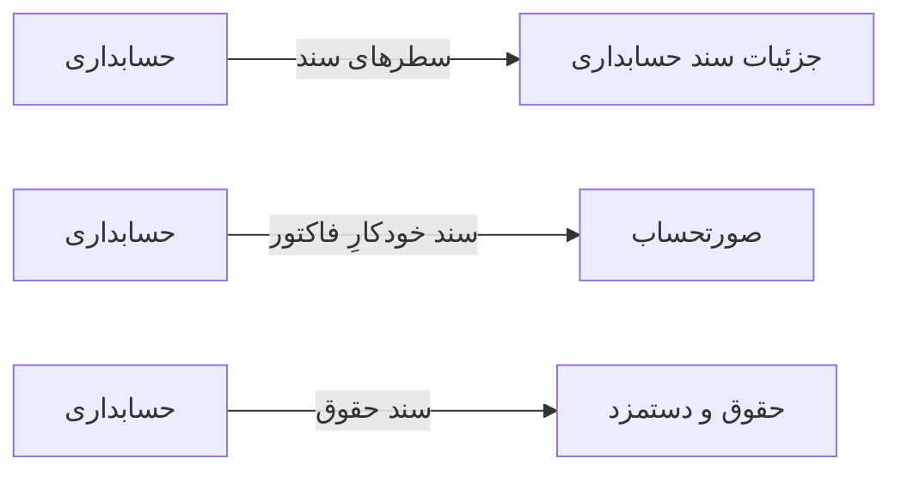

# 💰 حسابداری — `AccountingView`

> [مالی] · کهن‌الگوی `split` (دوپنلی) · آیکون `Icon.Calculator`

| پیوند | نشانی |
|---|---|
| وایرفریمِ زنده | [`01-wireframes-html/AccountingView.html`](../01-wireframes-html/AccountingView.html) |
| View | [`03-views/AccountingView.xaml`](../03-views/AccountingView.xaml) |
| ViewModel | [`04-viewmodels/AccountingViewModel.cs`](../04-viewmodels/AccountingViewModel.cs) |

**درخت سرفصل‌ها و اسناد حسابداری دوبل**

## 📝 شرح

قانون طلایی حسابداری دوبل: جمع بدهکار باید برابر با جمع بستانکار باشد؛ سند نامتوازن هرگز ذخیره نمی‌شود.

## 🖼 چیدمان

```
┌──────────────────────────────────────────────┬────────────────────┐
│  سربرگ: حسابداری                                  │                    │
├──────────────────────────────────────────────┤   ویزیتِ جاری      │
│  جدولِ نوبت‌ها                                │                    │
│  ┌────┬─────────────┬────────┬──────┬─────┐  │   بیمار: …         │
│  │ ن  │ بیمار      │ خدمت   │ ورود │ وضع │  │   سن: …            │
│  ├────┼─────────────┼────────┼──────┼─────┤  │   بیمه: …          │
│  │ ۱۲ │ …          │ …      │ …    │ نشان│  │   حساسیت: …        │
│  └────┴─────────────┴────────┴──────┴─────┘  │   …                 │
└──────────────────────────────────────────────┴────────────────────┘
```

## 📊 شاخص‌های کلیدی

| آیکون | شاخص | مقدار | روند | رنگِ تاکیدی |
|---|:--:|:--:|:--:|---|
| `Icon.TrendingUp` | درآمد ماه | **۴۲۸,۰۰۰,۰۰۰** | +۱۸٪ | green |
| `Icon.TrendingDown` | هزینه ماه | **۲۹۱,۰۰۰,۰۰۰** | +۱۱٪ | amber |
| `Icon.Equal` | سود خالص | **۱۳۷,۰۰۰,۰۰۰** | +۲۴٪ | teal |
| `Icon.Scale` | تراز | **متوازن** | — | blue |

## 🔍 فیلترها

| # | برچسب | نوع | پهنا | مقدارِ نمونه | گزینه‌ها |
|:--:|---|---|:--:|---|---|
| 1 | جستجو | `search` | w-xl | شماره سند یا شرح… | — |
| 2 | از تاریخ | `date` | w-md | ۱۴۰۴/۰۷/۰۱ | — |
| 3 | تا تاریخ | `date` | w-md | ۱۴۰۴/۰۷/۱۹ | — |

## 📐 ستون‌های جدول

| # | عنوان | اتصال | نوع | عرض | تراز |
|:--:|---|---|---|:--:|:--:|
| 1 | شماره سند | `No` | متن | 104px | Right |
| 2 | تاریخ | `Date` | تاریخ | 112px | Right |
| 3 | شرح | `Desc` | متن | * | Right |
| 4 | بدهکار | `Debit` | مبلغ | 124px | Left |
| 5 | بستانکار | `Credit` | مبلغ | 124px | Left |
| 6 | وضعیت | `Status` | نشان | 112px | Center |

## 🧪 دادهٔ نمونه

| 1 | 2 | 3 | 4 | 5 | 6 |
|:--:|:--:|:--:|:--:|:--:|:--:|
| JV-۱۲۴۰ | ۱۴۰۴/۰۷/۱۹ | فاکتور INV-۹۵۱۲ — درآمد ویزیت | ۲۵۰,۰۰۰ | ۲۵۰,۰۰۰ | `تراز` |
| JV-۱۲۴۱ | ۱۴۰۴/۰۷/۱۹ | خرید دارو — فاکتور F-۹۸۷۶۵ | ۱۲,۴۰۰,۰۰۰ | ۱۲,۴۰۰,۰۰۰ | `تراز` |
| JV-۱۲۴۲ | ۱۴۰۴/۰۷/۱۸ | حقوق پرسنل — تیر ماه | ۱۸۵,۰۰۰,۰۰۰ | ۱۸۵,۰۰۰,۰۰۰ | `تراز` |
| JV-۱۲۴۳ | ۱۴۰۴/۰۷/۱۸ | پیش‌پرداخت بیمه تکمیلی | ۸,۰۰۰,۰۰۰ | ۰ | `نامتوازن` |

## 📌 پانلِ کناری

**درخت سرفصل‌ها** (آیکون `Icon.GitFork`)

| کلید | مقدار |
|---|---|
| ۱ — دارایی‌ها | ۱,۲۴۰,۰۰۰,۰۰۰ |
| ۲ — بدهی‌ها | ۴۱۸,۰۰۰,۰۰۰ |
| ۳ — سرمایه | ۶۸۰,۰۰۰,۰۰۰ |
| ۴ — درآمدها | ۴۲۸,۰۰۰,۰۰۰ |
| ۵ — هزینه‌ها | ۲۹۱,۰۰۰,۰۰۰ |

## ⚡ اقدام‌ها

| فرمان | برچسب | آیکون | سبک |
|---|---|---|---|
| `NewCommand` | سند جدید | `Icon.Plus` | اصلی |
| `DetailCommand` | جزئیات سند | `Icon.Eye` | ثانویه |
| `TrialCommand` | تراز آزمایشی | `Icon.Scale` | ثانویه |
| `ExportCommand` | خروجی | `Icon.FileSpreadsheet` | ثانویه |

## 🔗 ارتباطات

| مبدأ | مقصد | نوعِ پیوند |
|---|---|---|
| حسابداری | جزئیات سند حسابداری | سطرهای سند |
| حسابداری | صورتحساب | سند خودکارِ فاکتور |
| حسابداری | حقوق و دستمزد | سند حقوق |



---

این فایل با `tools/gen_wireframes_md.py` ساخته شده است.
