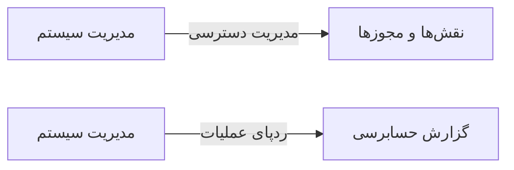

# 🧑‍💼 مدیریت سیستم — `AdminView`

> [منابع انسانی] · کهن‌الگوی `settings` (تنظیمات) · آیکون `Icon.Settings2`

| پیوند | نشانی |
|---|---|
| وایرفریمِ زنده | [`01-wireframes-html/AdminView.html`](../01-wireframes-html/AdminView.html) |
| View | [`03-views/AdminView.xaml`](../03-views/AdminView.xaml) |
| ViewModel | [`04-viewmodels/AdminViewModel.cs`](../04-viewmodels/AdminViewModel.cs) |

**تنظیمات پیشرفته و ابزارهای مدیریتی**

## 🖼 چیدمان

```
┌──────────────────────────────────────────────────────────────────┐
│  سربرگ: مدیریت سیستم                                               │
├────────────┬─────────────────────────────────────────────────────┤
│  بخش‌ها    │  تنظیمات                                            │
│            │                                                     │
│  ▸ بخش ۱   │  ┌──────────────┐ ┌──────────┐                     │
│    بخش ۲   │  │ فیلد         │ │ فیلد     │                     │
│    بخش ۳   │  └──────────────┘ └──────────┘                     │
│    بخش ۴   │  ┌───────────────────────────────────────────┐     │
│            │  │ فیلدِ تمام‌عرض                            │     │
│            │  └───────────────────────────────────────────┘     │
└────────────┴─────────────────────────────────────────────────────┘
```

## 📋 فیلدها

> پهنا بر پایه‌ی شبکه‌ی ۱۲ ستونه است: «بزرگیِ عنصر متناسب با کارکرد».

| بخش | آیکون | فیلد | برچسب | نوع | پهنا (از ۱۲) | الزامی | مقدارِ نمونه |
|---|---|---|---|---|:--:|:--:|---|
| **عملیات** | `Icon.Wrench` | `ClearCache` | پاک‌سازی حافظه پنهان | CheckBox | 12/۱۲ | خیر | False |
|  | `Icon.Wrench` | `Reindex` | بازسازی نمایه‌ها | CheckBox | 12/۱۲ | خیر | False |
|  | `Icon.Wrench` | `MaintenanceMode` | حالت نگهداری | CheckBox | 12/۱۲ | خیر | False |

## ⚡ اقدام‌ها

| فرمان | برچسب | آیکون | سبک |
|---|---|---|---|
| `RunCommand` | اجرا | `Icon.Play` | اصلی |
| `SaveCommand` | ذخیره | `Icon.Save` | ثانویه |

## 🔗 ارتباطات

| مبدأ | مقصد | نوعِ پیوند |
|---|---|---|
| مدیریت سیستم | نقش‌ها و مجوزها | مدیریت دسترسی |
| مدیریت سیستم | گزارش حسابرسی | ردپای عملیات |



---

این فایل با `tools/gen_wireframes_md.py` ساخته شده است.
