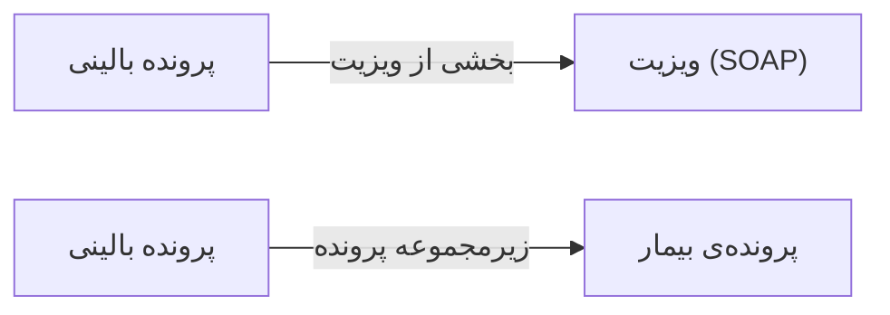

# 👥 پرونده بالینی پیشرفته — `AdvancedEmrView`

> [بیماران] · کهن‌الگوی `detail-tabs` (جزئیاتِ تب‌دار) · آیکون `Icon.NotebookPen`

| پیوند | نشانی |
|---|---|
| وایرفریمِ زنده | [`01-wireframes-html/AdvancedEmrView.html`](../01-wireframes-html/AdvancedEmrView.html) |
| View | [`03-views/AdvancedEmrView.xaml`](../03-views/AdvancedEmrView.xaml) |
| ViewModel | [`04-viewmodels/AdvancedEmrViewModel.cs`](../04-viewmodels/AdvancedEmrViewModel.cs) |

**ثبت شرح‌حال، معاینه، تشخیص و پیگیری**

## 🖼 چیدمان

```
┌──────────────────────────────────────────────────────────────────┐
│  سربرگ: پرونده بالینی پیشرفته                                      │
├──────────────────────────────────────────────────────────────────┤
│  فیلدهای سربرگ روی شبکه‌ی ۱۲ ستونه                                │
├──────────────────────────────────────────────────────────────────┤
│  تب ۱  │  تب ۲  │  تب ۳  │  تب ۴  │  تب ۵  │  تب ۶  │             │
├────────┴────────┴────────┴────────┴────────┴────────┴───────────┤
│                                                                  │
│  محتوای تب                                                       │
│  ┌──────────────────────────────────────────────────────────┐    │
│  │ جدول یا فرمِ مربوط به تب                                 │    │
│  └──────────────────────────────────────────────────────────┘    │
└──────────────────────────────────────────────────────────────────┘
```

## 🗂 تب‌ها

| # | عنوان | آیکون | شمارنده |
|:--:|---|---|:--:|
| 1 | شرح‌حال | `Icon.ClipboardList` | — |
| 2 | معاینه فیزیکی | `Icon.Stethoscope` | — |
| 3 | تشخیص‌ها | `Icon.CircleCheck` | — |
| 4 | داروهای جاری | `Icon.Pill` | — |
| 5 | یادداشت‌ها | `Icon.NotebookPen` | — |
| 6 | پیگیری‌ها | `Icon.CalendarClock` | — |

## 📋 فیلدها

> پهنا بر پایه‌ی شبکه‌ی ۱۲ ستونه است: «بزرگیِ عنصر متناسب با کارکرد».

| بخش | آیکون | فیلد | برچسب | نوع | پهنا (از ۱۲) | الزامی | مقدارِ نمونه |
|---|---|---|---|---|:--:|:--:|---|
| **شرح‌حالِ هدف‌دار** | `Icon.ClipboardList` | `ChiefComplaint` | شکایت اصلی | TextBox | 8/۱۲ | بله | درد شکمی از ۳ روز پیش |
|  | `Icon.ClipboardList` | `Duration` | مدت زمان | ComboBox | 4/۱۲ | خیر | ۳ روز |
|  | `Icon.ClipboardList` | `HistoryPresent` | شرح بیماری فعلی | TextBox (چندخطی) | 8/۱۲ | خیر | درد مبهم در ناحیه اپی‌گاستر که پس از غذا تشدید می‌شود… |
|  | `Icon.ClipboardList` | `PastMedical` | سابقه بیماری‌ها | TextBox (چندخطی) | 4/۱۲ | خیر | دیابت نوع ۲ از ۵ سال پیش |
|  | `Icon.ClipboardList` | `DrugHistory` | سابقه دارویی | TextBox (چندخطی) | 4/۱۲ | خیر | متفورمین ۵۰۰ |
|  | `Icon.ClipboardList` | `FamilyHistory` | سابقه خانوادگی | TextBox (چندخطی) | 4/۱۲ | خیر | پدر: فشار خون |
|  | `Icon.ClipboardList` | `SocialHistory` | سابقه اجتماعی | TextBox (چندخطی) | 4/۱۲ | خیر | غیرسیگاری |

## ⚡ اقدام‌ها

| فرمان | برچسب | آیکون | سبک |
|---|---|---|---|
| `SaveCommand` | ذخیره | `Icon.Save` | اصلی |
| `SaveDraftCommand` | پیش‌نویس | `Icon.File` | ثانویه |

## 🔗 ارتباطات

| مبدأ | مقصد | نوعِ پیوند |
|---|---|---|
| پرونده بالینی | ویزیت (SOAP) | بخشی از ویزیت |
| پرونده بالینی | پرونده‌ی بیمار | زیرمجموعه پرونده |



---

این فایل با `tools/gen_wireframes_md.py` ساخته شده است.
