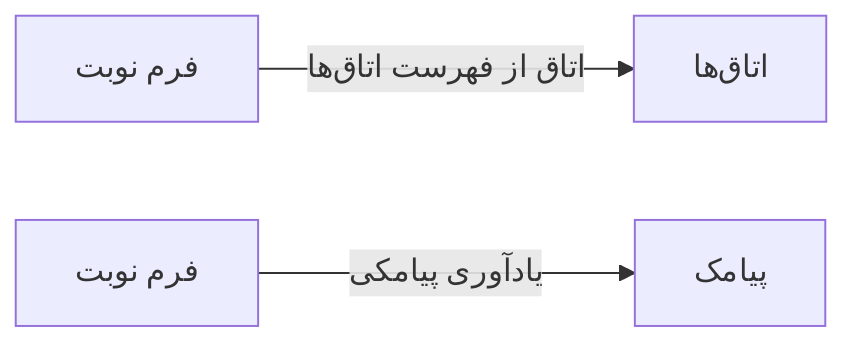

# 📅 فرم نوبت — `AppointmentFormWindow`

> [نوبت‌دهی] · کهن‌الگوی `form-std` (فرم استاندارد) · آیکون `Icon.CalendarPlus`

| پیوند | نشانی |
|---|---|
| وایرفریمِ زنده | [`01-wireframes-html/AppointmentFormWindow.html`](../01-wireframes-html/AppointmentFormWindow.html) |
| View | [`03-views/AppointmentFormWindow.xaml`](../03-views/AppointmentFormWindow.xaml) |
| ViewModel | [`04-viewmodels/AppointmentFormViewModel.cs`](../04-viewmodels/AppointmentFormViewModel.cs) |

**ثبت نوبت جدید**

## 🖼 چیدمان

```
┌──────────────────────────────────────────────────────────────────┐
│  سربرگ: فرم نوبت                                                   │
├──────────────────────────────────────────────────────────────────┤
│  شبکه‌ی ۱۲ ستونه — پهنای هر فیلد متناسب با کارکردش                │
  │ PatientId        │ DoctorI │ Date    │
  │ Time    │ Duratio │ VisitTy │ RoomId  │
  │ Reason                             │
  │ Notes                              │
  │ SendSms          │ IsUrgent         │

├──────────────────────────────────────────────────────────────────┤
│                                    [انصراف]  [ذخیره]             │
└──────────────────────────────────────────────────────────────────┘
```

## 📋 فیلدها

> پهنا بر پایه‌ی شبکه‌ی ۱۲ ستونه است: «بزرگیِ عنصر متناسب با کارکرد».

| بخش | آیکون | فیلد | برچسب | نوع | پهنا (از ۱۲) | الزامی | مقدارِ نمونه |
|---|---|---|---|---|:--:|:--:|---|
| **زمان و پزشک** | `Icon.CalendarClock` | `PatientId` | بیمار | ComboBox | 6/۱۲ | بله | سارا احمدی — P-۱۰۲۴ |
|  | `Icon.CalendarClock` | `DoctorId` | پزشک | ComboBox | 3/۱۲ | بله | دکتر موسوی |
|  | `Icon.CalendarClock` | `Date` | تاریخ نوبت | DatePicker | 3/۱۲ | بله | ۱۴۰۴/۰۷/۲۰ |
|  | `Icon.CalendarClock` | `Time` | ساعت | TextBox | 3/۱۲ | بله | ۱۰:۳۰ |
|  | `Icon.CalendarClock` | `Duration` | مدت | ComboBox | 3/۱۲ | خیر | ۲۰ دقیقه |
|  | `Icon.CalendarClock` | `VisitType` | نوع ویزیت | ComboBox | 3/۱۲ | خیر | ویزیت عمومی |
|  | `Icon.CalendarClock` | `RoomId` | اتاق | ComboBox | 3/۱۲ | خیر | اتاق ۲ |
| **توضیحات** | `Icon.MessageSquare` | `Reason` | علت مراجعه | TextBox | 12/۱۲ | خیر | درد معده |
|  | `Icon.MessageSquare` | `Notes` | یادداشت | TextBox (چندخطی) | 12/۱۲ | خیر | — |
|  | `Icon.MessageSquare` | `SendSms` | ارسال پیامک یادآوری | CheckBox | 6/۱۲ | خیر | True |
|  | `Icon.MessageSquare` | `IsUrgent` | نوبت فوری | CheckBox | 6/۱۲ | خیر | False |

## ⚡ اقدام‌ها

| فرمان | برچسب | آیکون | سبک |
|---|---|---|---|
| `SaveCommand` | ثبت نوبت | `Icon.Check` | اصلی |
| `CancelCommand` | انصراف | `—` | بی‌زمینه |

## 🔗 ارتباطات

| مبدأ | مقصد | نوعِ پیوند |
|---|---|---|
| فرم نوبت | اتاق‌ها | اتاق از فهرست اتاق‌ها |
| فرم نوبت | پیامک | یادآوری پیامکی |



---

این فایل با `tools/gen_wireframes_md.py` ساخته شده است.
