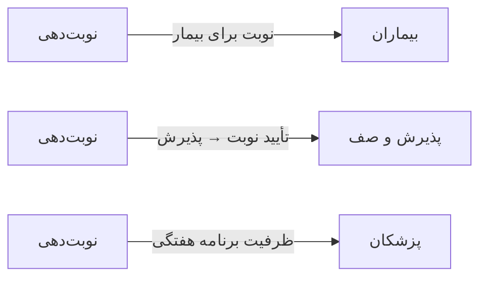

# 📅 نوبت‌دهی — `AppointmentsView`

> [نوبت‌دهی] · کهن‌الگوی `kanban` (کانبان) · آیکون `Icon.CalendarDays`

| پیوند | نشانی |
|---|---|
| وایرفریمِ زنده | [`01-wireframes-html/AppointmentsView.html`](../01-wireframes-html/AppointmentsView.html) |
| View | [`03-views/AppointmentsView.xaml`](../03-views/AppointmentsView.xaml) |
| ViewModel | [`04-viewmodels/AppointmentsViewModel.cs`](../04-viewmodels/AppointmentsViewModel.cs) |

**تقویم و صف نوبت‌ها در ستون‌های وضعیت**

## 📝 شرح

چهار ستون کانبان: در انتظار · تأیید شده · حاضر شده · لغو شده. هر کارت شامل نام بیمار، ساعت، پزشک، نوع ویزیت و نشان وضعیت.

## 🖼 چیدمان

```
┌──────────────────────────────────────────────────────────────────┐
│  سربرگ: نوبت‌دهی                                                   │
├──────────────────────────────────────────────────────────────────┤
│  ┌─────────────┐ ┌─────────────┐ ┌─────────────┐ ┌───────────┐   │
│  │ در انتظار  │ │ تأیید شده   │ │ در حال ویزیت│ │ انجام شده │   │
│  ├─────────────┤ ├─────────────┤ ├─────────────┤ ├───────────┤   │
│  │ ┌───────┐  │ │ ┌───────┐   │ │             │ │           │   │
│  │ │ کارت  │  │ │ │ کارت  │   │ │             │ │           │   │
│  │ └───────┘  │ │ └───────┘   │ │             │ │           │   │
│  │ ┌───────┐  │ │             │ │             │ │           │   │
│  │ │ کارت  │  │ │             │ │             │ │           │   │
│  │ └───────┘  │ │             │ │             │ │           │   │
│  └─────────────┘ └─────────────┘ └─────────────┘ └───────────┘   │
└──────────────────────────────────────────────────────────────────┘
```

## 📊 شاخص‌های کلیدی

| آیکون | شاخص | مقدار | روند | رنگِ تاکیدی |
|---|:--:|:--:|:--:|---|
| `Icon.CalendarCheck` | نوبت‌های امروز | **۳۶** | +۸٪ | teal |
| `Icon.CircleCheck` | تأیید شده | **۲۴** | — | green |
| `Icon.Clock` | در انتظار | **۸** | — | amber |
| `Icon.CircleX` | لغو شده | **۴** | +۱ | rose |

## 🔍 فیلترها

| # | برچسب | نوع | پهنا | مقدارِ نمونه | گزینه‌ها |
|:--:|---|---|:--:|---|---|
| 1 | تاریخ | `date` | w-md | امروز ۱۴۰۴/۰۷/۱۹ | — |
| 2 | پزشک | `combo` | w-lg | همه پزشکان | همه پزشکان، دکتر موسوی، دکتر رضایی |
| 3 | جستجو | `search` | w-lg | نام بیمار… | — |
| 4 | نما | `seg` | — | کانبان | کانبان، تقویم، جدول |

## 📐 ستون‌های جدول

| # | عنوان | اتصال | نوع | عرض | تراز |
|:--:|---|---|---|:--:|:--:|
| 1 | بیمار | `Patient` | شخص | * | Right |
| 2 | ساعت | `Time` | تاریخ | 86px | Center |
| 3 | پزشک | `Doctor` | متن | 140px | Right |
| 4 | نوع ویزیت | `Type` | متن | 130px | Right |
| 5 | وضعیت | `Status` | نشان | 104px | Center |

## 🧪 دادهٔ نمونه

| 1 | 2 | 3 | 4 | 5 |
|:--:|:--:|:--:|:--:|:--:|
| سارا احمدی | ۱۰:۳۰ | دکتر موسوی | ویزیت عمومی | `در انتظار` |
| محمد رضایی | ۱۰:۵۰ | دکتر رضایی | ویزیت تخصصی | `در انتظار` |
| فاطمه کریمی | ۱۱:۱۰ | دکتر موسوی | پیگیری | `در انتظار` |
| علی حسینی | ۰۹:۰۰ | دکتر کریمی | ویزیت عمومی | `تأیید شده` |
| زهرا موسوی | ۰۹:۲۰ | دکتر رضایی | معاینه دوره‌ای | `تأیید شده` |
| رضا قاسمی | ۰۹:۴۰ | دکتر موسوی | ویزیت عمومی | `حاضر شده` |
| مریم نوری | ۱۰:۰۰ | دکتر کریمی | اورژانس | `حاضر شده` |
| حسن کاظمی | ۰۸:۳۰ | دکتر رضایی | ویزیت تخصصی | `لغو شده` |
| نرگس صمدی | ۰۸:۱۰ | دکتر موسوی | پیگیری | `لغو شده` |

## ⚡ اقدام‌ها

| فرمان | برچسب | آیکون | سبک |
|---|---|---|---|
| `NewCommand` | نوبت جدید | `Icon.CalendarPlus` | اصلی |
| `ConfirmCommand` | تأیید | `Icon.Check` | ok |
| `RefreshCommand` | تازه‌سازی | `Icon.RefreshCw` | بی‌زمینه |

## 🔗 ارتباطات

| مبدأ | مقصد | نوعِ پیوند |
|---|---|---|
| نوبت‌دهی | بیماران | نوبت برای بیمار |
| نوبت‌دهی | پذیرش و صف | تأیید نوبت → پذیرش |
| نوبت‌دهی | پزشکان | ظرفیت برنامه هفتگی |



---

این فایل با `tools/gen_wireframes_md.py` ساخته شده است.
