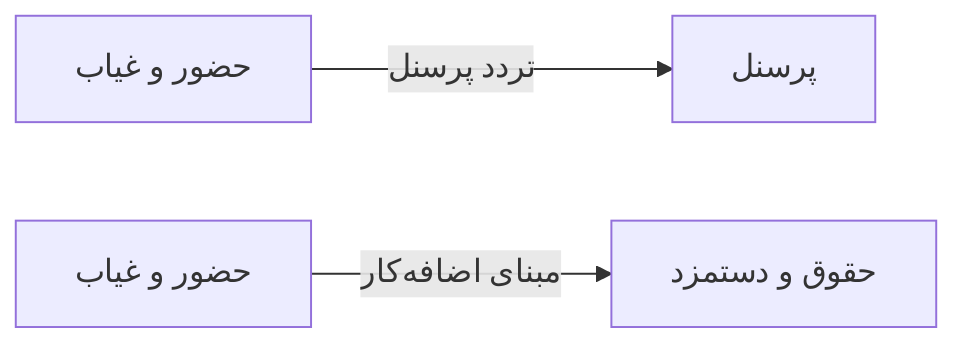

# 🧑‍💼 حضور و غیاب — `AttendanceView`

> [منابع انسانی] · کهن‌الگوی `list-dense` (لیستِ فشرده) · آیکون `Icon.Fingerprint`

| پیوند | نشانی |
|---|---|
| وایرفریمِ زنده | [`01-wireframes-html/AttendanceView.html`](../01-wireframes-html/AttendanceView.html) |
| View | [`03-views/AttendanceView.xaml`](../03-views/AttendanceView.xaml) |
| ViewModel | [`04-viewmodels/AttendanceViewModel.cs`](../04-viewmodels/AttendanceViewModel.cs) |

**ثبت و گزارش ورود و خروج پرسنل**

## 🖼 چیدمان

```
┌──────────────────────────────────────────────────────────────────┐
│  سربرگ: حضور و غیاب                                                │
├──────────────────────────────────────────────────────────────────┤
│  ┌────────┐ ┌────────┐ ┌────────┐ ┌────────┐                     │
│  │ شاخص ۱ │ │ شاخص ۲ │ │ شاخص ۳ │ │ شاخص ۴ │                     │
│  └────────┘ └────────┘ └────────┘ └────────┘                     │
├──────────────────────────────────────────────────────────────────┤
│  [جستجو…………] [فیلتر ▾] [فیلتر ▾]        [＋ جدید] [⟳] [⤓]      │
├──────────────────────────────────────────────────────────────────┤
│  جدول                                                            │
│  ┌──────────┬────────────────────┬────────┬────────┬────────┐    │
│  │ ستون     │ ستون               │ ستون   │ ستون   │ وضعیت  │    │
│  ├──────────┼────────────────────┼────────┼────────┼────────┤    │
│  │ دادهٔ ۱   │ …                  │ …      │ …      │ نشان   │    │
│  │ دادهٔ ۲   │ …                  │ …      │ …      │ نشان   │    │
│  └──────────┴────────────────────┴────────┴────────┴────────┘    │
├──────────────────────────────────────────────────────────────────┤
│  نمایش ۱ تا ۲۵ از ۱۲۴۵                         [◀] [▶]           │
└──────────────────────────────────────────────────────────────────┘
```

## 📊 شاخص‌های کلیدی

| آیکون | شاخص | مقدار | روند | رنگِ تاکیدی |
|---|:--:|:--:|:--:|---|
| `Icon.CircleCheck` | حاضر | **۲۹** | — | green |
| `Icon.Clock` | تأخیر | **۳** | — | amber |
| `Icon.CircleX` | غایب | **۲** | — | rose |
| `Icon.CalendarX` | مرخصی | **۰** | — | blue |

## 🔍 فیلترها

| # | برچسب | نوع | پهنا | مقدارِ نمونه | گزینه‌ها |
|:--:|---|---|:--:|---|---|
| 1 | تاریخ | `date` | w-md | ۱۴۰۴/۰۷/۱۹ | — |
| 2 | دپارتمان | `combo` | w-md | همه | — |
| 3 | جستجو | `search` | w-lg | نام پرسنل… | — |

## 📐 ستون‌های جدول

| # | عنوان | اتصال | نوع | عرض | تراز |
|:--:|---|---|---|:--:|:--:|
| 1 | پرسنل | `Employee` | شخص | * | Right |
| 2 | تاریخ | `Date` | تاریخ | 112px | Right |
| 3 | ورود | `In` | تاریخ | 96px | Center |
| 4 | خروج | `Out` | تاریخ | 96px | Center |
| 5 | ساعت کار | `Hours` | عدد | 96px | Center |
| 6 | تأخیر | `Delay` | عدد | 96px | Center |
| 7 | وضعیت | `Status` | نشان | 104px | Center |

## 🧪 دادهٔ نمونه

| 1 | 2 | 3 | 4 | 5 | 6 | 7 |
|:--:|:--:|:--:|:--:|:--:|:--:|:--:|
| مریم نوری | ۱۴۰۴/۰۷/۱۹ | ۰۸:۰۲ | ۱۴:۰۵ | ۶:۰۳ | ۰ | `حاضر` |
| احمد صادقی | ۱۴۰۴/۰۷/۱۹ | ۰۸:۲۷ | ۱۴:۰۰ | ۵:۳۳ | ۲۷ | `تأخیر` |
| لیلا حسنی | ۱۴۰۴/۰۷/۱۹ | — | — | ۰ | — | `غایب` |

## ⚡ اقدام‌ها

| فرمان | برچسب | آیکون | سبک |
|---|---|---|---|
| `ExportCommand` | خروجی | `Icon.FileSpreadsheet` | ثانویه |
| `ManualCommand` | ثبت دستی | `Icon.Pencil` | ثانویه |
| `PrintCommand` | چاپ | `Icon.Printer` | ثانویه |

## 🔗 ارتباطات

| مبدأ | مقصد | نوعِ پیوند |
|---|---|---|
| حضور و غیاب | پرسنل | تردد پرسنل |
| حضور و غیاب | حقوق و دستمزد | مبنای اضافه‌کار |



---

این فایل با `tools/gen_wireframes_md.py` ساخته شده است.
