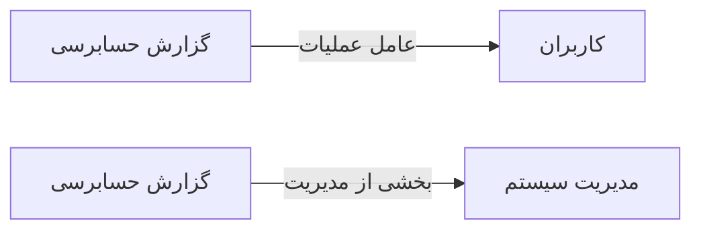

# 📊 گزارش حسابرسی — `AuditLogView`

> [گزارشات] · کهن‌الگوی `list-dense` (لیستِ فشرده) · آیکون `Icon.History`

| پیوند | نشانی |
|---|---|
| وایرفریمِ زنده | [`01-wireframes-html/AuditLogView.html`](../01-wireframes-html/AuditLogView.html) |
| View | [`03-views/AuditLogView.xaml`](../03-views/AuditLogView.xaml) |
| ViewModel | [`04-viewmodels/AuditLogViewModel.cs`](../04-viewmodels/AuditLogViewModel.cs) |

**ردپای کامل عملیات کاربران**

## 🖼 چیدمان

```
┌──────────────────────────────────────────────────────────────────┐
│  سربرگ: گزارش حسابرسی                                              │
├──────────────────────────────────────────────────────────────────┤
│  ┌────────┐ ┌────────┐ ┌────────┐ ┌────────┐                     │
│  │ شاخص ۱ │ │ شاخص ۲ │ │ شاخص ۳ │ │ شاخص ۴ │                     │
│  └────────┘ └────────┘ └────────┘ └────────┘                     │
├──────────────────────────────────────────────────────────────────┤
│  [جستجو…………] [فیلتر ▾] [فیلتر ▾]        [＋ جدید] [⟳] [⤓]      │
├──────────────────────────────────────────────────────────────────┤
│  جدول                                                            │
│  ┌──────────┬────────────────────┬────────┬────────┬────────┐    │
│  │ ستون     │ ستون               │ ستون   │ ستون   │ وضعیت  │    │
│  ├──────────┼────────────────────┼────────┼────────┼────────┤    │
│  │ دادهٔ ۱   │ …                  │ …      │ …      │ نشان   │    │
│  │ دادهٔ ۲   │ …                  │ …      │ …      │ نشان   │    │
│  └──────────┴────────────────────┴────────┴────────┴────────┘    │
├──────────────────────────────────────────────────────────────────┤
│  نمایش ۱ تا ۲۵ از ۱۲۴۵                         [◀] [▶]           │
└──────────────────────────────────────────────────────────────────┘
```

## 📊 شاخص‌های کلیدی

| آیکون | شاخص | مقدار | روند | رنگِ تاکیدی |
|---|:--:|:--:|:--:|---|
| `Icon.History` | رویداد امروز | **۱,۲۴۸** | — | teal |
| `Icon.Pencil` | ویرایش‌ها | **۳۴۲** | — | blue |
| `Icon.Trash2` | حذف‌ها | **۷** | — | rose |
| `Icon.LogIn` | ورودها | **۴۶** | — | green |

## 🔍 فیلترها

| # | برچسب | نوع | پهنا | مقدارِ نمونه | گزینه‌ها |
|:--:|---|---|:--:|---|---|
| 1 | جستجو | `search` | w-xl | کاربر، موجودیت یا توضیح… | — |
| 2 | عملیات | `combo` | w-md | همه | همه، ایجاد، ویرایش، حذف، ورود، خروج |
| 3 | از تاریخ | `date` | w-md | ۱۴۰۴/۰۷/۱۹ | — |

## 📐 ستون‌های جدول

| # | عنوان | اتصال | نوع | عرض | تراز |
|:--:|---|---|---|:--:|:--:|
| 1 | زمان | `Time` | تاریخ | 150px | Right |
| 2 | کاربر | `User` | شخص | 160px | Right |
| 3 | عملیات | `Action` | نشان | 96px | Center |
| 4 | موجودیت | `Entity` | متن | 160px | Right |
| 5 | توضیح | `Desc` | متن | * | Right |
| 6 | IP | `Ip` | عدد | 120px | Left |

## 🧪 دادهٔ نمونه

| 1 | 2 | 3 | 4 | 5 | 6 |
|:--:|:--:|:--:|:--:|:--:|:--:|
| ۱۴۰۴/۰۷/۱۹ ۰۹:۴۲:۱۱ | mnouri | `ایجاد` | Reception | پذیرش جدید — سارا احمدی | ۱۹۲٫۱۶۸٫۱٫۲۴ |
| ۱۴۰۴/۰۷/۱۹ ۰۹:۳۸:۰۵ | admin | `ویرایش` | Tariff | تغییر تعرفه ویزیت عمومی | ۱۹۲٫۱۶۸٫۱٫۱۰ |
| ۱۴۰۴/۰۷/۱۹ ۰۹:۳۰:۵۲ | lhasani | `حذف` | Invoice | حذف فاکتور INV-۹۵۰۱ | ۱۹۲٫۱۶۸٫۱٫۱۸ |
| ۱۴۰۴/۰۷/۱۹ ۰۸:۱۲:۰۰ | admin | `ورود` | Auth | ورود موفق | ۱۹۲٫۱۶۸٫۱٫۱۰ |

## ⚡ اقدام‌ها

| فرمان | برچسب | آیکون | سبک |
|---|---|---|---|
| `ExportCommand` | خروجی | `Icon.FileSpreadsheet` | ثانویه |
| `FilterCommand` | فیلتر پیشرفته | `Icon.ListFilter` | ثانویه |

## 🔗 ارتباطات

| مبدأ | مقصد | نوعِ پیوند |
|---|---|---|
| گزارش حسابرسی | کاربران | عامل عملیات |
| گزارش حسابرسی | مدیریت سیستم | بخشی از مدیریت |



---

این فایل با `tools/gen_wireframes_md.py` ساخته شده است.
