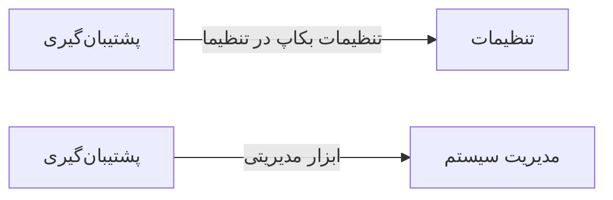

# ⚙️ پشتیبان‌گیری — `BackupView`

> [سیستم] · کهن‌الگوی `detail-tabs` (جزئیاتِ تب‌دار) · آیکون `Icon.DatabaseBackup`

| پیوند | نشانی |
|---|---|
| وایرفریمِ زنده | [`01-wireframes-html/BackupView.html`](../01-wireframes-html/BackupView.html) |
| View | [`03-views/BackupView.xaml`](../03-views/BackupView.xaml) |
| ViewModel | [`04-viewmodels/BackupViewModel.cs`](../04-viewmodels/BackupViewModel.cs) |

**تهیه و بازیابی نسخه پشتیبان**

## 🖼 چیدمان

```
┌──────────────────────────────────────────────────────────────────┐
│  سربرگ: پشتیبان‌گیری                                               │
├──────────────────────────────────────────────────────────────────┤
│  فیلدهای سربرگ روی شبکه‌ی ۱۲ ستونه                                │
├──────────────────────────────────────────────────────────────────┤
│  تب ۱  │  تب ۲  │  تب ۳  │  تب ۴  │  تب ۵  │  تب ۶  │             │
├────────┴────────┴────────┴────────┴────────┴────────┴───────────┤
│                                                                  │
│  محتوای تب                                                       │
│  ┌──────────────────────────────────────────────────────────┐    │
│  │ جدول یا فرمِ مربوط به تب                                 │    │
│  └──────────────────────────────────────────────────────────┘    │
└──────────────────────────────────────────────────────────────────┘
```

## 📊 شاخص‌های کلیدی

| آیکون | شاخص | مقدار | روند | رنگِ تاکیدی |
|---|:--:|:--:|:--:|---|
| `Icon.DatabaseBackup` | آخرین پشتیبان | **امروز ۰۲:۰۰** | — | green |
| `Icon.HardDrive` | حجم کل | **۴٫۲ گیگابایت** | — | blue |
| `Icon.History` | تعداد نسخه‌ها | **۳۰** | — | teal |

## 🗂 تب‌ها

| # | عنوان | آیکون | شمارنده |
|:--:|---|---|:--:|
| 1 | نسخه‌ها | `Icon.HardDrive` | — |
| 2 | زمان‌بندی | `Icon.Clock` | — |
| 3 | بازیابی | `Icon.RotateCcw` | — |
| 4 | تنظیمات | `Icon.Settings` | — |

## 📋 فیلدها

> پهنا بر پایه‌ی شبکه‌ی ۱۲ ستونه است: «بزرگیِ عنصر متناسب با کارکرد».

| بخش | آیکون | فیلد | برچسب | نوع | پهنا (از ۱۲) | الزامی | مقدارِ نمونه |
|---|---|---|---|---|:--:|:--:|---|
| **زمان‌بندی خودکار** | `Icon.Clock` | `AutoEnabled` | پشتیبان‌گیری خودکار | CheckBox | 12/۱۲ | خیر | True |
|  | `Icon.Clock` | `Schedule` | دوره | ComboBox | 4/۱۲ | خیر | روزانه |
|  | `Icon.Clock` | `Time` | ساعت اجرا | TextBox | 4/۱۲ | خیر | ۰۲:۰۰ |
|  | `Icon.Clock` | `Retention` | نگهداری (روز) | TextBox (عددی) | 4/۱۲ | خیر | ۳۰ |
|  | `Icon.Clock` | `Path` | مسیر ذخیره | TextBox | 8/۱۲ | خیر | D:\Backups\ClinicPro |
|  | `Icon.Clock` | `Compress` | فشرده‌سازی | CheckBox | 4/۱۲ | خیر | True |

## 📐 ستون‌های جدول

| # | عنوان | اتصال | نوع | عرض | تراز |
|:--:|---|---|---|:--:|:--:|
| 1 | نام فایل | `Name` | متن | * | Right |
| 2 | تاریخ | `Date` | تاریخ | 150px | Right |
| 3 | حجم | `Size` | عدد | 110px | Center |
| 4 | نوع | `Type` | نشان | 110px | Center |
| 5 | وضعیت | `Status` | نشان | 112px | Center |

## 🧪 دادهٔ نمونه

| 1 | 2 | 3 | 4 | 5 |
|:--:|:--:|:--:|:--:|:--:|
| clinicpro-14040719-0200.bak | ۱۴۰۴/۰۷/۱۹ ۰۲:۰۰ | ۱۴۲ مگابایت | `خودکار` | `موفق` |
| clinicpro-14040718-0200.bak | ۱۴۰۴/۰۷/۱۸ ۰۲:۰۰ | ۱۳۹ مگابایت | `خودکار` | `موفق` |
| clinicpro-14040717-0200.bak | ۱۴۰۴/۰۷/۱۷ ۰۲:۰۰ | ۱۳۷ مگابایت | `خودکار` | `موفق` |
| clinicpro-manual-14040716.bak | ۱۴۰۴/۰۷/۱۶ ۱۴:۳۰ | ۱۳۵ مگابایت | `دستی` | `موفق` |

## ⚡ اقدام‌ها

| فرمان | برچسب | آیکون | سبک |
|---|---|---|---|
| `BackupNowCommand` | پشتیبان‌گیری الآن | `Icon.DatabaseBackup` | اصلی |
| `RestoreCommand` | بازیابی | `Icon.RotateCcw` | خطر |

## 🔗 ارتباطات

| مبدأ | مقصد | نوعِ پیوند |
|---|---|---|
| پشتیبان‌گیری | تنظیمات | تنظیمات بکاپ در تنظیمات |
| پشتیبان‌گیری | مدیریت سیستم | ابزار مدیریتی |



---

این فایل با `tools/gen_wireframes_md.py` ساخته شده است.
