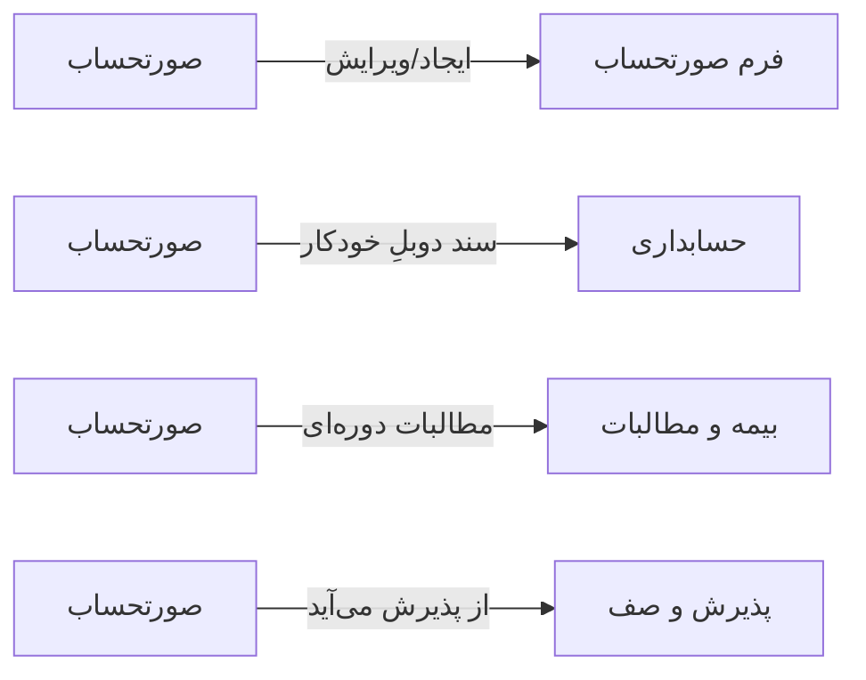

# 💰 صورتحساب — `BillingView`

> [مالی] · کهن‌الگوی `list-dense` (لیستِ فشرده) · آیکون `Icon.Receipt`

| پیوند | نشانی |
|---|---|
| وایرفریمِ زنده | [`01-wireframes-html/BillingView.html`](../01-wireframes-html/BillingView.html) |
| View | [`03-views/BillingView.xaml`](../03-views/BillingView.xaml) |
| ViewModel | [`04-viewmodels/BillingViewModel.cs`](../04-viewmodels/BillingViewModel.cs) |

**فهرست صورتحساب‌ها و وضعیت پرداخت**

## 🖼 چیدمان

```
┌──────────────────────────────────────────────────────────────────┐
│  سربرگ: صورتحساب                                                   │
├──────────────────────────────────────────────────────────────────┤
│  ┌────────┐ ┌────────┐ ┌────────┐ ┌────────┐                     │
│  │ شاخص ۱ │ │ شاخص ۲ │ │ شاخص ۳ │ │ شاخص ۴ │                     │
│  └────────┘ └────────┘ └────────┘ └────────┘                     │
├──────────────────────────────────────────────────────────────────┤
│  [جستجو…………] [فیلتر ▾] [فیلتر ▾]        [＋ جدید] [⟳] [⤓]      │
├──────────────────────────────────────────────────────────────────┤
│  جدول                                                            │
│  ┌──────────┬────────────────────┬────────┬────────┬────────┐    │
│  │ ستون     │ ستون               │ ستون   │ ستون   │ وضعیت  │    │
│  ├──────────┼────────────────────┼────────┼────────┼────────┤    │
│  │ دادهٔ ۱   │ …                  │ …      │ …      │ نشان   │    │
│  │ دادهٔ ۲   │ …                  │ …      │ …      │ نشان   │    │
│  └──────────┴────────────────────┴────────┴────────┴────────┘    │
├──────────────────────────────────────────────────────────────────┤
│  نمایش ۱ تا ۲۵ از ۱۲۴۵                         [◀] [▶]           │
└──────────────────────────────────────────────────────────────────┘
```

## 📊 شاخص‌های کلیدی

| آیکون | شاخص | مقدار | روند | رنگِ تاکیدی |
|---|:--:|:--:|:--:|---|
| `Icon.Receipt` | فاکتور امروز | **۴۲** | +۱۰٪ | teal |
| `Icon.Banknote` | مبلغ کل | **۲۸,۴۵۰,۰۰۰** | +۲۳٪ | green |
| `Icon.Clock` | پرداخت‌نشده | **۵,۲۰۰,۰۰۰** | +۴٪ | amber |
| `Icon.ShieldCheck` | سهم بیمه | **۱۱,۳۰۰,۰۰۰** | — | blue |

## 🔍 فیلترها

| # | برچسب | نوع | پهنا | مقدارِ نمونه | گزینه‌ها |
|:--:|---|---|:--:|---|---|
| 1 | جستجو | `search` | w-xl | شماره فاکتور یا بیمار… | — |
| 2 | وضعیت | `combo` | w-md | همه | همه، پرداخت شده، نیمه‌پرداخت، پرداخت‌نشده، لغو |
| 3 | از تاریخ | `date` | w-md | ۱۴۰۴/۰۷/۰۱ | — |
| 4 | تا تاریخ | `date` | w-md | ۱۴۰۴/۰۷/۱۹ | — |

## 📐 ستون‌های جدول

| # | عنوان | اتصال | نوع | عرض | تراز |
|:--:|---|---|---|:--:|:--:|
| 1 | شماره | `No` | متن | 110px | Right |
| 2 | بیمار | `Patient` | شخص | * | Right |
| 3 | تاریخ | `Date` | تاریخ | 112px | Right |
| 4 | مبلغ کل | `Total` | مبلغ | 116px | Left |
| 5 | سهم بیمه | `InsShare` | مبلغ | 112px | Left |
| 6 | سهم بیمار | `PatShare` | مبلغ | 112px | Left |
| 7 | پرداختی | `Paid` | مبلغ | 112px | Left |
| 8 | وضعیت | `Status` | نشان | 116px | Center |

## 🧪 دادهٔ نمونه

| 1 | 2 | 3 | 4 | 5 | 6 | 7 | 8 |
|:--:|:--:|:--:|:--:|:--:|:--:|:--:|:--:|
| INV-۹۵۱۲ | سارا احمدی | ۱۴۰۴/۰۷/۱۹ | ۲۵۰,۰۰۰ | ۱۷۵,۰۰۰ | ۷۵,۰۰۰ | ۷۵,۰۰۰ | `پرداخت شده` |
| INV-۹۵۱۳ | محمد رضایی | ۱۴۰۴/۰۷/۱۹ | ۴۰۰,۰۰۰ | ۲۸۰,۰۰۰ | ۱۲۰,۰۰۰ | ۰ | `پرداخت‌نشده` |
| INV-۹۵۱۴ | فاطمه کریمی | ۱۴۰۴/۰۷/۱۸ | ۱۵۰,۰۰۰ | ۰ | ۱۵۰,۰۰۰ | ۸۰,۰۰۰ | `نیمه‌پرداخت` |

## ⚡ اقدام‌ها

| فرمان | برچسب | آیکون | سبک |
|---|---|---|---|
| `NewCommand` | فاکتور جدید | `Icon.Plus` | اصلی |
| `PayCommand` | ثبت پرداخت | `Icon.HandCoins` | ok |
| `PrintCommand` | چاپ | `Icon.Printer` | ثانویه |
| `ExportCommand` | خروجی | `Icon.FileSpreadsheet` | ثانویه |

## 🔗 ارتباطات

| مبدأ | مقصد | نوعِ پیوند |
|---|---|---|
| صورتحساب | فرم صورتحساب | ایجاد/ویرایش |
| صورتحساب | حسابداری | سند دوبلِ خودکار |
| صورتحساب | بیمه و مطالبات | مطالبات دوره‌ای |
| صورتحساب | پذیرش و صف | از پذیرش می‌آید |



---

این فایل با `tools/gen_wireframes_md.py` ساخته شده است.
