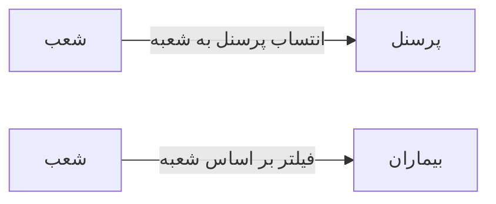

# 🏢 شعب — `BranchesView`

> [سازمانی] · کهن‌الگوی `list-cards` (لیستِ کارتی) · آیکون `Icon.Building2`

| پیوند | نشانی |
|---|---|
| وایرفریمِ زنده | [`01-wireframes-html/BranchesView.html`](../01-wireframes-html/BranchesView.html) |
| View | [`03-views/BranchesView.xaml`](../03-views/BranchesView.xaml) |
| ViewModel | [`04-viewmodels/BranchesViewModel.cs`](../04-viewmodels/BranchesViewModel.cs) |

**مدیریت شعبِ درمانگاه**

## 🖼 چیدمان

```
┌──────────────────────────────────────────────────────────────────┐
│  سربرگ: شعب                                                        │
├──────────────────────────────────────────────────────────────────┤
│  ┌───────────────┐ ┌───────────────┐ ┌───────────────┐           │
│  │ عنوان         │ │ عنوان         │ │ عنوان         │           │
│  │ زیرعنوان      │ │ زیرعنوان      │ │ زیرعنوان      │           │
│  │      [نشان]   │ │      [نشان]   │ │      [نشان]   │           │
│  └───────────────┘ └───────────────┘ └───────────────┘           │
└──────────────────────────────────────────────────────────────────┘
```

## 🔍 فیلترها

| # | برچسب | نوع | پهنا | مقدارِ نمونه | گزینه‌ها |
|:--:|---|---|:--:|---|---|
| 1 | جستجو | `search` | w-lg | نام شعبه… | — |
| 2 | وضعیت | `combo` | w-sm | فعال | — |

## 📐 ستون‌های جدول

| # | عنوان | اتصال | نوع | عرض | تراز |
|:--:|---|---|---|:--:|:--:|
| 1 | شعبه | `Name` | متن | * | Right |
| 2 | کد | `Code` | عدد | 92px | Center |
| 3 | شهر | `City` | متن | 110px | Right |
| 4 | پرسنل | `Staff` | عدد | 86px | Center |
| 5 | وضعیت | `Status` | نشان | 104px | Center |

## 🧪 دادهٔ نمونه

| 1 | 2 | 3 | 4 | 5 |
|:--:|:--:|:--:|:--:|:--:|
| شعبه مرکزی | ۱ | تبریز | ۲۲ | `فعال` |
| شعبه ولیعصر | ۲ | تبریز | ۹ | `فعال` |
| شعبه اهر | ۳ | اهر | ۳ | `غیرفعال` |

## ⚡ اقدام‌ها

| فرمان | برچسب | آیکون | سبک |
|---|---|---|---|
| `NewCommand` | شعبه جدید | `Icon.Plus` | اصلی |
| `EditCommand` | ویرایش | `Icon.Pencil` | ثانویه |

## 🔗 ارتباطات

| مبدأ | مقصد | نوعِ پیوند |
|---|---|---|
| شعب | پرسنل | انتساب پرسنل به شعبه |
| شعب | بیماران | فیلتر بر اساس شعبه |



---

این فایل با `tools/gen_wireframes_md.py` ساخته شده است.
