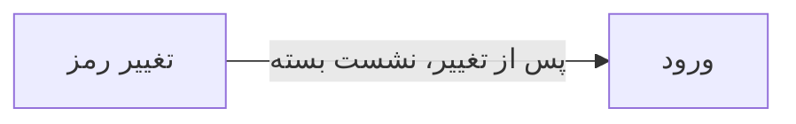

# 🏠 تغییر رمز عبور — `ChangePasswordWindow`

> [پیشخوان] · کهن‌الگوی `form-narrow` (فرمِ باریک) · آیکون `Icon.KeyRound`

| پیوند | نشانی |
|---|---|
| وایرفریمِ زنده | [`01-wireframes-html/ChangePasswordWindow.html`](../01-wireframes-html/ChangePasswordWindow.html) |
| View | [`03-views/ChangePasswordWindow.xaml`](../03-views/ChangePasswordWindow.xaml) |
| ViewModel | [`04-viewmodels/ChangePasswordViewModel.cs`](../04-viewmodels/ChangePasswordViewModel.cs) |

**تغییر رمز عبورِ کاربرِ جاری**

## 🖼 چیدمان

```
            ┌──────────────────────────────┐
            │                  آیکون          │
            │          تغییر رمز عبور         │
            ├──────────────────────────────┤
            │  ✓ ویژگیِ ۱                  │
            │  ✓ ویژگیِ ۲                  │
            │  ✓ ویژگیِ ۳                  │
            ├──────────────────────────────┤
            │  ┌────────────────────────┐  │
            │  │ فیلد                  │  │
            │  └────────────────────────┘  │
            │  ┌────────────────────────┐  │
            │  │ فیلد                  │  │
            │  └────────────────────────┘  │
            │  ☐ به خاطر بسپار             │
            ├──────────────────────────────┤
            │  [        ورود        ]      │
            └──────────────────────────────┘
```

## 📋 فیلدها

> پهنا بر پایه‌ی شبکه‌ی ۱۲ ستونه است: «بزرگیِ عنصر متناسب با کارکرد».

| بخش | آیکون | فیلد | برچسب | نوع | پهنا (از ۱۲) | الزامی | مقدارِ نمونه |
|---|---|---|---|---|:--:|:--:|---|
| **رمز عبور** | `Icon.KeyRound` | `CurrentPassword` | رمز عبور فعلی | PasswordBox | 12/۱۲ | بله | •••••••• |
|  | `Icon.KeyRound` | `NewPassword` | رمز عبور جدید | PasswordBox | 12/۱۲ | بله | •••••••• |
|  | `Icon.KeyRound` | `ConfirmPassword` | تکرار رمز عبور جدید | PasswordBox | 12/۱۲ | بله | •••••••• |

## ⚡ اقدام‌ها

| فرمان | برچسب | آیکون | سبک |
|---|---|---|---|
| `SaveCommand` | تغییر رمز | `Icon.Check` | اصلی |
| `CancelCommand` | انصراف | `—` | بی‌زمینه |

## 🔗 ارتباطات

| مبدأ | مقصد | نوعِ پیوند |
|---|---|---|
| تغییر رمز | ورود | پس از تغییر، نشست بسته می‌شود |



---

این فایل با `tools/gen_wireframes_md.py` ساخته شده است.
