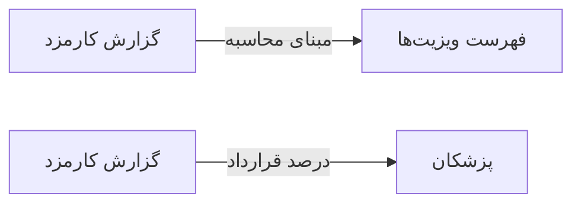

# 💰 گزارش کارمزد — `CommissionReportWindow`

> [مالی] · کهن‌الگوی `dialog` (دیالوگ) · آیکون `Icon.Handshake`

| پیوند | نشانی |
|---|---|
| وایرفریمِ زنده | [`01-wireframes-html/CommissionReportWindow.html`](../01-wireframes-html/CommissionReportWindow.html) |
| View | [`03-views/CommissionReportWindow.xaml`](../03-views/CommissionReportWindow.xaml) |
| ViewModel | [`04-viewmodels/CommissionReportViewModel.cs`](../04-viewmodels/CommissionReportViewModel.cs) |

**گزارش کارمزد پزشکان در بازه زمانی**

## 🖼 چیدمان

```
        ┌──────────────────────────────────────┐
        │               گزارش کارمزد              │
        ├──────────────────────────────────────┤
        │  ┌────────────────────────────────┐  │
        │  │ فیلد                          │  │
        │  └────────────────────────────────┘  │
        │  ┌────────────────────────────────┐  │
        │  │ فیلد                          │  │
        │  └────────────────────────────────┘  │
        ├──────────────────────────────────────┤
        │              [انصراف]  [تأیید]       │
        └──────────────────────────────────────┘
```

## 🔍 فیلترها

| # | برچسب | نوع | پهنا | مقدارِ نمونه | گزینه‌ها |
|:--:|---|---|:--:|---|---|
| 1 | پزشک | `combo` | w-lg | همه | — |
| 2 | از تاریخ | `date` | w-md | ۱۴۰۴/۰۷/۰۱ | — |
| 3 | تا تاریخ | `date` | w-md | ۱۴۰۴/۰۷/۱۹ | — |

## 📐 ستون‌های جدول

| # | عنوان | اتصال | نوع | عرض | تراز |
|:--:|---|---|---|:--:|:--:|
| 1 | پزشک | `Doctor` | شخص | * | Right |
| 2 | ویزیت‌ها | `Visits` | عدد | 88px | Center |
| 3 | ناخالص | `Gross` | مبلغ | 120px | Left |
| 4 | درصد | `Percent` | عدد | 76px | Center |
| 5 | کارمزد | `Commission` | مبلغ | 124px | Left |

## 🧪 دادهٔ نمونه

| 1 | 2 | 3 | 4 | 5 |
|:--:|:--:|:--:|:--:|:--:|
| دکتر موسوی | ۱۲۴ | ۳۱,۰۰۰,۰۰۰ | ۵۰ | ۱۵,۵۰۰,۰۰۰ |
| دکتر رضایی | ۸۷ | ۳۴,۸۰۰,۰۰۰ | ۵۵ | ۱۹,۱۴۰,۰۰۰ |

## ⚡ اقدام‌ها

| فرمان | برچسب | آیکون | سبک |
|---|---|---|---|
| `PrintCommand` | چاپ | `Icon.Printer` | اصلی |
| `ExportCommand` | خروجی | `Icon.FileSpreadsheet` | ثانویه |

## 🔗 ارتباطات

| مبدأ | مقصد | نوعِ پیوند |
|---|---|---|
| گزارش کارمزد | فهرست ویزیت‌ها | مبنای محاسبه |
| گزارش کارمزد | پزشکان | درصد قرارداد |



---

این فایل با `tools/gen_wireframes_md.py` ساخته شده است.
