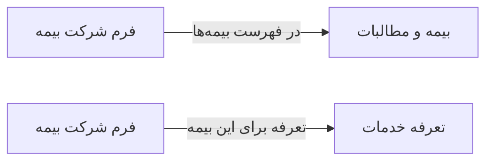

# 💰 فرم شرکت بیمه — `CompanyFormWindow`

> [مالی] · کهن‌الگوی `form-narrow` (فرمِ باریک) · آیکون `Icon.Building2`

| پیوند | نشانی |
|---|---|
| وایرفریمِ زنده | [`01-wireframes-html/CompanyFormWindow.html`](../01-wireframes-html/CompanyFormWindow.html) |
| View | [`03-views/CompanyFormWindow.xaml`](../03-views/CompanyFormWindow.xaml) |
| ViewModel | [`04-viewmodels/CompanyFormViewModel.cs`](../04-viewmodels/CompanyFormViewModel.cs) |

**تعریف شرکت بیمه و قرارداد**

## 🖼 چیدمان

```
            ┌──────────────────────────────┐
            │                  آیکون          │
            │          فرم شرکت بیمه          │
            ├──────────────────────────────┤
            │  ✓ ویژگیِ ۱                  │
            │  ✓ ویژگیِ ۲                  │
            │  ✓ ویژگیِ ۳                  │
            ├──────────────────────────────┤
            │  ┌────────────────────────┐  │
            │  │ فیلد                  │  │
            │  └────────────────────────┘  │
            │  ┌────────────────────────┐  │
            │  │ فیلد                  │  │
            │  └────────────────────────┘  │
            │  ☐ به خاطر بسپار             │
            ├──────────────────────────────┤
            │  [        ورود        ]      │
            └──────────────────────────────┘
```

## 📋 فیلدها

> پهنا بر پایه‌ی شبکه‌ی ۱۲ ستونه است: «بزرگیِ عنصر متناسب با کارکرد».

| بخش | آیکون | فیلد | برچسب | نوع | پهنا (از ۱۲) | الزامی | مقدارِ نمونه |
|---|---|---|---|---|:--:|:--:|---|
| **شرکت بیمه** | `Icon.Building2` | `Name` | نام شرکت | TextBox | 12/۱۲ | بله | بیمه تأمین اجتماعی |
|  | `Icon.Building2` | `Code` | کد شرکت | TextBox | 6/۱۲ | بله | INS-۰۰۱ |
|  | `Icon.Building2` | `ContractNo` | شماره قرارداد | TextBox | 6/۱۲ | خیر | ۱۴۰۴/۲۳۴ |
|  | `Icon.Building2` | `CoveragePercent` | درصد پوشش | TextBox (عددی) | 6/۱۲ | خیر | ۷۰ |
|  | `Icon.Building2` | `Ceiling` | سقف تعهد ماهانه | TextBox | 6/۱۲ | خیر | ۵۰,۰۰۰,۰۰۰ |
|  | `Icon.Building2` | `Active` | فعال | CheckBox | 12/۱۲ | خیر | True |

## ⚡ اقدام‌ها

| فرمان | برچسب | آیکون | سبک |
|---|---|---|---|
| `SaveCommand` | ذخیره | `Icon.Save` | اصلی |
| `CancelCommand` | انصراف | `—` | بی‌زمینه |

## 🔗 ارتباطات

| مبدأ | مقصد | نوعِ پیوند |
|---|---|---|
| فرم شرکت بیمه | بیمه و مطالبات | در فهرست بیمه‌ها |
| فرم شرکت بیمه | تعرفه خدمات | تعرفه برای این بیمه |



---

این فایل با `tools/gen_wireframes_md.py` ساخته شده است.
