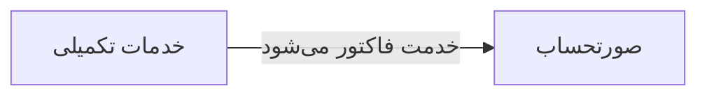

# 🩺 خدمات تکمیلی — `ComplementaryView`

> [ویزیت] · کهن‌الگوی `list-dense` (لیستِ فشرده) · آیکون `Icon.Sparkles`

| پیوند | نشانی |
|---|---|
| وایرفریمِ زنده | [`01-wireframes-html/ComplementaryView.html`](../01-wireframes-html/ComplementaryView.html) |
| View | [`03-views/ComplementaryView.xaml`](../03-views/ComplementaryView.xaml) |
| ViewModel | [`04-viewmodels/ComplementaryViewModel.cs`](../04-viewmodels/ComplementaryViewModel.cs) |

**خدمات پاراکلینیکِ تکمیلی و ثبت نتایج**

## 🖼 چیدمان

```
┌──────────────────────────────────────────────────────────────────┐
│  سربرگ: خدمات تکمیلی                                               │
├──────────────────────────────────────────────────────────────────┤
├──────────────────────────────────────────────────────────────────┤
│  [جستجو…………] [فیلتر ▾] [فیلتر ▾]        [＋ جدید] [⟳] [⤓]      │
├──────────────────────────────────────────────────────────────────┤
│  جدول                                                            │
│  ┌──────────┬────────────────────┬────────┬────────┬────────┐    │
│  │ ستون     │ ستون               │ ستون   │ ستون   │ وضعیت  │    │
│  ├──────────┼────────────────────┼────────┼────────┼────────┤    │
│  │ دادهٔ ۱   │ …                  │ …      │ …      │ نشان   │    │
│  │ دادهٔ ۲   │ …                  │ …      │ …      │ نشان   │    │
│  └──────────┴────────────────────┴────────┴────────┴────────┘    │
├──────────────────────────────────────────────────────────────────┤
│  نمایش ۱ تا ۲۵ از ۱۲۴۵                         [◀] [▶]           │
└──────────────────────────────────────────────────────────────────┘
```

## 🔍 فیلترها

| # | برچسب | نوع | پهنا | مقدارِ نمونه | گزینه‌ها |
|:--:|---|---|:--:|---|---|
| 1 | جستجو | `search` | w-lg | نام خدمت… | — |
| 2 | دسته | `combo` | w-md | همه | — |
| 3 | تاریخ | `date` | w-md | ۱۴۰۴/۰۷/۱۹ | — |

## 📐 ستون‌های جدول

| # | عنوان | اتصال | نوع | عرض | تراز |
|:--:|---|---|---|:--:|:--:|
| 1 | کد | `Code` | متن | 92px | Right |
| 2 | بیمار | `Patient` | شخص | * | Right |
| 3 | خدمت | `Service` | متن | 180px | Right |
| 4 | تاریخ | `Date` | تاریخ | 112px | Right |
| 5 | مبلغ | `Amount` | مبلغ | 108px | Left |
| 6 | وضعیت | `Status` | نشان | 104px | Center |

## 🧪 دادهٔ نمونه

| 1 | 2 | 3 | 4 | 5 | 6 |
|:--:|:--:|:--:|:--:|:--:|:--:|
| C-۳۰۱ | سارا احمدی | تزریقات | ۱۴۰۴/۰۷/۱۹ | ۸۰,۰۰۰ | `انجام شد` |
| C-۳۰۲ | محمد رضایی | پانسمان | ۱۴۰۴/۰۷/۱۹ | ۱۲۰,۰۰۰ | `در انتظار` |

## ⚡ اقدام‌ها

| فرمان | برچسب | آیکون | سبک |
|---|---|---|---|
| `NewCommand` | خدمت جدید | `Icon.Plus` | اصلی |
| `DoneCommand` | انجام شد | `Icon.Check` | ok |

## 🔗 ارتباطات

| مبدأ | مقصد | نوعِ پیوند |
|---|---|---|
| خدمات تکمیلی | صورتحساب | خدمت فاکتور می‌شود |



---

این فایل با `tools/gen_wireframes_md.py` ساخته شده است.
