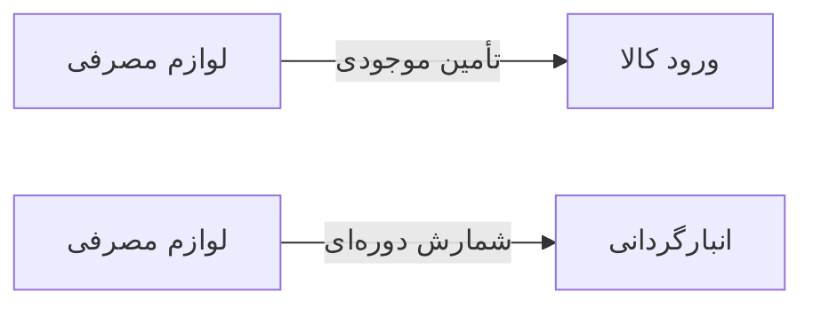

# 🩺 لوازم مصرفی — `ConsumablesView`

> [ویزیت] · کهن‌الگوی `list-dense` (لیستِ فشرده) · آیکون `Icon.Package`

| پیوند | نشانی |
|---|---|
| وایرفریمِ زنده | [`01-wireframes-html/ConsumablesView.html`](../01-wireframes-html/ConsumablesView.html) |
| View | [`03-views/ConsumablesView.xaml`](../03-views/ConsumablesView.xaml) |
| ViewModel | [`04-viewmodels/ConsumablesViewModel.cs`](../04-viewmodels/ConsumablesViewModel.cs) |

**مصرف لوازم در ویزیت و خدمات**

## 🖼 چیدمان

```
┌──────────────────────────────────────────────────────────────────┐
│  سربرگ: لوازم مصرفی                                                │
├──────────────────────────────────────────────────────────────────┤
├──────────────────────────────────────────────────────────────────┤
│  [جستجو…………] [فیلتر ▾] [فیلتر ▾]        [＋ جدید] [⟳] [⤓]      │
├──────────────────────────────────────────────────────────────────┤
│  جدول                                                            │
│  ┌──────────┬────────────────────┬────────┬────────┬────────┐    │
│  │ ستون     │ ستون               │ ستون   │ ستون   │ وضعیت  │    │
│  ├──────────┼────────────────────┼────────┼────────┼────────┤    │
│  │ دادهٔ ۱   │ …                  │ …      │ …      │ نشان   │    │
│  │ دادهٔ ۲   │ …                  │ …      │ …      │ نشان   │    │
│  └──────────┴────────────────────┴────────┴────────┴────────┘    │
├──────────────────────────────────────────────────────────────────┤
│  نمایش ۱ تا ۲۵ از ۱۲۴۵                         [◀] [▶]           │
└──────────────────────────────────────────────────────────────────┘
```

## 🔍 فیلترها

| # | برچسب | نوع | پهنا | مقدارِ نمونه | گزینه‌ها |
|:--:|---|---|:--:|---|---|
| 1 | جستجو | `search` | w-lg | نام قلم… | — |
| 2 | گروه | `combo` | w-md | همه | — |

## 📐 ستون‌های جدول

| # | عنوان | اتصال | نوع | عرض | تراز |
|:--:|---|---|---|:--:|:--:|
| 1 | کد | `Code` | متن | 92px | Right |
| 2 | نام قلم | `Name` | متن | * | Right |
| 3 | واحد | `Unit` | متن | 80px | Center |
| 4 | موجودی | `Stock` | عدد | 96px | Center |
| 5 | حد سفارش | `MinStock` | عدد | 96px | Center |
| 6 | قیمت | `Price` | مبلغ | 104px | Left |
| 7 | وضعیت | `Status` | نشان | 104px | Center |

## 🧪 دادهٔ نمونه

| 1 | 2 | 3 | 4 | 5 | 6 | 7 |
|:--:|:--:|:--:|:--:|:--:|:--:|:--:|
| K-۱۰۱ | دستکش لاتکس (بسته ۱۰۰) | بسته | ۴۲ | ۲۰ | ۷۵,۰۰۰ | `کافی` |
| K-۱۰۲ | سرنگ ۵ سی‌سی | عدد | ۱۱ | ۵۰ | ۳,۵۰۰ | `کمبود` |
| K-۱۰۳ | پنبه استریل ۵۰۰ گرمی | بسته | ۲۸ | ۱۵ | ۴۵,۰۰۰ | `کافی` |
| K-۱۰۴ | الکل ۷۰٪ یک لیتری | بطری | ۱۶ | ۱۲ | ۶۲,۰۰۰ | `نزدیک حد` |

## ⚡ اقدام‌ها

| فرمان | برچسب | آیکون | سبک |
|---|---|---|---|
| `NewCommand` | قلم جدید | `Icon.Plus` | اصلی |
| `StockInCommand` | ورود کالا | `Icon.PackagePlus` | ثانویه |
| `ExportCommand` | خروجی | `Icon.FileSpreadsheet` | ثانویه |

## 🔗 ارتباطات

| مبدأ | مقصد | نوعِ پیوند |
|---|---|---|
| لوازم مصرفی | ورود کالا | تأمین موجودی |
| لوازم مصرفی | انبارگردانی | شمارش دوره‌ای |



---

این فایل با `tools/gen_wireframes_md.py` ساخته شده است.
