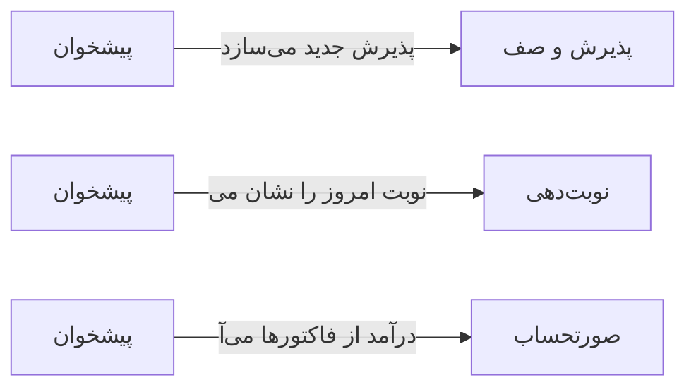

# 🏠 پیشخوان — `DashboardView`

> [پیشخوان] · کهن‌الگوی `dashboard` (پیشخوان) · آیکون `Icon.LayoutDashboard`

| پیوند | نشانی |
|---|---|
| وایرفریمِ زنده | [`01-wireframes-html/DashboardView.html`](../01-wireframes-html/DashboardView.html) |
| View | [`03-views/DashboardView.xaml`](../03-views/DashboardView.xaml) |
| ViewModel | [`04-viewmodels/DashboardViewModel.cs`](../04-viewmodels/DashboardViewModel.cs) |

**نمای کلیِ وضعیت امروز درمانگاه — یک نگاه برای همه‌چیز**

## 📝 شرح

پنج کارت شاخص در بالا، «صف انتظار زنده» در ستون راست، نمودار درآمد ۳۰ روزه و نمودار توزیع ویزیت در وسط، و فید فعالیّت‌های اخیر در پایین.

## 🖼 چیدمان

```
┌──────────────────────────────────────────────────────────────────┐
│  سربرگ: پیشخوان                                                    │
├──────────────────────────────────────────────────────────────────┤
│  ┌────────┐ ┌────────┐ ┌────────┐ ┌────────┐ ┌────────┐         │
│  │ شاخص ۱ │ │ شاخص ۲ │ │ شاخص ۳ │ │ شاخص ۴ │ │ شاخص ۵ │         │
│  └────────┘ └────────┘ └────────┘ └────────┘ └────────┘         │
├────────────────────────────────────────┬─────────────────────────┤
│  نمودارِ روند                          │  صفِ انتظارِ زنده        │
│                                        │                         │
│                                        │  ● در انتظار            │
│                                        │  ● در حال ویزیت         │
├────────────────────────────────────────┴─────────────────────────┤
│  فیدِ فعالیّت‌های اخیر                                             │
└──────────────────────────────────────────────────────────────────┘
```

## 📊 شاخص‌های کلیدی

| آیکون | شاخص | مقدار | روند | رنگِ تاکیدی |
|---|:--:|:--:|:--:|---|
| `Icon.Users` | بیماران امروز | **۴۸** | +۱۲٪ | teal |
| `Icon.CalendarCheck` | نوبت‌های امروز | **۳۶** | +۸٪ | blue |
| `Icon.Banknote` | درآمد امروز | **۲۸,۴۵۰,۰۰۰** | +۲۳٪ | green |
| `Icon.Timer` | میانگین انتظار | **۱۴ دقیقه** | −۶٪ | amber |
| `Icon.TriangleAlert` | هشدارهای فعال | **۳** | — | rose |

## ⚡ اقدام‌ها

| فرمان | برچسب | آیکون | سبک |
|---|---|---|---|
| `NewReceptionCommand` | پذیرش جدید | `Icon.UserPlus` | اصلی |
| `NewAppointmentCommand` | نوبت جدید | `Icon.CalendarPlus` | ثانویه |
| `RefreshCommand` | تازه‌سازی | `Icon.RefreshCw` | بی‌زمینه |

## 🔗 ارتباطات

| مبدأ | مقصد | نوعِ پیوند |
|---|---|---|
| پیشخوان | پذیرش و صف | پذیرش جدید می‌سازد |
| پیشخوان | نوبت‌دهی | نوبت امروز را نشان می‌دهد |
| پیشخوان | صورتحساب | درآمد از فاکتورها می‌آید |



---

این فایل با `tools/gen_wireframes_md.py` ساخته شده است.
