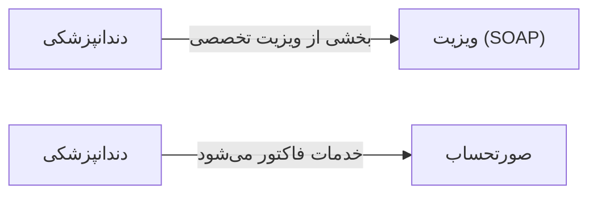

# 🩺 دندانپزشکی — `DentistryView`

> [ویزیت] · کهن‌الگوی `detail-tabs` (جزئیاتِ تب‌دار) · آیکون `Icon.Smile`

| پیوند | نشانی |
|---|---|
| وایرفریمِ زنده | [`01-wireframes-html/DentistryView.html`](../01-wireframes-html/DentistryView.html) |
| View | [`03-views/DentistryView.xaml`](../03-views/DentistryView.xaml) |
| ViewModel | [`04-viewmodels/DentistryViewModel.cs`](../04-viewmodels/DentistryViewModel.cs) |

**چارت دندانی و ثبت خدمات دندانپزشکی**

## 📝 شرح

چارت دندانی با ۳۲ دندانِ تعاملی؛ هر دندان رنگِ وضعیت خود را دارد (سالم/پوسیده/پرکرده/کشیده‌شده).

## 🖼 چیدمان

```
┌──────────────────────────────────────────────────────────────────┐
│  سربرگ: دندانپزشکی                                                 │
├──────────────────────────────────────────────────────────────────┤
│  فیلدهای سربرگ روی شبکه‌ی ۱۲ ستونه                                │
├──────────────────────────────────────────────────────────────────┤
│  تب ۱  │  تب ۲  │  تب ۳  │  تب ۴  │  تب ۵  │  تب ۶  │             │
├────────┴────────┴────────┴────────┴────────┴────────┴───────────┤
│                                                                  │
│  محتوای تب                                                       │
│  ┌──────────────────────────────────────────────────────────┐    │
│  │ جدول یا فرمِ مربوط به تب                                 │    │
│  └──────────────────────────────────────────────────────────┘    │
└──────────────────────────────────────────────────────────────────┘
```

## 🗂 تب‌ها

| # | عنوان | آیکون | شمارنده |
|:--:|---|---|:--:|
| 1 | چارت دندان | `Icon.Grid3x3` | — |
| 2 | خدمات | `Icon.Briefcase` | — |
| 3 | تصاویر | `Icon.Image` | — |
| 4 | طرح درمان | `Icon.ClipboardList` | — |

## 📐 ستون‌های جدول

| # | عنوان | اتصال | نوع | عرض | تراز |
|:--:|---|---|---|:--:|:--:|
| 1 | دندان | `Tooth` | عدد | 92px | Center |
| 2 | وضعیت | `Condition` | متن | 130px | Right |
| 3 | خدمت انجام‌شده | `Service` | متن | * | Right |
| 4 | تاریخ | `Date` | تاریخ | 112px | Right |
| 5 | وضعیت درمان | `Status` | نشان | 124px | Center |

## 🧪 دادهٔ نمونه

| 1 | 2 | 3 | 4 | 5 |
|:--:|:--:|:--:|:--:|:--:|
| ۱۶ | پوسیدگی سطحی | ترمیم کامپوزیت | ۱۴۰۴/۰۷/۱۸ | `انجام شد` |
| ۲۶ | پوسیدگی عمیق | عصب‌کشی | ۱۴۰۴/۰۷/۱۸ | `در حال درمان` |
| ۳۶ | کشیده‌شده | — | ۱۴۰۳/۱۱/۰۵ | `نیاز به ایمپلنت` |
| ۴۶ | سالم | — | — | `سالم` |

## ⚡ اقدام‌ها

| فرمان | برچسب | آیکون | سبک |
|---|---|---|---|
| `SaveCommand` | ذخیره | `Icon.Save` | اصلی |
| `PrintCommand` | چاپ چارت | `Icon.Printer` | ثانویه |

## 🔗 ارتباطات

| مبدأ | مقصد | نوعِ پیوند |
|---|---|---|
| دندانپزشکی | ویزیت (SOAP) | بخشی از ویزیت تخصصی |
| دندانپزشکی | صورتحساب | خدمات فاکتور می‌شود |



---

این فایل با `tools/gen_wireframes_md.py` ساخته شده است.
