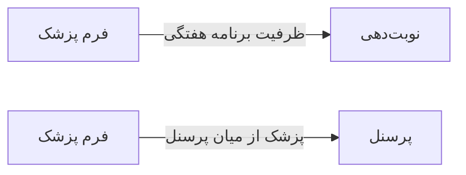

# 🧑‍💼 فرم پزشک — `DoctorFormWindow`

> [منابع انسانی] · کهن‌الگوی `form-std` (فرم استاندارد) · آیکون `Icon.Stethoscope`

| پیوند | نشانی |
|---|---|
| وایرفریمِ زنده | [`01-wireframes-html/DoctorFormWindow.html`](../01-wireframes-html/DoctorFormWindow.html) |
| View | [`03-views/DoctorFormWindow.xaml`](../03-views/DoctorFormWindow.xaml) |
| ViewModel | [`04-viewmodels/DoctorFormViewModel.cs`](../04-viewmodels/DoctorFormViewModel.cs) |

**تعریف پزشک، تخصص و برنامه کاری**

## 🖼 چیدمان

```
┌──────────────────────────────────────────────────────────────────┐
│  سربرگ: فرم پزشک                                                   │
├──────────────────────────────────────────────────────────────────┤
│  شبکه‌ی ۱۲ ستونه — پهنای هر فیلد متناسب با کارکردش                │
  │ PersonnelId      │ Special │ Medical │
  │ Contrac │ VisitDu │ MaxPerD │ RoomId  │
  │ SatS │ SatE │ SunS │ SunE │ MonS │ MonE │
  │ IsActive         │ AcceptsWalkIn    │

├──────────────────────────────────────────────────────────────────┤
│                                    [انصراف]  [ذخیره]             │
└──────────────────────────────────────────────────────────────────┘
```

## 📋 فیلدها

> پهنا بر پایه‌ی شبکه‌ی ۱۲ ستونه است: «بزرگیِ عنصر متناسب با کارکرد».

| بخش | آیکون | فیلد | برچسب | نوع | پهنا (از ۱۲) | الزامی | مقدارِ نمونه |
|---|---|---|---|---|:--:|:--:|---|
| **اطلاعات حرفه‌ای** | `Icon.Stethoscope` | `PersonnelId` | پرسنل مرتبط | ComboBox | 6/۱۲ | بله | دکتر موسوی (E-۱۰۰۳) |
|  | `Icon.Stethoscope` | `SpecialtyId` | تخصص | ComboBox | 3/۱۲ | بله | متخصص داخلی |
|  | `Icon.Stethoscope` | `MedicalCouncilNo` | شماره نظام پزشکی | TextBox | 3/۱۲ | بله | ۱۲۳۴۵ |
|  | `Icon.Stethoscope` | `ContractPercent` | درصد قرارداد | TextBox (عددی) | 3/۱۲ | خیر | ۵۰ |
|  | `Icon.Stethoscope` | `VisitDuration` | مدت هر ویزیت | ComboBox | 3/۱۲ | خیر | ۲۰ دقیقه |
|  | `Icon.Stethoscope` | `MaxPerDay` | ظرفیت روزانه | TextBox (عددی) | 3/۱۲ | خیر | ۴۰ |
|  | `Icon.Stethoscope` | `RoomId` | اتاق | ComboBox | 3/۱۲ | خیر | اتاق ۲ |
| **برنامه کاری هفتگی** | `Icon.CalendarDays` | `SatStart` | شنبه — شروع | TextBox | 2/۱۲ | خیر | ۰۸:۰۰ |
|  | `Icon.CalendarDays` | `SatEnd` | شنبه — پایان | TextBox | 2/۱۲ | خیر | ۱۴:۰۰ |
|  | `Icon.CalendarDays` | `SunStart` | یکشنبه — شروع | TextBox | 2/۱۲ | خیر | ۰۸:۰۰ |
|  | `Icon.CalendarDays` | `SunEnd` | یکشنبه — پایان | TextBox | 2/۱۲ | خیر | ۱۴:۰۰ |
|  | `Icon.CalendarDays` | `MonStart` | دوشنبه — شروع | TextBox | 2/۱۲ | خیر | ۱۴:۰۰ |
|  | `Icon.CalendarDays` | `MonEnd` | دوشنبه — پایان | TextBox | 2/۱۲ | خیر | ۲۰:۰۰ |
|  | `Icon.CalendarDays` | `IsActive` | فعال | CheckBox | 6/۱۲ | خیر | True |
|  | `Icon.CalendarDays` | `AcceptsWalkIn` | پذیرش بدون نوبت | CheckBox | 6/۱۲ | خیر | False |

## ⚡ اقدام‌ها

| فرمان | برچسب | آیکون | سبک |
|---|---|---|---|
| `SaveCommand` | ذخیره | `Icon.Save` | اصلی |
| `CancelCommand` | انصراف | `—` | بی‌زمینه |

## 🔗 ارتباطات

| مبدأ | مقصد | نوعِ پیوند |
|---|---|---|
| فرم پزشک | نوبت‌دهی | ظرفیت برنامه هفتگی |
| فرم پزشک | پرسنل | پزشک از میان پرسنل |



---

این فایل با `tools/gen_wireframes_md.py` ساخته شده است.
