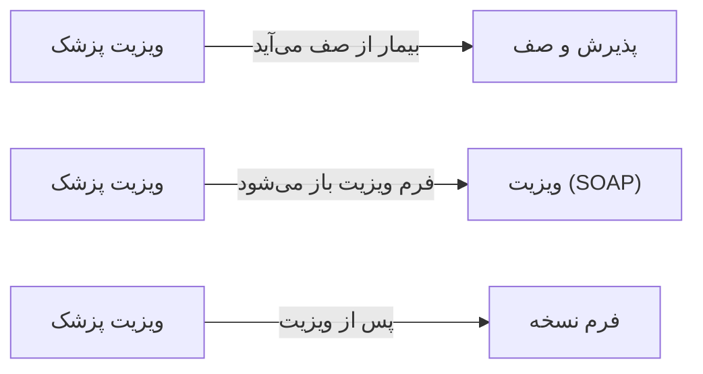

# 📅 ویزیت پزشک — `DoctorVisitView`

> [نوبت‌دهی] · کهن‌الگوی `split` (دوپنلی) · آیکون `Icon.Stethoscope`

| پیوند | نشانی |
|---|---|
| وایرفریمِ زنده | [`01-wireframes-html/DoctorVisitView.html`](../01-wireframes-html/DoctorVisitView.html) |
| View | [`03-views/DoctorVisitView.xaml`](../03-views/DoctorVisitView.xaml) |
| ViewModel | [`04-viewmodels/DoctorVisitViewModel.cs`](../04-viewmodels/DoctorVisitViewModel.cs) |

**میزکار پزشک: صف بیماران + فرم ویزیت**

## 🖼 چیدمان

```
┌──────────────────────────────────────────────┬────────────────────┐
│  سربرگ: ویزیت پزشک                                │                    │
├──────────────────────────────────────────────┤   ویزیتِ جاری      │
│  جدولِ نوبت‌ها                                │                    │
│  ┌────┬─────────────┬────────┬──────┬─────┐  │   بیمار: …         │
│  │ ن  │ بیمار      │ خدمت   │ ورود │ وضع │  │   سن: …            │
│  ├────┼─────────────┼────────┼──────┼─────┤  │   بیمه: …          │
│  │ ۱۲ │ …          │ …      │ …    │ نشان│  │   حساسیت: …        │
│  └────┴─────────────┴────────┴──────┴─────┘  │   …                 │
└──────────────────────────────────────────────┴────────────────────┘
```

## 📊 شاخص‌های کلیدی

| آیکون | شاخص | مقدار | روند | رنگِ تاکیدی |
|---|:--:|:--:|:--:|---|
| `Icon.Users` | در صف | **۷** | — | teal |
| `Icon.CircleCheck` | ویزیت‌شده امروز | **۱۹** | +۱۲٪ | green |
| `Icon.Timer` | میانگین ویزیت | **۱۶ دقیقه** | −۴٪ | blue |

## 📐 ستون‌های جدول

| # | عنوان | اتصال | نوع | عرض | تراز |
|:--:|---|---|---|:--:|:--:|
| 1 | نوبت | `Queue` | عدد | 64px | Center |
| 2 | بیمار | `Patient` | شخص | * | Right |
| 3 | خدمت | `Service` | متن | 140px | Right |
| 4 | ورود | `Time` | تاریخ | 86px | Center |
| 5 | وضعیت | `Status` | نشان | 112px | Center |

## 🧪 دادهٔ نمونه

| 1 | 2 | 3 | 4 | 5 |
|:--:|:--:|:--:|:--:|:--:|
| ۱۲ | سارا احمدی | ویزیت عمومی | ۰۹:۱۲ | `در انتظار` |
| ۱۳ | محمد رضایی | ویزیت تخصصی | ۰۹:۲۵ | `در انتظار` |
| ۱۴ | فاطمه کریمی | پیگیری | ۰۹:۳۱ | `در انتظار` |
| ۱۵ | علی حسینی | ویزیت عمومی | ۰۹:۴۰ | `در انتظار` |

## 📌 پانلِ کناری

**ویزیت جاری** (آیکون `Icon.Stethoscope`)

| کلید | مقدار |
|---|---|
| بیمار | سارا احمدی |
| سن | ۴۲ سال |
| بیمه | تأمین اجتماعی |
| حساسیت | پنی‌سیلین |
| آخرین ویزیت | ۱۴۰۴/۰۵/۱۲ |
| تعداد ویزیت | ۱۸ |
| فشار خون | ۱۲۰/۸۰ |
| وزن | ۶۵ کیلوگرم |

## ⚡ اقدام‌ها

| فرمان | برچسب | آیکون | سبک |
|---|---|---|---|
| `StartVisitCommand` | شروع ویزیت | `Icon.Play` | اصلی |
| `CallNextCommand` | فراخوانی بعدی | `Icon.ChevronLeft` | ثانویه |
| `CompleteCommand` | پایان ویزیت | `Icon.Check` | ok |

## 🔗 ارتباطات

| مبدأ | مقصد | نوعِ پیوند |
|---|---|---|
| ویزیت پزشک | پذیرش و صف | بیمار از صف می‌آید |
| ویزیت پزشک | ویزیت (SOAP) | فرم ویزیت باز می‌شود |
| ویزیت پزشک | فرم نسخه | پس از ویزیت |



---

این فایل با `tools/gen_wireframes_md.py` ساخته شده است.
