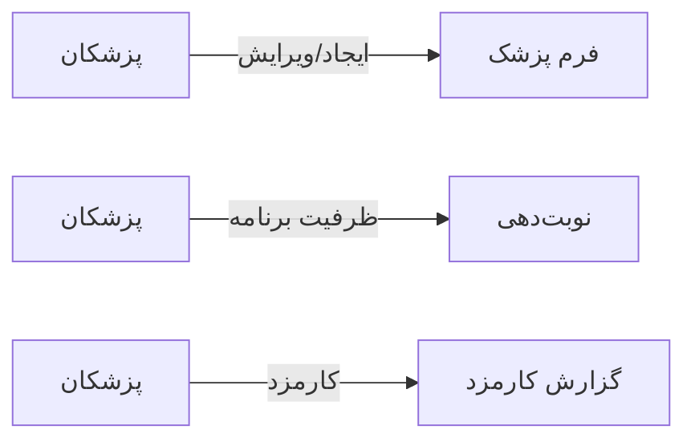

# 🧑‍💼 پزشکان — `DoctorsView`

> [منابع انسانی] · کهن‌الگوی `list-cards` (لیستِ کارتی) · آیکون `Icon.Stethoscope`

| پیوند | نشانی |
|---|---|
| وایرفریمِ زنده | [`01-wireframes-html/DoctorsView.html`](../01-wireframes-html/DoctorsView.html) |
| View | [`03-views/DoctorsView.xaml`](../03-views/DoctorsView.xaml) |
| ViewModel | [`04-viewmodels/DoctorsViewModel.cs`](../04-viewmodels/DoctorsViewModel.cs) |

**فهرست پزشکان و برنامه کاری**

## 🖼 چیدمان

```
┌──────────────────────────────────────────────────────────────────┐
│  سربرگ: پزشکان                                                     │
├──────────────────────────────────────────────────────────────────┤
│  ┌───────────────┐ ┌───────────────┐ ┌───────────────┐           │
│  │ عنوان         │ │ عنوان         │ │ عنوان         │           │
│  │ زیرعنوان      │ │ زیرعنوان      │ │ زیرعنوان      │           │
│  │      [نشان]   │ │      [نشان]   │ │      [نشان]   │           │
│  └───────────────┘ └───────────────┘ └───────────────┘           │
└──────────────────────────────────────────────────────────────────┘
```

## 🔍 فیلترها

| # | برچسب | نوع | پهنا | مقدارِ نمونه | گزینه‌ها |
|:--:|---|---|:--:|---|---|
| 1 | جستجو | `search` | w-xl | نام پزشک یا تخصص… | — |
| 2 | تخصص | `combo` | w-md | همه | — |
| 3 | وضعیت | `combo` | w-sm | فعال | — |

## 📐 ستون‌های جدول

| # | عنوان | اتصال | نوع | عرض | تراز |
|:--:|---|---|---|:--:|:--:|
| 1 | پزشک | `Name` | شخص | * | Right |
| 2 | تخصص | `Specialty` | متن | 150px | Right |
| 3 | روزهای کاری | `Days` | متن | 150px | Right |
| 4 | ظرفیت روزانه | `Capacity` | عدد | 110px | Center |
| 5 | وضعیت | `Status` | نشان | 104px | Center |

## 🧪 دادهٔ نمونه

| 1 | 2 | 3 | 4 | 5 |
|:--:|:--:|:--:|:--:|:--:|
| دکتر موسوی | متخصص داخلی | شنبه · یکشنبه · دوشنبه | ۴۰ | `فعال` |
| دکتر رضایی | متخصص قلب | شنبه · دوشنبه · چهارشنبه | ۳۰ | `فعال` |
| دکتر کریمی | پزشک عمومی | همه‌روزه | ۵۰ | `فعال` |

## ⚡ اقدام‌ها

| فرمان | برچسب | آیکون | سبک |
|---|---|---|---|
| `NewCommand` | پزشک جدید | `Icon.Plus` | اصلی |
| `ScheduleCommand` | برنامه هفتگی | `Icon.CalendarDays` | ثانویه |

## 🔗 ارتباطات

| مبدأ | مقصد | نوعِ پیوند |
|---|---|---|
| پزشکان | فرم پزشک | ایجاد/ویرایش |
| پزشکان | نوبت‌دهی | ظرفیت برنامه |
| پزشکان | گزارش کارمزد | کارمزد |



---

این فایل با `tools/gen_wireframes_md.py` ساخته شده است.
