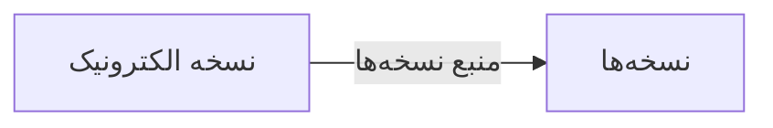

# 💊 نسخه الکترونیک — `EPrescriptionView`

> [نسخه] · کهن‌الگوی `list-dense` (لیستِ فشرده) · آیکون `Icon.Send`

| پیوند | نشانی |
|---|---|
| وایرفریمِ زنده | [`01-wireframes-html/EPrescriptionView.html`](../01-wireframes-html/EPrescriptionView.html) |
| View | [`03-views/EPrescriptionView.xaml`](../03-views/EPrescriptionView.xaml) |
| ViewModel | [`04-viewmodels/EPrescriptionViewModel.cs`](../04-viewmodels/EPrescriptionViewModel.cs) |

**ارسال نسخه‌ها به سامانه کشوری**

## 🖼 چیدمان

```
┌──────────────────────────────────────────────────────────────────┐
│  سربرگ: نسخه الکترونیک                                             │
├──────────────────────────────────────────────────────────────────┤
├──────────────────────────────────────────────────────────────────┤
│  [جستجو…………] [فیلتر ▾] [فیلتر ▾]        [＋ جدید] [⟳] [⤓]      │
├──────────────────────────────────────────────────────────────────┤
│  جدول                                                            │
│  ┌──────────┬────────────────────┬────────┬────────┬────────┐    │
│  │ ستون     │ ستون               │ ستون   │ ستون   │ وضعیت  │    │
│  ├──────────┼────────────────────┼────────┼────────┼────────┤    │
│  │ دادهٔ ۱   │ …                  │ …      │ …      │ نشان   │    │
│  │ دادهٔ ۲   │ …                  │ …      │ …      │ نشان   │    │
│  └──────────┴────────────────────┴────────┴────────┴────────┘    │
├──────────────────────────────────────────────────────────────────┤
│  نمایش ۱ تا ۲۵ از ۱۲۴۵                         [◀] [▶]           │
└──────────────────────────────────────────────────────────────────┘
```

## 🔍 فیلترها

| # | برچسب | نوع | پهنا | مقدارِ نمونه | گزینه‌ها |
|:--:|---|---|:--:|---|---|
| 1 | جستجو | `search` | w-lg | کد نسخه… | — |
| 2 | وضعیت ارسال | `combo` | w-md | همه | همه، ارسال شده، خطا، در صف |

## 📐 ستون‌های جدول

| # | عنوان | اتصال | نوع | عرض | تراز |
|:--:|---|---|---|:--:|:--:|
| 1 | کد | `Code` | متن | 108px | Right |
| 2 | بیمار | `Patient` | شخص | * | Right |
| 3 | تاریخ | `Date` | تاریخ | 112px | Right |
| 4 | کد رهگیری | `TrackCode` | عدد | 140px | Left |
| 5 | وضعیت | `Status` | نشان | 120px | Center |

## 🧪 دادهٔ نمونه

| 1 | 2 | 3 | 4 | 5 |
|:--:|:--:|:--:|:--:|:--:|
| RX-۸۵۲۰ | سارا احمدی | ۱۴۰۴/۰۷/۱۲ | ۱۲۳۴۵۶۷۸۹۰ | `ارسال شده` |
| RX-۸۵۲۱ | محمد رضایی | ۱۴۰۴/۰۷/۱۲ | — | `خطا` |

## ⚡ اقدام‌ها

| فرمان | برچسب | آیکون | سبک |
|---|---|---|---|
| `SendCommand` | ارسال مجدد | `Icon.Send` | اصلی |
| `RefreshCommand` | تازه‌سازی | `Icon.RefreshCw` | بی‌زمینه |

## 🔗 ارتباطات

| مبدأ | مقصد | نوعِ پیوند |
|---|---|---|
| نسخه الکترونیک | نسخه‌ها | منبع نسخه‌ها |



---

این فایل با `tools/gen_wireframes_md.py` ساخته شده است.
