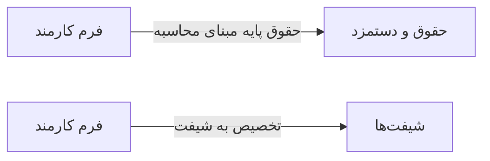

# 🧑‍💼 فرم کارمند — `EmployeeFormWindow`

> [منابع انسانی] · کهن‌الگوی `form-std` (فرم استاندارد) · آیکون `Icon.UserPlus`

| پیوند | نشانی |
|---|---|
| وایرفریمِ زنده | [`01-wireframes-html/EmployeeFormWindow.html`](../01-wireframes-html/EmployeeFormWindow.html) |
| View | [`03-views/EmployeeFormWindow.xaml`](../03-views/EmployeeFormWindow.xaml) |
| ViewModel | [`04-viewmodels/EmployeeFormViewModel.cs`](../04-viewmodels/EmployeeFormViewModel.cs) |

**ایجاد یا ویرایش پرونده پرسنلی**

## 🖼 چیدمان

```
┌──────────────────────────────────────────────────────────────────┐
│  سربرگ: فرم کارمند                                                 │
├──────────────────────────────────────────────────────────────────┤
│  شبکه‌ی ۱۲ ستونه — پهنای هر فیلد متناسب با کارکردش                │
  │ FirstNa │ LastNam │ Nationa │ Gender  │
  │ BirthDa │ Marital │ Educati │ Photo   │
  │ Employe │ Positio │ Departm │ HireDat │
  │ Employment │ BranchId   │ IsActive   │
  │ BaseSal │ HourlyR │ Insuran │ BankAcc │
  │ Phone      │ Email      │ Address    │

├──────────────────────────────────────────────────────────────────┤
│                                    [انصراف]  [ذخیره]             │
└──────────────────────────────────────────────────────────────────┘
```

## 📋 فیلدها

> پهنا بر پایه‌ی شبکه‌ی ۱۲ ستونه است: «بزرگیِ عنصر متناسب با کارکرد».

| بخش | آیکون | فیلد | برچسب | نوع | پهنا (از ۱۲) | الزامی | مقدارِ نمونه |
|---|---|---|---|---|:--:|:--:|---|
| **اطلاعات فردی** | `Icon.IdCard` | `FirstName` | نام | TextBox | 3/۱۲ | بله | مریم |
|  | `Icon.IdCard` | `LastName` | نام خانوادگی | TextBox | 3/۱۲ | بله | نوری |
|  | `Icon.IdCard` | `NationalId` | کد ملی | TextBox | 3/۱۲ | خیر | ۰۰۹۸۷۶۵۴۳۲ |
|  | `Icon.IdCard` | `Gender` | جنسیت | ComboBox | 3/۱۲ | خیر | زن |
|  | `Icon.IdCard` | `BirthDate` | تاریخ تولد | DatePicker | 3/۱۲ | خیر | ۱۳۶۵/۰۳/۱۲ |
|  | `Icon.IdCard` | `MaritalStatus` | وضعیت تأهل | ComboBox | 3/۱۲ | خیر | مجرد |
|  | `Icon.IdCard` | `Education` | تحصیلات | ComboBox | 3/۱۲ | خیر | کارشناسی |
|  | `Icon.IdCard` | `Photo` | عکس پرسنلی | StackPanel | 3/۱۲ | خیر | profile.jpg |
| **اطلاعات شغلی** | `Icon.Briefcase` | `EmployeeCode` | کد پرسنلی | TextBox | 3/۱۲ | بله | E-۱۰۰۱ |
|  | `Icon.Briefcase` | `PositionId` | سمت | ComboBox | 3/۱۲ | بله | کارشناس پذیرش |
|  | `Icon.Briefcase` | `DepartmentId` | دپارتمان | ComboBox | 3/۱۲ | بله | پذیرش |
|  | `Icon.Briefcase` | `HireDate` | تاریخ استخدام | DatePicker | 3/۱۲ | بله | ۱۴۰۱/۰۲/۱۵ |
|  | `Icon.Briefcase` | `EmploymentType` | نوع همکاری | ComboBox | 4/۱۲ | خیر | تمام‌وقت |
|  | `Icon.Briefcase` | `BranchId` | شعبه | ComboBox | 4/۱۲ | خیر | مرکزی |
|  | `Icon.Briefcase` | `IsActive` | فعال | CheckBox | 4/۱۲ | خیر | True |
| **اطلاعات مالی** | `Icon.Wallet` | `BaseSalary` | حقوق پایه | TextBox | 3/۱۲ | خیر | ۱۲,۰۰۰,۰۰۰ |
|  | `Icon.Wallet` | `HourlyRate` | نرخ ساعتی | TextBox | 3/۱۲ | خیر | ۷۵,۰۰۰ |
|  | `Icon.Wallet` | `InsuranceNo` | شماره بیمه | TextBox | 3/۱۲ | خیر | ۱۲۳۴۵۶۷۸۹۰ |
|  | `Icon.Wallet` | `BankAccount` | شماره حساب | TextBox | 3/۱۲ | خیر | IR۱۲۰۱۷۰۰۰۰۰۰۰۱۲۳۴۵۶۷۸۹۰ |
| **اطلاعات تماس** | `Icon.Phone` | `Phone` | موبایل | TextBox | 4/۱۲ | خیر | ۰۹۱۴۴۲۲۰۴۳۰ |
|  | `Icon.Phone` | `Email` | رایانامه | TextBox | 4/۱۲ | خیر | info@ea-fixer.ir |
|  | `Icon.Phone` | `Address` | نشانی | TextBox (چندخطی) | 4/۱۲ | خیر | تبریز، آبرسان، خیابان … |

## ⚡ اقدام‌ها

| فرمان | برچسب | آیکون | سبک |
|---|---|---|---|
| `SaveCommand` | ذخیره | `Icon.Save` | اصلی |
| `SaveNewCommand` | ذخیره و جدید | `Icon.Plus` | ثانویه |
| `CancelCommand` | انصراف | `—` | بی‌زمینه |

## 🔗 ارتباطات

| مبدأ | مقصد | نوعِ پیوند |
|---|---|---|
| فرم کارمند | حقوق و دستمزد | حقوق پایه مبنای محاسبه |
| فرم کارمند | شیفت‌ها | تخصیص به شیفت |



---

این فایل با `tools/gen_wireframes_md.py` ساخته شده است.
