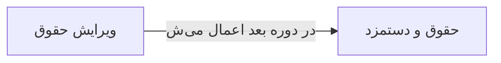

# 🧑‍💼 ویرایش حقوق — `EmployeeSalaryEditWindow`

> [منابع انسانی] · کهن‌الگوی `form-narrow` (فرمِ باریک) · آیکون `Icon.Banknote`

| پیوند | نشانی |
|---|---|
| وایرفریمِ زنده | [`01-wireframes-html/EmployeeSalaryEditWindow.html`](../01-wireframes-html/EmployeeSalaryEditWindow.html) |
| View | [`03-views/EmployeeSalaryEditWindow.xaml`](../03-views/EmployeeSalaryEditWindow.xaml) |
| ViewModel | [`04-viewmodels/EmployeeSalaryEditViewModel.cs`](../04-viewmodels/EmployeeSalaryEditViewModel.cs) |

**تغییر حقوق پایه و مزایا**

## 🖼 چیدمان

```
            ┌──────────────────────────────┐
            │                  آیکون          │
            │           ویرایش حقوق           │
            ├──────────────────────────────┤
            │  ✓ ویژگیِ ۱                  │
            │  ✓ ویژگیِ ۲                  │
            │  ✓ ویژگیِ ۳                  │
            ├──────────────────────────────┤
            │  ┌────────────────────────┐  │
            │  │ فیلد                  │  │
            │  └────────────────────────┘  │
            │  ┌────────────────────────┐  │
            │  │ فیلد                  │  │
            │  └────────────────────────┘  │
            │  ☐ به خاطر بسپار             │
            ├──────────────────────────────┤
            │  [        ورود        ]      │
            └──────────────────────────────┘
```

## 📋 فیلدها

> پهنا بر پایه‌ی شبکه‌ی ۱۲ ستونه است: «بزرگیِ عنصر متناسب با کارکرد».

| بخش | آیکون | فیلد | برچسب | نوع | پهنا (از ۱۲) | الزامی | مقدارِ نمونه |
|---|---|---|---|---|:--:|:--:|---|
| **حقوق** | `Icon.Wallet` | `Employee` | پرسنل | TextBox | 12/۱۲ | خیر | مریم نوری — E-۱۰۰۱ |
|  | `Icon.Wallet` | `BaseSalary` | حقوق پایه | TextBox | 6/۱۲ | بله | ۱۴,۰۰۰,۰۰۰ |
|  | `Icon.Wallet` | `HourlyRate` | نرخ ساعتی | TextBox | 6/۱۲ | خیر | ۸۷,۵۰۰ |
|  | `Icon.Wallet` | `OvertimeRate` | نرخ اضافه‌کار | TextBox | 6/۱۲ | خیر | ۱۲۰,۰۰۰ |
|  | `Icon.Wallet` | `Percent` | درصد کارمزد | TextBox (عددی) | 6/۱۲ | خیر | ۰ |
|  | `Icon.Wallet` | `EffectiveDate` | تاریخ اجرا | DatePicker | 12/۱۲ | بله | ۱۴۰۴/۰۸/۰۱ |

## ⚡ اقدام‌ها

| فرمان | برچسب | آیکون | سبک |
|---|---|---|---|
| `SaveCommand` | ذخیره | `Icon.Save` | اصلی |
| `CancelCommand` | انصراف | `—` | بی‌زمینه |

## 🔗 ارتباطات

| مبدأ | مقصد | نوعِ پیوند |
|---|---|---|
| ویرایش حقوق | حقوق و دستمزد | در دوره بعد اعمال می‌شود |



---

این فایل با `tools/gen_wireframes_md.py` ساخته شده است.
