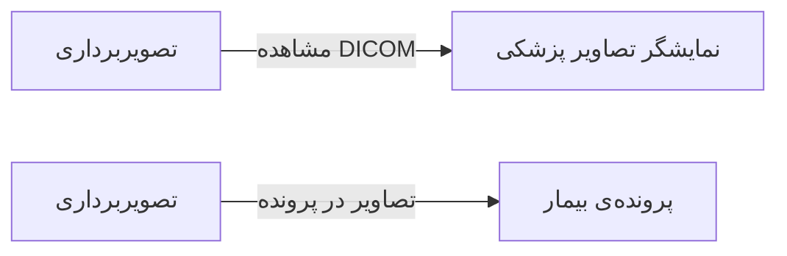

# 📷 تصویربرداری — `ImagingView`

> [تصویربرداری] · کهن‌الگوی `list-dense` (لیستِ فشرده) · آیکون `Icon.ScanLine`

| پیوند | نشانی |
|---|---|
| وایرفریمِ زنده | [`01-wireframes-html/ImagingView.html`](../01-wireframes-html/ImagingView.html) |
| View | [`03-views/ImagingView.xaml`](../03-views/ImagingView.xaml) |
| ViewModel | [`04-viewmodels/ImagingViewModel.cs`](../04-viewmodels/ImagingViewModel.cs) |

**مدیریت درخواست‌ها و تصاویر پزشکی**

## 🖼 چیدمان

```
┌──────────────────────────────────────────────────────────────────┐
│  سربرگ: تصویربرداری                                                │
├──────────────────────────────────────────────────────────────────┤
├──────────────────────────────────────────────────────────────────┤
│  [جستجو…………] [فیلتر ▾] [فیلتر ▾]        [＋ جدید] [⟳] [⤓]      │
├──────────────────────────────────────────────────────────────────┤
│  جدول                                                            │
│  ┌──────────┬────────────────────┬────────┬────────┬────────┐    │
│  │ ستون     │ ستون               │ ستون   │ ستون   │ وضعیت  │    │
│  ├──────────┼────────────────────┼────────┼────────┼────────┤    │
│  │ دادهٔ ۱   │ …                  │ …      │ …      │ نشان   │    │
│  │ دادهٔ ۲   │ …                  │ …      │ …      │ نشان   │    │
│  └──────────┴────────────────────┴────────┴────────┴────────┘    │
├──────────────────────────────────────────────────────────────────┤
│  نمایش ۱ تا ۲۵ از ۱۲۴۵                         [◀] [▶]           │
└──────────────────────────────────────────────────────────────────┘
```

## 🔍 فیلترها

| # | برچسب | نوع | پهنا | مقدارِ نمونه | گزینه‌ها |
|:--:|---|---|:--:|---|---|
| 1 | جستجو | `search` | w-xl | نام بیمار یا کد… | — |
| 2 | نوع تصویر | `combo` | w-md | همه | همه، رادیوگرافی، سونوگرافی، CT، MRI |
| 3 | تاریخ | `date` | w-md | ۱۴۰۴/۰۷/۱۹ | — |

## 📐 ستون‌های جدول

| # | عنوان | اتصال | نوع | عرض | تراز |
|:--:|---|---|---|:--:|:--:|
| 1 | کد | `Code` | متن | 100px | Right |
| 2 | بیمار | `Patient` | شخص | * | Right |
| 3 | نوع | `Modality` | متن | 130px | Right |
| 4 | ناحیه | `BodyPart` | متن | 130px | Right |
| 5 | تاریخ | `Date` | تاریخ | 112px | Right |
| 6 | تصاویر | `Images` | عدد | 86px | Center |
| 7 | وضعیت | `Status` | نشان | 112px | Center |

## 🧪 دادهٔ نمونه

| 1 | 2 | 3 | 4 | 5 | 6 | 7 |
|:--:|:--:|:--:|:--:|:--:|:--:|:--:|
| I-۳۱۰ | سارا احمدی | رادیوگرافی | قفسه سینه | ۱۴۰۴/۰۷/۱۸ | ۲ | `گزارش شده` |
| I-۳۱۱ | محمد رضایی | سونوگرافی | شکم | ۱۴۰۴/۰۷/۱۹ | ۶ | `در انتظار گزارش` |

## ⚡ اقدام‌ها

| فرمان | برچسب | آیکون | سبک |
|---|---|---|---|
| `NewCommand` | درخواست جدید | `Icon.Plus` | اصلی |
| `OpenCommand` | نمایش تصاویر | `Icon.Monitor` | ثانویه |
| `ReportCommand` | ثبت گزارش | `Icon.FileCheck` | ok |

## 🔗 ارتباطات

| مبدأ | مقصد | نوعِ پیوند |
|---|---|---|
| تصویربرداری | نمایشگر تصاویر پزشکی | مشاهده DICOM |
| تصویربرداری | پرونده‌ی بیمار | تصاویر در پرونده |



---

این فایل با `tools/gen_wireframes_md.py` ساخته شده است.
