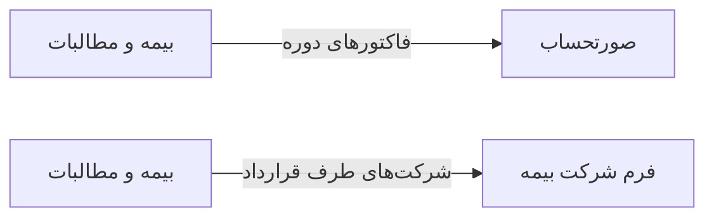

# 💰 بیمه و مطالبات — `InsuranceView`

> [مالی] · کهن‌الگوی `detail-tabs` (جزئیاتِ تب‌دار) · آیکون `Icon.ShieldCheck`

| پیوند | نشانی |
|---|---|
| وایرفریمِ زنده | [`01-wireframes-html/InsuranceView.html`](../01-wireframes-html/InsuranceView.html) |
| View | [`03-views/InsuranceView.xaml`](../03-views/InsuranceView.xaml) |
| ViewModel | [`04-viewmodels/InsuranceViewModel.cs`](../04-viewmodels/InsuranceViewModel.cs) |

**پیگیری مطالبات از شرکت‌های بیمه**

## 🖼 چیدمان

```
┌──────────────────────────────────────────────────────────────────┐
│  سربرگ: بیمه و مطالبات                                             │
├──────────────────────────────────────────────────────────────────┤
│  فیلدهای سربرگ روی شبکه‌ی ۱۲ ستونه                                │
├──────────────────────────────────────────────────────────────────┤
│  تب ۱  │  تب ۲  │  تب ۳  │  تب ۴  │  تب ۵  │  تب ۶  │             │
├────────┴────────┴────────┴────────┴────────┴────────┴───────────┤
│                                                                  │
│  محتوای تب                                                       │
│  ┌──────────────────────────────────────────────────────────┐    │
│  │ جدول یا فرمِ مربوط به تب                                 │    │
│  └──────────────────────────────────────────────────────────┘    │
└──────────────────────────────────────────────────────────────────┘
```

## 📊 شاخص‌های کلیدی

| آیکون | شاخص | مقدار | روند | رنگِ تاکیدی |
|---|:--:|:--:|:--:|---|
| `Icon.ShieldCheck` | مطالبات جاری | **۸۴,۵۰۰,۰۰۰** | +۷٪ | blue |
| `Icon.Clock` | در انتظار تأیید | **۲۳,۱۰۰,۰۰۰** | — | amber |
| `Icon.CircleCheck` | وصول شده | **۶۱,۴۰۰,۰۰۰** | +۱۲٪ | green |
| `Icon.CircleX` | برگشتی | **۳,۲۰۰,۰۰۰** | −۲٪ | rose |

## 🔍 فیلترها

| # | برچسب | نوع | پهنا | مقدارِ نمونه | گزینه‌ها |
|:--:|---|---|:--:|---|---|
| 1 | شرکت بیمه | `combo` | w-lg | همه | — |
| 2 | دوره | `combo` | w-md | مهر ۱۴۰۴ | — |
| 3 | وضعیت | `combo` | w-md | همه | همه، ارسال شده، تأیید شده، وصول شده، برگشتی |

## 🗂 تب‌ها

| # | عنوان | آیکون | شمارنده |
|:--:|---|---|:--:|
| 1 | دوره‌ها | `Icon.CalendarRange` | 6 |
| 2 | صورت‌حساب‌ها | `Icon.Receipt` | 128 |
| 3 | برگشتی‌ها | `Icon.RotateCcw` | 9 |
| 4 | قراردادها | `Icon.Signature` | 4 |

## 📐 ستون‌های جدول

| # | عنوان | اتصال | نوع | عرض | تراز |
|:--:|---|---|---|:--:|:--:|
| 1 | دوره | `Period` | متن | 112px | Right |
| 2 | شرکت بیمه | `Company` | متن | * | Right |
| 3 | تعداد | `Claims` | عدد | 84px | Center |
| 4 | مبلغ | `Amount` | مبلغ | 124px | Left |
| 5 | تأیید شده | `Approved` | مبلغ | 124px | Left |
| 6 | وضعیت | `Status` | نشان | 120px | Center |

## 🧪 دادهٔ نمونه

| 1 | 2 | 3 | 4 | 5 | 6 |
|:--:|:--:|:--:|:--:|:--:|:--:|
| مهر ۱۴۰۴ | تأمین اجتماعی | ۴۲ | ۳۸,۵۰۰,۰۰۰ | ۳۱,۲۰۰,۰۰۰ | `در انتظار` |
| شهریور ۱۴۰۴ | تأمین اجتماعی | ۳۹ | ۳۴,۱۰۰,۰۰۰ | ۳۴,۱۰۰,۰۰۰ | `وصول شده` |
| مهر ۱۴۰۴ | سلامت | ۱۸ | ۱۱,۹۰۰,۰۰۰ | ۰ | `ارسال شده` |

## ⚡ اقدام‌ها

| فرمان | برچسب | آیکون | سبک |
|---|---|---|---|
| `NewClaimCommand` | مطالبه جدید | `Icon.Plus` | اصلی |
| `SendCommand` | ارسال به بیمه | `Icon.Send` | ثانویه |
| `ExportCommand` | خروجی | `Icon.FileSpreadsheet` | ثانویه |

## 🔗 ارتباطات

| مبدأ | مقصد | نوعِ پیوند |
|---|---|---|
| بیمه و مطالبات | صورتحساب | فاکتورهای دوره |
| بیمه و مطالبات | فرم شرکت بیمه | شرکت‌های طرف قرارداد |



---

این فایل با `tools/gen_wireframes_md.py` ساخته شده است.
