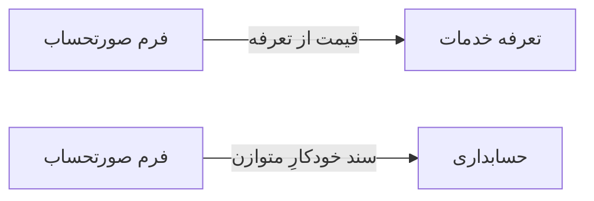

# 💰 فرم صورتحساب — `InvoiceFormWindow`

> [مالی] · کهن‌الگوی `form-lines` (فرمِ خطی) · آیکون `Icon.FilePlus`

| پیوند | نشانی |
|---|---|
| وایرفریمِ زنده | [`01-wireframes-html/InvoiceFormWindow.html`](../01-wireframes-html/InvoiceFormWindow.html) |
| View | [`03-views/InvoiceFormWindow.xaml`](../03-views/InvoiceFormWindow.xaml) |
| ViewModel | [`04-viewmodels/InvoiceFormViewModel.cs`](../04-viewmodels/InvoiceFormViewModel.cs) |

**ایجاد یا ویرایش صورتحساب**

## 🖼 چیدمان

```
┌──────────────────────────────────────────────────────────────────┐
│  سربرگ: فرم صورتحساب                                               │
├──────────────────────────────────────────────────────────────────┤
│  شبکه‌ی ۱۲ ستونه — پهنای هر فیلد متناسب با کارکردش                │
  │ PatientId        │ Date    │ Insuran │
  │ ReceptionId      │ DoctorId         │
├──────────────────────────────────────────────────────────────────┤
│  تعداد اقلام …   جمع کل …   تخفیف …        قابل پرداخت: …       │

├──────────────────────────────────────────────────────────────────┤
│                                    [انصراف]  [ذخیره]             │
└──────────────────────────────────────────────────────────────────┘
```

## 📋 فیلدها

> پهنا بر پایه‌ی شبکه‌ی ۱۲ ستونه است: «بزرگیِ عنصر متناسب با کارکرد».

| بخش | آیکون | فیلد | برچسب | نوع | پهنا (از ۱۲) | الزامی | مقدارِ نمونه |
|---|---|---|---|---|:--:|:--:|---|
| **اطلاعات فاکتور** | `Icon.Receipt` | `PatientId` | بیمار | ComboBox | 6/۱۲ | بله | سارا احمدی — P-۱۰۲۴ |
|  | `Icon.Receipt` | `Date` | تاریخ | DatePicker | 3/۱۲ | بله | ۱۴۰۴/۰۷/۱۹ |
|  | `Icon.Receipt` | `InsuranceId` | بیمه | ComboBox | 3/۱۲ | خیر | تأمین اجتماعی |
|  | `Icon.Receipt` | `ReceptionId` | پذیرش مرتبط | ComboBox | 6/۱۲ | خیر | R-۱۲۸۴ |
|  | `Icon.Receipt` | `DoctorId` | پزشک | ComboBox | 6/۱۲ | خیر | دکتر موسوی |

## 🧾 جمع

| مورد | مقدار |
|---|---|
| تعداد اقلام | **۳ ردیف** |
| جمع کل | **۲۷۵,۰۰۰** |
| تخفیف | **۲۵,۰۰۰** |
| قابل پرداخت | **۲۵۰,۰۰۰** |

## ⚡ اقدام‌ها

| فرمان | برچسب | آیکون | سبک |
|---|---|---|---|
| `SaveCommand` | ذخیره | `Icon.Save` | اصلی |
| `PayCommand` | ثبت پرداخت | `Icon.HandCoins` | ok |
| `PrintCommand` | چاپ فاکتور | `Icon.Printer` | ثانویه |
| `CancelCommand` | انصراف | `—` | بی‌زمینه |

## 🔗 ارتباطات

| مبدأ | مقصد | نوعِ پیوند |
|---|---|---|
| فرم صورتحساب | تعرفه خدمات | قیمت از تعرفه |
| فرم صورتحساب | حسابداری | سند خودکارِ متوازن |



---

این فایل با `tools/gen_wireframes_md.py` ساخته شده است.
