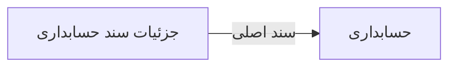

# 💰 جزئیات سند حسابداری — `JournalEntryDetailWindow`

> [مالی] · کهن‌الگوی `dialog` (دیالوگ) · آیکون `Icon.FileSpreadsheet`

| پیوند | نشانی |
|---|---|
| وایرفریمِ زنده | [`01-wireframes-html/JournalEntryDetailWindow.html`](../01-wireframes-html/JournalEntryDetailWindow.html) |
| View | [`03-views/JournalEntryDetailWindow.xaml`](../03-views/JournalEntryDetailWindow.xaml) |
| ViewModel | [`04-viewmodels/JournalEntryDetailViewModel.cs`](../04-viewmodels/JournalEntryDetailViewModel.cs) |

**نمایش و ویرایش سطرهای یک سند**

## 🖼 چیدمان

```
        ┌──────────────────────────────────────┐
        │           جزئیات سند حسابداری           │
        ├──────────────────────────────────────┤
        │  ┌────────────────────────────────┐  │
        │  │ فیلد                          │  │
        │  └────────────────────────────────┘  │
        │  ┌────────────────────────────────┐  │
        │  │ فیلد                          │  │
        │  └────────────────────────────────┘  │
        ├──────────────────────────────────────┤
        │              [انصراف]  [تأیید]       │
        └──────────────────────────────────────┘
```

## 🧾 جمع

| مورد | مقدار |
|---|---|
| تعداد اقلام | **۴ سطر** |
| جمع کل | **۲۵۰,۰۰۰** |
| تخفیف | **—** |
| قابل پرداخت | **بدهکار = بستانکار** |

## ⚡ اقدام‌ها

| فرمان | برچسب | آیکون | سبک |
|---|---|---|---|
| `SaveCommand` | ذخیره | `Icon.Save` | اصلی |
| `CancelCommand` | انصراف | `—` | بی‌زمینه |

## 🔗 ارتباطات

| مبدأ | مقصد | نوعِ پیوند |
|---|---|---|
| جزئیات سند حسابداری | حسابداری | سند اصلی |



---

این فایل با `tools/gen_wireframes_md.py` ساخته شده است.
