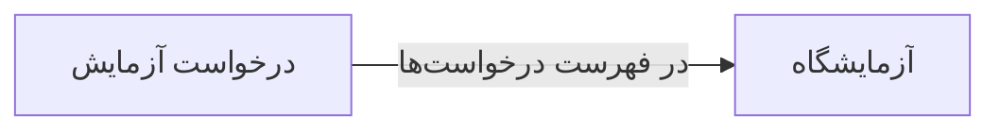

# 🔬 درخواست آزمایش — `LabOrderFormWindow`

> [آزمایشگاه] · کهن‌الگوی `form-std` (فرم استاندارد) · آیکون `Icon.TestTube`

| پیوند | نشانی |
|---|---|
| وایرفریمِ زنده | [`01-wireframes-html/LabOrderFormWindow.html`](../01-wireframes-html/LabOrderFormWindow.html) |
| View | [`03-views/LabOrderFormWindow.xaml`](../03-views/LabOrderFormWindow.xaml) |
| ViewModel | [`04-viewmodels/LabOrderFormViewModel.cs`](../04-viewmodels/LabOrderFormViewModel.cs) |

**ثبت درخواست آزمایش برای بیمار**

## 🖼 چیدمان

```
┌──────────────────────────────────────────────────────────────────┐
│  سربرگ: درخواست آزمایش                                             │
├──────────────────────────────────────────────────────────────────┤
│  شبکه‌ی ۱۲ ستونه — پهنای هر فیلد متناسب با کارکردش                │
  │ PatientId        │ DoctorI │ Date    │
  │ Priorit │ Lab     │ Fasting          │
  │ Tests                              │
  │ Notes                              │

├──────────────────────────────────────────────────────────────────┤
│                                    [انصراف]  [ذخیره]             │
└──────────────────────────────────────────────────────────────────┘
```

## 📋 فیلدها

> پهنا بر پایه‌ی شبکه‌ی ۱۲ ستونه است: «بزرگیِ عنصر متناسب با کارکرد».

| بخش | آیکون | فیلد | برچسب | نوع | پهنا (از ۱۲) | الزامی | مقدارِ نمونه |
|---|---|---|---|---|:--:|:--:|---|
| **درخواست** | `Icon.ClipboardList` | `PatientId` | بیمار | ComboBox | 6/۱۲ | بله | سارا احمدی — P-۱۰۲۴ |
|  | `Icon.ClipboardList` | `DoctorId` | پزشک تجویزکننده | ComboBox | 3/۱۲ | بله | دکتر موسوی |
|  | `Icon.ClipboardList` | `Date` | تاریخ | DatePicker | 3/۱۲ | بله | ۱۴۰۴/۰۷/۱۹ |
|  | `Icon.ClipboardList` | `Priority` | اولویت | ComboBox | 3/۱۲ | خیر | عادی |
|  | `Icon.ClipboardList` | `Lab` | آزمایشگاه | ComboBox | 3/۱۲ | خیر | آزمایشگاه مرکزی |
|  | `Icon.ClipboardList` | `Fasting` | ناشتا | CheckBox | 3/۱۲ | خیر | True |
|  | `Icon.ClipboardList` | `Tests` | آزمایش‌ها | ComboBox | 12/۱۲ | بله | CBC، قند ناشتا |
|  | `Icon.ClipboardList` | `Notes` | توضیحات | TextBox (چندخطی) | 12/۱۲ | خیر | — |

## ⚡ اقدام‌ها

| فرمان | برچسب | آیکون | سبک |
|---|---|---|---|
| `SaveCommand` | ثبت درخواست | `Icon.Save` | اصلی |
| `PrintCommand` | چاپ برچسب | `Icon.Printer` | ثانویه |
| `CancelCommand` | انصراف | `—` | بی‌زمینه |

## 🔗 ارتباطات

| مبدأ | مقصد | نوعِ پیوند |
|---|---|---|
| درخواست آزمایش | آزمایشگاه | در فهرست درخواست‌ها |



---

این فایل با `tools/gen_wireframes_md.py` ساخته شده است.
