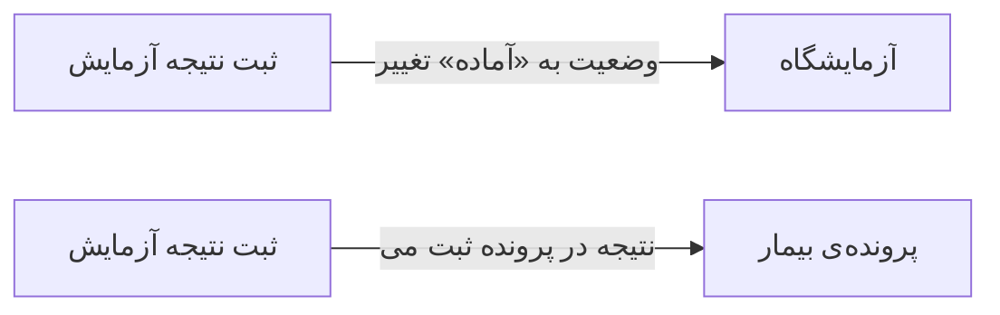

# 🔬 ثبت نتیجه آزمایش — `LabResultWindow`

> [آزمایشگاه] · کهن‌الگوی `form-lines` (فرمِ خطی) · آیکون `Icon.FileCheck`

| پیوند | نشانی |
|---|---|
| وایرفریمِ زنده | [`01-wireframes-html/LabResultWindow.html`](../01-wireframes-html/LabResultWindow.html) |
| View | [`03-views/LabResultWindow.xaml`](../03-views/LabResultWindow.xaml) |
| ViewModel | [`04-viewmodels/LabResultViewModel.cs`](../04-viewmodels/LabResultViewModel.cs) |

**ورود نتایج آزمایش و مقادیر مرجع**

## 🖼 چیدمان

```
┌──────────────────────────────────────────────────────────────────┐
│  سربرگ: ثبت نتیجه آزمایش                                           │
├──────────────────────────────────────────────────────────────────┤
│  شبکه‌ی ۱۲ ستونه — پهنای هر فیلد متناسب با کارکردش                │
  │ OrderCode  │ Patient    │ Samp │ Repo │
├──────────────────────────────────────────────────────────────────┤
│  تعداد اقلام …   جمع کل …   تخفیف …        قابل پرداخت: …       │

├──────────────────────────────────────────────────────────────────┤
│                                    [انصراف]  [ذخیره]             │
└──────────────────────────────────────────────────────────────────┘
```

## 📋 فیلدها

> پهنا بر پایه‌ی شبکه‌ی ۱۲ ستونه است: «بزرگیِ عنصر متناسب با کارکرد».

| بخش | آیکون | فیلد | برچسب | نوع | پهنا (از ۱۲) | الزامی | مقدارِ نمونه |
|---|---|---|---|---|:--:|:--:|---|
| **اطلاعات نمونه** | `Icon.TestTube` | `OrderCode` | کد درخواست | TextBox | 4/۱۲ | خیر | L-۷۴۰ |
|  | `Icon.TestTube` | `Patient` | بیمار | TextBox | 4/۱۲ | خیر | سارا احمدی |
|  | `Icon.TestTube` | `SampleDate` | تاریخ نمونه | DatePicker | 2/۱۲ | خیر | ۱۴۰۴/۰۷/۱۸ |
|  | `Icon.TestTube` | `ReportDate` | تاریخ پاسخ | DatePicker | 2/۱۲ | خیر | ۱۴۰۴/۰۷/۱۹ |

## 🧾 جمع

| مورد | مقدار |
|---|---|
| تعداد اقلام | **۱۸ پارامتر** |
| جمع کل | **—** |
| تخفیف | **—** |
| قابل پرداخت | **آماده ارسال** |

## ⚡ اقدام‌ها

| فرمان | برچسب | آیکون | سبک |
|---|---|---|---|
| `SaveCommand` | ذخیره نتایج | `Icon.Save` | اصلی |
| `ApproveCommand` | تأیید نهایی | `Icon.Check` | ok |
| `SendSmsCommand` | ارسال پیامک | `Icon.Send` | ثانویه |

## 🔗 ارتباطات

| مبدأ | مقصد | نوعِ پیوند |
|---|---|---|
| ثبت نتیجه آزمایش | آزمایشگاه | وضعیت به «آماده» تغییر می‌کند |
| ثبت نتیجه آزمایش | پرونده‌ی بیمار | نتیجه در پرونده ثبت می‌شود |



---

این فایل با `tools/gen_wireframes_md.py` ساخته شده است.
