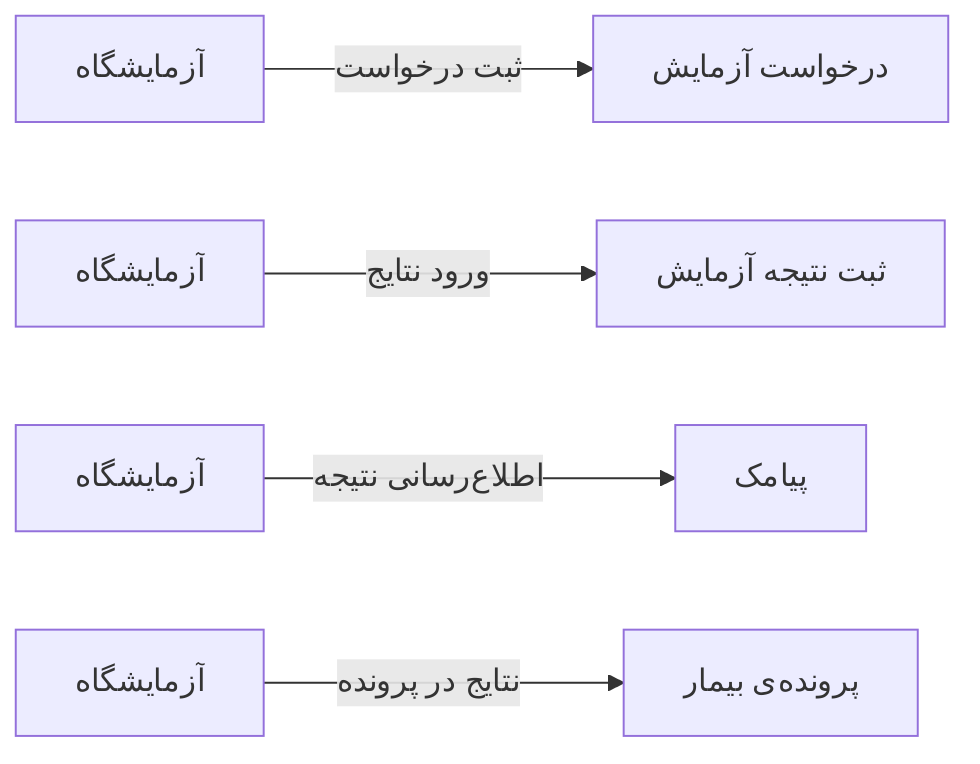

# 🔬 آزمایشگاه — `LabView`

> [آزمایشگاه] · کهن‌الگوی `list-dense` (لیستِ فشرده) · آیکون `Icon.FlaskConical`

| پیوند | نشانی |
|---|---|
| وایرفریمِ زنده | [`01-wireframes-html/LabView.html`](../01-wireframes-html/LabView.html) |
| View | [`03-views/LabView.xaml`](../03-views/LabView.xaml) |
| ViewModel | [`04-viewmodels/LabViewModel.cs`](../04-viewmodels/LabViewModel.cs) |

**پیگیری درخواست‌ها و نتایج آزمایش**

## 🖼 چیدمان

```
┌──────────────────────────────────────────────────────────────────┐
│  سربرگ: آزمایشگاه                                                  │
├──────────────────────────────────────────────────────────────────┤
│  ┌────────┐ ┌────────┐ ┌────────┐ ┌────────┐                     │
│  │ شاخص ۱ │ │ شاخص ۲ │ │ شاخص ۳ │ │ شاخص ۴ │                     │
│  └────────┘ └────────┘ └────────┘ └────────┘                     │
├──────────────────────────────────────────────────────────────────┤
│  [جستجو…………] [فیلتر ▾] [فیلتر ▾]        [＋ جدید] [⟳] [⤓]      │
├──────────────────────────────────────────────────────────────────┤
│  جدول                                                            │
│  ┌──────────┬────────────────────┬────────┬────────┬────────┐    │
│  │ ستون     │ ستون               │ ستون   │ ستون   │ وضعیت  │    │
│  ├──────────┼────────────────────┼────────┼────────┼────────┤    │
│  │ دادهٔ ۱   │ …                  │ …      │ …      │ نشان   │    │
│  │ دادهٔ ۲   │ …                  │ …      │ …      │ نشان   │    │
│  └──────────┴────────────────────┴────────┴────────┴────────┘    │
├──────────────────────────────────────────────────────────────────┤
│  نمایش ۱ تا ۲۵ از ۱۲۴۵                         [◀] [▶]           │
└──────────────────────────────────────────────────────────────────┘
```

## 📊 شاخص‌های کلیدی

| آیکون | شاخص | مقدار | روند | رنگِ تاکیدی |
|---|:--:|:--:|:--:|---|
| `Icon.TestTube` | درخواست امروز | **۲۴** | +۶ | teal |
| `Icon.Clock` | در انتظار نمونه | **۹** | — | amber |
| `Icon.CircleCheck` | نتیجه آماده | **۱۱** | — | green |
| `Icon.Send` | ارسال‌شده با پیامک | **۸** | — | blue |

## 🔍 فیلترها

| # | برچسب | نوع | پهنا | مقدارِ نمونه | گزینه‌ها |
|:--:|---|---|:--:|---|---|
| 1 | جستجو | `search` | w-xl | نام بیمار یا کد… | — |
| 2 | وضعیت | `combo` | w-md | همه | همه، درخواست، نمونه‌گیری، در حال انجام، آماده، ارسال شده |
| 3 | تاریخ | `date` | w-md | ۱۴۰۴/۰۷/۱۹ | — |

## 📐 ستون‌های جدول

| # | عنوان | اتصال | نوع | عرض | تراز |
|:--:|---|---|---|:--:|:--:|
| 1 | کد | `Code` | متن | 100px | Right |
| 2 | بیمار | `Patient` | شخص | * | Right |
| 3 | آزمایش‌ها | `Tests` | متن | 220px | Right |
| 4 | تاریخ | `Date` | تاریخ | 112px | Right |
| 5 | مبلغ | `Amount` | مبلغ | 108px | Left |
| 6 | وضعیت | `Status` | نشان | 124px | Center |

## 🧪 دادهٔ نمونه

| 1 | 2 | 3 | 4 | 5 | 6 |
|:--:|:--:|:--:|:--:|:--:|:--:|
| L-۷۴۰ | سارا احمدی | CBC، قند ناشتا، چربی | ۱۴۰۴/۰۷/۱۸ | ۴۲۰,۰۰۰ | `آماده` |
| L-۷۴۱ | محمد رضایی | TSH، T4 | ۱۴۰۴/۰۷/۱۸ | ۳۸۰,۰۰۰ | `در حال انجام` |
| L-۷۴۲ | فاطمه کریمی | آزمایش ادرار | ۱۴۰۴/۰۷/۱۹ | ۹۵,۰۰۰ | `نمونه‌گیری` |

## ⚡ اقدام‌ها

| فرمان | برچسب | آیکون | سبک |
|---|---|---|---|
| `NewCommand` | درخواست جدید | `Icon.Plus` | اصلی |
| `ResultCommand` | ثبت نتیجه | `Icon.FileCheck` | ok |
| `PrintCommand` | چاپ جواب | `Icon.Printer` | ثانویه |
| `SendSmsCommand` | ارسال پیامک | `Icon.Send` | ثانویه |

## 🔗 ارتباطات

| مبدأ | مقصد | نوعِ پیوند |
|---|---|---|
| آزمایشگاه | درخواست آزمایش | ثبت درخواست |
| آزمایشگاه | ثبت نتیجه آزمایش | ورود نتایج |
| آزمایشگاه | پیامک | اطلاع‌رسانی نتیجه |
| آزمایشگاه | پرونده‌ی بیمار | نتایج در پرونده |



---

این فایل با `tools/gen_wireframes_md.py` ساخته شده است.
