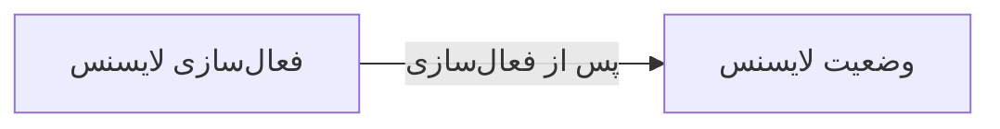

# ⚙️ فعال‌سازی لایسنس — `LicenseActivationWindow`

> [سیستم] · کهن‌الگوی `form-narrow` (فرمِ باریک) · آیکون `Icon.KeyRound`

| پیوند | نشانی |
|---|---|
| وایرفریمِ زنده | [`01-wireframes-html/LicenseActivationWindow.html`](../01-wireframes-html/LicenseActivationWindow.html) |
| View | [`03-views/LicenseActivationWindow.xaml`](../03-views/LicenseActivationWindow.xaml) |
| ViewModel | [`04-viewmodels/LicenseActivationViewModel.cs`](../04-viewmodels/LicenseActivationViewModel.cs) |

**ورود کلید مجوز یا بارگذاری فایل درخواست**

## 🖼 چیدمان

```
            ┌──────────────────────────────┐
            │                  آیکون          │
            │         فعال‌سازی لایسنس        │
            ├──────────────────────────────┤
            │  ✓ ویژگیِ ۱                  │
            │  ✓ ویژگیِ ۲                  │
            │  ✓ ویژگیِ ۳                  │
            ├──────────────────────────────┤
            │  ┌────────────────────────┐  │
            │  │ فیلد                  │  │
            │  └────────────────────────┘  │
            │  ┌────────────────────────┐  │
            │  │ فیلد                  │  │
            │  └────────────────────────┘  │
            │  ☐ به خاطر بسپار             │
            ├──────────────────────────────┤
            │  [        ورود        ]      │
            └──────────────────────────────┘
```

## 📋 فیلدها

> پهنا بر پایه‌ی شبکه‌ی ۱۲ ستونه است: «بزرگیِ عنصر متناسب با کارکرد».

| بخش | آیکون | فیلد | برچسب | نوع | پهنا (از ۱۲) | الزامی | مقدارِ نمونه |
|---|---|---|---|---|:--:|:--:|---|
| **فعال‌سازی** | `Icon.KeyRound` | `LicenseKey` | کلید مجوز | TextBox | 12/۱۲ | بله | SAHD-XXXX-XXXX-XXXX |
|  | `Icon.KeyRound` | `ClinicName` | نام درمانگاه | TextBox | 12/۱۲ | خیر | درمانگاه سهند |
|  | `Icon.KeyRound` | `PortalUrl` | نشانی پنل | TextBox | 12/۱۲ | خیر | https://clinic-license.ea-fixer.ir/api.php |
|  | `Icon.KeyRound` | `OfflineFile` | فایل درخواست آفلاین | StackPanel | 12/۱۲ | خیر | — |

## ⚡ اقدام‌ها

| فرمان | برچسب | آیکون | سبک |
|---|---|---|---|
| `ActivateCommand` | فعال‌سازی | `Icon.Check` | اصلی |
| `RequestFileCommand` | دریافت فایل .req | `Icon.Download` | ثانویه |
| `CancelCommand` | انصراف | `—` | بی‌زمینه |

## 🔗 ارتباطات

| مبدأ | مقصد | نوعِ پیوند |
|---|---|---|
| فعال‌سازی لایسنس | وضعیت لایسنس | پس از فعال‌سازی |



---

این فایل با `tools/gen_wireframes_md.py` ساخته شده است.
