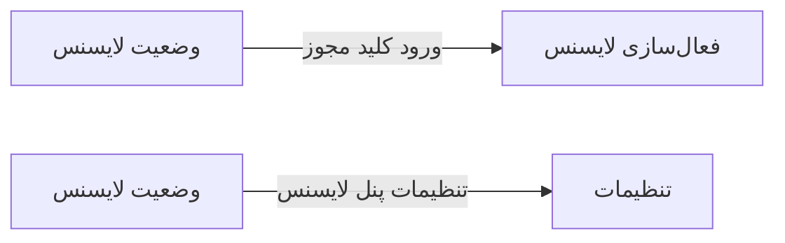

# ⚙️ وضعیت لایسنس — `LicenseStatusView`

> [سیستم] · کهن‌الگوی `detail-tabs` (جزئیاتِ تب‌دار) · آیکون `Icon.ShieldCheck`

| پیوند | نشانی |
|---|---|
| وایرفریمِ زنده | [`01-wireframes-html/LicenseStatusView.html`](../01-wireframes-html/LicenseStatusView.html) |
| View | [`03-views/LicenseStatusView.xaml`](../03-views/LicenseStatusView.xaml) |
| ViewModel | [`04-viewmodels/LicenseStatusViewModel.cs`](../04-viewmodels/LicenseStatusViewModel.cs) |

**وضعیت مجوز و ماژول‌های فعال**

## 📝 شرح

کارت وضعیت با نوار پیشرفتِ روزهای باقیمانده؛ جدول ماژول‌ها با چیپ‌های سبز/خاکستری.

## 🖼 چیدمان

```
┌──────────────────────────────────────────────────────────────────┐
│  سربرگ: وضعیت لایسنس                                               │
├──────────────────────────────────────────────────────────────────┤
│  فیلدهای سربرگ روی شبکه‌ی ۱۲ ستونه                                │
├──────────────────────────────────────────────────────────────────┤
│  تب ۱  │  تب ۲  │  تب ۳  │  تب ۴  │  تب ۵  │  تب ۶  │             │
├────────┴────────┴────────┴────────┴────────┴────────┴───────────┤
│                                                                  │
│  محتوای تب                                                       │
│  ┌──────────────────────────────────────────────────────────┐    │
│  │ جدول یا فرمِ مربوط به تب                                 │    │
│  └──────────────────────────────────────────────────────────┘    │
└──────────────────────────────────────────────────────────────────┘
```

## 📊 شاخص‌های کلیدی

| آیکون | شاخص | مقدار | روند | رنگِ تاکیدی |
|---|:--:|:--:|:--:|---|
| `Icon.ShieldCheck` | وضعیت | **فعال** | — | green |
| `Icon.CalendarClock` | روز باقیمانده | **۳۴۲** | — | teal |
| `Icon.Boxes` | ماژول‌های فعال | **۲۷ از ۳۹** | — | blue |
| `Icon.Users` | کاربران مجاز | **۱۲** | — | amber |

## 🗂 تب‌ها

| # | عنوان | آیکون | شمارنده |
|:--:|---|---|:--:|
| 1 | نمای کلی | `Icon.LayoutDashboard` | — |
| 2 | ماژول‌ها | `Icon.Boxes` | — |
| 3 | تاریخچه | `Icon.History` | — |
| 4 | پشتیبانی | `Icon.LifeBuoy` | — |

## 📐 ستون‌های جدول

| # | عنوان | اتصال | نوع | عرض | تراز |
|:--:|---|---|---|:--:|:--:|
| 1 | ماژول | `Module` | متن | * | Right |
| 2 | کلید | `Key` | متن | 150px | Right |
| 3 | تاریخ انقضا | `Expiry` | تاریخ | 130px | Right |
| 4 | وضعیت | `Status` | نشان | 124px | Center |

## 🧪 دادهٔ نمونه

| 1 | 2 | 3 | 4 |
|:--:|:--:|:--:|:--:|
| بیماران و پرونده الکترونیک | pat.emr | ۱۴۰۵/۰۷/۱۹ | `فعال` |
| نوبت‌دهی | apt.core | ۱۴۰۵/۰۷/۱۹ | `فعال` |
| پذیرش و صف | rcp.core | ۱۴۰۵/۰۷/۱۹ | `فعال` |
| ویزیت (SOAP) | vst.soap | ۱۴۰۵/۰۷/۱۹ | `فعال` |
| نسخه و تداخل دارویی | rx.core | ۱۴۰۵/۰۷/۱۹ | `فعال` |
| نسخه الکترونیک | rx.epres | ۱۴۰۵/۰۷/۱۹ | `فعال` |
| داروخانه و انبار | phr.inv | ۱۴۰۵/۰۷/۱۹ | `فعال` |
| آزمایشگاه | lab.core | ۱۴۰۵/۰۷/۱۹ | `فعال` |
| تصویربرداری (DICOM) | img.dicom | ۱۴۰۵/۰۷/۱۹ | `فعال` |
| گزارش‌ساز پویا | rpt.adhoc | — | `غیرفعال` |
| سامانه سپاس | int.sepas | — | `غیرفعال` |
| مرکز آموزش | edu.hub | — | `غیرفعال` |

## ⚡ اقدام‌ها

| فرمان | برچسب | آیکون | سبک |
|---|---|---|---|
| `RefreshCommand` | به‌روزرسانی وضعیت | `Icon.RefreshCw` | اصلی |
| `RenewCommand` | تمدید | `Icon.RotateCcw` | ok |
| `ActivateCommand` | فعال‌سازی | `Icon.KeyRound` | ثانویه |

## 🔗 ارتباطات

| مبدأ | مقصد | نوعِ پیوند |
|---|---|---|
| وضعیت لایسنس | فعال‌سازی لایسنس | ورود کلید مجوز |
| وضعیت لایسنس | تنظیمات | تنظیمات پنل لایسنس |



---

این فایل با `tools/gen_wireframes_md.py` ساخته شده است.
