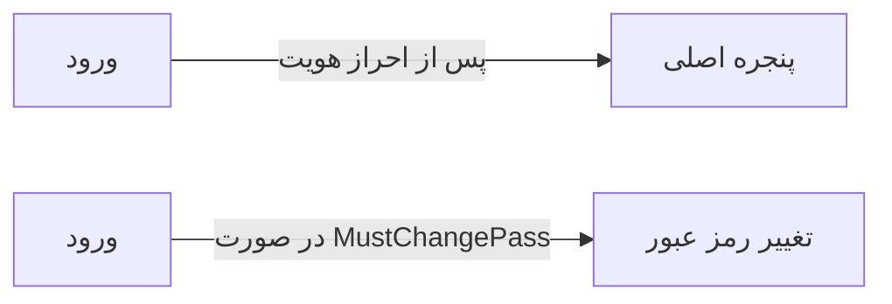

# 🏠 ورود به برنامه — `LoginWindow`

> [پیشخوان] · کهن‌الگوی `form-narrow` (فرمِ باریک) · آیکون `Icon.LogIn`

| پیوند | نشانی |
|---|---|
| وایرفریمِ زنده | [`01-wireframes-html/LoginWindow.html`](../01-wireframes-html/LoginWindow.html) |
| View | [`03-views/LoginWindow.xaml`](../03-views/LoginWindow.xaml) |
| ViewModel | [`04-viewmodels/LoginViewModel.cs`](../04-viewmodels/LoginViewModel.cs) |

**احراز هویت کاربر با نام کاربری و رمز عبور**

## 📝 شرح

پنلِ راست شامل برند و سه مزیت کلیدی است؛ فرم در پنل چپ و با اندازه‌ی کاملِ ستون.

## 🖼 چیدمان

```
            ┌──────────────────────────────┐
            │                  آیکون          │
            │          ورود به برنامه         │
            ├──────────────────────────────┤
            │  ✓ ویژگیِ ۱                  │
            │  ✓ ویژگیِ ۲                  │
            │  ✓ ویژگیِ ۳                  │
            ├──────────────────────────────┤
            │  ┌────────────────────────┐  │
            │  │ فیلد                  │  │
            │  └────────────────────────┘  │
            │  ┌────────────────────────┐  │
            │  │ فیلد                  │  │
            │  └────────────────────────┘  │
            │  ☐ به خاطر بسپار             │
            ├──────────────────────────────┤
            │  [        ورود        ]      │
            └──────────────────────────────┘
```

## 📋 فیلدها

> پهنا بر پایه‌ی شبکه‌ی ۱۲ ستونه است: «بزرگیِ عنصر متناسب با کارکرد».

| بخش | آیکون | فیلد | برچسب | نوع | پهنا (از ۱۲) | الزامی | مقدارِ نمونه |
|---|---|---|---|---|:--:|:--:|---|
| **ورود به حساب** | `Icon.LogIn` | `UserName` | نام کاربری | TextBox | 12/۱۲ | بله | admin |
|  | `Icon.LogIn` | `Password` | رمز عبور | PasswordBox | 12/۱۲ | بله | •••••••• |
|  | `Icon.LogIn` | `RememberMe` | مرا در این دستگاه به خاطر بسپار | CheckBox | 12/۱۲ | خیر | True |

## ⚡ اقدام‌ها

| فرمان | برچسب | آیکون | سبک |
|---|---|---|---|
| `LoginCommand` | ورود | `Icon.LogIn` | اصلی |
| `CancelCommand` | انصراف | `—` | بی‌زمینه |

## 🔗 ارتباطات

| مبدأ | مقصد | نوعِ پیوند |
|---|---|---|
| ورود | پنجره اصلی | پس از احراز هویت |
| ورود | تغییر رمز عبور | در صورت MustChangePassword |



---

این فایل با `tools/gen_wireframes_md.py` ساخته شده است.
