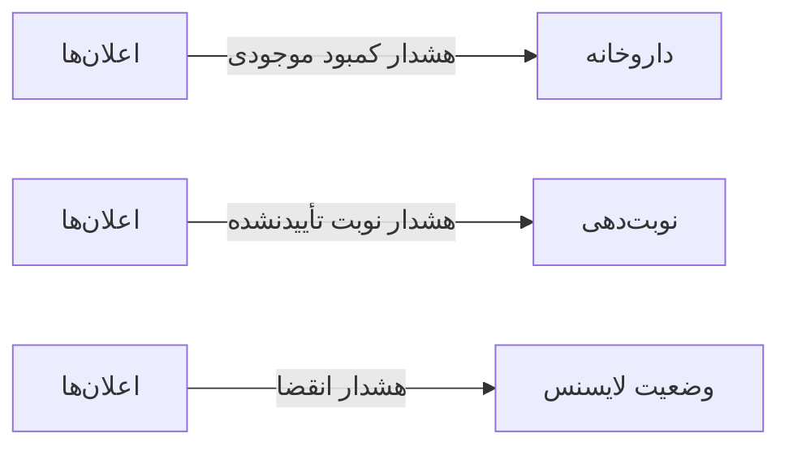

# 🏠 اعلان‌ها — `NotificationsView`

> [پیشخوان] · کهن‌الگوی `list-dense` (لیستِ فشرده) · آیکون `Icon.Bell`

| پیوند | نشانی |
|---|---|
| وایرفریمِ زنده | [`01-wireframes-html/NotificationsView.html`](../01-wireframes-html/NotificationsView.html) |
| View | [`03-views/NotificationsView.xaml`](../03-views/NotificationsView.xaml) |
| ViewModel | [`04-viewmodels/NotificationsViewModel.cs`](../04-viewmodels/NotificationsViewModel.cs) |

**فهرست اعلان‌های سیستم**

## 🖼 چیدمان

```
┌──────────────────────────────────────────────────────────────────┐
│  سربرگ: اعلان‌ها                                                   │
├──────────────────────────────────────────────────────────────────┤
├──────────────────────────────────────────────────────────────────┤
│  [جستجو…………] [فیلتر ▾] [فیلتر ▾]        [＋ جدید] [⟳] [⤓]      │
├──────────────────────────────────────────────────────────────────┤
│  جدول                                                            │
│  ┌──────────┬────────────────────┬────────┬────────┬────────┐    │
│  │ ستون     │ ستون               │ ستون   │ ستون   │ وضعیت  │    │
│  ├──────────┼────────────────────┼────────┼────────┼────────┤    │
│  │ دادهٔ ۱   │ …                  │ …      │ …      │ نشان   │    │
│  │ دادهٔ ۲   │ …                  │ …      │ …      │ نشان   │    │
│  └──────────┴────────────────────┴────────┴────────┴────────┘    │
├──────────────────────────────────────────────────────────────────┤
│  نمایش ۱ تا ۲۵ از ۱۲۴۵                         [◀] [▶]           │
└──────────────────────────────────────────────────────────────────┘
```

## 🔍 فیلترها

| # | برچسب | نوع | پهنا | مقدارِ نمونه | گزینه‌ها |
|:--:|---|---|:--:|---|---|
| 1 | جستجو | `search` | w-lg | عنوان یا متن… | — |
| 2 | نوع | `combo` | w-md | همه | همه، بحرانی، هشدار، اطلاعات |
| 3 | فقط خوانده‌نشده | `check` | — | True | — |

## 📐 ستون‌های جدول

| # | عنوان | اتصال | نوع | عرض | تراز |
|:--:|---|---|---|:--:|:--:|
| 1 | عنوان | `Title` | متن | * | Right |
| 2 | سطح | `Level` | نشان | 100px | Center |
| 3 | زمان | `Date` | تاریخ | 130px | Right |
| 4 | وضعیت | `IsRead` | نشان | 90px | Center |

## 🧪 دادهٔ نمونه

| 1 | 2 | 3 | 4 |
|:--:|:--:|:--:|:--:|
| `بحرانی` | موجودی آموکسی‌سیلین به زیر حد سفارش رسید | امروز ۰۹:۱۲ | `خوانده‌نشده` |
| `هشدار` | ۳ نوبت تأیید‌نشده برای فردا | امروز ۰۸:۴۰ | `خوانده‌نشده` |
| `اطلاعات` | پشتیبان‌گیری شبانه با موفقیت انجام شد | دیروز ۲۳:۰۰ | `خوانده شده` |
| `بحرانی` | گواهی لایسنس ۷ روز دیگر منقضی می‌شود | دیروز ۱۸:۲۵ | `خوانده‌نشده` |

## ⚡ اقدام‌ها

| فرمان | برچسب | آیکون | سبک |
|---|---|---|---|
| `MarkAllReadCommand` | خواندن همه | `Icon.Check` | ثانویه |
| `DeleteCommand` | حذف | `Icon.Trash2` | خطر |

## 🔗 ارتباطات

| مبدأ | مقصد | نوعِ پیوند |
|---|---|---|
| اعلان‌ها | داروخانه | هشدار کمبود موجودی |
| اعلان‌ها | نوبت‌دهی | هشدار نوبت تأیید‌نشده |
| اعلان‌ها | وضعیت لایسنس | هشدار انقضا |



---

این فایل با `tools/gen_wireframes_md.py` ساخته شده است.
