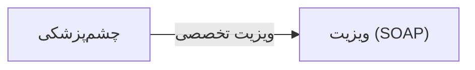

# 🩺 چشم‌پزشکی — `OphthalmologyView`

> [ویزیت] · کهن‌الگوی `detail-tabs` (جزئیاتِ تب‌دار) · آیکون `Icon.Eye`

| پیوند | نشانی |
|---|---|
| وایرفریمِ زنده | [`01-wireframes-html/OphthalmologyView.html`](../01-wireframes-html/OphthalmologyView.html) |
| View | [`03-views/OphthalmologyView.xaml`](../03-views/OphthalmologyView.xaml) |
| ViewModel | [`04-viewmodels/OphthalmologyViewModel.cs`](../04-viewmodels/OphthalmologyViewModel.cs) |

**معاینه بینایی و ثبت نمره چشم**

## 🖼 چیدمان

```
┌──────────────────────────────────────────────────────────────────┐
│  سربرگ: چشم‌پزشکی                                                  │
├──────────────────────────────────────────────────────────────────┤
│  فیلدهای سربرگ روی شبکه‌ی ۱۲ ستونه                                │
├──────────────────────────────────────────────────────────────────┤
│  تب ۱  │  تب ۲  │  تب ۳  │  تب ۴  │  تب ۵  │  تب ۶  │             │
├────────┴────────┴────────┴────────┴────────┴────────┴───────────┤
│                                                                  │
│  محتوای تب                                                       │
│  ┌──────────────────────────────────────────────────────────┐    │
│  │ جدول یا فرمِ مربوط به تب                                 │    │
│  └──────────────────────────────────────────────────────────┘    │
└──────────────────────────────────────────────────────────────────┘
```

## 🗂 تب‌ها

| # | عنوان | آیکون | شمارنده |
|:--:|---|---|:--:|
| 1 | حدت بینایی | `Icon.Eye` | — |
| 2 | فشار چشم | `Icon.Gauge` | — |
| 3 | فوندوس | `Icon.ScanEye` | — |
| 4 | نسخه عینک | `Icon.Glasses` | — |

## 📋 فیلدها

> پهنا بر پایه‌ی شبکه‌ی ۱۲ ستونه است: «بزرگیِ عنصر متناسب با کارکرد».

| بخش | آیکون | فیلد | برچسب | نوع | پهنا (از ۱۲) | الزامی | مقدارِ نمونه |
|---|---|---|---|---|:--:|:--:|---|
| **حدت بینایی** | `Icon.Eye` | `RightSph` | کروی راست | TextBox (عددی) | 2/۱۲ | خیر | −۱٫۵۰ |
|  | `Icon.Eye` | `RightCyl` | استیگمات راست | TextBox (عددی) | 2/۱۲ | خیر | −۰٫۵۰ |
|  | `Icon.Eye` | `RightAxis` | محور راست | TextBox (عددی) | 2/۱۲ | خیر | ۱۸۰ |
|  | `Icon.Eye` | `LeftSph` | کروی چپ | TextBox (عددی) | 2/۱۲ | خیر | −۱٫۲۵ |
|  | `Icon.Eye` | `LeftCyl` | استیگمات چپ | TextBox (عددی) | 2/۱۲ | خیر | −۰٫۷۵ |
|  | `Icon.Eye` | `LeftAxis` | محور چپ | TextBox (عددی) | 2/۱۲ | خیر | ۱۷۰ |

## 📐 ستون‌های جدول

| # | عنوان | اتصال | نوع | عرض | تراز |
|:--:|---|---|---|:--:|:--:|
| 1 | تاریخ | `Date` | تاریخ | 112px | Right |
| 2 | چشم راست | `RightEye` | متن | 150px | Right |
| 3 | چشم چپ | `LeftEye` | متن | 150px | Right |
| 4 | فشار چشم | `IOP` | عدد | 110px | Center |
| 5 | پزشک | `Doctor` | متن | 140px | Right |

## 🧪 دادهٔ نمونه

| 1 | 2 | 3 | 4 | 5 |
|:--:|:--:|:--:|:--:|:--:|
| ۱۴۰۴/۰۷/۱۸ | −۱٫۵۰ / −۰٫۵۰ × ۱۸۰ | −۱٫۲۵ / −۰٫۷۵ × ۱۷۰ | ۱۴ | دکتر کریمی |
| ۱۴۰۳/۰۹/۲۲ | −۱٫۲۵ / −۰٫۵۰ × ۱۷۵ | −۱٫۰۰ / −۰٫۵۰ × ۱۷۰ | ۱۵ | دکتر کریمی |

## ⚡ اقدام‌ها

| فرمان | برچسب | آیکون | سبک |
|---|---|---|---|
| `SaveCommand` | ذخیره | `Icon.Save` | اصلی |
| `PrintCommand` | چاپ نسخه عینک | `Icon.Printer` | ثانویه |

## 🔗 ارتباطات

| مبدأ | مقصد | نوعِ پیوند |
|---|---|---|
| چشم‌پزشکی | ویزیت (SOAP) | ویزیت تخصصی |



---

این فایل با `tools/gen_wireframes_md.py` ساخته شده است.
