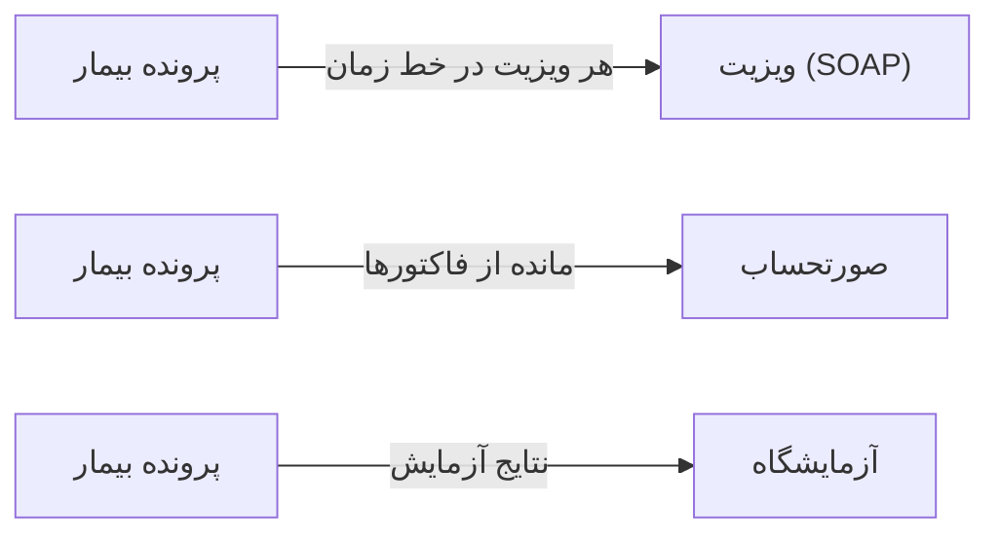

# 👥 پرونده‌ی بیمار — `PatientDetailWindow`

> [بیماران] · کهن‌الگوی `detail-timeline` (جزئیاتِ خط‌زمان) · آیکون `Icon.IdCard`

| پیوند | نشانی |
|---|---|
| وایرفریمِ زنده | [`01-wireframes-html/PatientDetailWindow.html`](../01-wireframes-html/PatientDetailWindow.html) |
| View | [`03-views/PatientDetailWindow.xaml`](../03-views/PatientDetailWindow.xaml) |
| ViewModel | [`04-viewmodels/PatientDetailViewModel.cs`](../04-viewmodels/PatientDetailViewModel.cs) |

**پرونده کامل بیمار با خط زمان درمان**

## 📝 شرح

سربرگ با کارتِ هویت، آمار و اطلاعات تماس؛ سپس تب‌ها؛ تب نخست «خط زمان درمان» رویدادها را به ترتیب زمان نشان می‌دهد.

## 🖼 چیدمان

```
┌──────────────────────────────────────────────────────────────────┐
│  ┌────┐   پرونده‌ی بیمار                                     │
│  │ نش │   نام · زیرعنوان                                         │
│  └────┘   [نشان] [نشان] [نشان]                                   │
├──────────────────────────────────────────────────────────────────┤
│  خطِ زمان │ ویزیت‌ها │ نوبت‌ها │ نسخه‌ها │ آزمایش │ …             │
├──────────────────────────────────────────────────────────────────┤
│  ◉ ۱۴۰۴/۰۷/۱۲  عنوانِ رخداد                                       │
│  │             جزئیات                                             │
│  ◉ ۱۴۰۴/۰۶/۲۸  عنوانِ رخداد                                       │
│  │             جزئیات                                             │
└──────────────────────────────────────────────────────────────────┘
```

## 🗂 تب‌ها

| # | عنوان | آیکون | شمارنده |
|:--:|---|---|:--:|
| 1 | خط زمان درمان | `Icon.History` | 8 |
| 2 | ویزیت‌ها | `Icon.Stethoscope` | 18 |
| 3 | نوبت‌ها | `Icon.CalendarDays` | 24 |
| 4 | نسخه‌ها | `Icon.FileText` | 11 |
| 5 | آزمایش‌ها | `Icon.FlaskConical` | 6 |
| 6 | تصویربرداری | `Icon.ScanLine` | 2 |
| 7 | صورتحساب‌ها | `Icon.Receipt` | 9 |
| 8 | پیوست‌ها | `Icon.Paperclip` | 3 |

## ⚡ اقدام‌ها

| فرمان | برچسب | آیکون | سبک |
|---|---|---|---|
| `NewVisitCommand` | ویزیت جدید | `Icon.Stethoscope` | اصلی |
| `NewAppointmentCommand` | نوبت جدید | `Icon.CalendarPlus` | ثانویه |
| `PrintCommand` | چاپ پرونده | `Icon.Printer` | ثانویه |

## 🔗 ارتباطات

| مبدأ | مقصد | نوعِ پیوند |
|---|---|---|
| پرونده بیمار | ویزیت (SOAP) | هر ویزیت در خط زمان |
| پرونده بیمار | صورتحساب | مانده از فاکتورها |
| پرونده بیمار | آزمایشگاه | نتایج آزمایش |



---

این فایل با `tools/gen_wireframes_md.py` ساخته شده است.
